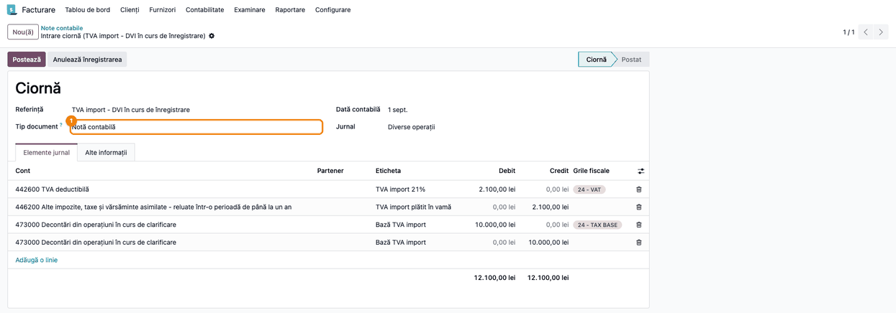
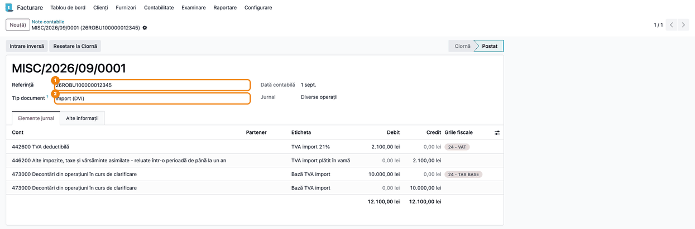
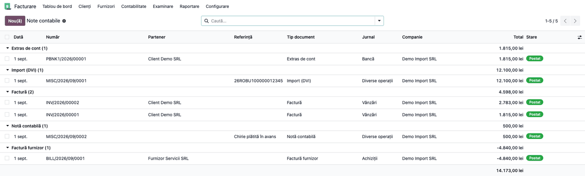

# Fișă Modul: Tipul documentului justificativ pe notele contabile

**Modul:** `l10n_ro_account_move_document_type`
**Utilizator principal:** Contabil, Contabil TVA
**Prioritate:** 🟡 Medie (necesar pentru jurnalele de TVA și registrele în care fiecare rând arată documentul justificativ)

---

## 1. Scop business

Fiecare înregistrare contabilă se face pe baza unui document justificativ: factură, chitanță,
dispoziție de casă, extras de cont, declarație vamală de import (DVI), stat de salarii, decont.
Odoo păstrează pe o notă doar tipul ei tehnic (factură, factură furnizor sau „notă contabilă”), așa că
jurnalele și registrele românești afișau „Notă contabilă” pe orice înregistrare care nu e factură,
inclusiv pe nota de TVA la import, al cărei document justificativ este DVI-ul.

Modulul adaugă pe fiecare notă câmpul **Tip document**:

- pe facturi, bonuri, plăți și extrase se completează singur;
- modulele care creează note (DVI, registrul de casă) îl completează cu documentul lor;
- pe notele introduse manual îl alege contabilul.

Jurnalul de TVA pentru cumpărări și vânzări (`l10n_ro_account_vat_journal`) afișează acest tip în
coloana **Tip document**.

## 2. Bază legală și context

- **Legea contabilității nr. 82/1991, art. 6 alin. (1)** — orice operațiune economico-financiară se
  consemnează într-un document care stă la baza înregistrărilor în contabilitate și devine astfel
  document justificativ.
- **Codul fiscal, art. 299 alin. (1)** — dreptul de deducere a TVA-ului la import se justifică cu
  **declarația vamală de import**: la lit. c), pentru TVA-ul plătit în vamă, împreună cu documentele
  care atestă plata; la lit. d), pentru TVA-ul cu certificat de amânare (art. 326 alin. (4)–(5)).
  Nota contabilă care înregistrează acest TVA nu este, singură, document justificativ pentru deducere.
- **OMFP nr. 2634/2015** privind documentele financiar-contabile — nota de contabilitate se folosește
  pentru înregistrările care nu au alt document justificativ (regularizări, închideri, corecturi).

Practic, tipul documentului spune cititorului jurnalului unde găsește justificarea fiecărui rând.

## 3. Utilizatori și roluri

- **Contabil** — alege tipul documentului pe notele contabile introduse manual (de exemplu nota de
  TVA la import înregistrată fără DVI în Odoo).
- **Contabil TVA** — verifică în jurnalul de cumpărări că importurile apar cu „Import (DVI)”.

Roluri recomandate pentru testare:
- utilizator cu drept **Contabilitate / Contabil**, care vede meniul **Contabilitate → Note contabile**
  și poate modifica notele.

## 4. Conturi și date implicate

Modulul nu generează note contabile și nu folosește conturi proprii. Câmpul se completează pe notele
existente:

| Notă | Tip document |
|---|---|
| Factură client / factură storno | Factură / Factură storno |
| Factură furnizor / storno furnizor | Factură furnizor / Storno furnizor |
| Plată sau rând de extras în jurnal de bancă | Extras de cont |
| Plată în jurnal de casă | Document de casă (sau chitanța / dispoziția, cu `l10n_ro_account_sequence`) |
| Bon de vânzare / bon de achiziție | Bon fiscal / Chitanță achiziție |
| Notă din DVI (`l10n_ro_customs_dvi`) | Import (DVI) |
| Orice altă notă | Notă contabilă, până când contabilul alege alt tip |

Valori care se aleg doar manual: **Stat de salarii**, **Decont de cheltuieli** și **Import (DVI)** pe
o notă introdusă de mână.

> **Tipul documentului este doar o etichetă.** Nu schimbă sumele, conturile și nici grilele fiscale
> ale notei, deci nici D300. O notă de TVA la import ajunge în D300 doar dacă poartă taxa de import
> cu grilele ei, ca nota generată din DVI (`l10n_ro_customs_dvi`). O notă Dr 4426 / Cr 446 fără
> grile apare în jurnalul de TVA la „TVA fără grile D300” și nu intră în decont. Varianta
> recomandată pentru importuri rămâne DVI-ul înregistrat în Odoo.

Date minime pentru demo:
- companie românească, cu planul de conturi RO;
- o notă în jurnalul **Diverse operații**, de exemplu TVA la import cu taxa de 21% și grilele ei:
  Dr 4426 / Cr 446 (în Odoo: 4462) pentru TVA, plus perechea tehnică Dr 473 / Cr 473 pentru bază.

## 5. Configurare inițială

1. Instalați modulul `l10n_ro_account_move_document_type` (dependențe: `account`, `l10n_ro`). Se
   instalează și singur, ca dependență, cu `l10n_ro_customs_dvi` sau `l10n_ro_account_sequence`.
2. La instalare, notele existente primesc automat tipul: facturile, bonurile, plățile și extrasele
   după tipul documentului sau al jurnalului, iar restul „Notă contabilă”. Notele DVI și documentele
   de casă existente primesc tipul lor la actualizarea modulelor `l10n_ro_customs_dvi` (19.0.2.2.0)
   și `l10n_ro_account_sequence` (19.0.1.1.0). Nu e nevoie de nicio altă setare.
3. Pentru coloana din jurnalul de TVA, instalați și `l10n_ro_account_vat_journal` (19.0.1.7.0 sau
   mai nou, livrat odată cu acest modul).

## 6. Flux de utilizare

### Pasul 1 — Tipul documentului pe o notă contabilă

Accesați **Contabilitate → Contabilitate → Note contabile** (în aplicația Facturare: **Facturare →
Contabilitate → Note contabile**) și deschideți sau creați o notă în
jurnalul **Diverse operații**. Sub **Referință** apare câmpul **Tip document**, cu valoarea
**Notă contabilă**. Câmpul apare doar pe notele contabile. Pe facturi tipul rezultă din felul
documentului și nu se afișează.



### Pasul 2 — Alegerea documentului justificativ

Varianta recomandată e DVI-ul înregistrat în Odoo (`l10n_ro_customs_dvi`), care generează nota cu
grilele și cu tipul **Import (DVI)**. Pentru o notă de TVA la import introdusă manual:

1. În **Referință** scrieți numărul declarației vamale (MRN), iar în **Tip document** alegeți
   **Import (DVI)**.
2. În tabul **Elemente jurnal**, adăugați linia de bază: cont **473**, debit = baza din DVI
   (10.000 lei), iar în coloana **Taxe** alegeți taxa de achiziție **21% G** (TVA deductibil 21% Produse). Odoo adaugă singur
   linia de TVA (2.100 lei pe 4426). Nu o scrieți de mână, altfel TVA-ul apare de două ori.
3. Adăugați contrapartidele: **446** (în Odoo: 4462), credit = TVA-ul (2.100 lei), și **473**,
   credit = baza (10.000 lei), ca perechea pe 473 să se soldeze.
4. Verificați în **Grile fiscale**: pe linia 4426 apare grila de TVA, iar pe linia de debit 473
   grila de bază. Pe ecran grilele apar ca „24 - VAT” și „24 - TAX BASE” (rândul 24 din D300). Fără
   ele, nota nu intră în D300 (vezi nota din secțiunea 4).
5. Apăsați **Postează**.

Tipul se poate schimba și pe nota postată, chiar după închiderea perioadei: schimbarea nu atinge
sumele, doar eticheta din jurnale.

Nota generată automat dintr-un DVI (`l10n_ro_customs_dvi`) primește direct **Import (DVI)**; pasul
acesta e doar pentru notele introduse de mână.



### Pasul 3 — Verificarea notelor pe tipuri de document

În **Contabilitate → Contabilitate → Note contabile**, din lista de filtre deschideți **Grupează după → Tip document**.

1. **Găsiți pe ecran:** câte un grup pentru fiecare tip: **Factură**, **Factură furnizor**,
   **Extras de cont**, **Import (DVI)**, **Notă contabilă** etc., cu numărul de note din fiecare.
2. **Verificați:**
   - lista din meniu pornește cu filtrul **Postat**: notele în ciornă apar doar după ce scoateți filtrul;
   - facturile nu apar în grupul **Notă contabilă**;
   - plățile prin bancă sunt la **Extras de cont**;
   - notele de TVA la import sunt la **Import (DVI)**. Totalul notei de import (12.100 lei) cuprinde
     și perechea tehnică pe 473; TVA-ul este doar linia 4426 (2.100 lei).

   O notă de import rămasă în **Notă contabilă** se deschide și se corectează ca la pasul 2.
3. **Coloana în listă:** din meniul de coloane opționale (iconița din dreapta antetului) bifați
   **Tip document**. Coloana e utilă și la exportul listei în Excel.



### Note de monografie și raportare

Modulul nu generează și nu modifică note contabile; doar le clasifică. Exemplu, TVA la import
de 10.000 lei la 21%, plătit în vamă, înregistrat manual cu grilele taxei:

| Cont debitor | Cont creditor | Sumă | Grilă D300 |
|---|---|---|---|
| 4426 TVA deductibilă | 446 (în Odoo: 4462) Alte impozite, taxe și vărsăminte asimilate | 2.100 | TVA rd. 24 |
| 473 Decontări din operațiuni în curs de clarificare | — | 10.000 | bază rd. 24 |
| — | 473 Decontări din operațiuni în curs de clarificare | 10.000 | — |

Perechea pe 473 e tehnică: se soldează și duce doar baza în D300. Tipul documentului este al notei
întregi: **Import (DVI)**.

În jurnalul de TVA pentru cumpărări (`l10n_ro_account_vat_journal`), rândul acestei note are în
coloana **Tip document** valoarea „Import (DVI)”, pe ecran și în XLSX. Baza, TVA-ul și rândul D300
vin din grilele notei, nu din tipul documentului.

## 7. Legături cu alte module / declarații

| Modul | Rol |
|---|---|
| `l10n_ro_customs_dvi` | pune „Import (DVI)” pe nota generată din DVI; actualizează DVI-urile vechi la upgrade |
| `l10n_ro_account_sequence` | pune Chitanță client / Chitanță furnizor / Dispoziție de plată / Dispoziție de încasare pe plățile prin casă |
| `l10n_ro_account_vat_journal` | afișează tipul în coloana „Tip document” a jurnalului de TVA |

**Ce e automat:** tipul pe facturi, bonuri, plăți, extrase, notele DVI și documentele de casă, plus
completarea notelor existente la instalare.

**Ce rămâne manual:** tipul pe notele introduse de mână (TVA la import fără DVI în Odoo, stat de
salarii, decont de cheltuieli).

## 8. Verificări pentru consultant

- [ ] După instalare, nicio notă nu are **Tip document** gol (grupare după tip în lista notelor).
- [ ] O factură client nouă are tipul **Factură**, iar o factură furnizor are **Factură furnizor**.
- [ ] O plată prin bancă are tipul **Extras de cont**.
- [ ] O notă nouă în **Diverse operații** are tipul **Notă contabilă** și se poate schimba în
      **Import (DVI)** înainte și după postare.
- [ ] Cu `l10n_ro_customs_dvi`: nota unui DVI validat are tipul **Import (DVI)**.
- [ ] Cu `l10n_ro_account_vat_journal`: în jurnalul de cumpărări, nota de import are în coloana
      **Tip document** „Import (DVI)”, pe ecran și în XLSX.

## 9. Mesaje de eroare frecvente

| Mesaj | Cauză | Remediere |
|---|---|---|
| Câmpul **Tip document** nu apare pe factură | Pe facturi tipul rezultă din felul documentului | Normal; câmpul se vede doar pe notele contabile și ca coloană opțională în listă |
| Nota de import apare tot ca „Notă contabilă” în jurnalul de TVA | Nota a fost introdusă manual, iar tipul n-a fost ales | Deschideți nota și alegeți **Import (DVI)** (pasul 2) |
| Tipul ales manual a revenit la „Notă contabilă” | S-a schimbat jurnalul notei, iar tipul s-a recalculat | Alegeți din nou tipul după schimbarea jurnalului |
| Nota de import apare în jurnalul de TVA la „TVA fără grile D300” | Nota manuală n-are taxa de import, deci nici grilele D300 | Refaceți nota cu taxa de import (ca nota din DVI) sau înregistrați importul prin DVI |

## 10. Capturi de ecran

Capturile sunt generate automat din `tests/test_screenshots.py` (mixinul `ScreenshotCase` din
`deltatech_doc_screenshots`, import defensiv), în limba română, pe planul de conturi RO:

1. `01_nota_tip_implicit.png` — nota de TVA la import în ciornă, cu grilele D300 și **Tip document** = Notă contabilă.
2. `02_nota_tip_dvi.png` — nota postată, cu **Tip document** = Import (DVI) și MRN-ul în referință.
3. `03_note_grupate_tip.png` — lista notelor contabile postate, grupată după **Tip document**, cu coloana afișată.

Regenerare:

```bash
./odoo/odoo-bin -c odoo.conf -d <db> -i l10n_ro_account_move_document_type,deltatech_doc_screenshots \
    --test-tags=fise_screenshots --stop-after-init
```

## 11. Observații pentru manual

- Păstrați exemplul cu TVA la import: este cazul care a cerut modulul (nota contabilă nu justifică
  dreptul de deducere, DVI-ul da).
- În capitolul despre jurnalul de TVA, menționați că „Tip document” vine din nota contabilă și se
  corectează pe notă, nu în raport.
- Lista de tipuri e fixă; un tip nou cere o modificare de modul.
