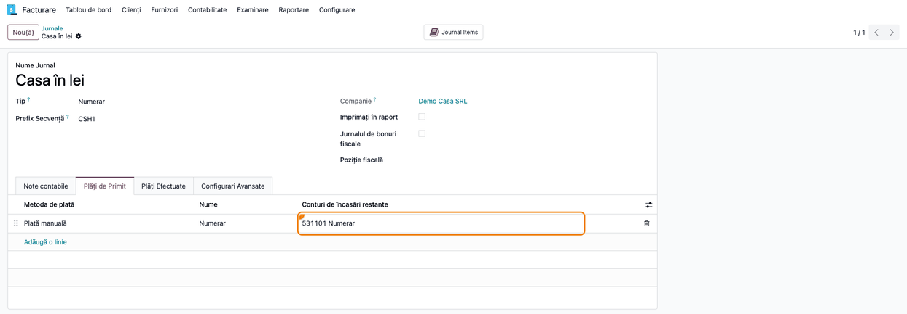
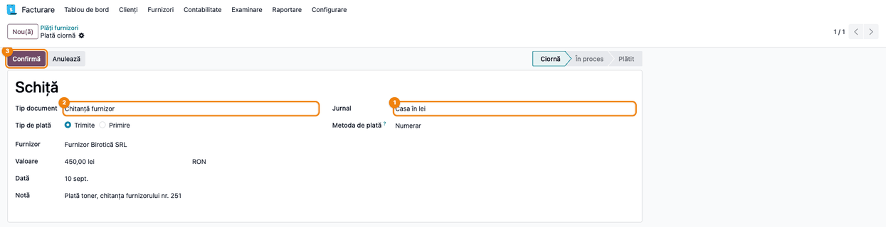
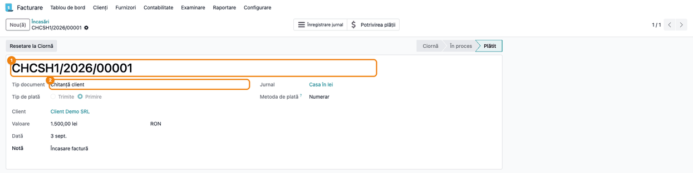
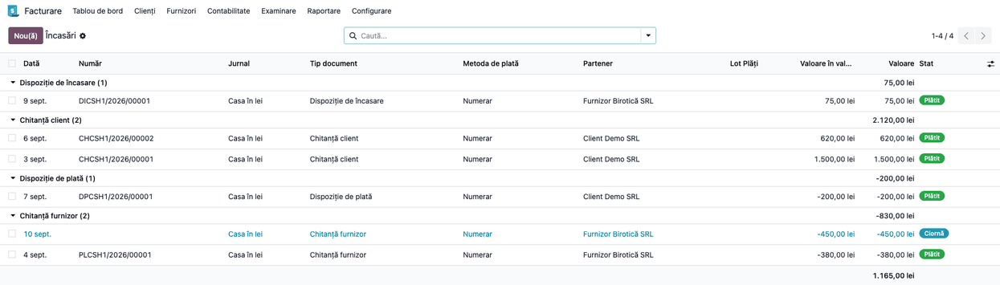
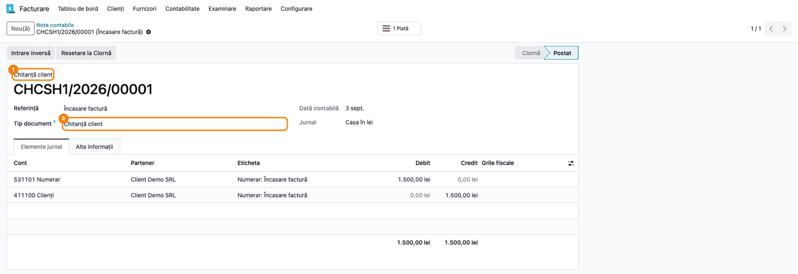

# Fișă Modul: Numerotarea documentelor de casă (chitanțe și dispoziții)

**Modul:** `l10n_ro_account_sequence`
**Utilizator principal:** Casier, Contabil
**Prioritate:** 🔴 Ridicată (registrul de casă și controlul numerelor de chitanță cer serii separate pe tip de document)

---

## 1. Scop business

Într-un jurnal de casă, Odoo numerotează toate plățile într-o singură serie, indiferent dacă
documentul e o chitanță emisă unui client sau o plată către un furnizor. Casieria unei firme
românești lucrează însă cu documente diferite, fiecare cu numerotarea lui: chitanțele emise,
chitanțele primite de la furnizori, dispozițiile de plată și de încasare.

Modulul adaugă pe plățile dintr-un jurnal de casă câmpul **Tip document** și dă fiecărui tip o
serie proprie, cu prefix:

| Tip document | Prefix | Când se propune |
|---|---|---|
| Chitanță client | **CH** | încasare de la un client |
| Chitanță furnizor | **PL** | plată către un furnizor |
| Dispoziție de plată | **DP** | plată către un client (de exemplu restituirea unui avans) |
| Dispoziție de încasare | **DI** | încasare de la un furnizor (de exemplu o sumă restituită) |
| Transfer intern | **IT** | doar ales manual |

Numărul are forma `<prefix><cod jurnal>/<an>/<nr. de ordine>`, de exemplu **CHCSH1/2026/00001**
pentru prima chitanță client din 2026 în jurnalul de casă cu codul CSH1. Numărul de ordine reîncepe
de la 1 în fiecare an, separat pentru fiecare tip. Plățile prin bancă rămân pe numerotarea standard.

Tot modulul face ca metodele de plată ale jurnalului de casă să înregistreze direct în contul
casei (5311), fără contul intermediar de plăți în curs. Nota contabilă a plății primește și
**documentul justificativ** (modulul `l10n_ro_account_move_document_type`), afișat în jurnalele
românești în locul mențiunii „Notă contabilă”.

## 2. Bază legală și context

- **Legea contabilității nr. 82/1991, art. 6 alin. (1)** — fiecare operațiune se înregistrează
  pe baza unui document justificativ. La casă, acestea sunt chitanța și dispoziția de plată sau
  de încasare.
- **OMFP nr. 2634/2015** privind documentele financiar-contabile — reglementează chitanța,
  dispoziția de plată/încasare către casierie și registrul de casă, în care fiecare operațiune
  apare cu numărul documentului ei.

Practic, seriile separate permit verificarea continuității numerelor pe fiecare tip de document
și regăsirea rapidă a documentului din registrul de casă.

## 3. Utilizatori și roluri

- **Casier** — înregistrează încasările și plățile în numerar și verifică tipul propus.
- **Contabil** — verifică seriile, nota contabilă și registrul de casă.

Roluri recomandate pentru testare:
- utilizator cu drept **Contabilitate / Contabil**, care vede meniurile **Facturare → Clienți →
  Plăți**, **Facturare → Furnizori → Plăți** și **Facturare → Configurare → Jurnale** (cu
  Enterprise, aceleași meniuri sunt în aplicația **Contabilitate**).

## 4. Conturi și date implicate

| Tip document | Cont debitor | Cont creditor |
|---|---|---|
| Chitanță client (CH) | 5311 Casa în lei | 4111 Clienți |
| Chitanță furnizor (PL) | 401 Furnizori | 5311 Casa în lei |
| Dispoziție de plată (DP) | 4111 Clienți | 5311 Casa în lei |
| Dispoziție de încasare (DI) | 5311 Casa în lei | 401 Furnizori |

Contul de client sau de furnizor este cel de pe fișa partenerului. Plățile prin casă nu poartă
TVA: TVA-ul se înregistrează pe factură. La restituirea unui avans facturat, stornați întâi
factura de avans; dispoziția de plată stinge apoi soldul clientului.

Date minime pentru demo:
- companie românească, cu planul de conturi RO și jurnalul de casă al planului (cont 5311);
- un client și un furnizor;
- câte o plată pentru fiecare tip de document.

## 5. Configurare inițială

1. Instalați modulul `l10n_ro_account_sequence`. Se instalează automat și dependența
   `l10n_ro_account_move_document_type` (documentul justificativ pe nota contabilă).
2. La crearea unui jurnal de casă și la modificarea contului implicit sau a metodelor de plată,
   modulul pune contul casei pe toate metodele de plată ale jurnalului. Jurnalele de casă care
   existau înainte de instalare nu se modifică singure: verificați tabul **Plăți de Primit** /
   **Plăți Efectuate** (pasul 1).

   > **Atenție:** la această sincronizare, liniile deja înregistrate în jurnalul de casă pe vechiul
   > cont de plăți în curs se mută pe contul casei, inclusiv cele postate în perioade închise.
   > Schimbați contul implicit sau metodele de plată ale unui jurnal de casă folosit doar cu
   > acordul contabilului și verificați apoi registrul de casă.
3. Opțional, pentru registrul de casă tipărit, instalați `l10n_ro_cash_register`.

## 6. Flux de utilizare

### Pasul 1 — Verificarea jurnalului de casă

Accesați **Facturare → Configurare → Jurnale** și deschideți jurnalul de casă. În tabul
**Plăți de Primit** (și la fel în **Plăți Efectuate**), coloana **Conturi de încasări restante**
(în **Plăți Efectuate**: conturile de plăți restante) arată contul casei, **5311** (în exemplu
analiticul 531101 Numerar). Modulul îl completează singur, ca plata să ajungă direct în casă.



### Pasul 2 — Introducerea plății în casă

Accesați **Facturare → Furnizori → Plăți** (pentru încasări: **Facturare → Clienți → Plăți**) și
apăsați **Nou**.

1. ① În **Jurnal** alegeți jurnalul de casă. Câmpul **Tip document** apare doar pe jurnalele de
   casă.
2. ② **Tip document** se propune după sensul plății și tipul partenerului (vezi tabelul din
   secțiunea 1). Pentru o plată către furnizor, valoarea propusă este **Chitanță furnizor**. În
   **Notă** treceți numărul chitanței primite de la furnizor.
3. ③ Apăsați **Confirmă**. Numărul se dă la confirmare; până atunci plata apare ca **Schiță**.
   După confirmare tipul nu se mai poate schimba.

Plățile înregistrate din factură (butonul **Înregistrare plată**) pe jurnalul de casă primesc
tipul și seria automat, după aceleași reguli.

Tipul **Transfer intern** nu se propune niciodată; se alege manual. În Odoo 19 plata nu are cont
de transfer, contrapartida rămâne contul de client sau de furnizor al partenerului. Verificați cu
contabilul nota înainte de a folosi tipul pentru transferuri între casă și bancă.



### Pasul 3 — Numărul documentului

După confirmare, plata primește numărul din seria tipului ei: ① numărul în antet, de exemplu
**CHCSH1/2026/00001** pentru prima chitanță client, ② tipul documentului. Plata trece direct în
starea **Plătit**, pentru că suma ajunge în contul casei.



### Pasul 4 — Verificarea seriilor pe tipuri de document

Accesați **Facturare → Clienți → Plăți** (lista **Încasări**), scoateți filtrul implicit, ca să
apară și plățile, filtrați după jurnalul de casă și grupați după **Tip document** (în
**Filtre → Grupează după**).

1. **Găsiți pe ecran:** câte un grup pentru fiecare tip (Chitanță client, Chitanță furnizor,
   Dispoziție de plată, Dispoziție de încasare), cu numărul plăților și totalul.
2. **Verificați:**
   - toate numerele dintr-un grup au același prefix (CH, PL, DP, DI), urmat de codul jurnalului;
   - în fiecare grup numerele sunt consecutive, fără goluri, în ordinea datelor (în exemplu
     CHCSH1/2026/00001 și 00002), iar fiecare tip pornește de la 00001;
   - plățile în ciornă apar fără număr (în exemplu, plata în ciornă de la pasul 2);
   - nicio plată din jurnalul de casă nu a rămas în grupul **Altele**.



### Pasul 5 — Nota contabilă și documentul justificativ

Din plată, deschideți nota contabilă (butonul **Înregistrare jurnal** din antet) sau căutați-o în
**Facturare → Contabilitate → Note contabile**.

1. **Găsiți pe ecran:** ① deasupra numărului, tipul documentului de casă (afișat fără etichetă);
   sub **Referință**, ② **Tip document**, documentul justificativ al notei. În tabul
   **Elemente jurnal**, liniile Dr/Cr.
2. **Verificați:**
   - documentul justificativ corespunde tipului de casă: Chitanță client, Chitanță furnizor,
     Dispoziție de plată sau Dispoziție de încasare (la Transfer intern: **Document de casă**);
   - liniile sunt Dr 5311 / Cr 4111 pentru chitanța client, fără cont de plăți în curs.

Notele înregistrate înainte de versiunea 19.0.1.1.0 primesc documentul justificativ la
actualizarea modulului.



### Note de monografie și raportare

Exemplul din capturi (încasare de 1.500 lei de la un client, prin casă):

| Cont debitor | Cont creditor | Sumă |
|---|---|---|
| 5311 Casa în lei | 4111 Clienți | 1.500 |

Celelalte tipuri sunt în tabelul din secțiunea 4. Modulul nu schimbă conturile, ci numărul și
eticheta documentului.

**Legătura cu jurnalul de TVA** (`l10n_ro_account_vat_journal`): coloana **Tip document** a
jurnalului citește documentul justificativ al notei. Plățile prin casă nu au, de regulă, rânduri
proprii în jurnalul de TVA, pentru că nu poartă TVA. La facturile cu TVA la încasare, rândul plății
din jurnal poartă tipul facturii (Factură, Factură furnizor), nu al chitanței.

## 7. Legături cu alte module / declarații

| Modul | Rol |
|---|---|
| `l10n_ro_account_move_document_type` | dependență; pune documentul justificativ (Chitanță client etc.) pe nota plății |
| `l10n_ro_cash_register` | registrul de casă; coloana documentului de casă arată numărul cu prefixul seriei |
| `l10n_ro_account_vat_journal` | jurnalul de TVA; coloana „Tip document” citește documentul justificativ al notei |

**Ce e automat:** tipul documentului pe plățile prin casă, seria cu prefix, contul casei pe
metodele de plată, documentul justificativ pe notă și completarea notelor vechi la actualizare.

**Ce rămâne manual:** alegerea tipului **Transfer intern** și corectarea tipului propus, cât timp
plata e în ciornă.

## 8. Verificări pentru consultant

- [ ] Pe jurnalul de casă, toate metodele de plată (primite și efectuate) au contul **5311**.
- [ ] O încasare de la client prin casă primește tipul **Chitanță client** și numărul **CH...**.
- [ ] O plată către furnizor primește **Chitanță furnizor** și numărul **PL...**.
- [ ] O plată către client primește **Dispoziție de plată** (**DP...**), iar o încasare de la
      furnizor **Dispoziție de încasare** (**DI...**).
- [ ] Numerele fiecărui tip sunt consecutive și reîncep de la 1 în anul următor.
- [ ] O plată prin bancă nu primește prefix de casă și nu afișează câmpul **Tip document**.
- [ ] Nota contabilă a unei chitanțe client are documentul justificativ **Chitanță client**,
      iar liniile Dr 5311 / Cr 4111.
- [ ] După actualizarea la 19.0.1.1.0, notele plăților prin casă mai vechi au documentul
      justificativ completat (gruparea după **Tip document** în lista notelor contabile).

## 9. Mesaje de eroare frecvente

| Mesaj | Cauză | Remediere |
|---|---|---|
| Câmpul **Tip document** nu apare pe plată | Jurnalul plății nu e de tip casă | Normal; pe bancă numerotarea rămâne cea standard |
| **Tip document** nu se poate modifica | Plata e confirmată; numărul din serie e deja dat | Schimbarea tipului pe o plată deja confirmată nu schimbă numărul. Anulați plata (**Anulează**); numărul rămâne în serie ca document anulat. Înregistrați o plată nouă cu tipul corect |
| Plata din casă a primit tipul **Altele** și numărul fără prefix | Plata a fost creată fără jurnal de casă sau importată cu tipul „Altele” | Anulați plata și înregistrați-o din nou pe jurnalul de casă, cu tipul corect |
| Nota plății trece prin contul de plăți în curs, nu direct în 5311 | Jurnalul de casă exista înainte de instalare sau metoda de plată a primit alt cont | Cu acordul contabilului, puneți contul casei pe metoda de plată din jurnal (vezi avertismentul din secțiunea 5): liniile deja înregistrate pe contul vechi se mută și ele pe 5311 |

## 10. Capturi de ecran

Capturile sunt generate automat din `tests/test_screenshots.py` (mixinul `ScreenshotCase` din
`deltatech_doc_screenshots`, import defensiv), în limba română, pe planul de conturi RO:

1. `01_jurnal_casa_cont.png` — jurnalul de casă, tabul **Plăți de Primit**, cu contul 5311 pe metodele de plată.
2. `02_plata_ciorna_tip.png` — plata către furnizor în ciornă, cu tipul propus **Chitanță furnizor**.
3. `03_chitanta_client.png` — chitanța client confirmată, cu numărul din seria CH.
4. `04_plati_grupate_tip.png` — lista **Încasări** filtrată pe jurnalul de casă și grupată după **Tip document**, câte o serie pe tip.
5. `05_nota_chitanta.png` — nota contabilă a chitanței, cu tipul de casă, documentul justificativ și liniile Dr/Cr.

Regenerare:

```bash
./odoo/odoo-bin -c odoo.conf -d <db> -i deltatech_doc_screenshots -u l10n_ro_account_sequence \
    --test-tags=/l10n_ro_account_sequence:TestCashSequenceScreenshots --stop-after-init
```

## 11. Observații pentru manual

- Păstrați tabelul tip → prefix → sens al plății: casierii întreabă de obicei de ce o restituire
  către client iese pe **DP**, nu pe **CH**.
- În capitolul despre registrul de casă, precizați că numărul documentului din registru este
  numărul plății, cu prefixul seriei. La chitanțele furnizorilor, numărul PL… e numărul intern de
  înregistrare; numărul chitanței primite apare în coloana de explicații, din câmpul **Notă**.
- Tipul **Transfer intern** se folosește doar după acordul contabilului (vezi pasul 2).
