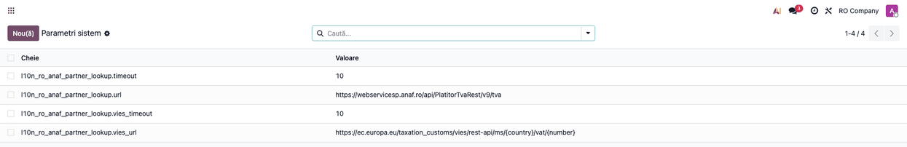
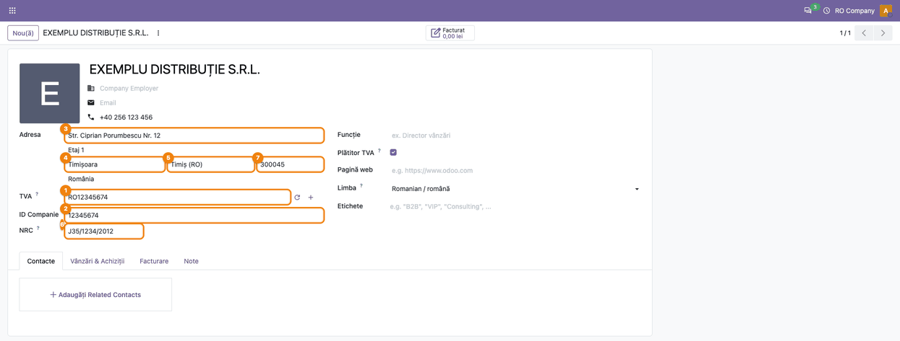
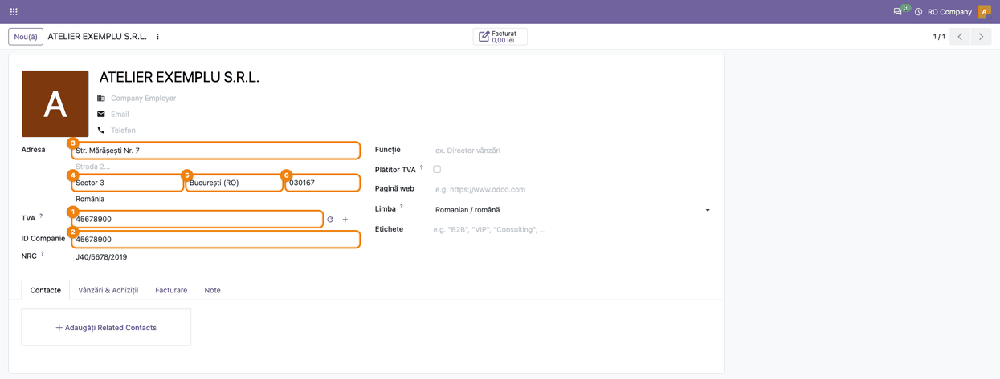
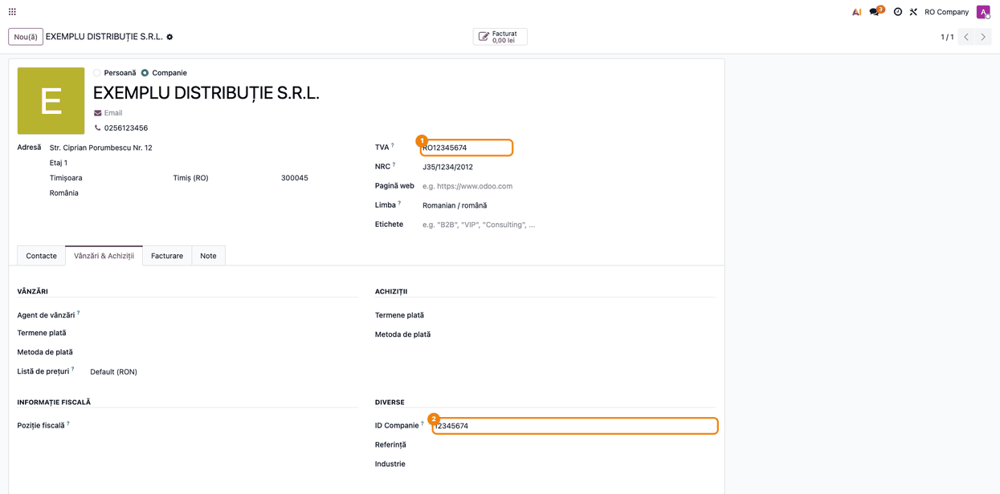
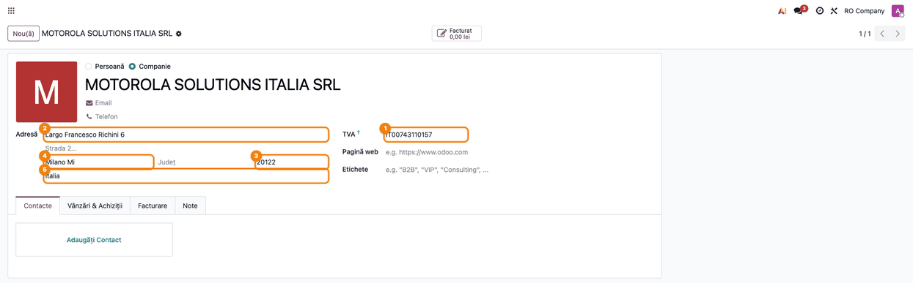

# Fișă Modul: Căutarea firmei la ANAF după CUI și în VIES după codul de TVA UE (serviciu pentru alte module)

**Modul:** `l10n_ro_anaf_partner_lookup`
**Utilizator principal:** Consultant / administrator (configurare); indirect, operatorul care creează clienți (agent de vânzări, casier la Punctul de vânzare, client pe site)
**Prioritate:** 🟡 Medie (nu are ecran propriu, dar de el depind datele firmei preluate automat la crearea partenerului, la casa POS și pe site)

---

## 1. Scop business

Când un client firmă cere factură, datele lui (denumire, CUI, adresă, registrul comerțului) trebuie
să fie corecte și complete, altfel factura poate fi respinsă de e-Factura (de ex. lipsa sectorului la București) sau tipărită greșit. Datele
oficiale sunt la ANAF, în registrul plătitorilor de TVA. Modulul este **serviciul comun** care
întreabă ANAF după CUI și întoarce datele partenerului gata de salvat, pentru ca modulele care
creează clienți (completarea automată a partenerului, căutarea clientului după CUI la casa
Punctului de vânzare, coșul de pe site) să nu le preia fiecare în felul lui. **Modulul nu are meniu, ecran sau buton propriu**: operatorul îl folosește fără să-l
vadă, prin modulul consumator în care tastează CUI-ul.

Pentru o firmă din **altă țară a Uniunii Europene**, modulul întreabă **VIES** (serviciul gratuit al
Comisiei Europene, fără cont) după codul de TVA intracomunitar, cu prefixul țării (`IT…`, `HU…`,
`EL…` pentru Grecia), și întoarce denumirea și adresa împărțită în stradă, cod poștal și oraș. Pentru
o firmă românească, același apel spune dacă firma este înregistrată pentru operațiuni
intracomunitare. Rezultatul VIES îl folosește deocamdată `l10n_ro_partner_autocomplete`.

## 2. Bază legală și context

- **Codul fiscal, art. 319 alin. (20)** — factura cuprinde denumirea, adresa și codul de
  înregistrare în scopuri de TVA (sau codul de identificare fiscală) ale cumpărătorului. Modulul pune
  prefixul `RO` doar la plătitorii de TVA, ca pe factură.
- **Legea 31/1990, art. 74** — societatea își arată sediul social pe documentele ei. Pentru
  consecvență cu datele din registru, adresa clientului se ia tot din **sediul social**; domiciliul
  fiscal se folosește doar când ANAF nu dă sediul social. Adresa vine întreagă dintr-un singur bloc,
  nu amestecată (strada dintr-unul, codul poștal din celălalt).
- **e-Factura (CIUS-RO)** — pentru București, localitatea se transmite ca sector; modulul scrie
  localitatea `Sector N`.
- **Operațiuni intracomunitare** — scutirea de TVA a unei livrări intracomunitare cere ca
  cumpărătorul să comunice un cod de TVA valabil atribuit de alt stat membru (**Codul fiscal,
  art. 294 alin. (2) lit. a)**); valabilitatea se verifică în **VIES**, sistemul de schimb de
  informații privind TVA dintre statele membre (**Regulamentul (UE) nr. 904/2010**). Modulul doar
  întoarce răspunsul VIES; decizia (bifa *Valabil în comunitate*, poziția fiscală) aparține
  modulului consumator.
- **Sursa datelor**: serviciul web public ANAF al registrului plătitorilor de TVA (v9), fără
  autentificare. ANAF răspunde cu diacriticele vechi cu sedilă (`ş`, `ţ`); modulul le corectează în
  cele cu virgulă (`ș`, `ț`).

## 3. Utilizatori și roluri

- **Administrator / consultant** (drepturi de administrare, cu modul dezvoltator activ):
  modifică, dacă e nevoie, parametrii de sistem ai serviciului.
- **Operatorii modulelor consumatoare** (agent de vânzări, casier la Punctul de vânzare, client pe
  site): tastează CUI-ul; nu au nevoie de drepturi suplimentare pentru acest modul.
- **La testare**: un utilizator obișnuit al modulului consumator (ex. casier), ca să se vadă
  completarea exact cum o vede operatorul, plus administratorul pentru parametri.

## 4. Conturi și date implicate

Modulul nu generează note contabile și nu atinge conturi. Întoarce valorile partenerului:

| Dată întoarsă | Câmp pe partener | Regulă |
|---|---|---|
| Denumire | Nume | diacritice corectate |
| — | Tip: **Companie** | partenerul este marcat întotdeauna ca firmă, plătitor de TVA sau nu |
| CUI | **TVA** (CIF) | cu `RO` doar pentru plătitorul de TVA; **ID Companie** (CUI-ul fără `RO`) îl calculează localizarea `l10n_ro` din TVA — fără `l10n_ro` rămâne gol |
| Stradă și număr | Stradă | denumirea străzii ca la ANAF (cu `Str.`, `Bd.` etc.) + `Nr. …`; adresele scrise de ANAF cu majuscule trec în forma obișnuită |
| Detalii adresă | Stradă 2 | bloc, etaj, apartament |
| Localitate | Localitate | fără `Mun.` / `Oraș` / `Com.`; satul fără comuna lui; la București `Sector N` |
| Județ | Județ | după codul auto al județului |
| Cod poștal | Cod poștal | 6 cifre (ANAF omite 0-ul din față la București) |
| Nr. registrul comerțului | NRC | doar dacă există câmpul NRC (localizarea RO) |
| Plătitor de TVA | bifa de plătitor de TVA | doar dacă localizarea instalată o are (`l10n_ro_config` sau `l10n_ro_anaf_partner`); ține prefixul `RO` la salvare |
| Telefon | Telefon | |
| Localitatea din listă | Oraș (listă) | doar cu orașele din `l10n_ro_city` |

Din VIES (firmă din altă țară UE), valorile sunt mai puține: **Nume** (spațiile multiple
eliminate), **TVA** (codul cu prefixul țării), tip **Companie**, **Țară** (după prefix; `EL` →
Grecia, `XI` → Regatul Unit / Irlanda de Nord) și, din adresa liberă dată de VIES, **Stradă**,
**Stradă 2** (rândurile în plus), **Cod poștal** și **Localitate**, scrise cu majusculă doar la
început de cuvânt. Dacă adresa nu are un cod poștal recunoscut, rămâne întreagă în **Stradă**. Unele
state (Germania, Spania) nu comunică denumirea și adresa: rezultatul are atunci doar TVA-ul, țara și tipul **Companie**.

Pe lângă valorile partenerului, rezultatul spune dacă firma este **plătitoare de TVA**, **inactivă**
(cu data) sau **radiată**, ca modulul consumator să avertizeze.

Date minime pentru demo: un CUI valid al unei firme active și, pentru VIES, un cod de TVA valid din
altă țară UE, cu prefix (ex. `IT00743110157`), pentru un răspuns real; în teste, răspunsurile ANAF
și VIES simulate.

## 5. Configurare inițială

1. Modulul se instalează **automat**, ca dependență a modulelor care îl folosesc (vezi secțiunea 7);
   depinde doar de `base`.
2. Nu are setări obligatorii: funcționează imediat, cu serviciul ANAF implicit și o așteptare de
   10 secunde (pe site, `l10n_ro_website_anaf` așteaptă 5 secunde, fix).
3. Opțional, cu modul dezvoltator activ, în **Setări → Tehnic → Parametri → Parametri sistem** se pot
   adăuga:
   - `l10n_ro_anaf_partner_lookup.url` — adresa serviciului ANAF (doar dacă ANAF o schimbă);
   - `l10n_ro_anaf_partner_lookup.timeout` — câte secunde se așteaptă răspunsul (implicit 10).
     Contează doar în backoffice (completarea automată a partenerului) și la Punctul de vânzare;
     site-ul are propria așteptare, de 5 secunde, și nu citește parametrul. Valoarea trebuie să fie
     **un număr întreg pozitiv** (ex. `15`): o valoare ca `10.5`, `zece` sau `0` face ca fiecare
     căutare din backoffice și de la POS să fie raportată ca „ANAF indisponibil”, până la
     corectarea parametrului;
   - `l10n_ro_anaf_partner_lookup.vies_url` — adresa serviciului VIES (implicit
     `https://ec.europa.eu/taxation_customs/vies/rest-api/ms/{country}/vat/{number}`; păstrați
     `{country}` și `{number}`);
   - `l10n_ro_anaf_partner_lookup.vies_timeout` — câte secunde se așteaptă VIES (implicit 10, tot
     număr întreg pozitiv). Verificarea VIES a unei firme românești, adăugată de
     `l10n_ro_partner_autocomplete` în nota din istoric, așteaptă fix 5 secunde.
4. Opțional, pentru completarea codului poștal și a orașului din listă: modulele `l10n_ro_zip`
   (codurile poștale pe străzi) și `l10n_ro_city` (localitățile României).
5. Pentru **ID Companie** și **NRC** pe partener trebuie instalată localizarea `l10n_ro` (de regulă
   este deja, prin planul de conturi românesc).

## 6. Flux de utilizare

Operatorul nu deschide niciun ecran al acestui modul. Fluxul real este: operatorul tastează CUI-ul
într-un modul consumator → modulul verifică cifra de control și întreabă ANAF → modulul consumator
completează partenerul cu valorile primite. Pașii de mai jos arată configurarea opțională și
rezultatul pe partener, cum îl salvează modulele consumatoare.

### Pasul 1 — Parametrii de sistem (opțional)

Cu modul dezvoltator activ, accesați **Setări → Tehnic → Parametri → Parametri sistem** și căutați
`l10n_ro_anaf_partner_lookup`. Dacă parametrii lipsesc, se folosesc valorile implicite (serviciul
ANAF v9 și 10 secunde). Parametrii se adaugă doar dacă trebuie schimbată adresa serviciului sau
timpul de așteptare, pentru ANAF sau pentru VIES.

- **Găsiți pe ecran:** implicit lista este goală — modulul nu creează parametrii. După ce i-ați
  adăugat cu **Nou**, apar cheile `l10n_ro_anaf_partner_lookup.timeout`,
  `l10n_ro_anaf_partner_lookup.url`, `l10n_ro_anaf_partner_lookup.vies_timeout` și
  `l10n_ro_anaf_partner_lookup.vies_url`, cu valorile lor (în captură, toate patru, cu valorile
  implicite).
- **Verificați:** valoarea timeout-ului este un număr întreg pozitiv de secunde, fără zecimale sau
  litere (altfel toate căutările din backoffice și de la POS răspund „ANAF indisponibil”); o așteptare scurtă, pentru că de regulă
  cineva așteaptă răspunsul la casă sau pe site; adresele sunt cele ale serviciilor ANAF și VIES.



### Pasul 2 — Firmă plătitoare de TVA: partenerul creat din datele ANAF

În modulul consumator, operatorul tastează CUI-ul în orice formă (`RO 12345674`, `ro12345674`,
`12345674`). Dacă cifra de control nu se potrivește, ANAF nu mai este întrebat. Altfel, partenerul
primește datele întoarse. În exemplu, firma are sediul social la Timișoara și domiciliul fiscal la
Arad: adresa vine întreagă din **sediul social**.

- **Găsiți pe ecran:** partenerul este de tip **Companie**; ① **TVA** cu prefixul `RO`; ② strada
  cu numărul (detaliile, ex. etajul, pe rândul al doilea); ③ localitatea fără `Mun.`, cu
  diacriticele corecte; ④ județul; ⑤ **NRC**; ⑥ codul poștal `300045` (Timișoara, nu `310025` de
  la Arad). **ID Companie** nu este pe prima pagină a formularului — vezi pasul 4.
- **Verificați:** prefixul `RO` apare doar pentru că firma este plătitoare de TVA; adresa este a
  sediului social, inclusiv codul poștal; numele are `Ț` cu virgulă, nu cu sedilă.



### Pasul 3 — Firmă neplătitoare de TVA din București

Pentru o firmă neplătitoare de TVA, **TVA** primește CUI-ul fără `RO`; partenerul este tot de tip
**Companie**, pentru că modulul îl marchează întotdeauna ca firmă. În exemplu, ANAF a scris adresa cu majuscule, localitatea
`Mun. București` fără sector și codul poștal `30167`.

- **Găsiți pe ecran:** partenerul este de tip **Companie**; ① **TVA** fără prefix; ② strada în
  forma obișnuită (nu cu majuscule); ③ localitatea **Sector 3**; ④ județul București; ⑤ codul
  poștal `030167`.
- **Verificați:** sectorul a fost dedus din codul poștal (`03…` → Sector 3); codul poștal are 6
  cifre. Dacă nici localitatea, nici codul poștal (de forma `0[1-6]xxxx`) nu arată sectorul,
  localitatea rămâne exact cum a scris-o ANAF (ex. `Mun. București`, cu prefix), ca verificarea
  e-Factura să semnaleze lipsa.



### Pasul 4 — ID Companie: CUI-ul fără `RO`

Pe aceeași firmă plătitoare de TVA din pasul 2, deschideți tabul **Vânzări & Achiziții**: în grupul
**Diverse** este **ID Companie**. Modulul nu îl trimite; îl calculează localizarea `l10n_ro` din
**TVA** la salvarea partenerului.

- **Găsiți pe ecran:** ① **TVA** `RO12345674`; ② **ID Companie** `12345674`, fără `RO`.
- **Verificați:** ID Companie este CUI-ul, nu numărul de la registrul comerțului (acela e în
  **NRC**). La o firmă neplătitoare de TVA (pasul 3), ID Companie este egal cu TVA. Fără `l10n_ro`
  instalat, ID Companie rămâne gol.



### Pasul 5 — Firmă din altă țară UE: partenerul creat din VIES

Modulul consumator trimite codul de TVA cu prefixul țării (`IT00743110157`, `it 007-43110157`).
Cifrele de control ale țării se verifică înainte ca VIES să fie întrebat. În exemplu, VIES dă adresa
pe două rânduri, `LARGO FRANCESCO RICHINI 6` și `20122 MILANO MI`: rândul cu codul poștal dă
localitatea.

- **Găsiți pe ecran:** partenerul este de tip **Companie**; ① **TVA** `IT00743110157`, cu prefixul
  țării; ② strada `Largo Francesco Richini 6`; ③ codul poștal `20122`; ④ localitatea `Milano Mi`
  (cu sigla provinciei, cum o scrie VIES); ⑤ țara **Italia**, după prefix. Județul și telefonul
  rămân goale, iar NRC-ul nu apare pe formular (e doar pentru firmele românești): VIES nu le dă.
- **Verificați:** strada, codul poștal și localitatea sunt fiecare în câmpul lui și scrise cu
  majusculă doar la început de cuvânt. Pentru Germania și Spania, VIES confirmă doar codul:
  partenerul primește atunci numai TVA-ul, țara și tipul **Companie**.



### Răspunsurile serviciului

Modulul consumator primește unul dintre patru răspunsuri de la ANAF (primele patru rânduri) sau
aceleași patru de la VIES (ultimul rând) și decide ce afișează operatorului:

| Răspuns | Când | Ce face de regulă modulul consumator |
|---|---|---|
| găsit | ANAF cunoaște CUI-ul | completează partenerul; avertizează dacă firma e inactivă sau radiată |
| negăsit | CUI corect, dar ANAF nu are firma | anunță că firma nu există în registru |
| CUI invalid | cifra de control greșită, CNP în loc de CUI, litere | cere corectarea CUI-ului, fără cerere la ANAF |
| ANAF indisponibil | serviciul nu răspunde în timpul de așteptare sau dă eroare | la POS și pe site: anunță că ANAF nu răspunde și lasă datele de completat manual; la completarea automată din backoffice: fără mesaj, propunerile vin doar din IAP (fără date ANAF) |
| VIES: găsit / negăsit / cod invalid / indisponibil | aceleași patru cazuri pentru un cod de TVA UE; „indisponibil” și când statul membru nu răspunde la VIES | `l10n_ro_partner_autocomplete`: sugestia VIES doar dacă e găsită cu denumire, altfel IAP; bifa *Valabil în comunitate* după răspuns |

### Note de monografie și raportare

Modulul nu generează note contabile. Efectul se vede pe documentele emise ulterior partenerului:
factura tipărită și XML-ul e-Factura conțin denumirea, CUI-ul (cu `RO` doar la plătitorii de TVA)
și adresa sediului social, iar la București localitatea este sectorul cerut de CIUS-RO.

## 7. Legături cu alte module / declarații

| Modul | Rol în flux |
|---|---|
| `l10n_ro_partner_autocomplete` | propunerile ANAF și VIES la completarea automată a partenerului în backoffice; rândul VIES din nota firmelor românești plătitoare de TVA |
| `l10n_ro_pos_partner_efactura` | **Caută la ANAF** în Punctul de vânzare: clientul negăsit după CUI este creat din ANAF, firma radiată este refuzată |
| `l10n_ro_website_anaf` | completarea datelor firmei după CUI în coșul de pe site |
| `l10n_ro_zip` (opțional) | codul poștal după stradă și număr, când ANAF nu îl dă |
| `l10n_ro_city` (opțional) | alegerea orașului din lista localităților României |
| `l10n_ro` (opțional) | câmpul NRC, în care ajunge numărul de la registrul comerțului, și calculul **ID Companie** din TVA |

**Ce e automat:** verificarea cifrei de control (și a cifrelor de control ale codului de TVA UE),
cererea la ANAF sau la VIES, împărțirea adresei VIES în stradă, cod poștal și localitate, curățarea denumirii și a adresei,
prefixul `RO`, sectorul la București, codul poștal și orașul din listă (cu modulele opționale),
semnalarea firmei inactive sau radiate.

**Ce rămâne manual:** completarea datelor când ANAF nu răspunde sau nu are firma; alegerea
localității când în județ sunt mai multe cu același nume și nici comuna, nici codul poștal nu le
deosebesc; decizia ce se face cu un client inactiv sau radiat (aparține modulului consumator și
operatorului).

## 8. Verificări pentru consultant

- [ ] Fără parametri de sistem, căutarea merge cu valorile implicite (serviciul ANAF v9, 10 secunde).
- [ ] Parametrul `l10n_ro_anaf_partner_lookup.timeout`, dacă există, este un număr întreg pozitiv.
- [ ] Un CUI cu cifra de control greșită este refuzat fără cerere la ANAF.
- [ ] CUI-ul tastat cu `RO`, cu spații sau cu liniuțe găsește aceeași firmă.
- [ ] O firmă plătitoare de TVA primește TVA cu `RO`; una neplătitoare, fără `RO`; ambele sunt de
      tip **Companie** și, cu `l10n_ro` instalat, au **ID Companie** = CUI-ul fără `RO`.
- [ ] Când ANAF dă și sediul social, și domiciliul fiscal, adresa (inclusiv codul poștal) este a
      sediului social.
- [ ] Localitatea nu are `Mun.` / `Oraș` / `Com.`; un sat apare fără comuna lui.
- [ ] La București, localitatea este `Sector N`, dedusă din cod poștal când ANAF nu scrie sectorul.
- [ ] Codul poștal are 6 cifre; cu `l10n_ro_zip` instalat, se completează după stradă când ANAF nu-l dă.
- [ ] Denumirea și adresa au `ș` / `ț` cu virgulă.
- [ ] Numărul de la registrul comerțului ajunge în **NRC**, nu în **ID Companie**.
- [ ] Un cod de TVA UE cu prefix (`IT00743110157`) aduce din VIES denumirea, strada, codul poștal,
      localitatea și țara; un cod cu cifrele de control greșite nu ajunge la VIES.
- [ ] Pentru un cod din Germania sau Spania, rezultatul VIES are doar TVA-ul, țara și tipul **Companie**.
- [ ] Parametrul `l10n_ro_anaf_partner_lookup.vies_timeout`, dacă există, este un număr întreg pozitiv.
- [ ] Cu ANAF oprit (sau cu adresa unui server inexistent în parametri), POS-ul anunță că ANAF nu
      răspunde și lasă completarea manuală; completarea automată din backoffice arată doar
      propunerile IAP.

## 9. Mesaje de eroare frecvente

Modulul nu afișează mesaje proprii; textul îl dă modulul consumator, după răspunsul primit.

| Mesaj | Cauză | Remediere |
|---|---|---|
| CUI invalid (formularea modulului consumator) | cifră de control greșită, CNP sau litere în loc de CUI | verificați CUI-ul pe documentul firmei |
| Firma nu a fost găsită la ANAF | CUI corect ca formă, dar inexistent în registru | verificați CUI-ul; completați manual dacă firma e nou înființată |
| Serviciul ANAF nu răspunde | ANAF indisponibil, fără internet sau timeout prea mic | completați manual; verificați parametrul `l10n_ro_anaf_partner_lookup.timeout` și `l10n_ro_anaf_partner_lookup.url` |
| Serviciul ANAF nu răspunde, la orice CUI, deși ANAF merge (backoffice, POS) | parametrul `l10n_ro_anaf_partner_lookup.timeout` nu este număr întreg pozitiv (ex. `10.5`, `0`) | corectați valoarea într-un număr întreg pozitiv sau ștergeți parametrul (rămâne 10) |
| ID Companie gol pe partenerul creat | localizarea `l10n_ro` nu este instalată | instalați `l10n_ro` sau completați manual |
| Avertisment firmă inactivă / radiată | ANAF raportează firma ca inactivă sau radiată | decideți cu contabilul dacă și cum se facturează |
| VIES nu răspunde (sugestia vine din IAP / mesaj la actualizare) | VIES sau statul membru indisponibil, fără internet, `vies_timeout` prea mic sau invalid | reîncercați; verificați `l10n_ro_anaf_partner_lookup.vies_timeout` și `vies_url` |
| Adresa firmei UE e toată în **Stradă** | VIES a dat adresa fără un cod poștal recunoscut | împărțiți manual adresa |
| Localitatea București rămâne fără sector | ANAF nu a scris sectorul și codul poștal lipsește | completați manual localitatea `Sector N` |

## 10. Capturi de ecran

Capturile sunt generate automat din `tests/test_screenshots.py` (mixinul `ScreenshotCase` din
`deltatech_doc_screenshots`, importat prin puntea `l10n_ro_doc_screenshots`, import defensiv), în RO, pe compania „RO Company" în RON, în
`static/description/`, în ordinea pașilor din secțiunea 6. Modulul nu are ecran propriu, deci
capturile arată parametrii de sistem și partenerii creați din valorile întoarse de modul, cum îi
creează modulele consumatoare. Răspunsurile ANAF și VIES sunt simulate, cu firme și coduri de
exemplu, deci rularea nu depinde de ANAF sau de VIES. Butoanele de actualizare ale
`l10n_ro_partner_autocomplete`, dacă e instalat în bază, sunt ascunse pe capturi.

| # | Fișier | Conținut |
|---|--------|----------|
| 1 | `static/description/01_parametri_sistem.png` | Parametrii de sistem `url`, `timeout`, `vies_url` și `vies_timeout`, adăugați manual |
| 2 | `static/description/02_firma_platitoare_tva.png` | Firmă plătitoare de TVA completată din ANAF: TVA cu `RO`, adresa sediului social cu codul poștal, NRC |
| 3 | `static/description/03_firma_bucuresti_sector.png` | Firmă neplătitoare de TVA din București: TVA fără `RO`, Sector 3 dedus din codul poștal |
| 4 | `static/description/04_id_companie.png` | Tabul Vânzări & Achiziții al firmei din pasul 2: ID Companie = CUI-ul fără `RO` |
| 5 | `static/description/05_firma_ue_vies.png` | Firmă din Italia completată din VIES: TVA cu `IT`, stradă, cod poștal, localitate, țară |

Regenerare:

```bash
# suitele l10n_ro_ent (l10n_ro_doc_screenshots) și deltatech (deltatech_doc_screenshots) în addons_path
.venv/bin/python odoo/odoo-bin -c odoo.conf -d test19 -i l10n_ro_anaf_partner_lookup,l10n_ro,l10n_ro_doc_screenshots \
    --test-tags=/l10n_ro_anaf_partner_lookup:TestAnafPartnerLookupScreenshots --stop-after-init
```

## 11. Observații pentru manual

- Modulul nu are capitol propriu de utilizare în manual: se descrie la capitolele modulelor care îl
  folosesc (completarea partenerului, site), cu trimitere la această fișă pentru reguli.
- De păstrat regulile vizibile pentru operator: `RO` doar la plătitorii de TVA, adresa sediului
  social, `Sector N` la București; pentru firmele din UE, codul de TVA **cu prefixul țării** (`EL`
  pentru Grecia).
- De subliniat că, atunci când ANAF nu răspunde, clientul **nu se pierde**: datele se completează
  manual.
- Parametrii de sistem sunt pentru consultant, nu pentru operator; în manualul de utilizare nu se
  menționează.
