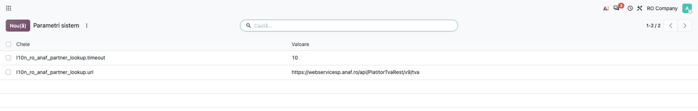
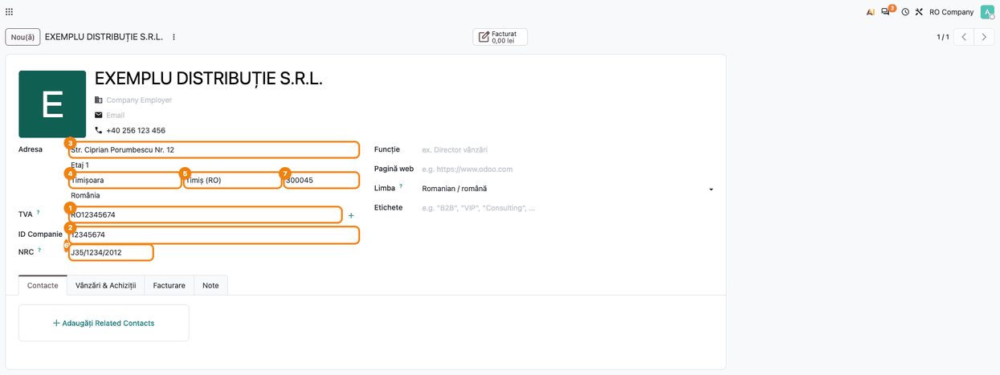
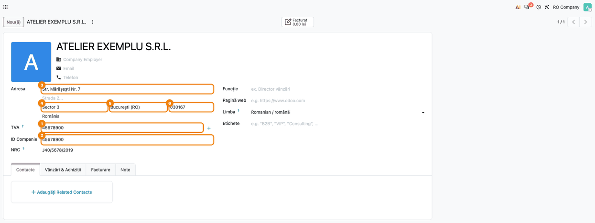

# Fișă Modul: Căutarea firmei la ANAF după CUI (serviciu pentru alte module)

**Modul:** `l10n_ro_anaf_partner_lookup`
**Utilizator principal:** Consultant / administrator (configurare); indirect, operatorul care creează clienți (agent de vânzări, client pe site)
**Prioritate:** 🟡 Medie (nu are ecran propriu, dar de el depind datele firmei preluate automat la crearea partenerului și pe site)

---

## 1. Scop business

Când un client firmă cere factură, datele lui (denumire, CUI, adresă, registrul comerțului) trebuie
să fie corecte și complete, altfel factura poate fi respinsă de e-Factura (de ex. lipsa sectorului la București) sau tipărită greșit. Datele
oficiale sunt la ANAF, în registrul plătitorilor de TVA. Modulul este **serviciul comun** care
întreabă ANAF după CUI și întoarce datele partenerului gata de salvat, pentru ca modulele care
creează clienți (completarea automată a partenerului, coșul de pe site) să nu le preia fiecare
în felul lui. **Modulul nu are meniu, ecran sau buton propriu**: operatorul îl folosește fără să-l
vadă, prin modulul consumator în care tastează CUI-ul.

## 2. Bază legală și context

- **Codul fiscal, art. 319 alin. (20)** — factura cuprinde denumirea, adresa și codul de
  înregistrare în scopuri de TVA (sau codul de identificare fiscală) ale cumpărătorului. Modulul pune
  prefixul `RO` doar la plătitorii de TVA, ca pe factură.
- **Legea 31/1990, art. 74** — societatea își arată sediul social pe documentele ei. Pentru
  consecvență cu datele din registru, adresa clientului se ia tot din **sediul social**; domiciliul
  fiscal se folosește doar când ANAF nu dă sediul social. Adresa vine întreagă dintr-un singur bloc,
  nu amestecată (strada dintr-unul, codul poștal din celălalt).
- **e-Factura (CIUS-RO)** — pentru București, localitatea se transmite ca sector; modulul scrie
  localitatea `Sector N`.
- **Sursa datelor**: serviciul web public ANAF al registrului plătitorilor de TVA (v9), fără
  autentificare. ANAF răspunde cu diacriticele vechi cu sedilă (`ş`, `ţ`); modulul le corectează în
  cele cu virgulă (`ș`, `ț`).

## 3. Utilizatori și roluri

- **Administrator / consultant** (drepturi de administrare, cu modul dezvoltator activ):
  modifică, dacă e nevoie, parametrii de sistem ai serviciului.
- **Operatorii modulelor consumatoare** (agent de vânzări, client pe site): tastează
  CUI-ul; nu au nevoie de drepturi suplimentare pentru acest modul.
- **La testare**: un utilizator obișnuit al modulului consumator (ex. casier), ca să se vadă
  completarea exact cum o vede operatorul, plus administratorul pentru parametri.

## 4. Conturi și date implicate

Modulul nu generează note contabile și nu atinge conturi. Întoarce valorile partenerului:

| Dată întoarsă | Câmp pe partener | Regulă |
|---|---|---|
| Denumire | Nume | diacritice corectate |
| CUI | **TVA** (CIF) | cu `RO` doar pentru plătitorul de TVA; **ID Companie** (CUI-ul fără `RO`) îl deduce Odoo din TVA |
| Stradă și număr | Stradă | `Str. … Nr. …`; adresele scrise de ANAF cu majuscule trec în forma obișnuită |
| Detalii adresă | Stradă 2 | bloc, etaj, apartament |
| Localitate | Localitate | fără `Mun.` / `Oraș` / `Com.`; satul fără comuna lui; la București `Sector N` |
| Județ | Județ | după codul auto al județului |
| Cod poștal | Cod poștal | 6 cifre (ANAF omite 0-ul din față la București) |
| Nr. registrul comerțului | NRC | doar dacă există câmpul NRC (localizarea RO) |
| Telefon | Telefon | |
| Localitatea din listă | Oraș (listă) | doar cu orașele din `l10n_ro_city` |

Pe lângă valorile partenerului, rezultatul spune dacă firma este **plătitoare de TVA**, **inactivă**
(cu data) sau **radiată**, ca modulul consumator să avertizeze.

Date minime pentru demo: un CUI valid al unei firme active (pentru un răspuns real) sau, în teste,
răspunsul ANAF simulat.

## 5. Configurare inițială

1. Modulul se instalează **automat**, ca dependență a modulelor care îl folosesc (vezi secțiunea 7);
   depinde doar de `base`.
2. Nu are setări obligatorii: funcționează imediat, cu serviciul ANAF implicit și o așteptare de
   10 secunde.
3. Opțional, cu modul dezvoltator activ, în **Setări → Tehnic → Parametri → Parametri sistem** se pot
   adăuga:
   - `l10n_ro_anaf_partner_lookup.url` — adresa serviciului ANAF (doar dacă ANAF o schimbă);
   - `l10n_ro_anaf_partner_lookup.timeout` — câte secunde se așteaptă răspunsul (implicit 10; o
     valoare care nu este număr întreg este ignorată și rămâne 10).
4. Opțional, pentru completarea codului poștal și a orașului din listă: modulele `l10n_ro_zip`
   (codurile poștale pe străzi) și `l10n_ro_city` (localitățile României).

## 6. Flux de utilizare

Operatorul nu deschide niciun ecran al acestui modul. Fluxul real este: operatorul tastează CUI-ul
într-un modul consumator → modulul verifică cifra de control și întreabă ANAF → modulul consumator
completează partenerul cu valorile primite. Pașii de mai jos arată configurarea opțională și
rezultatul pe partener, cum îl salvează modulele consumatoare.

### Pasul 1 — Parametrii de sistem (opțional)

Cu modul dezvoltator activ, accesați **Setări → Tehnic → Parametri → Parametri sistem** și căutați
`l10n_ro_anaf_partner_lookup`. Dacă parametrii lipsesc, se folosesc valorile implicite (serviciul
ANAF v9 și 10 secunde). Parametrii se adaugă doar dacă trebuie schimbată adresa serviciului sau
timpul de așteptare.

- **Găsiți pe ecran:** implicit lista este goală — modulul nu creează parametrii. După ce i-ați
  adăugat cu **Nou**, apar cheile `l10n_ro_anaf_partner_lookup.timeout` și
  `l10n_ro_anaf_partner_lookup.url`, cu valorile lor.
- **Verificați:** valoarea timeout-ului este un număr întreg de secunde (o așteptare scurtă,
  pentru că de regulă cineva așteaptă răspunsul la casă sau pe site); adresa este cea a serviciului
  ANAF.



### Pasul 2 — Firmă plătitoare de TVA: partenerul creat din datele ANAF

În modulul consumator, operatorul tastează CUI-ul în orice formă (`RO 12345674`, `ro12345674`,
`12345674`). Dacă cifra de control nu se potrivește, ANAF nu mai este întrebat. Altfel, partenerul
primește datele întoarse. În exemplu, firma are sediul social la Timișoara și domiciliul fiscal la
Arad: adresa vine întreagă din **sediul social**.

- **Găsiți pe ecran:** ① **TVA** cu prefixul `RO`; ② **ID Companie** = CUI-ul fără `RO`;
  ③ strada cu numărul (detaliile, ex. etajul, pe rândul al doilea); ④ localitatea fără `Mun.`, cu
  diacriticele corecte; ⑤ județul; ⑥ **NRC**; ⑦ codul poștal `300045` (Timișoara, nu `310025` de
  la Arad).
- **Verificați:** prefixul `RO` apare doar pentru că firma este plătitoare de TVA; adresa este a
  sediului social, inclusiv codul poștal; numele are `Ț` cu virgulă, nu cu sedilă.



### Pasul 3 — Firmă neplătitoare de TVA din București

Pentru o firmă neplătitoare de TVA, **TVA** primește CUI-ul fără `RO`; partenerul rămâne firmă,
pentru că Odoo îl recunoaște după CUI. În exemplu, ANAF a scris adresa cu majuscule, localitatea
`Mun. București` fără sector și codul poștal `30167`.

- **Găsiți pe ecran:** ① **TVA** fără prefix; ② **ID Companie** egal cu el; ③ strada în forma
  obișnuită (nu cu majuscule); ④ localitatea **Sector 3**; ⑤ județul București; ⑥ codul poștal
  `030167`.
- **Verificați:** sectorul a fost dedus din codul poștal (`03…` → Sector 3); codul poștal are 6
  cifre. Dacă nici localitatea, nici codul poștal nu arată sectorul, localitatea rămâne cum a
  scris-o ANAF, ca verificarea e-Factura să semnaleze lipsa.



### Răspunsurile serviciului

Modulul consumator primește unul dintre patru răspunsuri și decide ce afișează operatorului:

| Răspuns | Când | Ce face de regulă modulul consumator |
|---|---|---|
| găsit | ANAF cunoaște CUI-ul | completează partenerul; avertizează dacă firma e inactivă sau radiată |
| negăsit | CUI corect, dar ANAF nu are firma | anunță că firma nu există în registru |
| CUI invalid | cifra de control greșită, CNP în loc de CUI, litere | cere corectarea CUI-ului, fără cerere la ANAF |
| ANAF indisponibil | serviciul nu răspunde în timpul de așteptare sau dă eroare | lasă datele de completat manual |

### Note de monografie și raportare

Modulul nu generează note contabile. Efectul se vede pe documentele emise ulterior partenerului:
factura tipărită și XML-ul e-Factura conțin denumirea, CUI-ul (cu `RO` doar la plătitorii de TVA)
și adresa sediului social, iar la București localitatea este sectorul cerut de CIUS-RO.

## 7. Legături cu alte module / declarații

| Modul | Rol în flux |
|---|---|
| `l10n_ro_partner_autocomplete` | propunerile ANAF la completarea automată a partenerului în backoffice |
| `l10n_ro_website_anaf` | completarea datelor firmei după CUI în coșul de pe site |
| `l10n_ro_zip` (opțional) | codul poștal după stradă și număr, când ANAF nu îl dă |
| `l10n_ro_city` (opțional) | alegerea orașului din lista localităților României |
| `l10n_ro` (opțional) | câmpul NRC, în care ajunge numărul de la registrul comerțului |

**Ce e automat:** verificarea cifrei de control, cererea la ANAF, curățarea denumirii și a adresei,
prefixul `RO`, sectorul la București, codul poștal și orașul din listă (cu modulele opționale),
semnalarea firmei inactive sau radiate.

**Ce rămâne manual:** completarea datelor când ANAF nu răspunde sau nu are firma; alegerea
localității când în județ sunt mai multe cu același nume și nici comuna, nici codul poștal nu le
deosebesc; decizia ce se face cu un client inactiv sau radiat (aparține modulului consumator și
operatorului).

## 8. Verificări pentru consultant

- [ ] Fără parametri de sistem, căutarea merge cu valorile implicite (serviciul ANAF v9, 10 secunde).
- [ ] Un CUI cu cifra de control greșită este refuzat fără cerere la ANAF.
- [ ] CUI-ul tastat cu `RO`, cu spații sau cu liniuțe găsește aceeași firmă.
- [ ] O firmă plătitoare de TVA primește TVA cu `RO`; una neplătitoare, fără `RO`; ambele au
      **ID Companie** = CUI-ul fără `RO`.
- [ ] Când ANAF dă și sediul social, și domiciliul fiscal, adresa (inclusiv codul poștal) este a
      sediului social.
- [ ] Localitatea nu are `Mun.` / `Oraș` / `Com.`; un sat apare fără comuna lui.
- [ ] La București, localitatea este `Sector N`, dedusă din cod poștal când ANAF nu scrie sectorul.
- [ ] Codul poștal are 6 cifre; cu `l10n_ro_zip` instalat, se completează după stradă când ANAF nu-l dă.
- [ ] Denumirea și adresa au `ș` / `ț` cu virgulă.
- [ ] Numărul de la registrul comerțului ajunge în **NRC**, nu în **ID Companie**.
- [ ] Cu ANAF oprit (sau cu adresa unui server inexistent în parametri), modulul consumator anunță că
      serviciul nu răspunde și lasă completarea manuală.

## 9. Mesaje de eroare frecvente

Modulul nu afișează mesaje proprii; textul îl dă modulul consumator, după răspunsul primit.

| Mesaj | Cauză | Remediere |
|---|---|---|
| CUI invalid (formularea modulului consumator) | cifră de control greșită, CNP sau litere în loc de CUI | verificați CUI-ul pe documentul firmei |
| Firma nu a fost găsită la ANAF | CUI corect ca formă, dar inexistent în registru | verificați CUI-ul; completați manual dacă firma e nou înființată |
| Serviciul ANAF nu răspunde | ANAF indisponibil, fără internet sau timeout prea mic | completați manual; verificați parametrul `l10n_ro_anaf_partner_lookup.timeout` și `l10n_ro_anaf_partner_lookup.url` |
| Avertisment firmă inactivă / radiată | ANAF raportează firma ca inactivă sau radiată | decideți cu contabilul dacă și cum se facturează |
| Localitatea București rămâne fără sector | ANAF nu a scris sectorul și codul poștal lipsește | completați manual localitatea `Sector N` |

## 10. Capturi de ecran

Capturile sunt generate automat din `tests/test_screenshots.py` (mixinul `ScreenshotCase` din
`l10n_ro_doc_screenshots`, import defensiv), în RO, pe compania „RO Company" în RON, în
`static/description/`, în ordinea pașilor din secțiunea 6. Modulul nu are ecran propriu, deci
capturile arată parametrii de sistem și partenerii creați din valorile întoarse de modul, cum îi
creează modulele consumatoare. Răspunsul ANAF este simulat, cu firme și CUI-uri de exemplu, deci
rularea nu depinde de ANAF.

| # | Fișier | Conținut |
|---|--------|----------|
| 1 | `static/description/01_parametri_sistem.png` | Parametrii de sistem `url` și `timeout` ai căutării la ANAF, adăugați manual |
| 2 | `static/description/02_firma_platitoare_tva.png` | Firmă plătitoare de TVA completată din ANAF: TVA cu `RO`, ID Companie, adresa sediului social cu codul poștal, NRC |
| 3 | `static/description/03_firma_bucuresti_sector.png` | Firmă neplătitoare de TVA din București: TVA fără `RO`, Sector 3 dedus din codul poștal |

Regenerare:

```bash
# suita l10n_ro_ent (cu l10n_ro_doc_screenshots) trebuie să fie în addons_path
.venv/bin/python odoo/odoo-bin -c odoo.conf -d test20 -i l10n_ro_anaf_partner_lookup,l10n_ro,l10n_ro_doc_screenshots \
    --test-tags=/l10n_ro_anaf_partner_lookup:TestAnafPartnerLookupScreenshots --stop-after-init
```

## 11. Observații pentru manual

- Modulul nu are capitol propriu de utilizare în manual: se descrie la capitolele modulelor care îl
  folosesc (completarea partenerului, site), cu trimitere la această fișă pentru reguli.
- De păstrat regulile vizibile pentru operator: `RO` doar la plătitorii de TVA, adresa sediului
  social, `Sector N` la București.
- De subliniat că, atunci când ANAF nu răspunde, clientul **nu se pierde**: datele se completează
  manual.
- Parametrii de sistem sunt pentru consultant, nu pentru operator; în manualul de utilizare nu se
  menționează.
