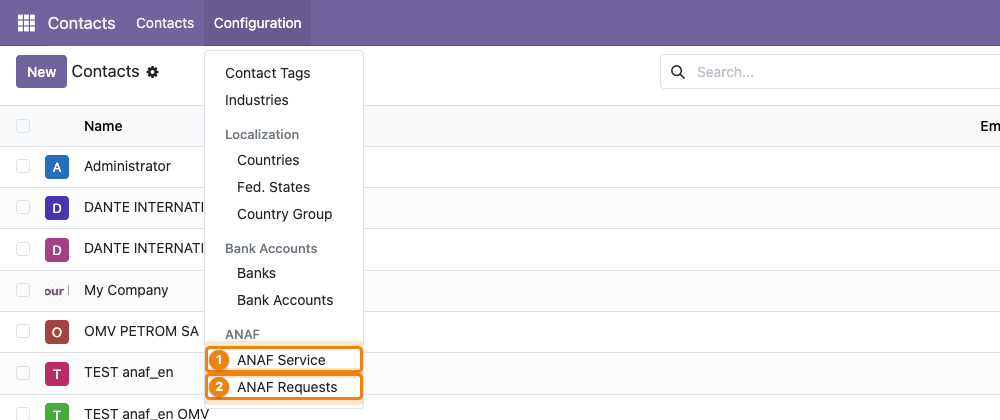
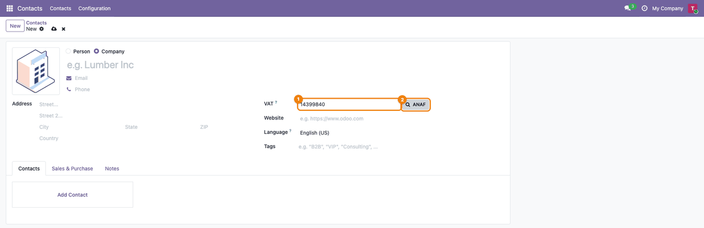
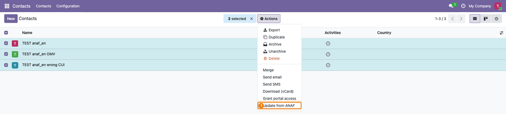
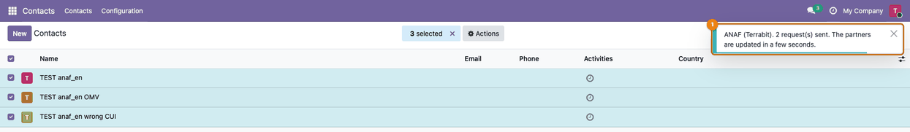
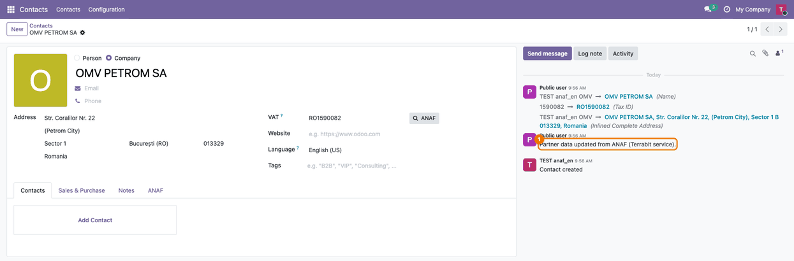
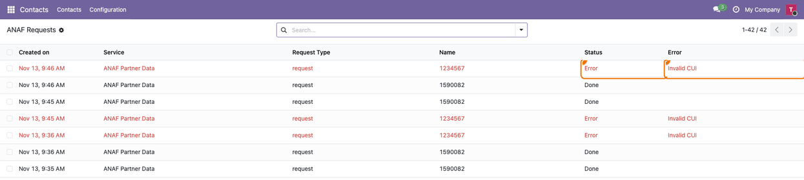

===========================================
Romania - ANAF Partner Data for Odoo Online
===========================================

..
   !!!!!!!!!!!!!!!!!!!!!!!!!!!!!!!!!!!!!!!!!!!!!!!!!!!!
   !! This file is generated by oca-gen-addon-readme !!
   !! changes will be overwritten.                   !!
   !!!!!!!!!!!!!!!!!!!!!!!!!!!!!!!!!!!!!!!!!!!!!!!!!!!!
   !! source digest: sha256:ab3d2837af98faf5d2dcbe958bccf43adb3b3c4ab3718b8bb125f16df72896df
   !!!!!!!!!!!!!!!!!!!!!!!!!!!!!!!!!!!!!!!!!!!!!!!!!!!!

.. |badge1| image:: https://img.shields.io/badge/maturity-Alpha-red.png
    :target: https://odoo-community.org/page/development-status
    :alt: Alpha
.. |badge2| image:: https://img.shields.io/badge/license-AGPL--3-blue.png
    :target: http://www.gnu.org/licenses/agpl-3.0-standalone.html
    :alt: License: AGPL-3
.. |badge3| image:: https://img.shields.io/badge/github-dhongu%2Fl10n--romania-lightgray.png?logo=github
    :target: https://github.com/dhongu/l10n-romania/tree/19.0/l10n_ro_anaf_partner_online
    :alt: dhongu/l10n-romania

|badge1| |badge2| |badge3|

Fill in Romanian companies from ANAF by their CUI (Tax ID), on **Odoo
Online** too: the module has no Python code and is imported as a zip
(Apps > Import Module). The lookup itself runs on the Terrabit service,
which asks ANAF and sends the data back to your database.

- **ANAF button on the partner form**: next to the Tax ID, it fills in
  the name, the address of the registered office (county, city, postal
  code), the Tax ID with ``RO`` only for VAT payers and the phone,
  before you save.
- **Many partners at once**: *Actions > Update from ANAF* on a selection
  of partners; the service answers in a few seconds and posts a note in
  the chatter of each partner found.
- **ANAF status on the partner**: VAT payer, fiscally inactive, struck
  off, the trade register number (J…) and the date of the last check, on
  the **ANAF** tab.
- **Activation in one click**: *Contacts > Configuration > ANAF > ANAF
  Service*, **Activate**; the service token is written in your database
  automatically, with free trial lookups. **Buy Credits** and **Refresh
  Credits** are on the same screen (module *IAP Services for Odoo
  Online*, ``deltatech_iap_online``, installed with this one).
- **Who sees what**: the users who edit partners (*Contact Creation*)
  can read the service account, because the ANAF button asks the service
  from their browser; the button and *Update from ANAF* are for them.
  Only administrators activate the service, buy credits and read the
  requests and their answers (access rights of
  ``deltatech_iap_online``).
- **What leaves your database**: the CUI you look up, the account and
  request tokens, the id of the request, the UUID and the address of
  your database (for the answer); at activation, also the name and the
  Tax ID of the company. The requests, their status and errors stay
  visible under *ANAF Requests*.

The service is provided by Terrabit: after the trial lookups, more can
be bought from Terrabit.

.. IMPORTANT::
   This is an alpha version, the data model and design can change at any time without warning.
   Only for development or testing purpose, do not use in production.
   `More details on development status <https://odoo-community.org/page/development-status>`_

**Table of contents**

.. contents::
   :local:

Usage
=====

**Activate the service** (administrator, once)

1. Go to *Contacts > Configuration*: the **ANAF** group holds **ANAF
   Service** and **ANAF Requests** (administrators only).

   |The Configuration menu of Contacts, open, with ANAF Service and ANAF
   Requests highlighted in the ANAF group|

2. Open **ANAF Service** and click **Activate**. The account token comes
   back by itself in a few seconds, with free trial lookups. Once
   active, the header shows **Activate Again**, **Refresh Credits** and
   **Buy Credits**, and **Credits Left** shows the lookups left on the
   Terrabit account (updated by **Refresh Credits** and by every queued
   answer). One credit is used per ANAF answer (company found or not
   found); an invalid CUI or ANAF not answering is free.

   |The ANAF Service form, active: Activate Again, Refresh Credits and
   Buy Credits in the header, Service Code anaf_partner_online and
   Credits Left highlighted|

**Fill in a new partner**

3. Create a contact, choose **Company** and type the CUI in **VAT**
   (with or without ``RO``). Press Tab so that the suggestion list of
   the field closes, then click **ANAF** next to it. The button is
   hidden on the contacts of a company.

   |A new company contact with 14399840 in VAT and the ANAF button
   highlighted next to it|

4. The form is filled in at once, before you save: name, **VAT** with
   ``RO`` only for VAT payers, the address of the registered office (in
   Bucharest, the city is the sector) and the phone, if ANAF has it. A
   notification shows the lookups left. Check the data, then save. If
   the browser cannot reach the service, the partner is saved and the
   lookup is queued instead.

   |The form filled in from ANAF before saving: DANTE INTERNATIONAL SA,
   VAT RO14399840, the address in Sector 6, Bucharest, and the
   notification Filled in from ANAF with the lookups left|

5. After saving, the **ANAF** tab shows **VAT Payer (ANAF)**, **Fiscally
   Inactive (ANAF)**, **Struck Off (ANAF)**, **Trade Register No.** and
   **Last ANAF Check**. The tab appears once the partner has been
   checked at ANAF.

   |The ANAF tab of the partner: VAT Payer ticked, Fiscally Inactive and
   Struck Off not ticked, the trade register number and the date of the
   last check|

**Update many partners**

6. In the list of contacts, select the partners and click *Actions >
   Update from ANAF* (also in the *Actions* menu of the partner form).
   Partners without a VAT number are skipped.

   |The list of contacts with three partners selected and Update from
   ANAF highlighted in the Actions menu|

7. A notification tells how many requests were sent; the partners are
   updated in a few seconds.

   |The notification ANAF (Terrabit): 2 request(s) sent, over the list
   with three partners selected|

8. Each partner found gets the ANAF data and the note *Partner data
   updated from ANAF (Terrabit service).* in the chatter, with the
   tracked changes. The answer is written only if the user who sent the
   request may edit the partner and the partner still has the same CUI.

   |The partner OMV PETROM SA updated from ANAF, with the tracked
   changes of name, VAT and address and the note in the chatter|

**Follow the requests** (administrator)

9. *Contacts > Configuration > ANAF > ANAF Requests* lists every request
   with its **Request Type**, **Name** (the CUI looked up), **Status**
   and **Error**; the requests in error are red (for example
   ``Invalid CUI``). A request still without answer after 10 minutes is
   sent once more.

   |The ANAF Requests list: a request Done and a red request in Error
   with Invalid CUI|

.. |The ANAF Service form, active: Activate Again, Refresh Credits and Buy Credits in the header, Service Code anaf_partner_online and Credits Left highlighted| image:: https://raw.githubusercontent.com/dhongu/l10n-romania/19.0/l10n_ro_anaf_partner_online/static/description/en/02_serviciu_anaf.png

.. |The form filled in from ANAF before saving: DANTE INTERNATIONAL SA, VAT RO14399840, the address in Sector 6, Bucharest, and the notification Filled in from ANAF with the lookups left| image:: https://raw.githubusercontent.com/dhongu/l10n-romania/19.0/l10n_ro_anaf_partner_online/static/description/en/04_partener_completat.png
.. |The ANAF tab of the partner: VAT Payer ticked, Fiscally Inactive and Struck Off not ticked, the trade register number and the date of the last check| image:: https://raw.githubusercontent.com/dhongu/l10n-romania/19.0/l10n_ro_anaf_partner_online/static/description/en/05_tab_anaf.png

Changelog
=========

19.0.1.0.2 (2026-11-14)
-----------------------

- Apps Store banner: the "IAP" label shows that the module works with
  IAP credits.

19.0.1.0.1 (2026-11-14)
-----------------------

- Cannot be installed together with ``l10n_ro_partner_create_by_vat`` or
  ``l10n_ro_partner_autocomplete``, the modules with Python code that
  fill the partner from ANAF too: the manifest lists them under
  ``excludes``.
- The zip import (Apps > Import Module) does not check ``excludes``, so
  the import now stops with a missing external ID
  (``error_uninstall_..._first``) while that module is installed.

19.0.1.0.0
==========

- First version: ANAF button on the partner form (immediate answer),
  *Update from ANAF* on a selection of partners (queued answer),
  activation by callback, ANAF status on the partner.
- Consultant sheet (``readme/FISA_CONSULTANT.md``), ``readme/USAGE.md``
  and screenshots (RO, EN).

Bug Tracker
===========

Bugs are tracked on `Terrabit Issues <https://www.terrabit.ro/helpdesk>`_.
In case of trouble, please check there if your issue has already been reported.

Do not contact contributors directly about support or help with technical issues.

Credits
=======

Authors
-------

* Dorin Hongu
* Terrabit

Maintainers
-----------

.. |maintainer-dhongu| image:: https://github.com/dhongu.png?size=40px
    :target: https://github.com/dhongu
    :alt: dhongu

Current maintainer:

|maintainer-dhongu| 

This module is part of the `dhongu/l10n-romania <https://github.com/dhongu/l10n-romania/tree/19.0/l10n_ro_anaf_partner_online>`_ project on GitHub.

You are welcome to contribute.