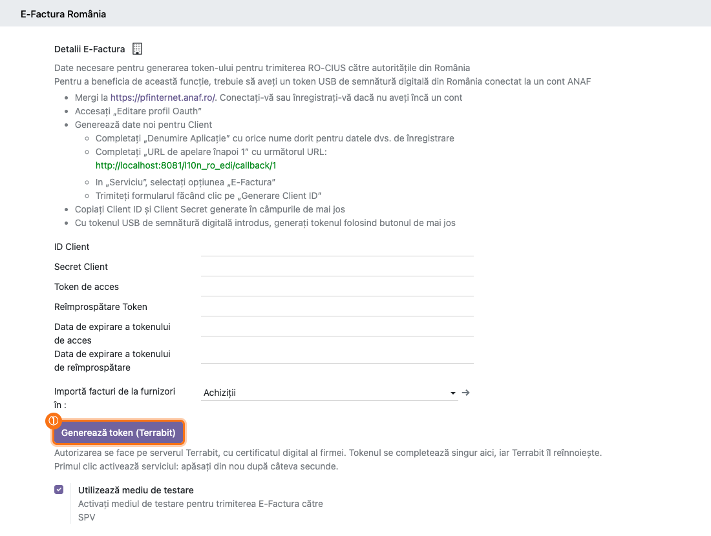
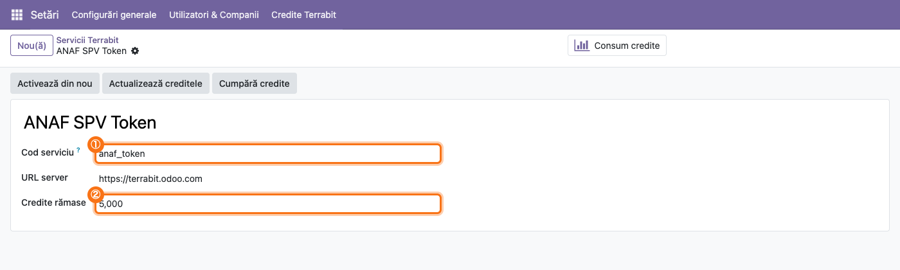
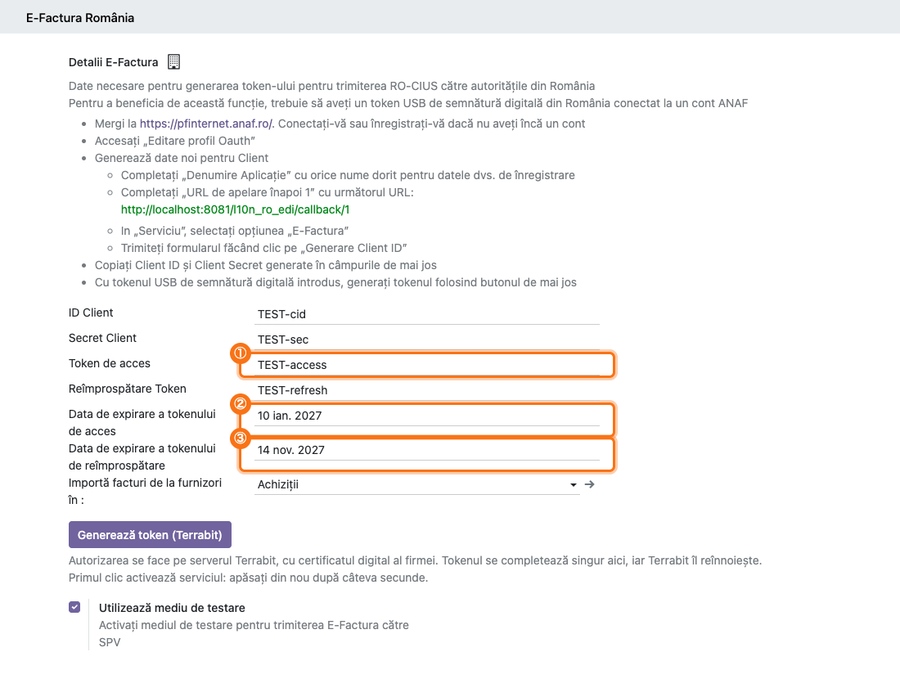
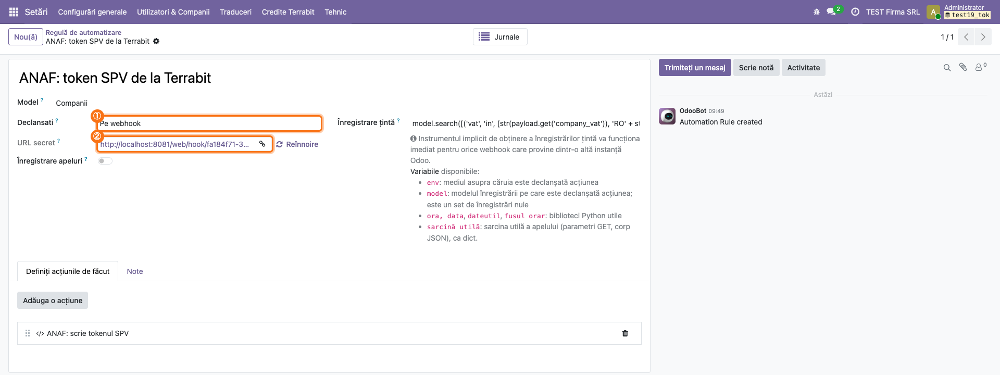
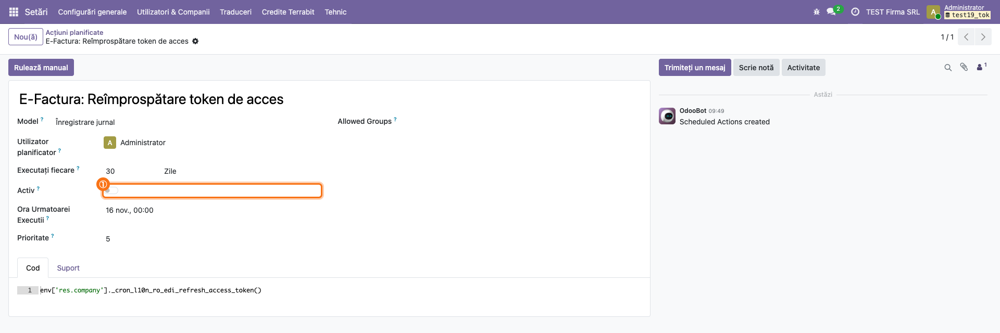

========================================
Romania - ANAF SPV Token for Odoo Online
========================================

..
   !!!!!!!!!!!!!!!!!!!!!!!!!!!!!!!!!!!!!!!!!!!!!!!!!!!!
   !! This file is generated by oca-gen-addon-readme !!
   !! changes will be overwritten.                   !!
   !!!!!!!!!!!!!!!!!!!!!!!!!!!!!!!!!!!!!!!!!!!!!!!!!!!!
   !! source digest: sha256:0173dd7bc9fdca6567fd6b3db293c320d12806f2e302d2205727ad1c7f1cc311
   !!!!!!!!!!!!!!!!!!!!!!!!!!!!!!!!!!!!!!!!!!!!!!!!!!!!

.. |badge1| image:: https://img.shields.io/badge/maturity-Alpha-red.png
    :target: https://odoo-community.org/page/development-status
    :alt: Alpha
.. |badge2| image:: https://img.shields.io/badge/license-AGPL--3-blue.png
    :target: http://www.gnu.org/licenses/agpl-3.0-standalone.html
    :alt: License: AGPL-3
.. |badge3| image:: https://img.shields.io/badge/github-dhongu%2Fl10n--romania-lightgray.png?logo=github
    :target: https://github.com/dhongu/l10n-romania/tree/19.0/l10n_ro_anaf_token_online
    :alt: dhongu/l10n-romania

|badge1| |badge2| |badge3|

Tokenul SPV ANAF pentru e-Factura, și pe **Odoo Online**: modulul nu
conține cod Python și se importă ca arhivă zip (Aplicații > Importați
modulul). Autorizarea cu certificatul digital se face o singură dată, pe
serverul Terrabit, care ține tokenul valabil și îl trimite în baza
dumneavoastră. Nu înregistrați o aplicație proprie la ANAF și nu
reînnoiți tokenul manual.

- **Generează token (Terrabit)**, în *Setări > Facturare > E-Factura
  România*: deschide autorizarea ANAF pe serverul Terrabit. Primul clic
  activează serviciul Terrabit al bazei; apăsați din nou după câteva
  secunde.
- **Tokenul se completează singur**: Client ID, Client Secret, tokenul
  de acces, tokenul de reînnoire și datele lor de expirare se scriu pe
  firmă, în câmpurile standard e-Factura, imediat după autorizare și din
  nou după fiecare reînnoire. Firma se găsește după CUI.
- **Reînnoire într-un singur loc**: când sosește tokenul, acțiunea
  programată standard de reînnoire e-Factura se oprește, pentru că ANAF
  invalidează tokenul anterior la fiecare reînnoire. Tokenul îl
  reînnoiește serverul Terrabit. Acțiunea programată este comună tuturor
  firmelor din bază: într-o bază cu mai multe firme se oprește doar când
  toate firmele care au token ANAF îl primesc de la Terrabit.
- **Costul**: o autorizare costă 1 credit (1 credit = 1 EUR);
  reînnoirile sunt gratuite. Autorizarea apare în *Setări > Credite
  Terrabit > Consum credite*.
- **Butonul standard Generează token este ascuns**: ar porni o
  autorizare locală, cu aplicația ANAF proprie, și ar invalida tokenul
  reînnoit de Terrabit.

Modulul are nevoie de ``deltatech_iap_online`` (serviciile Terrabit),
importat înainte. Serviciul Terrabit apare în *Setări > Credite
Terrabit*.

**Ce iese din baza dumneavoastră**: la activare, adresa și UUID-ul
bazei, denumirea și CUI-ul firmei; la autorizare, adresa webhook-ului
care primește tokenul. Tokenul vine de la serverul Terrabit, prin HTTPS,
pe un URL de webhook secret.

Odoo Online
~~~~~~~~~~~

Modulul nu conține Python: se poate importa pe Odoo Online (planul
Custom) din Aplicații > Importați modulul. Nu se poate instala împreună
cu ``terrabit_iap_anaf`` (manifestul îl exclude, iar importul zip este
refuzat cât timp acel modul e instalat): amândouă primesc același token.

Dacă dezinstalați modulul, reporniți acțiunea programată de reînnoire a
tokenului e-Factura (*Setări > Tehnic > Automatizare > Acțiuni
planificate*) sau generați un token cu butonul standard.

.. IMPORTANT::
   This is an alpha version, the data model and design can change at any time without warning.
   Only for development or testing purpose, do not use in production.
   `More details on development status <https://odoo-community.org/page/development-status>`_

**Table of contents**

.. contents::
   :local:

Usage
=====

1. Importați ``deltatech_iap_online``, apoi acest modul, din **Aplicații
   → Importați Modulul**. Dacă baza are instalat ``terrabit_iap_anaf``,
   dezinstalați-l întâi: importul e refuzat cât timp e instalat.

2. Deschideți **Setări → Facturare**, blocul **E-Factura România**
   (firma trebuie să aibă țara fiscală România și codul fiscal
   completat). Butonul standard **Generare token** e ascuns; apăsați
   **Generează token (Terrabit)**. Prima apăsare activează serviciul
   Terrabit; după câteva secunde, apăsați din nou: se deschide, într-o
   filă nouă, autorizarea ANAF pe serverul Terrabit.

   |Blocul E-Factura România cu câmpurile tokenului goale și butonul
   Generează token (Terrabit) evidențiat|

3. Serviciul apare în **Setări → Credite Terrabit → Servicii și
   credite**, ca **ANAF SPV Token**, cu soldul în **Credite rămase** (1
   credit = 1 EUR). Activarea a reușit când a doua apăsare pe
   **Generează token (Terrabit)** deschide pagina de autorizare; altfel,
   verificați cererea de activare în **Setări → Tehnic → Servicii
   Terrabit → Cereri** (modul dezvoltator). O autorizare reușită costă 1
   credit, iar reînnoirile sunt gratuite: înainte de autorizare,
   **Credite rămase** trebuie să fie cel puțin 1 (altfel apăsați
   **Cumpără credite**).

   |Serviciul ANAF SPV Token activat, cu Cod serviciu anaf_token și
   Credite rămase evidențiate|

4. Pe pagina de autorizare, titularul certificatului digital se
   autentifică la ANAF. Serverul Terrabit trimite apoi tokenul în Odoo.
   Fără credite suficiente, serverul refuză autorizarea cu „Not enough
   credits”, înainte de alegerea certificatului: cumpărați credite din
   **Servicii și credite** și reluați autorizarea. Autorizarea taxată
   apare în **Setări → Credite Terrabit → Consum credite** ca „ANAF
   authorization”, cu 1 credit.

5. Reîncărcați **Setări → Facturare**: ID Client, Secret Client,
   tokenurile și datele de expirare sunt completate pe firmă. Verificați
   că data de expirare a tokenului de acces e în viitor.

   |Blocul E-Factura România cu tokenul primit și datele de expirare
   evidențiate|

6. Opțional, în modul dezvoltator: regula de automatizare **ANAF: token
   SPV de la Terrabit** (**Setări → Tehnic → Automatizare → Regulă de
   automatizare**) primește tokenul pe un URL secret. Nu apăsați
   **Reînnoire** lângă URL și lăsați **Înregistrare apeluri** oprit.

   |Regula de automatizare cu declanșatorul Pe webhook și URL-ul secret
   evidențiate|

7. Odată primit tokenul, acțiunea planificată **E-Factura:
   Reîmprospătare token de acces** se oprește: tokenul îl reînnoiește
   serverul Terrabit. Într-o bază cu mai multe firme, acțiunea rămâne
   activă cât timp o altă firmă își reînnoiește singură tokenul.

   |Acțiunea planificată E-Factura: Reîmprospătare token de acces cu
   comutatorul Activ oprit|

La dezinstalarea modulului, reporniți manual acțiunea planificată de
reîmprospătare (**Setări → Tehnic → Automatizare → Acțiuni
planificate**, filtrul **Arhivat**) sau generați un token cu butonul
standard.

Changelog
=========

19.0.1.0.0
----------

- Prima versiune: varianta fără Python a modulului
  ``terrabit_iap_anaf``, importabilă pe Odoo Online. Tokenul vine de la
  serverul Terrabit pe o automatizare *On webhook* (în locul rutei
  ``/iap/anaf_token_response``), care oprește și acțiunea programată de
  reînnoire e-Factura; butonul Generează token (Terrabit) trimite adresa
  acestui webhook în linkul de autorizare. O autorizare costă 1 credit
  și apare în *Consum credite*. Acțiunea programată, comună tuturor
  firmelor, se oprește doar când toate firmele cu token ANAF îl primesc
  de la Terrabit. Necesită ``terrabit_iap_server_anaf`` 19.0.1.5.0 pe
  server și ``deltatech_iap_online`` 19.0.1.2.0.

Bug Tracker
===========

Bugs are tracked on `Terrabit Issues <https://www.terrabit.ro/helpdesk>`_.
In case of trouble, please check there if your issue has already been reported.

Do not contact contributors directly about support or help with technical issues.

Credits
=======

Authors
-------

* Dorin Hongu
* Terrabit

Maintainers
-----------

.. |maintainer-dhongu| image:: https://github.com/dhongu.png?size=40px
    :target: https://github.com/dhongu
    :alt: dhongu

Current maintainer:

|maintainer-dhongu| 

This module is part of the `dhongu/l10n-romania <https://github.com/dhongu/l10n-romania/tree/19.0/l10n_ro_anaf_token_online>`_ project on GitHub.

You are welcome to contribute.