# Fișă Modul: Declarația Vamală de Import (DVI) ca cost de aterizare

**Modul:** `l10n_ro_customs_dvi`
**FR:** FR-15
**Capitol manual:** Cap 12.9
**Utilizator principal:** Contabil importuri, Operator achiziții
**Prioritate:** 🔴 Ridicată (afectează baza TVA deductibilă și costul stocului)

> Modulul se numea `terrabit_dvi` până la 23.09.2026. Vechiul nume rămâne ca modul tranzitoriu, fără
> conținut, doar ca dependențele existente să continue să se încarce.

---

## 1. Scop business

La importul de mărfuri din afara Uniunii Europene, autoritatea vamală emite o **Declarație Vamală de
Import (DVI)** care stabilește taxa vamală datorată și TVA-ul de plătit în vamă. Aceste sume nu se
regăsesc pe factura furnizorului extern și trebuie înregistrate separat, cu două efecte diferite:
taxele vamale **măresc costul mărfii**, iar TVA-ul la import este **deductibil** și nu atinge costul.

Modulul leagă declarația vamală de factura furnizorului printr-un **cost de aterizare** (landed cost)
atașat recepției. Rezultatul: costul unitar al produsului reflectă costul real de import, iar marja de
pe vânzare nu mai este supraevaluată.

> **Terminologie.** Interfața Odoo în română numește acest mecanism **cost adițional** (`stock.landed.cost`), nu „cost de aterizare". Fișa folosește termenul consacrat în casă, dar pe ecran veți căuta etichetele din interfață: „Costuri adiționale", „Creați costuri adiționale", „Este un cost adițional".

Fără acest flux, taxele vamale ar rămâne cheltuială a perioadei, iar produsul ar ieși din gestiune la
un cost mai mic decât cel real.

## 2. Bază legală și context

Această secțiune este partea pe care consultantul o folosește când contabilul întreabă **ce cifră se
pune unde**. Nu e teorie: majoritatea erorilor de operare vin din confundarea a trei mărimi diferite —
valoarea facturii, valoarea statistică din declarație și baza de impozitare.

### 2.1 Baza de impozitare la import — art. 289 din Legea 227/2015

**Alin. (1):** baza este **valoarea în vamă a bunurilor, stabilită conform legislației vamale**, la
care se adaugă **orice taxe, impozite, comisioane și alte taxe datorate în afara României, precum și
cele datorate ca urmare a importului**, cu excepția TVA-ului care urmează a fi perceput.

**Alin. (2):** baza cuprinde și **cheltuielile accesorii — comisioane, ambalare, transport, asigurare
— care intervin până la primul loc de destinație a bunurilor în România**, *în măsura în care nu au
fost deja cuprinse în baza stabilită conform alin. (1)*, precum și cele care decurg din transportul
către alt loc de destinație din Uniunea Europeană, dacă locul respectiv este cunoscut la momentul
> **TVA-ul care urmează a fi perceput nu se adaugă la bază** (art. 289 alin. (1), teza finală).
> Baza este prin construcție o valoare fără TVA: **nu există etapă de scădere a TVA** și nu se
> aplică niciodată calculul de tip sută mărită. O formulare de tip „minus TVA” ar duce operatorul
> la o bază mai mică cu valoarea cotei.

faptului generator. Sintagma subliniată este clauza
anti-dublă-numărare: transportul deja inclus în valoarea în vamă **nu se adaugă a doua oară**.
**Primul loc de destinație nu este frontiera**, ci destinația din documentul de transport (CMR) — în
practică depozitul importatorului — iar în lipsa mențiunii, primul loc de descărcare în România.

**Alin. (3):** baza nu cuprinde rabaturile, remizele, risturnele și sconturile acordate la data
exigibilității, daunele-interese, penalitățile, dobânzile de întârziere și ambalajele care circulă
prin schimb fără facturare (art. 286 alin. (4) lit. a)–d)).

Formula practică:

```
Bază TVA import = valoarea în vamă, stabilită conform legislației vamale
                + taxa vamală (A00), accizele și celelalte drepturi de import
                + alte taxe, impozite și comisioane datorate în afara României
                  sau ca urmare a importului în România              [alin. (1)]
                + cheltuieli accesorii (comisioane, ambalare, transport,
                  asigurare) până la primul loc de destinație în RO — DOAR
                  dacă nu sunt deja cuprinse în valoarea în vamă     [alin. (2)]
                − rabaturi, remize, risturne, sconturi, daune-interese,
                  penalități, dobânzi de întârziere, ambalaje prin
                  schimb fără facturare                              [alin. (3)]
```

### 2.2 Valoarea statistică din DVI **nu** este baza de impozitare

Sunt două mărimi cu scopuri diferite. Valoarea statistică servește statisticii de comerț exterior
(Reg. de punere în aplicare (UE) 2020/1197, Anexa V, Secțiunea 10) și reprezintă valoarea mărfurilor
**la frontiera statului membru de import**; pentru mărfuri puse în liberă circulație se folosește chiar
valoarea în vamă. Baza de impozitare servește calculului TVA și este definită de art. 289.

Ele **coincid numeric** în cazul simplu — marfă adusă direct peste frontiera română, fără taxă vamală
și fără cheltuieli accesorii ulterioare frontierei. **Diferă** când: există taxă vamală sau accize
(intră în baza TVA, nu în valoarea statistică); există transport intern de la frontieră până la primul
loc de destinație, nedeclarat în vamă (intră în baza TVA prin alin. (2)); marfa intră în UE prin alt
stat membru și se vămuiește în România; există reduceri cunoscute la data exigibilității.

> **Regula de operare:** se transcrie **baza poziției B00 din declarație**, nu valoarea statistică și
> nu netul facturii externe. Nu se recalculează — se copiază.

### 2.3 Unde intră transportul

Regulamentul (UE) 952/2013 (Codul Vamal al Uniunii) pornește de la valoarea de tranzacție (art. 70), la
care art. 71 alin. (1) lit. (e) **adaugă** transportul, asigurarea, încărcarea și manipularea **până la
locul de introducere pe teritoriul vamal al Uniunii**; art. 72 lit. (a) **exclude** transportul de după
intrarea pe teritoriul vamal.

| Segment de transport | Valoare în vamă (bază taxă vamală) | Bază TVA import |
|---|---|---|
| Din țara terță până la frontiera UE | **DA** — CVU art. 71 alin. (1) lit. (e) | DA, indirect, prin valoarea în vamă |
| De la frontiera UE la primul loc de destinație din RO | **NU** — CVU art. 72 lit. (a) | **DA** — art. 289 alin. (2) |
| După primul loc de destinație din RO | NU | NU |

Pentru un import din Republica Moldova vămuit în România, frontiera UE **este** frontiera română —
întregul transport extern se regăsește deja în valoarea în vamă.

Pe latura contabilă, transportul intră în **costul de achiziție** al mărfii: OMFP 1802/2014 pct. 6 —
„costul de achiziție cuprinde prețul de cumpărare, taxele de import și alte taxe (cu excepția acelora
pe care persoana juridică le poate recupera de la autoritățile fiscale), **cheltuielile de transport,
manipulare** și alte cheltuieli care pot fi atribuibile direct achiziției". Faptul că aceeași sumă
apare și în baza TVA **nu** este o dublare — baza TVA nu debitează niciun cont de stoc. Dubla
înregistrare apare doar dacă transportul e capitalizat de două ori pe latura de stoc.

### 2.4 Transportul aferent importului este scutit de TVA

**Art. 294 alin. (1) lit. d):** sunt scutite prestările de servicii, inclusiv transportul, **dacă sunt
direct legate de importul de bunuri și valoarea lor este inclusă în baza de impozitare potrivit
art. 289**. Scutirea nu este opțională. Dacă valoarea transportului a fost efectiv inclusă în baza din
DVI, transportatorul facturează **fără TVA**, cu mențiunea scutirii; justificarea se face cu copie
după DVI. TVA facturată pe o operațiune scutită riscă să fie respinsă la deducere în control.

### 2.5 Cursul și cotele

Valorile din DVI sunt deja în lei, la **cursul vamal lunar** (Reg. (UE) 2015/2447 art. 146, coroborat
cu art. 290 alin. (1) Cod fiscal) — se transcriu, nu se convertesc. Cursul BNR al zilei rămâne relevant
separat, pentru datoria față de furnizor (401) și valoarea de intrare în stoc (OMFP 1802 pct. 319).

Cota se ia la data acceptării declarației (art. 285 alin. (1)–(2)): **21% standard**, **11% redusă**
(art. 291, modificat prin Legea 141/2025, în vigoare de la 1 august 2025). Cota redusă acoperă, între
altele, alimentele de bază — atenție la importurile de produse alimentare, unde taxa de achiziție
implicită a companiei nu este cota corectă.

Deducerea se exercită pe baza declarației vamale sau a actului constatator: art. 299 alin. (1) lit. c)
la plata efectivă în vamă, lit. d) la importul fără plata efectivă (§2.8).

### 2.7 Cele două regimuri de plată a TVA în vamă

Codul fiscal prevede două tratamente, iar modulul le acoperă pe amândouă. Pe regimul vamal 4000
(câmpul **Regim vamal**, implicit), **taxa aleasă în wizard este comutatorul** între ele — nu există
alt câmp de configurat. Importul scutit pe regimul 4200 e tratat separat, la §2.10.

**Plata efectivă la organul vamal — art. 326 alin. (3).** Regimul obișnuit. Se alege o taxă de
achiziție normală (o singură linie de repartiție, pe 4426):

```
Dr 4426 = Cr 4462        TVA de plată în vamă, stinsă ulterior prin plată
```

**Fără plata efectivă la organul vamal — art. 326 alin. (4)-(5).** Cu **certificat de amânare de la plată** (lit. a)), vămuire centralizată (lit. b)), înscriere în
evidențele declarantului (lit. c)) sau bunurile din art. 331 alin. (2) lit. b), c), i)–k) importate
de persoane înregistrate în scopuri de TVA (lit. d)),
**nu se face plata efectivă la organele vamale**. Taxa se evidențiază în decont **atât ca taxă
colectată, cât și ca taxă deductibilă** (alin. (5)), pe D300 rd. 7 și 22. Se alege o taxă cu **două
linii de repartiție, pe 4426 și 4427** — cu `l10n_ro_anaf_d300` instalat, **„21% IMP AM”** sau
**„11% IMP AM”**, care au și grilele rd. 7 / 22:

```
Dr 4426 = Cr 4427        fără 446 și fără plată
```

Cele două linii se soldează între ele, deci nota nu mai are contrapartidă pe contul de buget — nu
există nicio datorie de stins **pentru TVA**. Taxa vamală (A00) rămâne datorată și se plătește ca
în regimul obișnuit: certificatul de amânare privește doar TVA-ul.

Fluxul pas cu pas al acestui regim este în **Pasul 10**.

> **De verificat înainte de prima declarație:** ce regim are societatea. Practic toți importatorii
> mari au certificat de amânare. Dacă alegeți taxa greșită, nota iese cu o datorie la buget care nu
> există — sau, invers, fără datoria care chiar trebuie plătită.

### 2.8 Condiția de deducere

**La plata efectivă în vamă**, art. 299 alin. (1) lit. c) cere, pe lângă declarație, **documente care
să ateste plata taxei**. Nota se generează la data DVI. Dacă declarația e pe 30 ale lunii și plata pe
2 ale lunii următoare, TVA-ul intră într-un decont în care condiția de deducere nu era încă
îndeplinită. Verificați decalajul la închiderea lunii.

**Fără plata efectivă în vamă** (§2.7), condiția nu e plata: art. 299 alin. (1) lit. d) cere DVI-ul
(sau actul constatator) care menționează importatorul și suma taxei datorate, plus înscrierea taxei
ca taxă colectată în decontul perioadei în care ia naștere exigibilitatea — perioada datei DVI
(art. 285).

### 2.9 Restituirea TVA-ului plătit în vamă

Întrebare frecventă după primele importuri: *am plătit TVA în vamă, se poate „debloca"?* Răspunsul
depinde de motiv, iar în multe cazuri cererea **nu are temei sau nu are rost economic**.

**TVA-ul de import se plătește „în conformitate cu reglementările în vigoare privind plata drepturilor
de import"** (art. 326 alin. (3) Cod fiscal). Practica este ca restituirea să urmeze procedura vamală
de **rambursare** (Codul Vamal al Uniunii, Reg. (UE) 952/2013, art. 116–121), cu Codul de procedură
fiscală în completare. Extinderea regulilor vamale la TVA e însă o interpretare a trimiterii din
art. 326 alin. (3), nu un text expres: **temeiul procedural se confirmă cu biroul vamal**. Cererea se
depune la **biroul vamal unde s-a depus declarația** (sau la direcția regională vamală de care ține),
nu la administrația financiară.

| Situația | Are temei? | Ce se face |
|---|---|---|
| Suma plătită e **mai mare decât cea datorată** (bază sau cotă greșită) | Da | Modificarea declarației după acordarea liberului de vamă, apoi rambursarea diferenței. Diferența **nu se deduce** — nu e taxă datorată |
| Declarația a fost **invalidată** (marfa nu a fost pusă în liberă circulație) | Da | Invalidarea DVI și rambursarea întregii sume; nu există import, deci nici drept de deducere |
| Firma avea **certificat de amânare valabil la data DVI**, dar vama a încasat totuși TVA-ul | Da | Rambursare; după aceea TVA-ul se evidențiază ca la §2.7 (colectată și deductibilă) |
| Certificatul de amânare s-a obținut **după** data DVI | **Nu** | Exigibilitatea apare la data importului (art. 285), iar condițiile art. 326 alin. (4) se judecă la acea dată |
| TVA-ul plătit **corect** și dedus integral | **Fără rost** | Suma se recuperează prin decontul de TVA (compensare sau rambursare); diferența e doar de flux de numerar |

**Dacă suma a fost deja dedusă și se cere restituirea**, deducerea se ajustează în favoarea bugetului
(art. 304 alin. (1) lit. a) Cod fiscal; art. 305 pentru bunurile de capital): restituirea plus
deducerea ar însemna o recuperare dublă. Baza de impozitare a importului se corectează doar prin
documentul de regularizare emis de vamă (Normele metodologice, pct. 34 alin. (2)). Cererea trebuie să
spună explicit dacă suma a fost dedusă și în ce decont s-a regularizat.

**Taxa vamală (A00) se restituie și ea** la invalidarea declarației sau la o bază greșită. Ea a intrat
deja în costul stocului prin costul adițional: cât timp marfa e în stoc, corecția se face cu un cost
adițional de corecție, cu valoare negativă (Dr 4482 = Cr 371). Tratamentul după vânzarea mărfii se
confirmă cu contabilul.

> ⚠️ **De confirmat cu biroul vamal înainte de prima cerere:** temeiul procedural, formularul acceptat (nu am identificat
> un formular oficial național aprobat prin ordin), termenul de depunere (Codul Vamal al Uniunii
> prevede, ca regulă, 3 ani de la notificarea datoriei) și lista anexelor. Modelul din **Anexa A** este
> un model Terrabit, de adaptat la cerințele biroului vamal.

Notele contabile ale restituirii sunt în **Note de monografie și raportare**.

### 2.10 Regimul vamal 4200 — import scutit, urmat de livrare intracomunitară

Regimul **4200** (caseta 37 a declarației) se folosește când marfa importată nu rămâne în România, ci
se livrează direct unui client din alt stat membru. Importul e **scutit de TVA** — art. 293 alin. (1)
lit. m) Cod fiscal, cu trimitere la art. 294 alin. (2) — dacă la data importului importatorul dă vămii
(Normele metodologice, Titlul VII, pct. 64):

- codul său de înregistrare în scopuri de TVA din România;
- codul de TVA din alt stat membru al clientului;
- dovada că bunurile pleacă în celălalt stat membru în aceeași stare.

**Ce înseamnă pentru evidență.** Nu există TVA de import: nici deductibil, nici de plată. Pe DVI se
alege **Regim vamal = 4200**. Wizardul propune atunci taxa **„0% EXEMPT"** (TVA Cumpărări Exempționate)
și lasă **Valoare TVA la import** goală. Nota DVI conține doar perechea tehnică pe 473, de valoarea
bazei, cu grila **„29 - TAX BASE"**. Baza importului scutit apare astfel în D300 pe **rd. 29**
(achiziții scutite sau neimpozabile), coloana bază. Un DVI pe 4200 cu TVA completat **este refuzat**.

**Livrarea către client** (FR, PL) se facturează ca livrare intracomunitară scutită: D300 rd. 1 și
D390 cu cod **L**. Clientul trebuie să aibă cod de TVA valid în VIES, iar CMR-ul semnat de client este
proba transportului. Pașii din vânzări sunt în **Pasul 12**.

**Luna de declarare.** La livrarea intracomunitară, exigibilitatea TVA intervine la data emiterii
facturii (art. 283 alin. (1) Cod fiscal); factura se emite cel târziu în ziua 15 a lunii următoare
(art. 319 alin. (15)). Cursul valutar este cel din data exigibilității (Normele metodologice, pct. 35
alin. (5)). Livrarea se declară deci în **luna facturii**, chiar dacă marfa pleacă luna următoare: în
D390 (art. 325 alin. (1) lit. a)) și în D300 rd. 1 [de verificat rândul în instrucțiunile D300].
Recomandare: factura, DVI-ul și plecarea mărfii în aceeași lună.

> ⚠️ Dacă livrarea lipsește din D390 sau e declarată greșit, scutirea livrării intracomunitare nu se
> aplică (art. 294 alin. (2^1)), cu excepția cazului în care deficiența e justificată satisfăcător (de
> exemplu, prin rectificarea D390). Poate fi pusă în discuție și scutirea la import, condiționată de
> existența unei livrări intracomunitare scutite (art. 293 alin. (1) lit. m); Normele, pct. 64)
> [de verificat: procedura vamală de regularizare].

**Garanția TVA.** Vama poate cere ca TVA-ul calculat (de exemplu 11% la mere) să fie **blocat din
contul de garanție** al importatorului, până la proba livrării intracomunitare. Suma blocată **nu e
TVA datorat** și nu se înregistrează pe 4426. Pe DVI se trece doar ca evidență, în câmpul **TVA
reținut ca garanție**, cu starea **Blocată** / **Deblocată** (Pasul 11). Garanția însăși se ține pe
**2678 „Alte creanțe imobilizate"** (OMFP 1802/2014 pct. 265 alin. (1): garanțiile depuse la terți).
Notele ei sunt manuale, în **Note de monografie și raportare**.

> ⚠️ **De confirmat:** textul instrucțiunilor D300 (OPANAF 174/2026) pentru rd. 29 și denumirea
> oficială a codului D406 308302 nu au fost verificate pe sursa oficială.

### 2.6 Biroul vamal nu este partener

Întrebare recurentă la implementare: *se creează câte un partener pentru fiecare birou vamal, ca să i
se urmărească soldul?* **Nu.**

Entitatea juridică este **Autoritatea Vamală Română** (Legea 268/2021); birourile vamale sunt structuri
în subordine, fără CUI propriu. Ce are fiecare birou este un **cod de nomenclator**, nu un cod fiscal.

Taxele și TVA-ul vamal se varsă la **bugetul de stat, prin Trezorerie** — nu există relație de tip
furnizor. Contrapartida este contul **446**, cont de decontare cu bugetul: funcțiunea din OMFP
1802/2014 îl arată creditat cu „valoarea taxelor vamale aferente aprovizionărilor din import
(213, 214, 301, 302, 303, **371**, 381)", debitat cu „plățile efectuate la bugetul de stat (512)", iar
„soldul contului reprezintă sumele datorate bugetului statului". **Soldul pe care vreți să-l urmăriți
există deja pe cont**, iar urmărirea per declarație se face prin reconciliere pe 446, cu numărul de DVI
ca referință. Un partener „Vama" ar adăuga doar o fișă de terț care nu se închide niciodată prin
facturi.

**Comisionarul vamal (brokerul) este însă partener real**, cu CUI și sold pe 401 — vezi Pasul 8.

**Partenerul de pe nota DVI este furnizorul extern, nu vama.** La validare, antetul notei preia
furnizorul de pe factura legată de DVI (câmpul *Factură furnizor*), ca jurnalul de TVA pentru
cumpărări să arate importul cu numele lui (Pasul 7). Liniile notei — TVA pe 4426 / 4427, taxa
vamală și TVA-ul pe 446 — rămân fără partener: fișa furnizorului pe 401 nu se schimbă, iar 446 se
urmărește în continuare pe numărul de DVI.

## 3. Utilizatori și roluri

- **Operator achiziții** — creează comanda de achiziție către furnizorul extern și urmărește recepția.
- **Gestionar depozit / terminal vamal** — validează recepția mărfii.
- **Contabil importuri** — înregistrează factura furnizorului, operează DVI-ul, verifică nota de TVA.
- **Contabil șef** — confirmă baza de impozitare față de declarație și urmărește soldul contului 446.
- **Consultant implementare** — reproduce fluxul și explică diferența dintre cele trei mărimi din §2.

Roluri recomandate pentru testare: Administrator funcțional (instalare), utilizator cu drepturi de
Contabilitate (facturi, note) și Inventar (recepții, costuri de aterizare).

## 4. Conturi și date implicate

| Cont | Rol în flux |
|---|---|
| `371` / `301` | stocul al cărui cost este majorat de taxele vamale |
| `4462` | taxe vamale și TVA de plată în vamă — decontare cu bugetul, datorie curentă |
| `4426` | TVA deductibilă la import |
| `4427` | TVA colectată — doar la importul fără plata TVA în vamă (§2.7, Pasul 10) |
| `4482` | alte creanțe privind bugetul statului — TVA de recuperat de la vamă (§2.9) |
| `2678` | alte creanțe imobilizate — garanția în numerar constituită la vamă, din care se blochează TVA-ul la regimul 4200 (§2.10); partea recuperabilă sub 12 luni se prezintă în bilanț la creanțe (OMFP 1802/2014 pct. 265 alin. (3)) |
| `401` | furnizorul extern și comisionarul vamal |
| `622` | onorariul comisionarului vamal, dacă **nu** se capitalizează |
| `473` | cont neutru de clarificare — tranzit pentru accesorii capitalizate și pentru baza din decont |
| `607` | descărcarea gestiunii la ieșirea mărfii |

Date minime pentru demo:

- companie românească cu planul de conturi RO instalat;
- produs **stocabil**, pe o categorie cu **Evaluarea stocurilor = Perpetuă (la facturare)** și metodă
  de cost **Costul mediu (AVCO)** sau FIFO;
- furnizor extern (non-UE) cu **țara completată** — fără ea butonul DVI refuză să pornească;
- comandă de achiziție cu recepție validată;
- factură furnizor **postată**, legată de comanda de achiziție;
- o declarație vamală reală sau simulată, din care se transcriu A00, baza B00 și valoarea B00.

## 5. Configurare inițială

1. Instalați `l10n_ro_customs_dvi`. Modulul **exclude** `l10n_ro_dvi` (varianta OCA) — cele două nu pot
   coexista.
2. **Inventar → Configurare → Categorii de produse**: pe categoria mărfurilor importate setați
   **Evaluarea stocurilor = Perpetuă (la facturare)** și **Metodă de cost = Costul mediu (AVCO)**
   sau FIFO. Pe **Periodic (la închidere)**, costul adițional **nu postează** note contabile și
   costul nu se îmbogățește.
3. Verificați că produsul este **stocabil** și are furnizorul completat în fila Achiziții.
4. Verificați că furnizorul extern are **țara** completată.
5. Verificați că există contul **4462**. Atenție la ordinea din planul RO, e contraintuitivă:
   **4461 = reluate într-o perioadă mai mare de un an**, **4462 = până la un an**. Datoria vamală se
   stinge în zile, deci e datorie curentă (OMFP 1802/2014 pct. 360 alin. (1)). Modulul preferă 4462
   și cade pe orice `446…` doar dacă planul nu are defalcarea pe scadențe.
6. Verificați că există un cont **473** „Decontări din operațiuni în curs de clarificare”. Pe el se
   poartă perechea tehnică prin care baza importului ajunge în decontul de TVA, și tot el e contul de
   tranzit recomandat pentru accesoriile care se capitalizează.
7. **Doar pentru importul fără plata TVA în vamă** (§2.7, Pasul 10): verificați că există taxele
   **„21% IMP AM"** și **„11% IMP AM"** (**Contabilitate → Configurare → Taxe**). Ele vin cu
   `l10n_ro_anaf_d300`; fără acest modul, creați o taxă de achiziție cu două repartiții (Dr 4426,
   Cr 4427 cu −100%) și grilele D300 rd. 7 și 22. Pentru D406, completați pe taxă **Tipul fiscal SAF-T
   românesc** și **Cod Fiscal SAF-T Roman** — vezi §9.
8. Nu există parametri proprii de configurat. Produsele de serviciu se creează automat la prima
   utilizare și se memorează în parametrii de sistem.

## 6. Flux de utilizare

> Capturile sunt luate pe o bază unde e instalat doar modulul de facturare, așa că aplicația apare
> în bara de sus ca **Facturare**. Pe o instalare cu contabilitatea completă se numește
> **Contabilitate**; meniurile și elementele finale sunt aceleași.

### Pasul 1 — Configurarea categoriei de produse

**Inventar → Configurare → Categorii de produse** — deschideți categoria mărfurilor importate și
verificați **Evaluarea stocurilor = Perpetuă (la facturare)** și metoda de cost. Este singura configurare care poate bloca tăcut tot
fluxul: pe **Periodic (la închidere)**, DVI-ul se salvează, dar nu produce nicio notă contabilă.

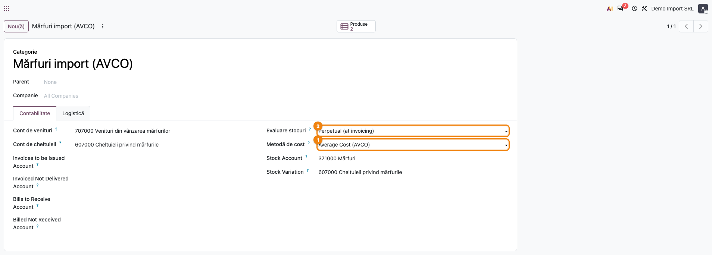

### Pasul 2 — Comanda de achiziție către furnizorul extern

**Achiziții → Comenzi → Comenzi de achiziție** — creați comanda către furnizorul non-UE și
confirmați-o. Marfa nu e încă vămuită; comanda stabilește doar ce se cumpără și la ce preț.

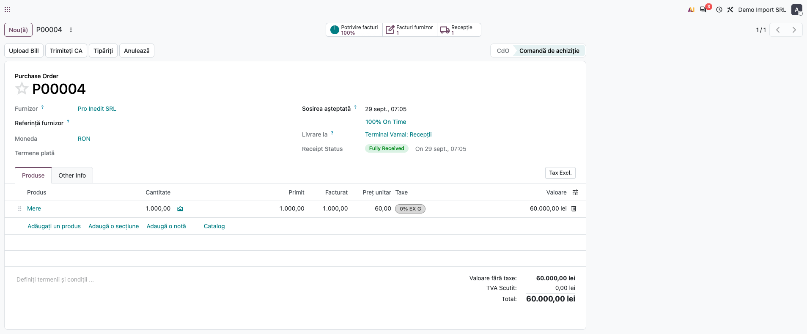

### Pasul 3 — Recepția mărfii

Din comandă, deschideți recepția cu butonul inteligent **Recepție** și validați-o. La acest moment
stocul e valorizat **la prețul furnizorului**, fără taxe vamale.

Recepția este obligatorie: costul de aterizare are nevoie de un strat de valorizare de intrare pe care
să se atașeze. Un flux de tip dropship, care sare peste recepție, **nu** este compatibil cu DVI-ul.

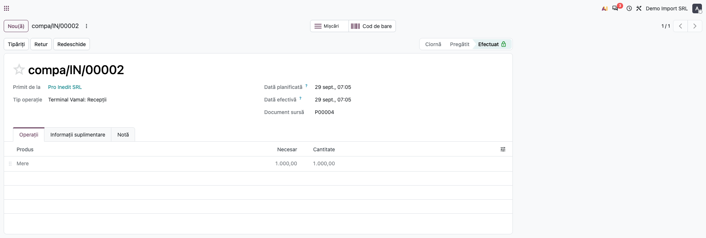

### Pasul 4 — Factura furnizorului extern și butonul DVI

**Contabilitate → Furnizori → Facturi** — înregistrați factura din comanda de achiziție și
**confirmați-o**. Pe factura postată apare butonul **DVI**, lângă *Resetare la ciornă*.

Butonul e vizibil doar pe facturi furnizor în stare **Postat**.

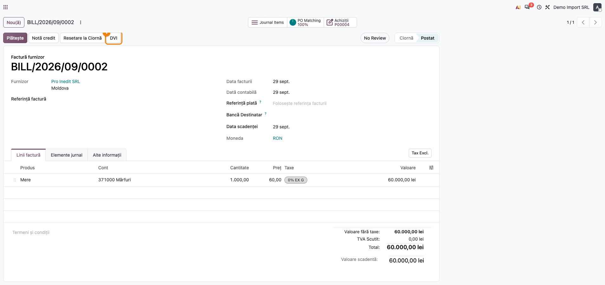

### Pasul 5 — Completarea wizardului DVI

Butonul deschide wizardul. În capul lui se află o casetă de îndrumare cu maparea declarație → câmp.
**Sumele se transcriu din declarație**, nu se recalculează din factură.

> **Declarația primită ca PDF din SNI?** Cu modulul `l10n_ro_customs_dvi_import`, wizardul are în
> plus câmpul **PDF DVI (SNI)**. Încărcați în el PDF-ul primit de la comisionar, iar câmpurile de mai
> jos se completează singure din declarație: MRN-ul, data, regimul vamal, A00, baza și valoarea B00,
> sau garanția la regimul 4200. Modulul verifică întâi că declarația e a companiei, că nu e deja
> înregistrată, că articolele au aceeași cotă de TVA și că sumele de pe articole dau totalurile,
> apoi atașează PDF-ul pe DVI. Rămâne la
> operator alegerea taxei: TVA plătit în vamă sau amânat (Pasul 10). Fluxul, cu capturi, e în fișa
> modulului `l10n_ro_customs_dvi_import`. Transcrierea manuală de mai jos rămâne pentru declarațiile
> primite fără PDF-ul SNI.

| Câmp | Ce se pune | Unde e în DVI |
|---|---|---|
| **Bază de impozitare** | baza pe care vama a calculat TVA-ul | baza poziției **B00** |
| **Valoare TVA la import** | TVA-ul efectiv datorat | valoarea poziției **B00** |
| **TVA la import** | cota aplicată de vamă — **și regimul**: taxă normală la plata efectivă, taxă cu două repartiții (4426 / 4427, ex. „21% IMP AM”) fără plata în vamă (§2.7) | din declarație |
| **Taxă vamală** | taxa vamală datorată | poziția **A00** |
| **Număr DVI** | MRN-ul | antetul declarației |
| **Data DVI** | data acceptării declarației | antetul declarației |

**Găsiți pe ecran:** câmpul *Bază de impozitare* vine precompletat cu **netul facturii furnizorului**.

**Verificați, înainte de a confirma:** baza propusă coincide cu baza poziției B00 din declarație? Dacă
declarația include transportul extern sau taxa vamală, **nu coincide** — vezi §2.1. Cota propusă este
cea din declarație? Valoarea TVA corespunde cotei aplicate bazei corectate?

**Treceți mai departe:** abia după corectarea câmpurilor, apăsați **Aplică**.

> Valoarea TVA **nu se recalculează** automat când modificați baza sau cota. Dacă schimbați baza,
> schimbați și valoarea — altfel nota se postează cu suma veche, fără nicio eroare.

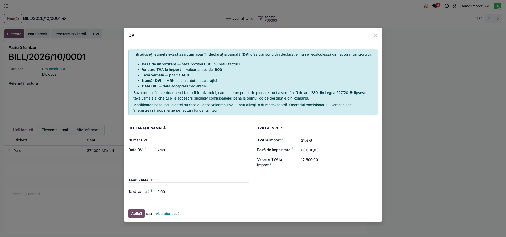

### Pasul 6 — Validarea costului de aterizare

Aplicarea creează un cost adițional legat de recepțiile comenzii, cu o linie pentru taxa vamală,
plus câmpurile DVI în capul formularului. Câmpul **Factură furnizor** este factura de pe care ați
pornit wizardul, iar pe factură apare butonul **Costuri adiționale**, care deschide DVI-ul. Apăsați
**Calculează**, verificați repartizarea pe produse, apoi **Validează**.

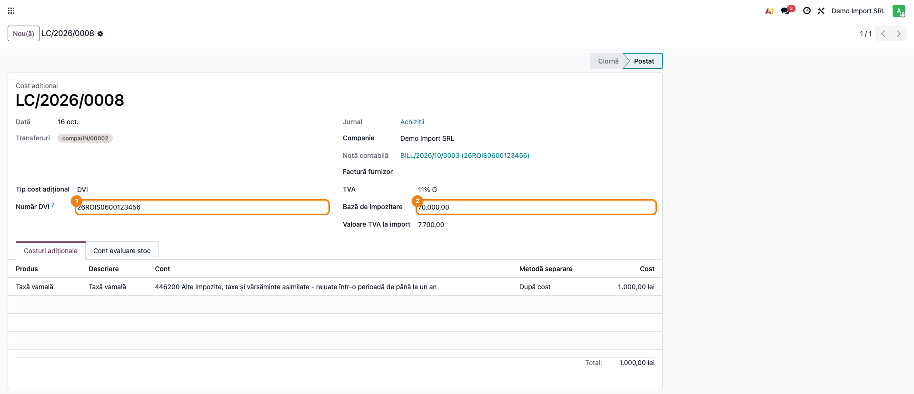

### Pasul 7 — Verificarea notei contabile

Din costul de aterizare validat deschideți nota contabilă. **Referința notei este numărul de DVI**, nu
secvența internă — astfel plata către vamă din extrasul bancar se poate reconcilia pe contul 446, per
declarație.

**Partenerul notei este furnizorul extern** de pe factura legată de DVI, completat automat la
validare, doar pe antet (§2.6). Jurnalul de TVA pentru cumpărări îl preia de acolo: importul apare
**o singură dată**, pe nota DVI, cu numele furnizorului, achizițiile pe cotă și rândul D300 (24 sau
25). Factura furnizorului extern, cu taxa „0% EX G”, nu apare în jurnal, pentru că baza și TVA-ul
importului se înscriu din declarația vamală (art. 299 alin. (1) lit. c) și d) Cod fiscal). Notele
DVI validate înainte de versiunea 19.0.2.1.10 primesc furnizorul la actualizarea modulului, cu
excepția celor din perioadele blocate.

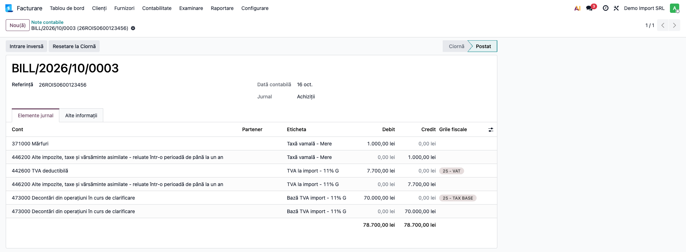

Pe fișa produsului, costul unitar a crescut cu taxa vamală raportată la cantitate.

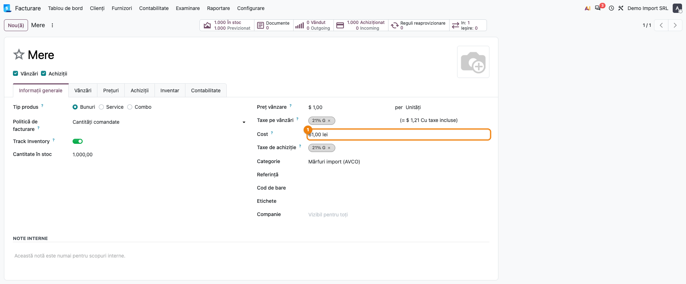

### Pasul 8 — Onorariul comisionarului vamal (broker)

> **Nu există un „comision vamal" datorat autorității.** Comisionul vamal de 0,5% a dispărut odată
> cu aderarea la UE; nu apare în Codul fiscal, în norme, în OMFP 1802/2014 și nici printre drepturile
> de import din Codul Vamal al Uniunii. Wizardul a avut până la versiunea 19.0.2.0.0 un câmp
> „Comision vamal”, moștenit din 2008, care în practică era folosit greșit tocmai pentru onorariul
> brokerului — cu contul greșit (446, datorie la buget, în loc de 401) și fără TVA-ul lui. Câmpul a
> fost eliminat; onorariul se operează exclusiv așa cum se arată mai jos.

**Nu se operează prin wizardul DVI.** Brokerul este furnizor obișnuit, cu CUI, factură cu TVA și sold
pe 401.

1. Creați un produs de tip **serviciu** cu bifa **Este un cost adițional** (fila Achiziții). Contul de
   cheltuială al produsului este **473** dacă onorariul se capitalizează — el e doar tranzit, se
   soldează la validarea costului adițional — respectiv **622** „Cheltuieli privind comisioanele și
   onorariile” dacă nu se capitalizează. **Nu 628**: acela e contul rezidual al grupei 62, iar 622
   acoperă explicit comisioanele de intermediere și onorariile.
2. Înregistrați factura brokerului pe acest produs, cu TVA-ul lui. Linia se marchează automat ca linie
   de cost de aterizare.
3. **Capitalizarea este regula, nu o opțiune.** OMFP 1802/2014, pct. 8 subpct. 6: „în costul de
   achiziție se includ, de asemenea, **comisioanele**, taxele notariale, cheltuielile cu obținerea de
   autorizații și alte cheltuieli nerecuperabile, atribuibile direct bunurilor respective”. Pentru un
   onorariu atribuibil unei declarații identificabile, apăsați **Creați costuri adiționale** pe
   factură, selectați recepția și validați.

   **Excepția** — onorariu nesemnificativ (pragul de semnificație, pct. 8 subpct. 14) sau nealocabil
   direct, de exemplu un abonament lunar care acoperă zeci de declarații — se justifică în politica
   contabilă. Atunci nu apăsați butonul, iar factura rămâne cheltuială pe 622.

> ⚠️ **Onorariul poate fi scutit de TVA.** Art. 294 alin. (1) lit. d) acoperă *prestările de servicii*,
> nu doar transportul, iar art. 289 alin. (2) enumeră expres **comisioanele** printre cheltuielile
> accesorii care intră în bază. Dacă onorariul a fost efectiv inclus în baza B00, factura brokerului
> trebuie emisă **fără TVA**, la fel ca transportul.

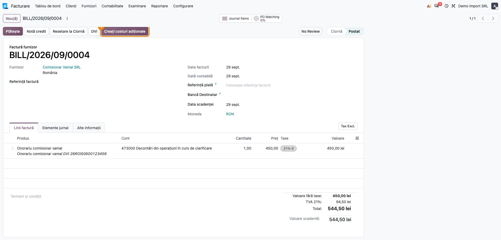

### Pasul 9 — Urmărirea declarațiilor

**Contabilitate → Contabilitate → DVI — Costuri vamale** deschide lista filtrată doar pe costurile de
aterizare de tip DVI, grupate pe dată. Numărul declarației este coloană în listă și câmp de căutare.

**Găsiți pe ecran:** fiecare rând este o declarație vamală, cu numărul MRN și suma repartizată.

**Verificați:** toate declarațiile lunii apar în listă; fiecare are număr de DVI completat; totalul
corespunde cu suma taxelor vamale din evidența vamală a lunii.

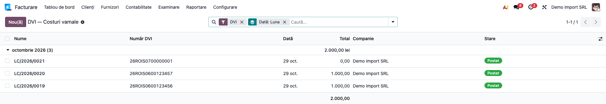

### Pasul 10 — DVI fără plata TVA în vamă (TVA amânat)

Pentru firmele cu **certificat de amânare de la plată** sau în celelalte cazuri din art. 326 alin. (4)
(§2.7). Pașii 1–6 sunt identici; diferă **doar taxa aleasă în wizard**.

1. În wizardul DVI (Pasul 5), la **TVA la import** alegeți **„21% IMP AM"** sau **„11% IMP AM"**, după
   cota din declarație — nu taxa obișnuită de achiziție. Baza și valoarea TVA se transcriu din
   declarație, exact ca la Pasul 5.
2. Apăsați **Aplică**, apoi pe costul adițional **Calculează** și **Validează** (Pasul 6).

**Găsiți pe ecran:** pe costul adițional validat, în capul formularului, câmpul **TVA** are taxa
„IMP AM", iar **Valoare TVA la import** are valoarea din declarație. Etichetele sunt neutre în ambele
regimuri; regimul se recunoaște după numele taxei.

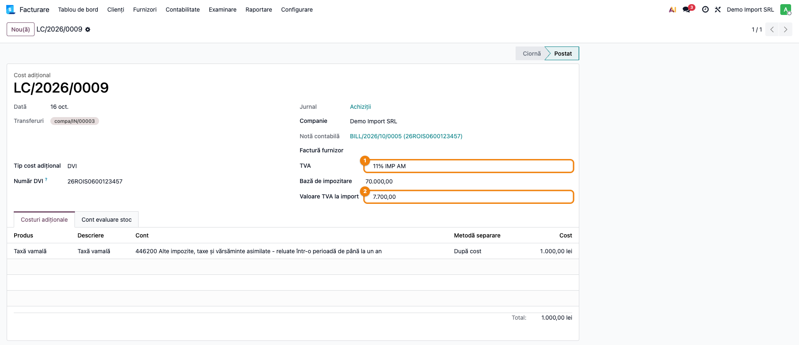

Deschideți nota contabilă cu un clic pe câmpul **Notă contabilă** din capul formularului.

**Găsiți pe ecran:** liniile de TVA sunt **Dr 4426** și **Cr 4427**, de aceeași valoare, cu eticheta
„TVA la import - 21% IMP AM" (sau „11% IMP AM"). Perechea tehnică pe **473** poartă baza
importului.

**Verificați:**

- **nu există nicio linie de TVA pe 446** — dacă apare, s-a ales taxa obișnuită, iar nota creează o
  datorie la buget care nu există;
- taxa vamală (A00) apare în continuare pe 446: ea se plătește normal;
- referința notei este numărul de DVI.

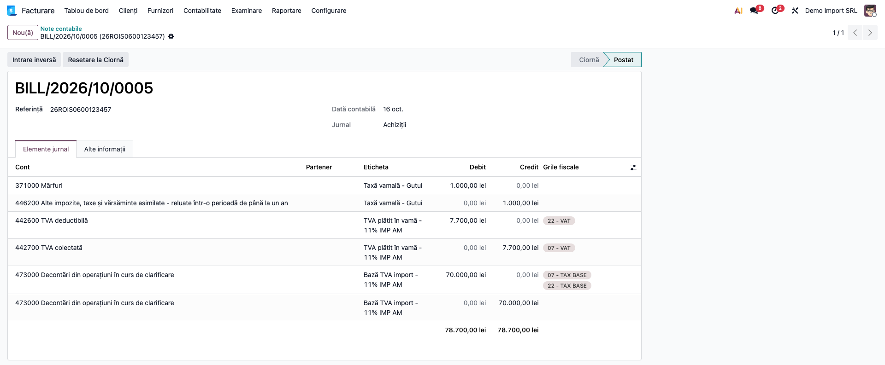

**Treceți mai departe:** pentru TVA nu urmează nicio plată și nicio reconciliere pe 446. În decontul
perioadei, TVA-ul apare **atât la colectată, cât și la deductibilă** (D300 rd. 7 și 22), cu efect net
zero.

### Pasul 11 — DVI pe regimul 4200 (import scutit, livrare intracomunitară)

Pentru marfa importată și livrată direct unui client din alt stat membru (§2.10). Pașii 1–4 sunt
identici.

**Înainte de vămuire: factura intracomunitară.** La regimul 4200, vama cere factura de livrare
intracomunitară către clientul din UE **la vămuire**; proforma și contractul nu sunt acceptate.
Ordinea este deci:

1. factura către client (Pasul 12);
2. vămuirea și DVI-ul;
3. recepția și costul adițional DVI.

Factura poate avea data DVI-ului sau o zi înainte.

După vămuire, la DVI:

1. În wizardul DVI (Pasul 5), la **Regim vamal** alegeți **„4200 - Scutit de TVA, livrare
   intracomunitară"**. Wizardul schimbă taxa în **„0% EXEMPT"** și ascunde valoarea TVA; apare o casetă
   de avertizare.
2. La **Bază de impozitare** transcrieți baza din declarație, ca la Pasul 5.
3. La **TVA reținut ca garanție** transcrieți TVA-ul calculat de vamă și blocat din contul de garanție
   (de exemplu 6.861,00 lei). Valoarea propusă e doar punctul de plecare: verificați-o pe declarație.
4. **Taxa vamală** se completează doar dacă declarația o cere. La mărfurile cu preferință tarifară
   (de exemplu UE–Republica Moldova) rămâne 0.
5. Apăsați **Aplică**, apoi pe costul adițional **Validează** (Pasul 6). Fără taxă vamală, costul
   adițional nu are linii și costul produsului nu se schimbă; nota DVI se creează și se postează
   totuși, pentru bază.

**Găsiți pe ecran:** pe costul adițional validat, **Regim vamal** este 4200, **TVA** este „0% EXEMPT",
**TVA reținut ca garanție** are suma blocată, iar **Stare garanție** este **Blocată**.

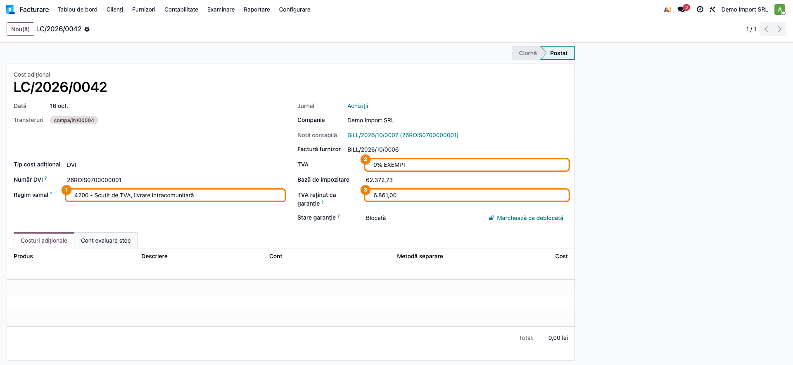

Deschideți nota contabilă cu un clic pe câmpul **Notă contabilă**.

**Găsiți pe ecran:** două linii pe **473**, de valoarea bazei, cu eticheta „Bază TVA import - 0%
EXEMPT". Linia de debit poartă grila **„29 - TAX BASE"**.

**Verificați:**

- **nu există nicio linie pe 4426 sau 446** pentru TVA — garanția nu e TVA datorat;
- referința notei este numărul de DVI;
- nota este **postată** (altfel baza nu ajunge în decont).

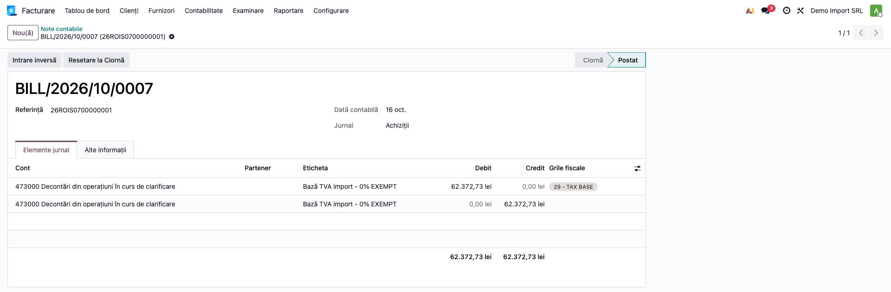

**Deblocarea garanției.** După ce clientul confirmă CMR-ul, depuneți la biroul vamal cererea de
deblocare, cu CMR-ul și factura de livrare intracomunitară. Când vama confirmă deblocarea, apăsați pe
DVI butonul **Marchează ca deblocată**. Filtrul **Garanție TVA blocată** din lista **DVI — Costuri
vamale** arată declarațiile pentru care cererea de deblocare e încă de făcut; coloanele opționale
**TVA reținut ca garanție** și **Stare garanție** dau totalul blocat.

**Treceți mai departe:** livrarea către client se validează după validarea tuturor costurilor
adiționale ale recepției (Pasul 12).

### Pasul 12 — Vânzarea intracomunitară pe regimul 4200

1. Pe produs, setați **Politică de facturare = Cantități comandate**, ca factura să se poată emite
   înainte de livrare. Setarea e pe produs, deci se aplică tuturor companiilor din bază.
2. Pe client, setați poziția fiscală **intracomunitară**, care trece vânzarea pe taxa **„0% EU G"**
   (D300 rd. 1, D390 cod L, D406 310301). Verificați codul de TVA al clientului în **VIES** la import
   și din nou la livrare.
3. Confirmați comanda de vânzare și emiteți factura **înainte de vămuire** (Pasul 11).
4. Validați livrarea către client **după** ce sunt validate toate costurile adiționale ale recepției
   (DVI, transport, broker). Astfel descărcarea din gestiune și marja au costul complet.
5. Diferențele de cantitate față de factură se corectează prin notă de credit sau factură
   suplimentară, tot cu „0% EU G".

### Note de monografie și raportare

La validarea costului de aterizare:

| Cont | Denumire | Debit | Credit |
|---|---|---|---|
| 371 / 301 | valoare stoc | taxa vamală | |
| 446 | taxe vamale datorate bugetului | | taxa vamală |
| 4426 | TVA deductibilă la import | TVA B00 | |
| 446 | TVA de plată în vamă | | TVA B00 |
| 473 | pereche tehnică pentru baza din decont | baza B00 | baza B00 |

Perechea pe 473 se soldează; doar linia de debit poartă baza în decont și taxa (pentru SAF-T).

Fără plata TVA în vamă (Pasul 10), liniile de TVA devin:

```
Dr 4426 = Cr 4427        TVA B00, fără 446 pentru TVA
Dr 473  = Cr 473         baza B00 (pereche tehnică)
```

La plata către vamă: **Dr 446 = Cr 5121**, exclusiv în lei, fără diferențe de curs. După plată, contul
446 rămâne cu sold zero pentru declarația respectivă.

La descărcarea gestiunii: **Dr 607 = Cr 371**, la costul îmbogățit.

Pentru transportul extern facturat separat, alegeți **una** dintre variante, niciodată amândouă:

```
Varianta de referință, direct pe stoc:
    Dr 371 = Cr 401

Varianta prin cost adițional, când marfa e deja recepționată:
    Dr 473 = Cr 401     la factura transportatorului
    Dr 371 = Cr 473     la validarea costului adițional
```

> **Nu folosiți 628 ca tranzit.** Funcțiunea contului din OMFP 1802/2014 nu prevede creditarea lui
> prin 371, iar mișcarea în oglindă lasă rulaj debitor și creditor artificial pe un cont de clasa 6 —
> vizibil în balanță și raportat în SAF-T, care raportează mișcările, nu soldurile. Contul 473 este
> neutru, se soldează, iar un sold rămas la sfârșit de lună arată exact ce accesoriu a fost facturat
> dar necapitalizat.

Pe regimul 4200 (Pasul 11), nota DVI are doar perechea tehnică pentru bază:

```
Dr 473 = Cr 473          baza B00, grila rd. 29 (achiziții scutite), fără TVA
```

**Garanția din contul de garanție la vamă (§2.10)** — note manuale, în jurnalul de operațiuni
diverse; modulul ține doar evidența sumei blocate pe DVI. Notele presupun o garanție depusă **în
numerar**. Pentru o scrisoare de garanție bancară nu se face notă pe 2678; evidența în afara
bilanțului se stabilește cu contabilul.

| Moment | Notă |
|---|---|
| Constituirea garanției la vamă | Dr 2678 = Cr 5121 |
| Blocarea TVA-ului pe un import 4200 | fără notă — **TVA reținut ca garanție** pe DVI, stare **Blocată** |
| Deblocarea după CMR-ul confirmat | fără notă — garanția rămâne la vamă; pe DVI, **Marchează ca deblocată** |
| Restituirea garanției | Dr 5121 = Cr 2678 |
| Executarea garanției (scutirea cade, vama reține TVA-ul) | Dr 4426 = Cr 2678, cu grila TVA a taxei de import (rd. 25 la 11%), pe baza documentului emis de vamă. **Mutați și baza** de pe rd. 29 pe rândul importului taxabil: pereche Dr 473 = Cr 473 cu grila „29 - TAX BASE" negativă, plus pereche 473 cu grila bazei rândului de import. Altfel D300 raportează baza de două ori |

> ⚠️ La executarea garanției, grila din D300 și eventualele accesorii (Dr 6581 = Cr 2678 sau Cr 4481)
> se confirmă cu contabilul.

**Restituirea TVA-ului plătit în vamă (§2.9)** — note manuale, în jurnalul de operațiuni diverse.
Decontul de TVA se calculează **doar din grilele fiscale** ale liniilor: o notă pe 4426 fără grilă
schimbă soldul contului, dar nu și D300. De aceea, liniile de TVA din notele de mai jos poartă grila
indicată (coloana **Grile fiscale** a liniei).

| Moment | Notă | Grila pe linia de TVA |
|---|---|---|
| La depunerea cererii, nota DVI e deja înregistrată (TVA-ul e în D300 rd. 24 / 25) | Dr 4482 = Cr 4426 | **33 - TVA** (regularizări taxă dedusă), cu semn negativ |
| DVI-ul nu e încă înregistrat în Odoo | nu se face regularizare: DVI-ul se înregistrează cu suma corectă, iar excedentul plătit trece din 446 în 4482 (Dr 4482 = Cr 446) | — |
| Certificat de amânare valabil la data DVI, dar vama a încasat TVA-ul | Dr 4482 = Cr 4426 (anularea deducerii TVA-ului plătit), apoi evidențierea ca la Pasul 10: pereche Dr 473 = Cr 473 de valoarea bazei, cu taxa „IMP AM" pe linia de debit — Odoo generează Dr 4426 = Cr 4427 | 33 - TVA negativ; apoi rd. 7 și 22 din taxa „IMP AM" |
| Restituire prin compensare cu alte obligații | Dr 446 / 4423 / … = Cr 4482 | — |
| Refuz: TVA-ul era datorat și e deductibil (ex. certificat obținut după DVI) | Dr 4426 = Cr 4482 | **33 - TVA**, cu semn pozitiv |
| Refuz: suma nu era datorată și nu e deductibilă | Dr 635 = Cr 4482 | — (rămâne cost) |
| Încasarea | Dr 5121 = Cr 4482 | — |

> ⚠️ Rândul de regularizare (rd. 33) și perioada în care se evidențiază TVA-ul în cazul cu certificat
> de amânare se confirmă cu contabilul, pe instrucțiunile D300 în vigoare.

Puneți numărul de DVI ca referință pe aceste note, ca să poată fi urmărite per declarație.

**Raportare:**

- **D300** — TVA-ul de la import intră prin grilele taxei: rd. 24 / 25 la plata în vamă, rd. 7 și 22
  fără plata în vamă (Pasul 10). Baza vine de pe linia de debit a perechii 473.
- **D406 (SAF-T)** — informația de taxă (*TaxInformation*: tip, cod, sumă) apare pe **linia de bază**
  a perechii 473, ca la facturi, unde taxa stă pe linia de produs; linia 4426 apare cu codul
  000000, tot ca la facturi. La „IMP AM" se raportează partea
  deductibilă (4426). Versiunile modulului anterioare 19.0.2.1.4 exportau nota cu cod 000000 și
  TVA zero. Pe regimul 4200, linia de bază poartă taxa „0% EXEMPT" (cod 308302). Exportul SAF-T din
  Odoo nu scrie însă *TaxInformation* pentru liniile cu taxă 0% — nici pe facturile obișnuite cu
  „0% EXEMPT" —, deci linia apare fără informație de taxă.
- **D300, regimul 4200** — baza pe rd. 29 (achiziții scutite), fără TVA; livrarea către clientul din
  UE pe rd. 1.
- **D390** — importul nu generează rând (declarația recapitulativă acoperă doar operațiuni
  intracomunitare). Pe regimul 4200, livrarea intracomunitară ulterioară apare cu cod L.

## 7. Legături cu alte module / declarații

| Modul / proces | Rol în flux | Tip legătură |
|---|---|---|
| `stock_landed_costs` | mecanismul de repartizare a costurilor în valoarea stocului | dependență (manifest) |
| `purchase_stock` | legătura comandă de achiziție ↔ recepție | dependență (manifest) |
| `stock_account` | valorizarea stocului (AVCO/FIFO) | dependență (manifest) |
| `l10n_ro` | planul de conturi RO, pentru determinarea contului 446 | dependență (manifest) |
| `l10n_ro_invoice_dvi_protect` | blochează resetarea facturii și anularea DVI după consum FIFO | complementar, recomandat |
| `l10n_ro_customs_dvi_import` | completează wizardul DVI din PDF-ul declarației tipărit de SNI (Pasul 5) | complementar, opțional |
| `l10n_ro_dvi` (OCA) | flux DVI alternativ | **exclus** — nu pot coexista |
| `l10n_ro_anaf_d300` | TVA deductibilă la import, prin tag-urile taxei; taxele „21% IMP AM" / „11% IMP AM" pentru importul fără plata TVA în vamă | integrare prin convenție |
| `l10n_ro_saft` (Enterprise) | D406: tipul și codul SAF-T ale taxei alese pe DVI | integrare prin convenție |
| `l10n_ro_account_vat_journal` | jurnalul de TVA pentru cumpărări: importul apare o dată, pe nota DVI, cu furnizorul din antetul ei; liniile „0% EX G” ale facturii externe nu intră în jurnal | integrare prin convenție |
| `l10n_ro_anaf_d394` | nota DVI are partener străin, deci nu intră în D394 (importurile nu se raportează pe partener) | integrare prin convenție |

**Ce este automat:** crearea costului de aterizare din factură, repartizarea taxelor în costul
stocului, nota de TVA la import cu tag-urile pentru D300, referința MRN și furnizorul extern pe notă.

**Ce rămâne manual:** transcrierea cifrelor din declarație (baza, valoarea TVA, cota, garanția la
4200) și alegerea regimului vamal, dacă nu e instalat `l10n_ro_customs_dvi_import`; apoi alegerea
regimului de plată (prin taxă), notele garanției pe 2678 și cererea de deblocare, plata către vamă și reconcilierea ei pe 446, decizia de capitalizare a
onorariului brokerului, includerea transportului extern, cererea de restituire a TVA-ului plătit în
vamă și notele ei contabile.

## 8. Verificări pentru consultant

- [ ] Categoria produsului are **Evaluarea stocurilor = Perpetuă (la facturare)** și cost AVCO/FIFO.
- [ ] Furnizorul extern are **țara** completată (altfel butonul DVI dă eroare).
- [ ] Butonul **DVI** apare pe factura furnizor **postată**, nu în ciornă.
- [ ] Baza introdusă în wizard **coincide cu baza poziției B00** din declarație, nu cu netul facturii.
- [ ] Dacă baza a fost modificată, **valoarea TVA a fost actualizată** manual în același wizard.
- [ ] Cota de TVA corespunde celei din declarație (atenție la cota redusă pentru alimente).
- [ ] **Regimul de plată e cel corect**: taxă normală dacă TVA-ul se achită în vamă, taxă cu
      două repartiții (ex. „21% IMP AM”) dacă nu se face plata efectivă în vamă (§2.7).
- [ ] După validare, **costul unitar al produsului a crescut** cu taxa vamală / cantitate.
- [ ] TVA-ul de import apare pe **4426**, nu în costul mărfii.
- [ ] Nota contabilă are ca **referință numărul de DVI**, nu secvența internă.
- [ ] Nota contabilă are ca **partener furnizorul extern** de pe factură, iar liniile ei de TVA și de
      pe 446 sunt fără partener.
- [ ] În jurnalul de TVA pentru cumpărări, importul apare **o singură dată**, pe nota DVI, cu numele
      furnizorului; factura cu „0% EX G” nu apare.
- [ ] Taxa vamală este creditată pe **4462**, analiticul de scadență scurtă.
- [ ] Onorariul brokerului **nu** a fost introdus în wizard, ci pe factura lui de furnizor.
- [ ] Transportul extern apare **o singură dată** în costul stocului.
- [ ] Contul 446 se închide la zero pentru declarația respectivă după plata către vamă.
- [ ] La importul fără plata TVA în vamă: nota are **Dr 4426 = Cr 4427** și **nicio linie de TVA pe
      446**; taxa vamală apare totuși pe 446 (Pasul 10).
- [ ] În D300, TVA-ul fără plată în vamă apare pe **rd. 7 și 22**, cu aceeași valoare.
- [ ] Taxa aleasă pe DVI are completate **tipul și codul SAF-T**; altfel exportul D406 se oprește
      cu eroare.
- [ ] Înainte de o cerere de restituire: motivul are temei (§2.9) și s-a stabilit dacă suma fusese
      dedusă.
- [ ] La regimul **4200**: taxa e „0% EXEMPT", TVA-ul la import e gol, nota are doar perechea 473 cu
      grila rd. 29, iar suma blocată de vamă e trecută la **TVA reținut ca garanție** (Pasul 11).
- [ ] La 4200, garanțiile cu stare **Blocată** se urmăresc lunar, cu filtrul **Garanție TVA blocată**.
- [ ] La 4200, factura intracomunitară există **înainte** de DVI și e din aceeași lună cu el.
- [ ] La 4200, livrarea către client e validată după toate costurile adiționale ale recepției.
- [ ] Declarația apare în lista **DVI — Costuri vamale**.

## 9. Mesaje de eroare frecvente

| Mesaj / simptom | Cauză probabilă | Remediere |
|---|---|---|
| „The partner has no country set." / „Partenerul nu are țara setată." | Furnizorul extern nu are țara completată | Completați țara pe fișa partenerului și reluați |
| Butonul **DVI** nu apare pe factură | Factura e în ciornă sau nu e factură furnizor | Confirmați factura; butonul apare doar pe `in_invoice` postată |
| DVI-ul se validează, dar **nu apare nicio notă contabilă** | Categoria produsului e pe **Periodic (la închidere)** | Setați **Perpetuă (la facturare)** pe categorie și reluați |
| Costul produsului nu crește după validare | Costul de aterizare nu a fost **Validat**, doar salvat | Apăsați **Calculează**, apoi **Validează** |
| Wizardul nu găsește nicio recepție | Fluxul a fost dropship, fără recepție | Refaceți fluxul cu recepție; dropship-ul e incompatibil cu DVI |
| TVA-ul din notă nu corespunde bazei | Baza a fost modificată fără actualizarea valorii TVA | Corectați prin cost de aterizare de corecție; valoarea nu se recalculează automat |
| „În regimul vamal 4200 importul este scutit de TVA: alegeți o taxă scutită (0%)…" | Pe un DVI 4200 s-a completat TVA-ul la import sau s-a ales o taxă cu cotă | Lăsați **Valoare TVA la import** goală, alegeți „0% EXEMPT" și treceți TVA-ul blocat la **TVA reținut ca garanție** |
| Modulul nu se poate instala | `l10n_ro_dvi` (OCA) este instalat | Cele două se exclud reciproc; dezinstalați varianta OCA |
| Nota DVI fără plata TVA are o linie de TVA pe **446** | S-a ales taxa obișnuită de achiziție, nu „IMP AM" | Costul adițional validat **nu se poate anula**. Corectați doar TVA-ul, printr-o notă manuală: Dr 446 = Cr 4426, cu grila rd. 24 / 25 (cea a taxei folosite) cu semn negativ, apoi perechea 473 cu taxa „IMP AM" (ca în tabelul restituirii). Cereți confirmarea consultantului înainte de postare |
| Exportul D406: „Unele taxe nu au completate câmpurile „Tip taxă SAF-T România” și/sau „Cod taxă SAF-T România”." | Taxa de pe DVI (de exemplu „IMP AM") nu are tipul și codul SAF-T | **Contabilitate → Configurare → Taxe**, deschideți taxa și completați **Tipul fiscal SAF-T românesc** (300 – TVA) și **Cod Fiscal SAF-T Roman**. Pentru „IMP AM", codul din nomenclatorul D406 **e de confirmat** — maparea nu e încă livrată nici de Odoo, nici de `l10n_ro_saft_fix` |

## 10. Capturi de ecran

Capturile din `readme/screenshots/` sunt **generate automat** din `tests/test_screenshots.py`
(mixinul `ScreenshotCase` din `l10n_ro_doc_screenshots`, import defensiv), în **limba română**, pe
planul de conturi RO:

1. `01_config_categorie.png` — categoria de produse cu evaluare perpetuă și cost mediu (AVCO).
2. `02_po_import.png` — comanda de achiziție către furnizorul extern.
3. `03_receptie_terminal.png` — recepția validată a mărfii importate.
4. `04_factura_furnizor_buton_dvi.png` — factura furnizor postată, cu butonul DVI.
5. `05_wizard_dvi.png` — wizardul DVI la deschidere, cu caseta de îndrumare; baza propusă este
   netul facturii (60.000), nu baza din declarație (70.000).
6. `06_landed_cost_dvi.png` — costul de aterizare generat, cu numărul declarației.
7. `07_nota_contabila_tva.png` — nota contabilă cu MRN-ul ca referință.
8. `08_cost_produs.png` — costul produsului majorat cu taxele vamale.
9. `09_factura_broker.png` — factura brokerului cu butonul de creare a costului de aterizare.
10. `10_lista_dvi.png` — lista DVI — Costuri vamale, grupată pe lună.
11. `11_landed_cost_tva_amanat.png` — costul adițional DVI cu taxa „11% IMP AM" (fără plata TVA în
    vamă).
12. `12_nota_tva_amanat.png` — nota DVI fără plata TVA: Dr 4426 = Cr 4427, fără 446 pentru TVA.
13. `13_landed_cost_4200.png` — costul adițional DVI pe regimul 4200, cu taxa „0% EXEMPT" și garanția
    blocată.
14. `14_nota_4200.png` — nota DVI pe 4200: doar perechea 473, cu baza pe rd. 29.

Regenerare:

```bash
./odoo/odoo-bin -c odoo.conf -d <db> -i l10n_ro_customs_dvi,l10n_ro_doc_screenshots \
    --test-tags=fise_screenshots --stop-after-init
```

## 11. Observații pentru manual

Păstrați în manual, cu prioritate, distincția dintre cele trei mărimi — valoarea facturii, valoarea
statistică și baza de impozitare (§2.1 și §2.2). Este singura confuzie care produce erori care nu se
văd: sistemul acceptă orice cifră, nota se postează, iar diferența apare abia în decont.

A doua idee de păstrat: **biroul vamal nu e furnizor**. Soldul se urmărește pe contul 446, prin
reconciliere per declarație, cu MRN-ul ca referință. Brokerul, în schimb, este furnizor obișnuit și se
operează prin factura lui.

A treia: valoarea TVA nu se recalculează la modificarea bazei sau a cotei. Merită o casetă de
atenționare în manual, nu doar o propoziție în text.

A patra: **taxa aleasă pe DVI decide regimul** — plata în vamă sau TVA amânat (§2.7, Pasul 10). O taxă
greșită produce o datorie la buget care nu există, sau invers.

A cincea: restituirea TVA-ului plătit în vamă (§2.9) e o procedură vamală, cu temei doar în câteva
situații. Păstrați tabelul cu situațiile și avertismentul că formularul și termenul se confirmă cu
biroul vamal.

## Anexa A — Model de cerere de restituire a TVA-ului plătit în vamă

Model Terrabit, de adaptat la cerințele biroului vamal (§2.9). Câmpurile din paranteze drepte se
completează din DVI, din nota contabilă și din plata către vamă.

```text
Către: Biroul vamal [denumire, cod birou] / Direcția Regională Vamală [denumire]

CERERE DE RAMBURSARE A TAXEI PE VALOAREA ADĂUGATĂ PLĂTITE LA IMPORT

Subscrisa [denumire importator], cu sediul în [adresă], CUI [cod], EORI [cod],
reprezentată prin [nume, funcție] [/ prin comisionarul vamal [denumire], conform
împuternicirii anexate],

solicităm rambursarea sumei de [suma] lei, reprezentând taxa pe valoarea adăugată
plătită la import pentru declarația vamală:

  - număr DVI (MRN):            [MRN]
  - data acceptării:            [data]
  - baza de impozitare declarată / TVA plătit:   [bază] / [TVA plătit] lei
  - baza de impozitare corectă / TVA datorat:    [bază corectă] / [TVA datorat] lei
  - plata:                      OP nr. [număr] din [data], suma [suma] lei

Motivul cererii: [alegeți unul]
  [ ] suma plătită depășește suma legal datorată (bază / cotă greșită);
  [ ] declarația vamală a fost invalidată;
  [ ] la data declarației, societatea deținea certificatul de amânare de la plată
      a TVA în vamă nr. [număr] din [data] (art. 326 alin. (4) Cod fiscal);
  [ ] alt motiv: [descriere].

Temei legal: art. 326 alin. (3) din Legea 227/2015 privind Codul fiscal și dispozițiile
Codului Vamal al Uniunii privind rambursarea [articolul indicat de biroul vamal].

Declarăm că suma solicitată:
  [ ] nu a fost dedusă în decontul de TVA;
  [ ] a fost dedusă în decontul perioadei [luna/anul] și a fost regularizată
      în decontul perioadei [luna/anul].

Vă rugăm ca suma să fie [virată în contul IBAN [cont], deschis la [bancă], titular
[denumire]] / [compensată cu obligațiile: [descriere]].

Anexăm:
  1. declarația vamală de import [MRN];
  2. dovada plății (OP nr. [număr] din [data]);
  3. [decizia de modificare / invalidare a declarației, dacă există];
  4. [certificatul de amânare de la plată, dacă este cazul];
  5. [factura comercială, documentul de transport, calculul valorii în vamă — la bază greșită];
  6. [împuternicirea comisionarului vamal, dacă cererea e depusă de acesta];
  7. extras din jurnalul de cumpărări și decontul de TVA al perioadei declarației.

Data: [data]                                   [Nume, funcție, semnătura]
```
