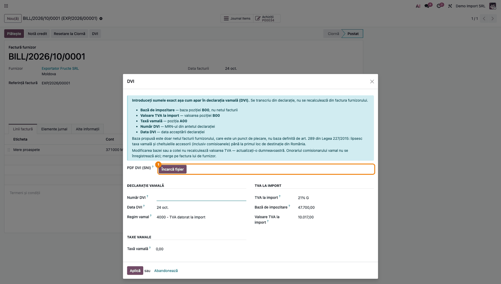
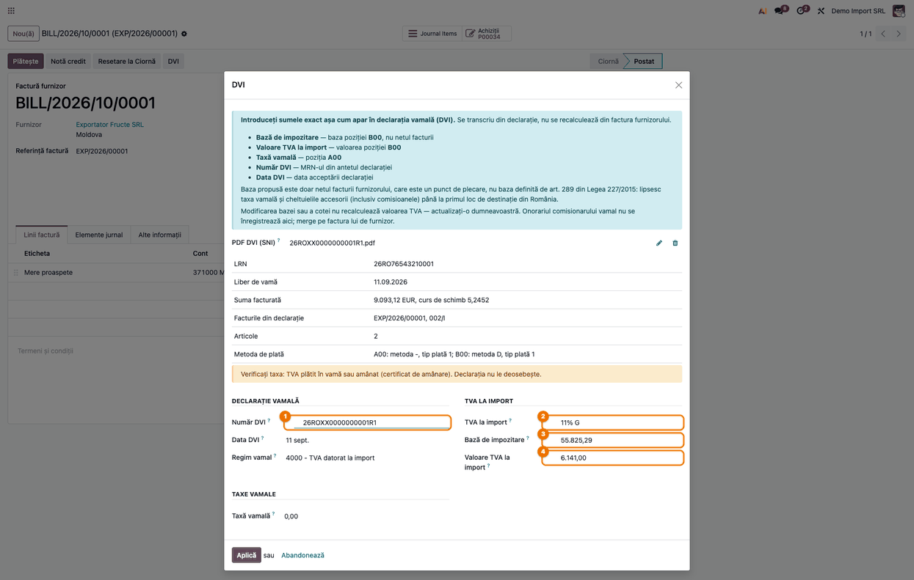
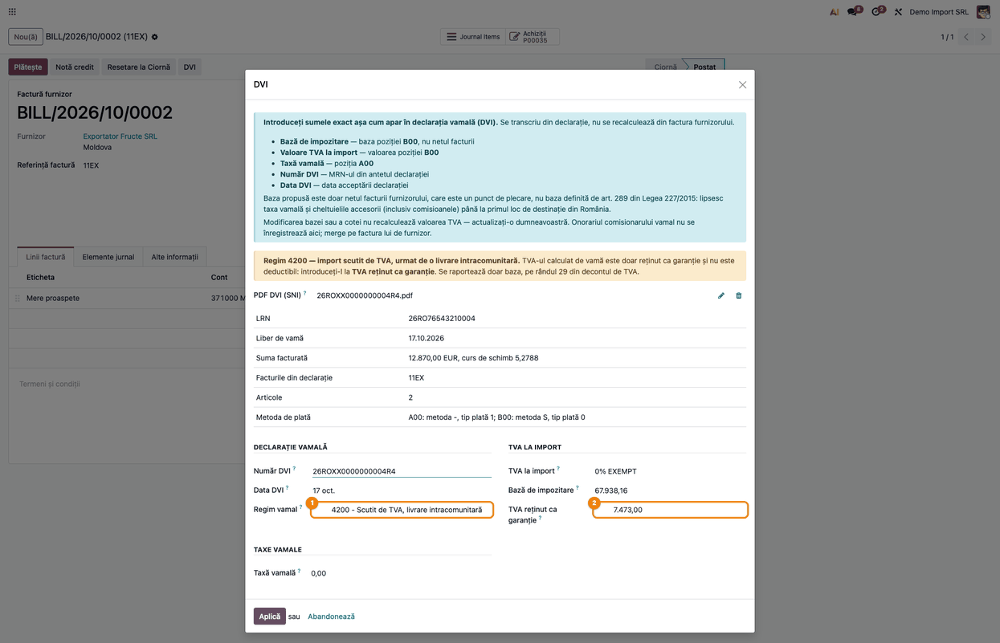
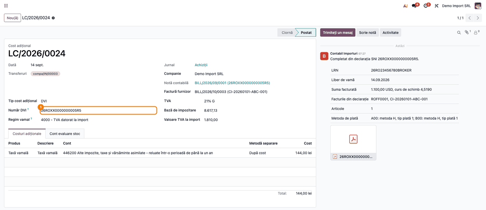
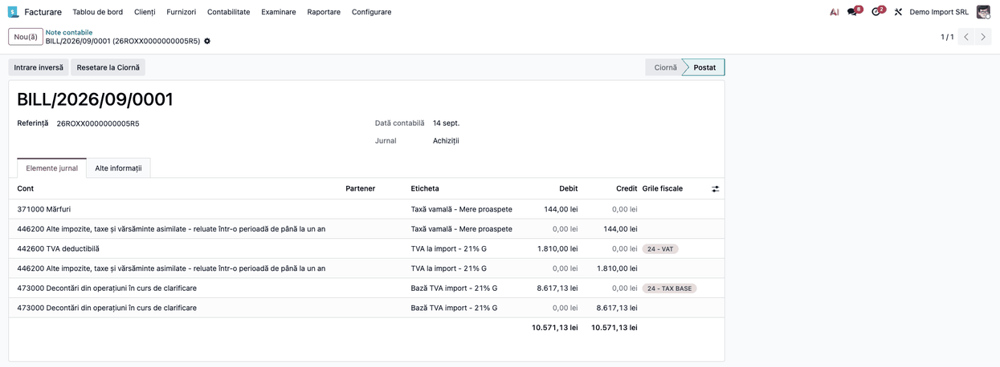
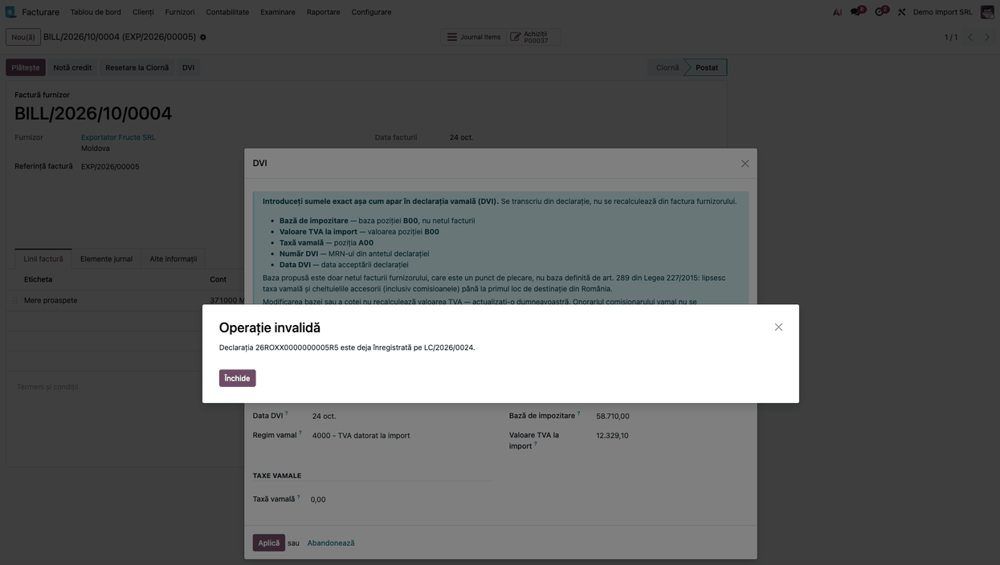

# Fișă Modul: Importul DVI din PDF-ul SNI

**Modul:** `l10n_ro_customs_dvi_import`
**Utilizator principal:** Contabil importuri
**Prioritate:** 🟡 Medie (scutește transcrierea manuală a declarației; fluxul contabil rămâne cel din `l10n_ro_customs_dvi`)

> Fișa completează fișa modulului `l10n_ro_customs_dvi` („Declarația Vamală de Import (DVI) ca cost de
> aterizare”), care descrie fluxul complet, baza legală și notele contabile. Aici e descris doar ce se
> schimbă la **Pasul 5 — Completarea wizardului DVI**: valorile se citesc din PDF-ul declarației, nu se
> mai transcriu de mână.

---

## 1. Scop business

Declarația vamală de import vine de la comisionar ca PDF tipărit de **Sistemul Național de Import
(SNI)**, în producție din 1 august 2025. Până acum, contabilul copia din PDF în wizardul DVI MRN-ul,
data, regimul vamal, taxa vamală A00 și baza și valoarea B00. Erorile de transcriere trec nevăzute:
nota se postează cu cifra greșită, fără nicio eroare. Modulul citește aceste valori direct din PDF,
verifică declarația înainte de a completa ceva și atașează PDF-ul pe DVI, ca document justificativ.

## 2. Bază legală și context

- **Codul Vamal al Uniunii** (Regulamentul (UE) nr. 952/2013): fiecare câmp al declarației are un
  cod de element de date, de forma `[13 04]` (importatorul) sau `[14 03]` (taxele). SNI tipărește
  aceste coduri lângă etichete, deci formatul e același la toți comisionarii.
- **Ordinul AVR nr. 2.478/2025** (Monitorul Oficial nr. 781 din 21 august 2025) aprobă normele
  tehnice de utilizare a SNI, modificate prin Ordinul nr. 516/2026.
- Baza de impozitare la import (art. 289 din Legea 227/2015), cotele, regimurile de plată a TVA și
  regimul 4200 sunt descrise în fișa `l10n_ro_customs_dvi`, §2. Modulul de față nu schimbă nimic din
  ele. Valorile se **transcriu** din declarație, nu se recalculează: el doar face transcrierea în
  locul operatorului.
- Pozițiile folosite din declarație:

  | Poziție | Ce este | Unde ajunge în Odoo |
  |---|---|---|
  | **MRN** și data lui | numărul și data acceptării declarației | *Număr DVI*, *Data DVI* |
  | **Regim unificat** | 4000 = punere în liberă circulație; 4200 = import scutit, urmat de livrare intracomunitară | *Regim vamal* |
  | **A00** | taxa vamală | *Taxă vamală* (suma tuturor articolelor) |
  | **B00** — cuantumul | baza TVA calculată de vamă | *Bază de impozitare* (suma articolelor) |
  | **B00** — de plătit | TVA-ul la import | *Valoare TVA la import* (4000) sau *TVA reținut ca garanție* (4200) |
  | **B00** — cota | cota TVA (0,11 / 0,21) | taxa de achiziție propusă |
  | **N380** | facturile comerciale din documentele justificative | verificare față de referința facturii |

## 3. Utilizatori și roluri

- **Contabil importuri** — încarcă PDF-ul declarației pe factura furnizorului, verifică valorile și
  aplică wizardul.
- **Contabil șef** — urmărește avertismentele (taxa, factura care nu apare în declarație) și decide
  regimul de plată a TVA.
- **Consultant implementare** — verifică instalarea bibliotecii `pdfminer.six` și reproduce fluxul.

Roluri recomandate pentru testare: aceleași ca la `l10n_ro_customs_dvi` (Contabilitate + Inventar).

## 4. Conturi și date implicate

Conturile sunt cele din fișa `l10n_ro_customs_dvi`, §4: `4426`, `4462`, `4427` (TVA amânat), `473`
(perechea pentru baza din decont), `371` / `301`.

Date minime pentru demo:

- companie românească cu planul de conturi RO și **codul fiscal completat**: modulul refuză o
  declarație al cărei importator are alt cod fiscal;
- o factură de furnizor extern, **postată**, legată de o comandă de achiziție cu recepție validată;
- **referința furnizorului** de pe factură egală cu numărul facturii din declarație (documentul N380),
  altfel wizardul afișează un avertisment;
- PDF-ul declarației, așa cum îl tipărește SNI (cu MRN-ul în antet și semnătura „Liber de vamă”).

## 5. Configurare inițială

1. Instalați biblioteca Python `pdfminer.six` pe server. Pe odoo.sh se instalează din
   `requirements.txt` al repo-ului. Pe un server propriu cu pachete Ubuntu 22.04, citiți întâi nota
   de instalare din README: actualizarea bibliotecii `cryptography` poate opri Odoo.
2. Instalați `l10n_ro_customs_dvi_import`. Modulul instalează și `l10n_ro_customs_dvi`, dacă nu e deja
   instalat.
3. Faceți configurarea din fișa `l10n_ro_customs_dvi`, §5 (categoria de produse, contul 4462, contul
   473, taxele „IMP AM” pentru TVA amânat).
4. **Setări → Companii**: verificați că firma are codul fiscal completat, cu sau fără prefixul `RO`.
   Fără cod fiscal pe companie, verificarea importatorului nu se face.
5. Pe o bază cu mai multe companii, verificați la produsul **Taxă vamală** (creat automat la primul
   DVI cu taxă vamală) că, pe compania curentă, contul de cheltuieli este **4462**. Produsul e unic pe
   bază, iar contul se setează doar pe compania care l-a creat. Pe altă companie, TVA-ul și taxa
   vamală s-ar credita pe contul categoriei, nu pe 4462.

## 6. Flux de utilizare

> Pașii 1–4 din fișa `l10n_ro_customs_dvi` (categoria, comanda de achiziție, recepția, factura
> postată cu butonul **DVI**) rămân la fel. Fluxul de mai jos pornește de pe factura furnizorului
> postată. Datele din capturi sunt ale unor declarații reale, anonimizate.
>
> Capturile sunt luate pe o bază unde aplicația apare ca **Facturare**; pe o instalare cu
> contabilitatea completă se numește **Contabilitate**, cu aceleași meniuri.

### Pasul 1 — Deschiderea wizardului și încărcarea PDF-ului

**Contabilitate → Furnizori → Facturi** — deschideți factura furnizorului extern, postată, și apăsați
**DVI**. Wizardul are acum, deasupra câmpurilor, câmpul **PDF DVI (SNI)**. Încărcați în el PDF-ul
declarației primit de la comisionar.



### Pasul 2 — Verificarea valorilor citite (regim 4000)

La încărcare, wizardul se completează singur: **Număr DVI** (MRN-ul), **Data DVI** (data acceptării),
**Regim vamal**, **Taxă vamală** (A00), **Bază de impozitare** și **Valoare TVA la import** (B00) și
taxa de achiziție cu cota din declarație.

**Găsiți pe ecran** caseta **Citit din declarație**, sub câmpul cu PDF-ul. Ea arată LRN-ul, data
liberului de vamă, suma facturată cu moneda și cursul de schimb, facturile din declarație, numărul de
articole și metoda de plată pe fiecare poziție (A00, B00). Avertismentele apar dedesubt, pe galben.

**Verificați, înainte de a aplica** (numerele corespund bulinelor din captură):

- ① *Număr DVI* este MRN-ul din antetul PDF-ului, iar *Data DVI* data de lângă el;
- ② **taxa**: declarația nu arată dacă TVA-ul s-a plătit în vamă sau e amânat (certificat de
  amânare). Wizardul propune taxa standard de achiziție cu cota din declarație („11% G” / „21% G”).
  La TVA amânat, alegeți taxa „IMP AM” (fișa `l10n_ro_customs_dvi`, Pasul 10). Avertismentul
  „Verificați taxa” apare la fiecare import pe regimul 4000, tocmai pentru această decizie. Nu
  decideți după codul metodei de plată: semnificația lui nu e legată de regim în modul;
- ③ *Bază de impozitare* e suma bazelor B00 de pe toate articolele, nu netul facturii;
- ④ *Valoare TVA la import* e totalul B00 din antetul declarației. În declarațiile văzute, vama
  dă TVA-ul pe fiecare articol în lei întregi, deci o diferență sub 1 leu pe articol față de
  bază × cotă e normală: nu o corectați (regula exactă de rotunjire e de confirmat cu vama);
- factura furnizorului apare în rândul *Facturile din declarație*. Dacă nu apare, wizardul o spune
  într-un avertisment: verificați că ați încărcat declarația potrivită.

**Treceți mai departe:** abia după aceste verificări, apăsați **Aplică**.



### Pasul 3 — Regimul 4200: garanția în locul TVA-ului

Pe o declarație cu **regimul 4200**, B00 nu e TVA datorat, ci TVA reținut de vamă ca garanție. La
încărcare, wizardul pune ① **Regim vamal = 4200**, trece totalul B00 la ② **TVA reținut ca
garanție** și propune taxa scutită „0% EXEMPT”. Câmpul *Valoare TVA la import* dispare. Metoda de
plată a poziției B00 este, în declarațiile văzute, **S** cu tipul de plată **0**; nu decideți
regimul după acest cod.

**Verificați:** *TVA reținut ca garanție* este totalul B00 din antetul declarației, iar taxa este
„0% EXEMPT”. Pe regimul 4200 nu apare avertismentul despre taxă.



### Pasul 4 — DVI-ul creat, cu declarația atașată

**Aplică** creează DVI-ul (costul de aterizare) ca în fluxul manual. Pe o declarație cu taxă
vamală, tab-ul **Costuri adiționale** are linia **Taxă vamală**, cu suma A00, pe contul 4462. În
plus, PDF-ul declarației e atașat pe DVI, iar în istoric apare mesajul „Completat din declarația
SNI …”, cu valorile citite. Apăsați **Calculează**, apoi **Validează**, ca în fișa
`l10n_ro_customs_dvi`, Pasul 6. Captura arată declarația cu taxă vamală și TVA 21%.



### Pasul 5 — Nota contabilă

Nota DVI e aceeași ca la fluxul manual: referința este MRN-ul, iar sumele sunt cele citite din
declarație. Nota primește numărul din jurnalul **Achiziții** (BILL/…), ca în fluxul manual.

**Verificați pe notă:**

- `371 = 4462` cu taxa vamală A00 (144,00 în captură), care mărește costul stocului;
- `4426 = 4462` cu TVA-ul B00 (1.810,00), cu grila „24 - VAT” (21%) sau „25 - VAT” (11%);
- perechea `473 = 473` cu baza B00 (8.617,13), cu grila „24 - TAX BASE” pe debit („25 - TAX
  BASE” la 11%).



### Pasul 6 — Declarația deja înregistrată

Dacă încărcați a doua oară aceeași declarație, pe altă factură, wizardul refuză cu
mesajul „Declarația … este deja înregistrată pe …”. Nu se completează nimic. Verificarea se face
după MRN, pe DVI-urile neanulate ale companiei. Pe aceeași factură nu se ajunge aici: după primul
DVI, butonul **DVI** deschide DVI-ul existent, nu wizardul.



### Note de monografie și raportare

Modulul nu creează note proprii: completează wizardul, iar nota o face `l10n_ro_customs_dvi`. Am
verificat pe cele cinci declarații reale de la care pornește modulul:

| Situație | Notă |
|---|---|
| Regim 4000, TVA plătit în vamă, fără taxă vamală | `473 = 473` cu baza B00 (rd. 25 la 11%, rd. 24 la 21% din D300); `4426 = 4462` cu TVA-ul B00 |
| Regim 4000, cu taxă vamală A00 | în plus, `371` (sau `301`, după categoria produsului) `= 4462` cu taxa vamală, care intră în costul stocului |
| Regim 4000, TVA amânat (taxa „IMP AM” aleasă de operator) | `4426 = 4427` în locul lui `4426 = 4462` — fișa `l10n_ro_customs_dvi`, Pasul 10 |
| Regim 4200 | perechea `473 = 473` cu baza, pe rd. 29 din D300; dacă declarația are A00, în plus `371 = 4462` cu taxa vamală. Garanția nu intră în nota DVI: notele ei pe 2678 sunt manuale (fișa `l10n_ro_customs_dvi`) |

## 7. Legături cu alte module / declarații

| Modul / declarație | Rol |
|---|---|
| `l10n_ro_customs_dvi` | wizardul DVI, costul de aterizare, notele contabile, regimurile 4000 / 4200 |
| `l10n_ro_anaf_d300` | taxele „IMP AM” pentru TVA-ul amânat |
| D300 | baza și TVA-ul importului, din nota DVI: rd. 24 (21%), 25 (11%), 29 (regim 4200), sau rd. 7 și 22 la TVA amânat (taxa „IMP AM”) |
| SNI (Autoritatea Vamală Română) | sursa PDF-ului; modulul nu se conectează la SNI |

**Ce e automat:** citirea MRN-ului, a datei, a regimului, a sumelor A00 și B00 și a cotei; propunerea
taxei; verificările de la §9; atașarea PDF-ului și rezumatul din istoric.

**Ce rămâne manual:**

- alegerea între TVA plătit în vamă și TVA amânat;
- legătura cu factura: wizardul se deschide tot de pe factura furnizorului și doar avertizează dacă
  factura nu apare în declarație;
- onorariul comisionarului (fișa `l10n_ro_customs_dvi`, Pasul 8);
- declarațiile primite doar ca scanare: modulul citește numai PDF-ul tipărit de SNI, cu text.

## 8. Verificări pentru consultant

- [ ] După încărcarea PDF-ului, *Număr DVI* este MRN-ul din antetul declarației, iar *Data DVI* este
      data de lângă MRN.
- [ ] *Bază de impozitare* este suma bazelor B00 de pe articole; pe o declarație cu taxă vamală,
      e mai mare decât valoarea în vamă cel puțin cu valoarea taxei (plus accizele și cheltuielile
      până la primul loc de destinație, dacă există).
- [ ] *Valoare TVA la import* este totalul B00 din antet (regim 4000).
- [ ] Pe regimul 4200, *TVA reținut ca garanție* este totalul B00, câmpul *Valoare TVA la
      import* nu apare, iar taxa propusă e „0% EXEMPT”.
- [ ] Caseta *Citit din declarație* arată factura furnizorului printre facturile din declarație.
- [ ] Taxa propusă e cea standard de achiziție („11% G” / „21% G”), nu o variantă nedeductibilă.
- [ ] Taxa aleasă corespunde regimului real de plată (plătit în vamă sau amânat).
- [ ] O declarație cu articole la cote de TVA diferite e refuzată.
- [ ] După **Aplică**, DVI-ul are PDF-ul atașat și mesajul „Completat din declarația SNI” în istoric.
- [ ] A doua încărcare a aceleiași declarații e refuzată.
- [ ] O declarație a altei firme e refuzată.

## 9. Mesaje de eroare frecvente

Erorile de citire apar precedate de „DVI-ul nu poate fi importat: …”.

| Mesaj | Cauză | Remediere |
|---|---|---|
| Documentul nu este o declarație vamală de import (DVI) tipărită de SNI. | alt PDF (factura, CMR-ul) sau o scanare fără text | încărcați PDF-ul declarației primit de la comisionar, tipărit din SNI |
| Fișierul nu poate fi citit ca PDF | fișierul nu e PDF sau e deteriorat | cereți din nou PDF-ul de la comisionar |
| Importatorul din declarație (…) nu este compania curentă (…). | declarația e a altei firme, sau codul fiscal al companiei e greșit | verificați compania activă și codul fiscal din **Setări → Companii** |
| Declarația … este deja înregistrată pe … | MRN-ul există deja pe un DVI neanulat | deschideți DVI-ul existent. Dacă e în ciornă și e greșit, **ștergeți-l** (nu îl anulați: un DVI anulat rămâne legat de factură, iar butonul DVI îl redeschide), apoi reîncărcați PDF-ul din factură. Dacă e validat, nu se mai poate anula: corecția se face prin notă manuală, ca în fișa `l10n_ro_customs_dvi`, §9, cu confirmarea consultantului |
| Nu s-a găsit MRN-ul declarației. | PDF incomplet sau un format SNI nou | completați manual wizardul și trimiteți PDF-ul la suport |
| Articolele declarației au cote de TVA diferite (…) | un DVI are o singură taxă; cu două cote, tot TVA-ul ar ajunge pe rândul D300 al uneia | înregistrați manual câte un DVI pe cotă, cu același MRN și cu baza și TVA-ul articolelor de la acea cotă (vezi procedura de mai jos) |
| Declarația are N articole, dar din document s-au citit M. | PDF incomplet sau un format SNI nou | completați manual wizardul și trimiteți PDF-ul la suport |
| Sumele B00 de pe articole (…) nu dau totalul declarației (…). | idem: o linie de taxă nu s-a putut citi | idem |
| Articolele au regimuri vamale diferite (…). | declarație cu articole pe 4000 și pe 4200 | înregistrați manual, câte un DVI pe regim |
| Pentru citirea declarației este necesară biblioteca Python pdfminer.six. | biblioteca nu e instalată pe server | instalați-o (§5, punctul 1) |

**Declarație cu cote de TVA diferite — procedura manuală.** Butonul **DVI** de pe factură deschide
wizardul o singură dată: după primul DVI, el deschide DVI-ul existent. De aceea:

1. Primul DVI se face din factură, cu butonul **DVI**, completat manual pentru prima cotă: baza și
   TVA-ul articolelor de la acea cotă, taxa cu acea cotă, MRN-ul și data declarației.
2. Al doilea DVI se face din **Contabilitate → Contabilitate → DVI — Costuri vamale → Nou**, cu
   *Tip cost adițional* = DVI, același MRN, recepția comenzii la *Transferuri*, *Factură furnizor* =
   aceeași factură, *Jurnal* = Achiziții (ca la primul DVI), baza, TVA-ul și taxa celei de-a doua
   cote. Fără factură, nota intră fără furnizor în jurnalul de TVA. Butonul **DVI** al facturii
   rămâne legat doar de primul DVI.
3. **Taxa vamală A00** se trece o singură dată, pe unul dintre cele două DVI-uri, ca linie de cost
   adițional cu produsul **Taxă vamală**, metoda „După cost”. Totalul A00 al celor două DVI-uri trebuie să fie egal cu cel din declarație; altfel
   costul stocului și nota `371 = 4462` se dublează.

Avertismente, care nu opresc importul:

| Avertisment | Ce faceți |
|---|---|
| Verificați taxa: TVA plătit în vamă sau amânat … | alegeți taxa „IMP AM” dacă TVA-ul e amânat |
| Referința furnizorului de pe factură (…) nu se află printre facturile din declarație. | verificați că declarația și factura sunt ale aceluiași import |
| Regimul vamal … nu este tratat: verificați declarația. | regimul trece pe „Altul”, iar taxa e propusă după cotă: verificați în fișa `l10n_ro_customs_dvi` cum se tratează regimul respectiv înainte de a aplica |
| Nu s-a găsit nicio taxă de achiziție cu cota … | alegeți taxa manual sau creați-o |

## 10. Capturi de ecran

Capturile din `static/description/` sunt **generate automat** din `tests/test_screenshots.py`
(mixinul `ScreenshotCase` din `l10n_ro_doc_screenshots`, import defensiv), în română, pe planul de
conturi RO. Declarațiile sunt cele anonimizate din `tests/data/`, aceleași ca în testele modulului.

| Fișier | Ce arată |
|---|---|
| `01_wizard_incarcare_pdf.png` | wizardul DVI deschis de pe factură, cu câmpul **PDF DVI (SNI)** |
| `02_wizard_completat_din_pdf.png` | wizardul completat dintr-o declarație pe regimul 4000, cu caseta *Citit din declarație* și avertismentul despre taxă |
| `03_wizard_4200_garantie.png` | wizardul completat dintr-o declarație pe regimul 4200, cu garanția |
| `04_dvi_pdf_atasat.png` | DVI-ul creat, cu PDF-ul atașat și rezumatul în istoric |
| `05_nota_contabila.png` | nota contabilă a DVI-ului, cu MRN-ul ca referință |
| `06_eroare_declaratie_inregistrata.png` | mesajul la reîncărcarea unei declarații |

Regenerare:

```bash
./odoo/odoo-bin -c odoo.conf -d <db> -i l10n_ro_customs_dvi_import,l10n_ro_doc_screenshots \
    --test-tags=fise_screenshots --stop-after-init
```

## 11. Observații pentru manual

- Capitolul DVI din manual descrie Pasul 5 al fluxului manual; acolo trebuie adăugată varianta cu
  PDF-ul, ca primă opțiune, iar transcrierea manuală rămâne pentru declarațiile primite fără PDF SNI.
- Decizia „plătit în vamă sau amânat” rămâne la operator; manualul trebuie să o spună explicit,
  pentru că avertismentul apare la fiecare import pe 4000 și riscă să fie ignorat.
- Metoda de plată din declarație (H, D, S) se afișează doar pentru control. Semnificația codurilor nu
  e încă legată de regimul de plată în modul.
