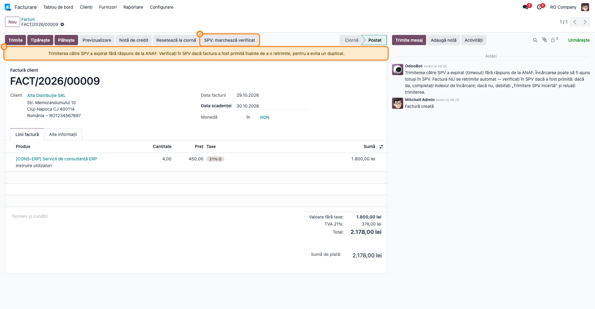

# Fișă Modul: e-Factura automatizată — trimitere în SPV, status, email și protecție anti-duplicat

**Modul:** `l10n_ro_efactura_enhancement`
**Utilizator principal:** Contabil facturare / operator vânzări (emite facturile), contabil-șef
(urmărește raportul zilnic SPV), administrator funcțional (setări, parametri, cron-uri)
**Prioritate:** 🔴 Ridicată (transmiterea în RO e-Factura este obligatorie; o factură netrimisă sau
trimisă de două ori la ANAF are consecințe fiscale)

---

## 1. Scop business

Modulul completează e-Factura standard din Odoo 18 (`l10n_ro_edi`) cu ce îi lipsește pentru un
volum zilnic real de facturi:

- **trimiterea automată în SPV** a facturilor confirmate, în loturi, cu **maximum 3 încercări**
  pentru o factură care eșuează și un **raport pe email** către contabilitate după fiecare rulare;
- **citirea automată a stării** din SPV (validată / respinsă) pentru facturile trimise;
- **emailul către client trimis o singură dată, după validarea în SPV** — nu la încărcare și nu la
  fiecare reîncercare a unei facturi respinse;
- acțiunea **„Trimite in SPV"** din lista de facturi, care trimite doar în SPV, fără email;
- **protecție anti-duplicat**: o factură deja încărcată nu se mai trimite a doua oară, iar la un
  timeout de la ANAF factura este marcată **„Trimitere SPV incertă"** și scoasă din trimiterea
  automată până la verificarea manuală;
- **validări și corecții ale XML-ului CIUS-RO**: adresă completă obligatorie pentru partenerii din
  România (la confirmare), trunchierea referinței comenzii (BT-13) și a numărului comenzii de
  vânzare (BT-14) la 200 de caractere, tipul de factură 751 pentru facturile din POS. Peste
  corecțiile pe care Odoo standard le face deja (13 zerouri pentru persoane fizice fără CUI,
  nume/descriere/notă scurtate).

Scopul este ca facturile să ajungă în SPV fără intervenție zilnică, iar contabilul să se ocupe doar
de excepții: facturi respinse, reîncercări epuizate, trimiteri incerte.

## 2. Bază legală și context

- **Sistemul național RO e-Factura** — transmiterea facturilor emise în SPV este obligatorie
  (OUG nr. 120/2021, cu modificările ulterioare; pentru B2B din 2024, pentru B2C din 1 ianuarie
  2025). Termenul legal de transmitere este de **5 zile lucrătoare** de la emiterea facturii; de
  aceea modulul trimite automat, la fiecare rulare, facturile din zilele anterioare.
- **Formatul CIUS-RO** (specificația națională peste standardul european EN 16931) impune limite
  de lungime pe unele câmpuri. ANAF respinge, de exemplu, o referință de comandă (BT-13) mai lungă
  de 200 de caractere cu eroarea **BR-RO-L200**; modulul trunchiază aceste câmpuri la generarea
  XML-ului.
- **Persoane fizice (B2C)** — când clientul persoană fizică nu are cod de identificare fiscală,
  practica ANAF pentru e-Factura este completarea identificatorului cu `0000000000000`
  (13 zerouri); Odoo standard (`l10n_ro_edi`) face acest lucru automat.
- **Facturi emise din comenzi POS** — modulul trece automat tipul facturii din 380 (factură
  comercială) în **751** (cod din lista CIUS-RO, „factură — informații în scopuri contabile")
  pentru orice factură legată de o comandă POS. Este un comportament fix al modulului (nu se
  poate dezactiva); validați cu contabilul clientului că acest tratament se potrivește fluxului lui de
  bonuri fiscale.
- **Clienți din afara României** — modulul exclude din SPV facturile după **țara clientului**, nu
  după locul livrării. O operațiune cu loc al livrării în România către un client cu adresă
  externă trebuie tratată manual.
- **Duplicatele la ANAF** — interfața de încărcare a ANAF nu deduplică: fiecare trimitere creează un
  nou index de încărcare, chiar dacă numărul facturii e același. Protecția din modul există pentru
  că o factură trimisă de două ori apare de două ori la client în SPV.

Modulul **nu** schimbă regulile fiscale ale facturii (cote TVA, conturi); lucrează doar pe
transmiterea electronică și pe conținutul XML-ului.

## 3. Utilizatori și roluri

| Rol | Ce face cu modulul |
|---|---|
| Operator facturare / vânzări | confirmă facturile; corectează adresa partenerului când confirmarea e blocată; trimite manual în SPV din listă la nevoie |
| Contabil-șef | primește raportul zilnic al trimiterilor; tratează facturile eșuate, cu reîncercări epuizate sau cu trimitere incertă |
| Administrator funcțional | configurează setările „eFactura SPV", parametrii de sistem `efactura.*` și orarul cron-urilor |

Roluri recomandate la testare: un utilizator **Facturare** (Facturare / Contabil) pentru emitere și
un **Administrator** (Setări) pentru configurare. Cron-urile rulează ca administrator, iar
trimiterea automată apare în istoricul facturii ca făcută de **OdooBot**.

## 4. Conturi și date implicate

Modulul nu generează și nu modifică note contabile. Factura de vânzare rămâne cea standard
(`4111` = `707` / `704` + `4427`); modulul acționează doar după confirmarea ei, la transmiterea în SPV.

Date minime pentru demo:

- compania **„RO Company"** cu planul de conturi românesc, CUI și **conexiunea SPV configurată**
  (token ANAF obținut din setările e-Factura ale companiei — fără token, cron-urile ignoră compania);
- un client **persoană juridică din România** cu adresă completă (țară, județ, oraș, stradă) și CUI;
- un client **persoană fizică** din România fără CUI (pentru codul `0000000000000` în XML);
- un client **din România fără stradă** (pentru blocajul la confirmare);
- un client **din afara României** (pentru a verifica excluderea din SPV);
- câteva **facturi de vânzare confirmate**, cu data contabilă din zilele anterioare.

## 5. Configurare inițială

1. Instalați modulul `l10n_ro_efactura_enhancement` (aduce `l10n_ro_edi` și `l10n_ro_config`).
2. Configurați conexiunea SPV a companiei din e-Factura standard (certificat digital, token ANAF).
   Este condiția ca o companie să fie luată în calcul de cron-uri.
3. În **Facturare → Configurare → Setări** (cu Contabilitatea Enterprise instalată:
   **Contabilitate → Configurare → Setări**), blocul **„eFactura SPV"**:
   - completați **„Email raport cron SPV"** cu adresele care primesc raportul (separate prin
     virgulă). Gol = raportul nu se trimite deloc;
   - bifați **„Trimite în SPV fără email (cron)"** doar dacă nu doriți ca facturile validate să fie
     trimise automat clientului pe email.
4. (Opțional) Ajustați parametrii de sistem `efactura.*` (vezi Pasul 2).
5. Verificați în **Setări → Tehnic → Automatizare → Acțiuni planificate** că cele trei cron-uri
   „E-Factura: ..." sunt active și au orarul dorit.
6. Pe fiecare client din România verificați **țara, județul, orașul și strada** — fără ele factura
   nu se poate confirma — și codul fiscal: **cu** prefixul „RO" pentru plătitorii de TVA, **fără**
   pentru neplătitori. XML-ul îl preia exact cum este pe partener.

## 6. Flux de utilizare

### Pasul 1 — Setările „eFactura SPV"

Accesați **Facturare → Configurare → Setări** (sau **Contabilitate → Configurare → Setări**) și
derulați la blocul **„eFactura SPV"**, aflat după secțiunea de facturare și înaintea blocului
standard „E-Factura Română" (conexiunea SPV). Aici sunt cele două opțiuni ale companiei curente:

- **Trimite în SPV fără email (cron)** — dacă e bifată, cron-ul de email nu mai trimite clientului
  factura validată; facturile ajung doar în SPV;
- **Email raport cron SPV** — destinatarii raportului trimis după fiecare rulare a trimiterii
  automate.

Apăsați **Salvează**.


### Pasul 2 — Parametrii de sistem ai XML-ului

Accesați **Setări → Tehnic → Parametri → Parametri de sistem** (mod dezvoltator) și căutați
`efactura`. Modulul creează patru parametri:

| Parametru | Implicit | Efect |
|---|---|---|
| `efactura.embed_pdf` | `True` | include PDF-ul facturii în XML; `False` = XML fără PDF. Are efect **doar** la butonul **Trimite** pe **o singură** factură; cu mai multe facturi bifate, la cron și la „Trimite in SPV", PDF-ul se atașează indiferent de valoare |
| `efactura.use_line_description` | `False` | `True` = în XML, numele și descrierea articolului se iau din descrierea liniei de factură, nu din produs |
| `efactura.replace_unit_uom` | `False` | un cod de unitate care înlocuiește în XML codul generic `C62` („unitate"). Valoarea se scrie **între ghilimele**, ex. `'H87'`; scris fără ghilimele, generarea XML-ului eșuează |
| `efactura.get_all_banks` | `False` | `True` = XML-ul facturilor (nu și al notelor de credit) conține toate conturile bancare bifate pentru tipărire pe rapoarte, în moneda facturii. Necesită modulul `l10n_ro_report_common` (care adaugă bifa pe contul bancar); fără el, generarea XML-ului eșuează. Căutarea nu filtrează pe companie — în baze multi-companie bifați doar conturile companiei emitente |


### Pasul 3 — Completarea facturii și lungimea textelor

Accesați **Facturare → Clienți → Facturi** și creați factura ca de obicei. Pe liniile facturii,
din meniul de coloane opționale (iconița de la capătul antetului tabelului) puteți afișa
**„Prod. length"** și **„Desc. length"** — lungimea numelui produsului și a descrierii liniei.

- **Găsiți** — coloanele numerice de lângă produs și etichetă. „Prod. length" include și codul
  intern al produsului (ex. `[CONS-ERP] `), deci este puțin mai mare decât numele care ajunge în XML.
- **Verificați** — în XML, numele articolului se taie la **100** de caractere, iar descrierea la
  **200**. O valoare peste aceste praguri înseamnă că în SPV textul va apărea scurtat; dacă
  informația tăiată contează, mutați-o în nota facturii (care se taie la 300 de caractere) sau
  scurtați descrierea.


### Pasul 4 — Confirmarea: validarea adresei partenerului

Apăsați **Confirmă**. Pentru facturile și notele de credit de vânzare, modulul verifică întâi
clientul și adresa de livrare: **țara** este obligatorie pentru orice client, iar pentru clienții
din România și **județul, orașul și strada**. Dacă lipsește ceva, confirmarea este refuzată cu
dialogul **„Operație invalidă"** și un mesaj (în engleză) care numește câmpul lipsă și partenerul
(ex. „You can not post invoice without street for partner: Beta Construct SRL"). Completați câmpul pe fișa partenerului și confirmați din nou.


### Pasul 5 — Trimiterea manuală doar în SPV (din listă)

În **Facturare → Clienți → Facturi**, bifați facturile confirmate și alegeți din meniul
**Acțiuni** (iconița roată) **„Trimite in SPV"** (ultima opțiune; „Preia Starea E-Factura", din
același meniu, este acțiunea standard de citire a stării). Facturile sunt generate în format CIUS-RO și
încărcate în SPV **fără email** către client.

- Facturile către clienți din afara României sunt sărite (nu intră în SPV); dacă toate cele bifate
  sunt externe, apare mesajul „Facturile selectate au clienti din afara Romaniei...".
- O factură deja trimisă sau validată în SPV este ignorată fără mesaj (are deja o stare
  e-Factura). Mesajul „Trimiterea către SPV a fost evitată: factura are deja o încărcare în SPV
  (index de încărcare ...)" apare în istoric doar în cazul rar al două trimiteri aproape simultane
  (cron + operator) sau al unui index rămas fără respingere.
- Același filtru pe țară se aplică și butonului standard **Trimite**: pentru clienții externi
  opțiunea de trimitere în SPV nu mai este propusă.


**Ce conține XML-ul trimis** — extras din XML-ul CIUS-RO al unei facturi către o persoană fizică
fără CUI (baza demo): identificatorul fiscal al cumpărătorului este completat automat cu
`0000000000000` (comportament Odoo standard).

```xml
<cbc:CustomizationID>urn:cen.eu:en16931:2017#compliant#urn:efactura.mfinante.ro:CIUS-RO:1.0.1</cbc:CustomizationID>
<cbc:ID>FACT/2026/00006</cbc:ID>
...
<cac:AccountingCustomerParty>
  <cac:Party>
    <cac:PartyName><cbc:Name>Ion Popescu</cbc:Name></cac:PartyName>
    <cac:PostalAddress>
      <cbc:StreetName>Str. Eroilor 5</cbc:StreetName>
      <cbc:CityName>Florești</cbc:CityName>
      <cbc:CountrySubentity>RO-CJ</cbc:CountrySubentity>
      ...
    </cac:PostalAddress>
    <cac:PartyTaxScheme>
      <cbc:CompanyID>0000000000000</cbc:CompanyID>
      ...
    </cac:PartyTaxScheme>
    <cac:PartyLegalEntity>
      <cbc:RegistrationName>Ion Popescu</cbc:RegistrationName>
      <cbc:CompanyID>0000000000000</cbc:CompanyID>
    </cac:PartyLegalEntity>
  </cac:Party>
</cac:AccountingCustomerParty>
```

Alte corecții la generare, fără acțiune din partea operatorului: Odoo standard scurtează numele
articolului la 100 de caractere, descrierea la 200 și nota facturii la 300; modulul adaugă
scurtarea referinței comenzii (BT-13) și a numărului comenzii de vânzare (BT-14) la 200. Atenție:
pentru o persoană fizică fără CUI, modulul scrie `0000000000000` și în câmpul de nr. de
înregistrare (`company_registry`) de pe fișa partenerului, nu doar în XML. Dacă partenerul (sau
compania emitentă) are completat **Nr. Reg. Com.**, modulul îl pune în XML ca identificator de
înregistrare legală (BT-47 la cumpărător, BT-30 la vânzător), în locul codului fiscal. Modulul
golește și proprietățile suplimentare ale articolului, deci atributele variantelor de produs nu
ajung în XML.

Codul fiscal al clientului (BT-48) se ia **exact** cum este pe fișa partenerului: plătitorii de TVA
trebuie să aibă codul salvat **cu** prefixul „RO", neplătitorii **fără** (vezi Configurare, pasul 6).

### Pasul 6 — Cron-urile de trimitere, status și email

Accesați **Setări → Tehnic → Automatizare → Acțiuni planificate** (mod dezvoltator) și căutați
„E-Factura". Modulul adaugă trei cron-uri, care rulează pentru fiecare companie cu conexiune SPV
(al patrulea din listă, „E-Factura: Reîmprospătare Token de Acces", este standard):

| Cron | Orar implicit | Ce face |
|---|---|---|
| **E-Factura: Send TO SPV** | zilnic | citește întâi starea facturilor trimise, apoi trimite în SPV facturile de vânzare confirmate, către clienți din România, cu data contabilă din ultimele 30 de zile **anterioare zilei curente**, încă netrimise sau eșuate; câte 20 pe rulare (dacă sunt mai multe, se reia după 5 minute); trimite raportul pe email |
| **E-Factura: Fetch From SPV** | la 4 ore | citește din SPV starea facturilor aflate „trimise", cu data contabilă din ultimele 30 de zile anterioare zilei curente, câte 20 pe rulare; se reia după 2 minute doar dacă lotul a fost plin **și** cel puțin o factură și-a schimbat starea |
| **E-Factura: Trimite email facturi validate** | la 15 minute | trimite clientului factura pe email, o singură dată, după ce SPV a validat-o (aceeași fereastră: ultimele 30 de zile, fără ziua curentă) |

Reguli de selecție la trimiterea automată:

- o factură care a eșuat de **3 ori** nu mai este reîncercată automat (apare în raport la
  „Sărite — reîncercări epuizate");
- o factură marcată **„Trimitere SPV incertă"** nu este trimisă automat (vezi Pasul 8);
- încărcarea automată nu trimite niciodată email clientului; emailul vine doar după validare;
- dacă operatorul a trimis deja factura pe email manual (butonul **Trimite**), cron-ul de email nu
  o mai trimite a doua oară;
- dacă la setări este bifat „Trimite în SPV fără email (cron)", cron-ul de email ignoră compania.


### Pasul 7 — Raportul trimiterii automate

După fiecare rulare a cron-ului de trimitere care a avut facturi de procesat, destinatarii din
**„Email raport cron SPV"** primesc emailul **„[Companie] Raport e-Factura SPV"**. Emailul trece prin
coada normală de mailuri și poate fi văzut în **Setări → Tehnic → Email → E-mailuri** cât timp
este în coadă (stare „Ieșire"); după trimitere se șterge automat. Ora
„Data rulării" din corpul emailului este în UTC (ora serverului), nu ora României.

- **Găsiți** — tabelul cu cinci rânduri: *Validate de SPV*, *Trimise în SPV — în așteptare
  validare*, *Eșuate la această rulare*, *Reîncercări (eșuaseră anterior)*, *Sărite — reîncercări
  epuizate (necesită atenție)*; pe fiecare rând numărul și lista facturilor.
- **Verificați** — „Trimise în SPV" înseamnă doar că XML-ul a fost încărcat; confirmarea vine
  ulterior, la citirea stării. De aceea rândul „Validate de SPV" este de regulă **0**: facturile
  încărcate la această rulare sunt validate abia la o citire ulterioară a stării. Rândurile *Eșuate* și *Sărite* trebuie tratate: deschideți factura,
  citiți eroarea ANAF din istoric, corectați și retrimiteți. **Înainte de retrimitere**, verificați
  că factura nu are banda galbenă „Trimitere SPV incertă"; dacă o are, urmați Pasul 8 (o factură
  incertă poate apărea la *Eșuate* cu o eroare ANAF mai veche). *Reîncercări* se suprapune cu
  celelalte rânduri, iar *Sărite* nu intră în totalul facturilor procesate.
- **Acționați** — pentru facturile cu reîncercări epuizate, după corectare, trimiteți-le manual
  (Pasul 5).

Dacă nu a existat nicio factură de procesat, raportul nu se trimite.


### Pasul 8 — Factura cu „Trimitere SPV incertă"

Când ANAF nu răspunde la timp la o încărcare (timeout), Odoo nu știe dacă factura a ajuns sau nu în
SPV. În loc să o retrimită (risc de duplicat), modulul:

- marchează factura **„Trimitere SPV incertă (verificare manuală)"**;
- afișează deasupra formularului banda galbenă „Trimiterea către SPV a expirat fără răspuns de la
  ANAF...";
- scrie în istoric un mesaj de avertizare;
- o scoate din trimiterea automată (cron).

> ⚠️ Marcajul blochează **doar cron-ul**. Butonul **Trimite** și acțiunea **„Trimite in SPV"** rămân
> disponibile și ar încărca factura încă o dată. Cât timp factura este marcată incertă, **nu o
> trimiteți manual**, nu o resetați la ciornă și nu o modificați.

Operatorul verifică în SPV (portalul ANAF) dacă factura a fost primită:

- **da, factura este în SPV** — **nu** apăsați „SPV: marchează verificat": fără marcaj, factura
  redevine „de trimis" și următoarea rulare a cron-ului ar retrimite-o (duplicat). Indexul de
  încărcare nu se poate completa din interfață; lăsați factura marcată și cereți suportului
  Terrabit/administratorului să lege încărcarea existentă de factură;
- **nu, factura nu este în SPV** — apăsați **„SPV: marchează verificat"**; factura este preluată la
  următoarea rulare a cron-ului sau o puteți trimite imediat cu „Trimite in SPV" (Pasul 5).

O trimitere reușită ulterioară șterge automat marcajul. Textul din istoric („completați indexul de
încărcare; ... debifați «Trimitere SPV incertă»") este mai vechi decât interfața: debifarea se face
cu butonul „SPV: marchează verificat", iar indexul nu se completează manual.

Limitare cunoscută: la un timeout pe **prima** trimitere a unei facturi (fără niciun document
e-Factura anterior), marcajul se salvează (Odoo salvează imediat după încercarea de trimitere),
dar operația din care făcea parte factura se oprește cu o eroare tehnică (`IndexError`); facturile
rămase din lot sunt preluate la rularea următoare. **Plasă de siguranță:** dacă la „Trimite" /
„Trimite in SPV" apare o eroare tehnică sau raportul cron-ului lipsește, deschideți factura: dacă
**nu** are banda galbenă, verificați-o în SPV **înainte de următoarea rulare** a cron-ului (numărul
ei apare în jurnalul serverului: „Timeout la trimiterea E-Factura ...") și, dacă e deja acolo,
dezactivați temporar cron-ul și contactați suportul. Pe cron, eroarea oprește toată rularea
(inclusiv celelalte companii și reluarea la 5 minute), deci „rularea următoare" este cea zilnică.
La un timeout pe o **reîncercare** (factura avea deja o trimitere eșuată) nu apare eroare tehnică:
factura apare la „Eșuate" cu eroarea ANAF anterioară, dar are banda galbenă.

Lista facturilor incerte (nu apar în raportul cron-ului): **Facturare → Clienți → Facturi →
Filtre → Adaugă filtru personalizat** → „Trimitere SPV incertă (verificare manuală)" este setat.



### Note de monografie și raportare

Modulul **nu generează note contabile**. Factura de vânzare își păstrează monografia standard:

| Operațiune | Debit | Credit |
|---|---|---|
| Factură de vânzare mărfuri / servicii | `4111` Clienți | `707` / `704` Venituri |
| | `4111` Clienți | `4427` TVA colectată |
| Notă de credit | `707` / `704`, `4427` | `4111` |

La companiile cu contabilitate storno activată, nota de credit apare cu semn minus pe aceleași
laturi ca factura (`4111` = `707` / `704` + `4427`, în roșu).

Trimiterea în SPV, citirea stării și emailul nu modifică înregistrările contabile. Raportarea
modulului este operațională: raportul pe email (Pasul 7), starea e-Factura a fiecărei facturi și
istoricul ei.

## 7. Legături cu alte module / declarații

| Modul | Rol |
|---|---|
| `l10n_ro_edi` (Odoo standard) | conexiunea SPV, generarea și încărcarea XML-ului, documentele e-Factura și stările lor |
| `account_edi_ubl_cii` | generatorul UBL peste care se aplică corecțiile CIUS-RO |
| `l10n_ro_config` | configurările de localizare românească ale companiei |
| `point_of_sale` (dacă e instalat) | facturile emise din comenzi POS primesc tipul 751 în XML |

**Ce e automat:** trimiterea zilnică în SPV, reîncercările (max. 3 încercări), citirea stării, emailul către
client după validare, raportul către contabilitate, blocarea retrimiterii unei facturi deja
încărcate, marcarea trimiterilor incerte, corecțiile XML (BT-13/BT-14 la 200 de caractere, Nr. Reg. Com. în BT-30/BT-47, tip 751), sugerarea formatului CIUS-RO pentru partenerii din România.

**Ce rămâne manual:** completarea adresei partenerilor; tratarea facturilor respinse de ANAF și a
celor cu reîncercări epuizate; verificarea în SPV a trimiterilor incerte și debifarea marcajului (doar când factura **nu** a
ajuns în SPV); legarea unei încărcări existente de factură, prin suport; configurarea
destinatarilor raportului; codul fiscal al clienților cu/fără prefixul „RO" după statutul de
plătitor de TVA; validarea fiscală a tipului 751 pe fluxul clientului; facturile cu data contabilă
mai veche de 30 de zile (nu mai sunt trimise automat și nici nu li se mai citește starea).

## 8. Verificări pentru consultant

- [ ] Blocul „eFactura SPV" apare în **Facturare / Contabilitate → Configurare → Setări** cu cele două opțiuni.
- [ ] Cu „Email raport cron SPV" gol, după o rulare cu facturi **nu** se creează niciun email de raport.
- [ ] Cu „Email raport cron SPV" completat, după o rulare cu facturi apare emailul „Raport e-Factura
      SPV" cu cele cinci rânduri.
- [ ] Confirmarea unei facturi către un client din România fără stradă (sau fără județ/oraș) este
      refuzată cu mesaj care numește partenerul.
- [ ] Confirmarea unei facturi este refuzată pentru orice client fără țară.
- [ ] Coloanele opționale „Prod. length" / „Desc. length" arată lungimea corectă pe linii.
- [ ] Un client persoană fizică fără CUI apare în XML cu `0000000000000`.
- [ ] O factură cu referința clientului mai lungă de 200 de caractere se încarcă fără eroarea BR-RO-L200.
- [ ] „Trimite in SPV" din listă încarcă facturile fără să trimită email clientului.
- [ ] „Trimite in SPV" pe o factură către un client extern nu o trimite în SPV.
- [ ] O factură deja trimisă/validată, selectată din nou la „Trimite in SPV", este ignorată și nu
      creează un al doilea index.
- [ ] O factură respinsă de ANAF, corectată, **poate** fi retrimisă.
- [ ] Cron-ul „E-Factura: Send TO SPV" nu ia facturile cu data de azi și nici facturile către clienți externi.
- [ ] O factură care a eșuat de 3 ori nu mai este reîncercată și apare la „Sărite — reîncercări epuizate".
- [ ] După validarea în SPV, clientul primește factura pe email o singură dată; o factură trimisă
      manual pe email înainte nu se mai trimite.
- [ ] Cu „Trimite în SPV fără email (cron)" bifat, facturile validate nu se trimit pe email.
- [ ] O factură cu „Trimitere SPV incertă" are banda galbenă, butonul „SPV: marchează verificat" și
      nu este luată de cron cât timp marcajul e activ.
- [ ] Cron-ul „E-Factura: Fetch From SPV" nu se reprogramează la 2 minute când ANAF nu a schimbat
      starea niciunei facturi.

## 9. Mesaje de eroare frecvente

| Mesaj / Simptom | Cauză | Remediere |
|---|---|---|
| „You can not post invoice without country for partner: X" | clientul sau adresa de livrare nu are țară | completați țara pe partener |
| „You can not post invoice without state / city / street for partner: X" | client din România fără județ, oraș sau stradă | completați câmpul pe fișa partenerului (mesajele sunt afișate în engleză — modulul nu are traducere) |
| „Nu exista facturi confirmate selectate pentru trimitere in SPV." | „Trimite in SPV" pe facturi neconfirmate sau pe alte documente | confirmați facturile; acțiunea funcționează doar pe facturi și note de credit de vânzare |
| „Facturile selectate au clienti din afara Romaniei si nu pot fi trimise in SPV." | toate facturile bifate sunt către clienți externi | normal — facturile externe nu se transmit în SPV |
| În istoric: „Trimiterea către SPV a fost evitată: factura are deja o încărcare în SPV..." | două trimiteri aproape simultane ale aceleiași facturi sau un index rămas fără respingere | nu e o eroare — protecția anti-duplicat; urmăriți starea încărcării existente |
| Generarea XML-ului eșuează după setarea `efactura.replace_unit_uom` | codul de unitate scris fără ghilimele | scrieți valoarea între ghilimele, ex. `'H87'` |
| Generarea XML-ului eșuează după activarea `efactura.get_all_banks` | modulul `l10n_ro_report_common` nu e instalat | instalați-l sau readuceți parametrul la `False` |
| Bandă galbenă „Trimiterea către SPV a expirat fără răspuns de la ANAF" | timeout la încărcare | verificați în SPV, apoi „SPV: marchează verificat" (Pasul 8) |
| Factura nu mai este trimisă automat, apare la „Sărite — reîncercări epuizate" | 3 încercări eșuate | citiți eroarea ANAF din istoric, corectați, trimiteți manual |
| Raportul pe email nu sosește | „Email raport cron SPV" gol sau nicio factură de procesat la rulare | completați destinatarii; raportul se trimite doar când există facturi |
| Raportul sosește la fiecare rulare cu aceleași facturi „Sărite" | facturi cu reîncercări epuizate netratate (raportul se trimite și când există doar astfel de facturi) | corectați și trimiteți manual facturile; peste 20 de facturi, vine câte un raport la fiecare reluare de 5 minute |
| Eroare tehnică (`IndexError`) la Trimite / „Trimite in SPV" sau la cron | timeout ANAF la prima trimitere a unei facturi | vezi Pasul 8, „Limitare cunoscută" — verificați factura în SPV înainte de următoarea rulare |
| Facturile nu pleacă deloc automat | compania nu are conexiune SPV (token ANAF) sau cron-ul e inactiv | configurați conexiunea SPV; activați cron-ul |
| Clientul nu primește emailul după validare — opțiunea „Trimite în SPV fără email (cron)" e bifată | opțiunea oprește cron-ul de email pentru companie | debifați opțiunea: cron-ul trimite apoi emailul pentru **toate** facturile validate și netrimise din ultimele 30 de zile |
| Clientul nu primește emailul după validare — fără adresă de email sau cu altă metodă de trimitere | cron-ul marchează și aceste facturi ca procesate și nu le mai reia | completați emailul clientului **și** trimiteți factura manual (butonul Trimite) |

## 10. Capturi de ecran

Capturile din `static/description/` sunt făcute pe Odoo 18, în română, pe compania demo
**„RO Company"** (plan de conturi RO, RON), temă luminoasă, lățime 1920. Mixinul `ScreenshotCase`
(`l10n_ro_doc_screenshots`) nu există pe 18.0, așa că modulul nu are `tests/test_screenshots.py`:
capturile au fost generate cu un script Playwright separat, pe o bază dedicată, cu date demo
seedate prin `odoo shell` (parteneri fictivi, facturi fictive, marcaj de trimitere incertă și un
raport de cron generat cu statistici demo). Nu conțin date de client.

Lista capturilor (în ordinea fluxului):

1. `01_setari_efactura_spv.png` — blocul „eFactura SPV" din setările Facturare
2. `02_parametri_sistem.png` — parametrii de sistem `efactura.*`
3. `03_linii_lungime_descriere.png` — liniile facturii cu coloanele „Prod. length" / „Desc. length"
4. `04_blocaj_adresa_partener.png` — confirmare refuzată pentru client din România fără stradă
5. `05_lista_actiune_trimite_spv.png` — lista de facturi cu acțiunea „Trimite in SPV"
6. `06_cronuri_efactura.png` — cele trei cron-uri E-Factura
7. `07_raport_cron_spv.png` — emailul de raport al trimiterii automate
8. `08_factura_trimitere_incerta.png` — factură cu trimitere incertă: banda galbenă și butonul de deblocare

Extrasul XML din Pasul 5 este text inline, nu fișier în folderul capturilor.

## 11. Observații pentru manual

- Subliniați diferența dintre **„trimisă"** și **„validată"**: trimisă = XML încărcat în SPV;
  validată = ANAF a acceptat factura. Doar validarea declanșează emailul către client.
- Trimiterea automată ia doar facturile din **zilele anterioare** (nu și pe cele de azi) — operatorul
  are ziua curentă pentru corecturi înainte de transmitere. Pentru o factură urgentă folosiți
  „Trimite in SPV", apoi, după câteva minute, „Preia Starea E-Factura" (meniul Acțiuni) și
  trimiteți-o manual pe email: cron-urile de stare și de email nu iau factura din ziua curentă.
- Partea anti-duplicat (garda de retrimitere, „Trimitere SPV incertă") este o adaptare pe 18.0 a
  comportamentului **existent nativ în Odoo 19** (`l10n_ro_edi`: starea „neindexată" și
  sincronizarea cu SPV). La migrarea pe 19, explicați utilizatorilor echivalentul nativ.
- Mesajele de validare a adresei apar în engleză; în manual dați traducerea lor.
- Parametrii `efactura.*` se schimbă doar din modul dezvoltator; păstrați tabelul din Pasul 2 în
  manual, cu exemple de când se activează fiecare.
