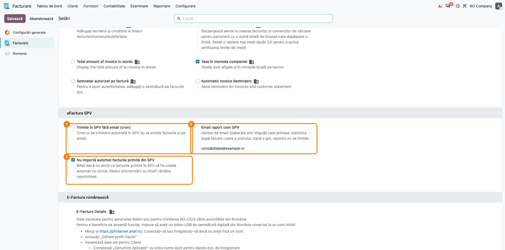
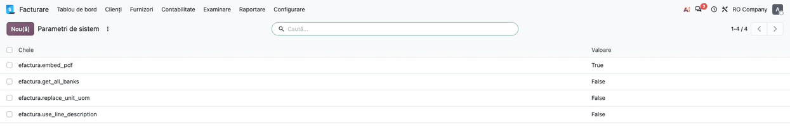
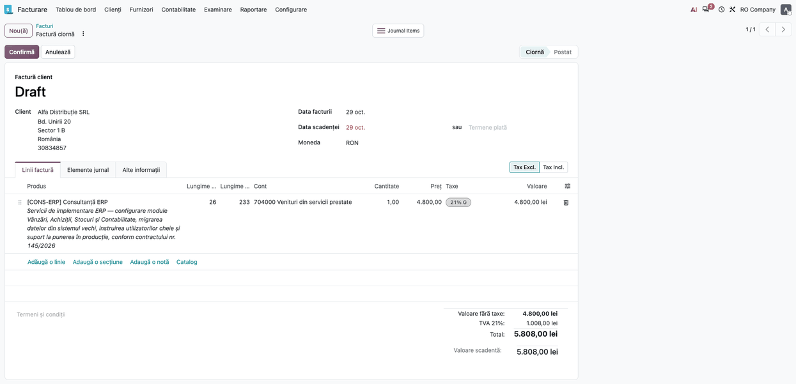
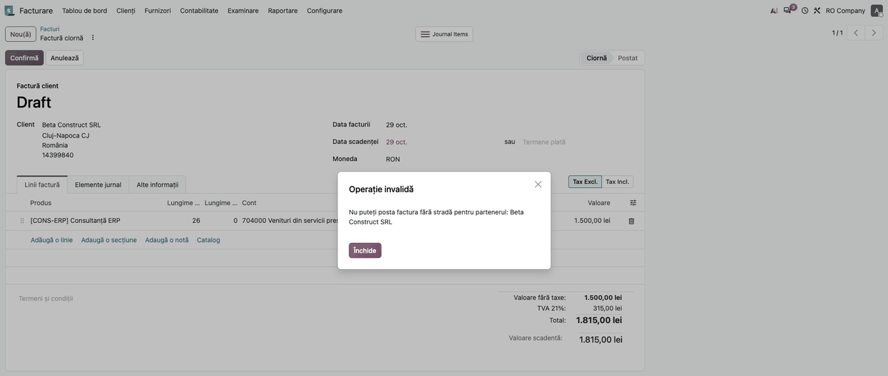
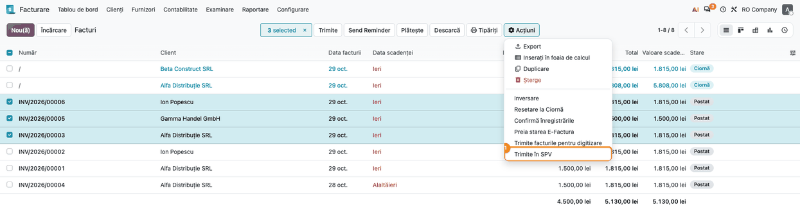
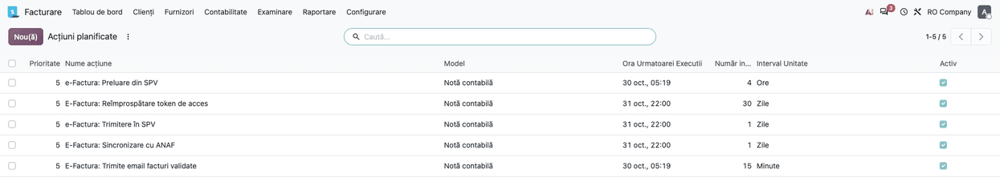
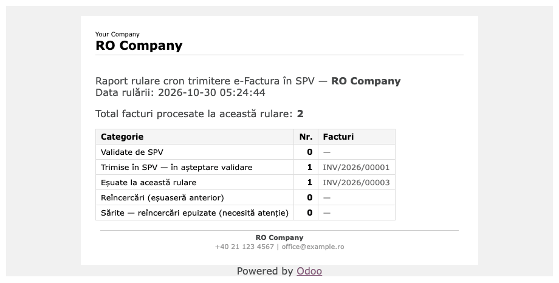
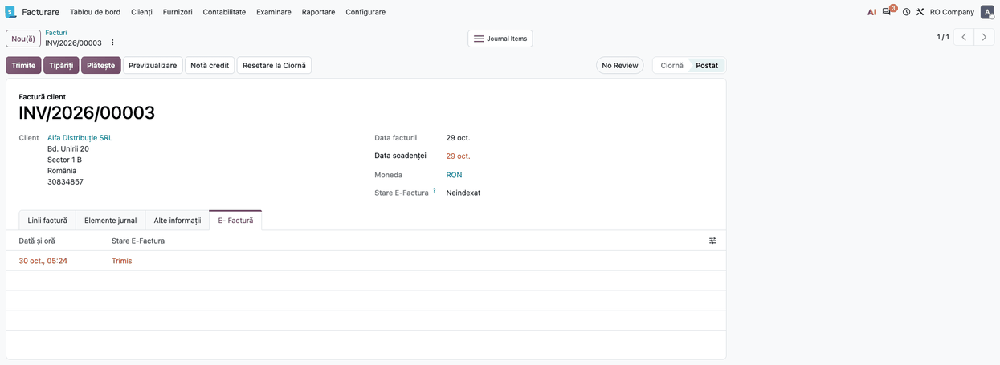
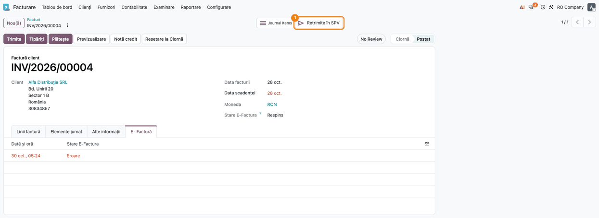
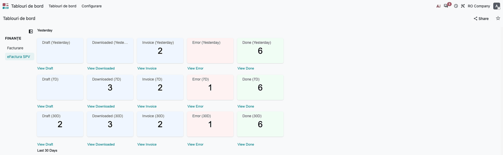

# Fișă Modul: e-Factura automatizată — trimitere în SPV, status, email și retrimiterea facturilor respinse

**Modul:** `l10n_ro_efactura_enhancement`
**Utilizator principal:** Contabil facturare / operator vânzări (emite facturile), contabil-șef
(urmărește raportul zilnic SPV), administrator funcțional (setări, parametri, cron-uri)
**Prioritate:** 🔴 Ridicată (transmiterea în RO e-Factura este obligatorie; o factură netrimisă sau
trimisă de două ori la ANAF are consecințe fiscale)

---

## 1. Scop business

Modulul completează e-Factura standard din Odoo 20 (`l10n_ro_edi`) cu ce îi lipsește pentru un
volum zilnic real de facturi:

- **trimiterea automată în SPV** a facturilor confirmate, în loturi de câte 20, cu un **raport pe
  email** către contabilitate după fiecare rulare;
- **citirea automată a stării** din SPV (validată / respinsă) pentru facturile trimise;
- **emailul către client trimis o singură dată, după validarea în SPV** — nu la încărcare și nu la
  fiecare retrimitere a unei facturi respinse;
- acțiunea **„Trimite în SPV"** din lista de facturi, care trimite doar în SPV, fără email, și
  butonul **„Retrimite în SPV"** pe factura respinsă de ANAF;
- o **singură regulă pentru „merge în SPV"**: clientul din România sau, fără țară, factura în RON;
  facturile către clienți din alte țări nu sunt propuse și nu sunt trimise în SPV;
- **blocarea trimiterii** către un partener **marcat firmă** din România fără CUI (date migrate sau
  importate). Atenție: pe Odoo 20 un partener nou fără CUI valid este considerat automat persoană
  fizică, deci factura pleacă B2C cu `0000000000000` — CUI-ul firmelor se verifică manual;
- **validări și corecții ale XML-ului CIUS-RO**: adresă completă obligatorie la confirmare, toate
  limitele de lungime BR-RO-L* aplicate la generare, referința facturii corectate pe stornouri,
  tipul 751 pentru facturile din POS, suma de plată egală cu totalul cât timp factura nu e
  achitată;
- opțiunea de **a nu importa automat** facturile primite în SPV ca ciorne de furnizor;
- la **importul facturilor de furnizor** din XML (inclusiv din SPV): recalcularea liniei când prețul
  unitar declarat de furnizor contrazice valoarea liniei.

Scopul este ca facturile să ajungă în SPV fără intervenție zilnică, iar contabilul să se ocupe doar
de excepții: facturi respinse, trimiteri eșuate, trimiteri fără index.

## 2. Bază legală și context

- **Sistemul național RO e-Factura** — transmiterea facturilor emise în SPV este obligatorie
  (OUG nr. 120/2021, cu modificările ulterioare; pentru B2B din 2024, pentru B2C din 1 ianuarie
  2025). Termenul legal de transmitere este de **5 zile lucrătoare** de la emiterea facturii
  (termen modificat prin OUG nr. 89/2025); de
  aceea modulul trimite automat, la fiecare rulare, facturile din zilele anterioare.
- **Formatul CIUS-RO** (specificația națională peste standardul european EN 16931) impune limite
  de lungime pe câmpuri (regulile **BR-RO-L020 … BR-RO-L1000**). ANAF respinge toată factura dacă
  un singur câmp își depășește limita; modulul scurtează câmpurile la generarea XML-ului, fără să
  modifice datele din Odoo.
- **Stornouri** — factura de corecție trebuie să menționeze numărul și data facturii corectate
  (art. 319 alin. (20) lit. r) și art. 330 alin. (1) lit. b) din Codul fiscal). Modulul pune în XML referința facturii stornate
  (BT-25 / BT-26), pe care standardul Odoo 20 o lasă goală pentru CIUS-RO.
- **Persoane fizice (B2C)** — când clientul persoană fizică nu are cod de identificare fiscală,
  practica ANAF pentru e-Factura este completarea identificatorului cu `0000000000000`
  (13 zerouri); Odoo standard (`l10n_ro_edi`) face acest lucru automat. Pentru o **firmă** valoarea
  nu este acceptabilă (factura ar ajunge la ANAF fără cumpărător identificat). Pe Odoo 20 însă
  standardul decide singur dacă partenerul e firmă după CUI: un partener fără CUI valid este
  persoană fizică, deci blocajul modulului acoperă doar partenerii migrați sau importați marcați
  firmă. Verificarea CUI-ului la clienții firme rămâne un pas manual (Configurare, pct. 7).
- **Facturi emise din comenzi POS** — modulul trece automat tipul facturii din 380 (factură
  comercială) în **751** (cod din lista CIUS-RO, „factură — informații în scopuri contabile")
  pentru orice factură legată de o comandă POS: vânzarea este deja înregistrată pe bonul fiscal.
  Este un comportament fix al modulului. Dacă în fluxul clientului există facturi POS emise **în
  locul** bonului fiscal (comandă facturată fără bon), tipul 751 este greșit pentru ele și vânzarea
  ar lipsi din evidența ANAF; confirmați cu contabilul clientului că orice comandă POS facturată are
  bon fiscal.
- **Clienți din afara României** — modulul exclude din SPV facturile după **țara clientului**, nu
  după locul livrării. O operațiune cu loc al livrării în România către un client cu adresă
  externă trebuie tratată manual.
- **Duplicatele la ANAF** — interfața de încărcare a ANAF nu deduplică: fiecare trimitere creează un
  nou index de încărcare, chiar dacă numărul facturii e același. De aceea o factură rămasă fără
  index nu se retrimite înainte de o sincronizare cu ANAF.

Modulul **nu** schimbă regulile fiscale ale facturii (cote TVA, conturi); lucrează doar pe
transmiterea electronică și pe conținutul XML-ului.

## 3. Utilizatori și roluri

| Rol | Ce face cu modulul |
|---|---|
| Operator facturare / vânzări | confirmă facturile; corectează adresa sau CUI-ul partenerului când confirmarea ori trimiterea e blocată; trimite manual în SPV din listă la nevoie |
| Contabil-șef | primește raportul zilnic al trimiterilor; tratează facturile eșuate, respinse sau rămase fără index |
| Administrator funcțional | configurează setările „eFactura SPV", parametrii de sistem `efactura.*` și orarul cron-urilor |

Roluri recomandate la testare: un utilizator **Facturare** (Facturare / Contabil) pentru emitere și
un **Administrator** (Setări) pentru configurare. Butonul „Retrimite în SPV" apare doar
utilizatorilor cu drept de facturare. Cron-urile rulează ca
administrator, iar trimiterea automată apare în istoricul facturii ca făcută de **OdooBot**.

## 4. Conturi și date implicate

Modulul nu generează și nu modifică note contabile. Factura de vânzare rămâne cea standard
(`4111` = `707` / `704` + `4427`); modulul acționează doar după confirmarea ei, la transmiterea în SPV.

Date minime pentru demo:

- compania **„RO Company"** cu planul de conturi românesc, CUI și **conexiunea SPV configurată**
  (token ANAF obținut din setările e-Factura ale companiei — fără token, cron-urile ignoră compania);
- un client **persoană juridică din România** cu adresă completă (țară, județ, oraș, stradă) și CUI;
- un client **persoană fizică** din România fără CUI (pentru codul `0000000000000` în XML);
- un client **din România fără stradă** (pentru blocajul la confirmare);
- un client **din afara României** (pentru a verifica excluderea din SPV);
- câteva **facturi de vânzare confirmate**, cu data contabilă din zilele anterioare.

## 5. Configurare inițială

1. Instalați modulul `l10n_ro_efactura_enhancement` (aduce `l10n_ro_edi`, `l10n_ro_config`,
   `l10n_ro_message_spv` și tablourile de bord spreadsheet).
2. Configurați conexiunea SPV a companiei din e-Factura standard (certificat digital, token ANAF).
   Este condiția ca o companie să fie luată în calcul de cron-uri.
3. În **Facturare → Configurare → Setări** (cu Contabilitatea Enterprise instalată:
   **Contabilitate → Configurare → Setări**), blocul **„eFactura SPV"**:
   - completați **„Email raport cron SPV"** cu adresele care primesc raportul (separate prin
     virgulă). Gol = raportul nu se trimite deloc;
   - bifați **„Trimite în SPV fără email (cron)"** doar dacă nu doriți ca facturile validate să fie
     trimise automat clientului pe email;
   - lăsați bifat **„Nu importă automat facturile primite din SPV"** dacă facturile de furnizor se
     introduc din comanda de achiziție (vezi Pasul 1).
4. (Opțional) Ajustați parametrii de sistem `efactura.*` (vezi Pasul 2).
5. Verificați în **Setări → Tehnic → Automatizare → Acțiuni planificate** (căutați „factura") că
   cele trei cron-uri ale modulului sunt active și au orarul dorit.
6. Pe clienții plătitori de TVA verificați bifa **„TVA aplicabil"** (în engleză „Romania - VAT Subjected"; vizibilă doar pe partenerii de tip companie) de
   pe fișa partenerului (`l10n_ro_config`): ea decide dacă CUI-ul este salvat — și transmis în XML — cu prefixul „RO".
7. Pe fiecare client din România verificați **țara, județul, orașul și strada** — fără ele factura
   nu se poate confirma — și, pe firme, **codul fiscal (CUI)**, **înainte de confirmarea primei
   facturi**: pe Odoo 20 un partener fără CUI valid este tratat automat ca persoană fizică, iar
   factura către el pleacă în SPV ca B2C, cu `0000000000000`, fără niciun avertisment.

## 6. Flux de utilizare

### Pasul 1 — Setările „eFactura SPV"

Accesați **Facturare → Configurare → Setări** (sau **Contabilitate → Configurare → Setări**) și
derulați la blocul **„eFactura SPV"**, aflat după secțiunea de facturare. Aici sunt cele trei opțiuni
ale companiei curente:

- **Trimite în SPV fără email (cron)** — dacă e bifată, cron-ul de email nu mai trimite clientului
  factura validată; facturile ajung doar în SPV;
- **Email raport cron SPV** — destinatarii raportului trimis după fiecare rulare a trimiterii
  automate;
- **Nu importă automat facturile primite din SPV** — cron-ul standard „E-Factura: Sincronizare cu
  ANAF" nu mai creează ciorne de facturi de furnizor din mesajele primite în SPV; citirea stării
  facturilor trimise (acceptat / respins) continuă. **La instalarea modulului opțiunea se bifează
  pe toate companiile** (și pe cele noi), pentru că ciorna adusă din SPV dublează factura introdusă
  din comanda de achiziție. Dacă clientul vrea în continuare ciornele aduse din SPV, debifați-o după
  instalare.

Apăsați **Salvează**.



### Pasul 2 — Parametrii de sistem ai XML-ului

Accesați **Setări → Tehnic → Parametri → Parametri sistem** (mod dezvoltator) și căutați
`efactura`. Modulul creează patru parametri:

| Parametru | Implicit | Efect |
|---|---|---|
| `efactura.embed_pdf` | `True` | include PDF-ul facturii în XML; `False` = XML fără PDF, pe toate căile de trimitere (buton, „Trimite în SPV", cron) |
| `efactura.use_line_description` | `False` | `True` = în XML, numele articolului se ia din descrierea liniei de factură (fără numele produsului), nu din produs |
| `efactura.replace_unit_uom` | `False` | un cod de unitate care înlocuiește în XML codul generic `C62` („unitate"). Valoarea se scrie **între ghilimele**, ex. `'H87'`; scris fără ghilimele, generarea XML-ului eșuează |
| `efactura.get_all_banks` | `False` | `True` = XML-ul facturilor (nu și al notelor de credit) conține toate conturile bancare bifate pentru tipărire pe rapoarte, în moneda facturii (moneda unui cont este cea a jurnalului bancar legat; un cont fără jurnal e în moneda companiei). Necesită modulul care adaugă bifa pe contul bancar (`l10n_ro_report_common`); fără el, generarea XML-ului eșuează. Căutarea nu filtrează pe companie — în baze multi-companie bifați doar conturile companiei emitente |



### Pasul 3 — Completarea facturii și lungimea textelor

Accesați **Facturare → Clienți → Facturi** și creați factura ca de obicei. Pe liniile facturii,
din meniul de coloane opționale (iconița de la capătul antetului tabelului) puteți afișa
**„Lungime prod."** și **„Lungime desc."** — lungimea numelui produsului și a descrierii liniei.

- **Găsiți** — cele două coloane „Lungime..." de după coloana **Produs** (antetul e scurtat în
  listă): prima este „Lungime prod." — lungimea numelui afișat al produsului, cu codul intern (ex.
  `[CONS-ERP] Consultanță ERP` = 26), exact textul care ajunge în XML ca nume al articolului; a doua
  este „Lungime desc." — lungimea descrierii liniei (textul de sub produs).
- **Verificați** — în XML, numele articolului se taie la **100** de caractere, iar descrierea la
  **200**. O valoare peste aceste praguri înseamnă că în SPV textul va apărea scurtat; dacă
  informația tăiată contează, scurtați descrierea. Nota facturii (BT-22) se taie și ea la **300**
  de caractere (comportament standard), deci nu mutați acolo texte lungi.



### Pasul 4 — Confirmarea: validarea adresei partenerului

Apăsați **Confirmă**. Pentru facturile și notele de credit de vânzare, modulul verifică întâi
clientul și adresa de livrare: **țara** este obligatorie pentru orice client, iar pentru clienții
din România și **județul, orașul și strada**. Dacă lipsește ceva, confirmarea este refuzată cu
dialogul **„Operație invalidă"** și un mesaj care numește câmpul lipsă și partenerul. Completați
câmpul pe fișa partenerului și confirmați din nou.



### Pasul 5 — Trimiterea manuală doar în SPV (din listă)

În **Facturare → Clienți → Facturi**, bifați facturile confirmate și alegeți din meniul
**Acțiuni** (iconița roată) **„Trimite în SPV"**. „Preia starea E-Factura", din același meniu, este
acțiunea standard de citire a stării. Facturile sunt generate în format CIUS-RO și încărcate în
SPV **fără email** către client.

- Facturile către clienți din afara României sunt sărite (nu intră în SPV); dacă toate cele bifate
  sunt externe, apare mesajul „Facturile selectate au clienți din afara României...". Un client
  **fără țară** este tratat ca român dacă factura este în **RON** — caz care apare doar la facturi
  confirmate înainte de instalarea modulului, importate sau la care țara s-a șters ulterior de pe
  partener (la confirmare, țara este obligatorie).
- O factură deja trimisă, validată sau rămasă fără index este ignorată (standardul nu o trimite a
  doua oară); o factură **respinsă** se retrimite.
- Același filtru pe țară se aplică și butonului standard **Trimite**: pentru clienții externi
  opțiunea „Trimite E-Factura către SPV" nu mai este propusă.
- O factură către un partener **marcat firmă** din România fără CUI (sau cu `0000000000000`) nu
  pleacă: mesajul „Clientul ... este firmă, dar nu are CUI..." apare la generare și în istoricul
  facturii (în engleză, „The customer ... is a company but has no VAT number...", când vine din
  cron). Pe Odoo 20 cazul apare doar la parteneri migrați sau importați marcați firmă: un partener
  nou fără CUI valid devine automat persoană fizică și **nu** este blocat.



**Ce conține XML-ul trimis** — extras din XML-ul CIUS-RO al unei facturi către o persoană fizică
fără CUI (baza demo): identificatorul fiscal al cumpărătorului este completat automat cu
`0000000000000` (comportament Odoo standard).

```xml
<cbc:CustomizationID>urn:cen.eu:en16931:2017#compliant#urn:efactura.mfinante.ro:CIUS-RO:1.0.1</cbc:CustomizationID>
<cbc:ID>INV/2026/00006</cbc:ID>
...
<cac:AccountingCustomerParty>
  <cac:Party>
    <cac:PartyName><cbc:Name>Ion Popescu</cbc:Name></cac:PartyName>
    <cac:PostalAddress>
      <cbc:StreetName>Str. Eroilor 5</cbc:StreetName>
      <cbc:CityName>Florești</cbc:CityName>
      <cbc:CountrySubentity>RO-CJ</cbc:CountrySubentity>
      ...
    </cac:PostalAddress>
    <cac:PartyTaxScheme>
      <cbc:CompanyID>0000000000000</cbc:CompanyID>
      ...
    </cac:PartyTaxScheme>
    <cac:PartyLegalEntity>
      <cbc:RegistrationName>Ion Popescu</cbc:RegistrationName>
      <cbc:CompanyID>0000000000000</cbc:CompanyID>
    </cac:PartyLegalEntity>
  </cac:Party>
</cac:AccountingCustomerParty>
```

Alte corecții la generare, fără acțiune din partea operatorului:

- **limitele de lungime CIUS-RO** se aplică pe tot documentul: referințe (BT-12…BT-17, inclusiv
  avizele de expediție, păstrate întregi cât încap), nume și adrese de parteneri, conturi și
  referința de plată (BT-83, la 140 de caractere, tăiată la ultimul separator „ - "), motivul
  scutirii de TVA, articolele de pe linii;
- pe **stornouri**, numărul și data facturii stornate (BT-25 / BT-26);
- **suma de plată** (`PayableAmount`) este totalul facturii cât timp factura nu e achitată integral,
  chiar dacă în Odoo are deja o încasare parțială (ex. ramburs înregistrat din fluxul de curierat);
- dacă partenerul (sau compania emitentă) are completat câmpul **NRC** și are CUI, NRC-ul intră în
  XML ca identificator de înregistrare legală (BT-47 la cumpărător, BT-30 la vânzător), în locul
  codului fiscal; la cumpărătorul fără CUI rămâne `0000000000000`;
- codul fiscal al cumpărătorului (BT-48) se transmite **exact** cum este pe fișa partenerului:
  prefixul „RO" apare doar dacă CUI-ul e salvat cu el (la `l10n_ro_config`, partenerii bifați
  „TVA aplicabil"). Un plătitor de TVA nebifat pleacă fără „RO";
- proprietățile suplimentare ale articolului sunt golite, deci atributele variantelor de produs nu
  ajung în XML.

Atenție — modulul scrie și pe fișa partenerului, nu doar în XML: la o persoană fizică din România
fără stradă completează strada „Principala"; la o persoană fizică din București fără sector în oraș
scrie orașul „SECTOR1".

### Pasul 6 — Cron-urile de trimitere, status și email

Accesați **Setări → Tehnic → Automatizare → Acțiuni planificate** (mod dezvoltator) și căutați
„factura" (numele cron-urilor încep cu „E-Factura" sau „e-Factura"). Modulul adaugă trei cron-uri, care rulează pentru fiecare companie cu conexiune SPV
(„E-Factura: Sincronizare cu ANAF" și „E-Factura: Reîmprospătare token de acces" sunt standard):

| Cron | Orar implicit | Ce face |
|---|---|---|
| **e-Factura: Trimitere în SPV** | zilnic (prima rulare la 22:00 UTC, adică 00:00/01:00 ora României) | citește întâi starea facturilor trimise, apoi trimite în SPV facturile de vânzare confirmate, destinate SPV, cu data contabilă din ultimele 30 de zile **anterioare zilei curente în UTC** (la rularea de la 00:00/01:00 ora României se trimit facturile cu data de până **alaltăieri** inclusiv; cele de ieri pleacă la rularea din noaptea următoare), încă netrimise sau cu trimiterea eșuată; câte 20 pe rulare (dacă sunt mai multe, se reia după 5 minute, dar numai dacă cel puțin o factură din lot a ajuns în SPV); trimite raportul pe email |
| **e-Factura: Preluare din SPV** | la 4 ore | citește din SPV starea facturilor aflate „Trimis", cu data contabilă din ultimele 30 de zile anterioare zilei curente, câte 20 pe rulare; se reia după 2 minute **numai** dacă lotul a fost plin (20) și ANAF a răspuns pentru cel puțin o factură; altfel, la următoarea rulare (4 ore) |
| **E-Factura: Trimite email facturi validate** | la 15 minute | trimite clientului factura pe email, o singură dată, după ce SPV a validat-o (aceeași fereastră: ultimele 30 de zile, fără ziua curentă) |

Reguli de selecție la trimiterea automată:

- o factură a cărei încărcare a eșuat (eroare de conexiune, XML invalid, CUI lipsă) rămâne fără
  stare e-Factura și este reluată la rulările următoare, de cel mult **3 ori**; după al treilea eșec
  cron-ul o sare și o raportează la *Sărite*. Eroarea se vede în istoricul facturii, iar eșecurile
  se numără pe factură, în câmpul „Trimiteri SPV eșuate (cron)";
- în lot intră întâi facturile netrimise încă, apoi cele care au mai eșuat;
- o factură readusă în ciornă și reconfirmată primește din nou toate cele 3 încercări;
- o factură **respinsă de ANAF** („Respins") **nu** este retrimisă automat: corectați-o și folosiți
  „Retrimite în SPV" (Pasul 9);
- o factură **fără index** („Neindexat") nu este retrimisă automat (Pasul 8);
- încărcarea automată nu trimite niciodată email clientului; emailul vine doar după validare;
- dacă operatorul a trimis deja factura pe email manual (butonul **Trimite**), cron-ul de email nu
  o mai trimite a doua oară;
- dacă la setări este bifat „Trimite în SPV fără email (cron)", cron-ul de email ignoră compania.



### Pasul 7 — Raportul trimiterii automate

După fiecare rulare a cron-ului de trimitere care a avut facturi de procesat, destinatarii din
**„Email raport cron SPV"** primesc emailul **„[Companie] Raport e-Factura SPV"**. Emailul trece prin
coada normală de mailuri și poate fi văzut în **Setări → Tehnic → Email → Email-uri** cât timp
este în coadă (stare „Ieșiri"); după trimitere se șterge automat. Antetul emailului („Your Company") vine din layout-ul standard, netradus. Ora „Data rulării" din corpul
emailului este în UTC (ora serverului), nu ora României.

- **Găsiți** — tabelul cu cinci rânduri: *Validate de SPV*, *Trimise în SPV — în așteptare
  validare*, *Eșuate la această rulare*, *Reîncercări (eșuaseră anterior)*, *Sărite — reîncercări
  epuizate (necesită atenție)*; pe fiecare rând numărul și lista facturilor.
- **Verificați** — „Trimise în SPV" înseamnă doar că XML-ul a fost încărcat; confirmarea vine
  ulterior, la citirea stării. De aceea rândul „Validate de SPV" este de regulă **0**. Rândul
  *Eșuate* include și facturile rămase fără index la această rulare (acestea nu se numără ca
  eșecuri și nu sunt retrimise). *Reîncercări* arată facturile care au mai eșuat cel puțin o dată,
  *Sărite* pe cele care au epuizat cele 3 încercări.
- **Acționați** — pentru fiecare factură de la *Eșuate*, deschideți factura, citiți eroarea din
  istoric și corectați cauza; cron-ul o reia la rularea următoare. O factură de la *Sărite* nu mai pleacă
  automat: după corectare, trimiteți-o cu „Trimite în SPV" sau readuceți-o în ciornă și
  reconfirmați-o. O factură cu starea „Neindexat" se tratează ca în Pasul 8.

Dacă nu a existat nicio factură de procesat, raportul nu se trimite.



### Pasul 8 — Factura rămasă fără index („Neindexat")

Când ANAF nu întoarce indexul de încărcare la timp, Odoo nu știe dacă factura a ajuns în SPV.
Standardul trece factura în starea **„Neindexat"**, scrie în istoric „SPV nu a reușit să returneze un
index la timp..." și nu o mai trimite: nici cron-ul modulului, nici „Trimite în SPV" nu o iau. În
pagina **E- Factură** documentul apare cu starea „Trimis".

1. Verificați în SPV (portalul ANAF) dacă factura a fost primită.
2. Sincronizarea standard cu ANAF (cron-ul „E-Factura: Sincronizare cu ANAF") regăsește factura
   dacă a ajuns în SPV și îi completează indexul și starea.
3. Dacă factura nu apare în SPV, după **3 zile** sincronizarea o marchează respinsă („Respins") cu
   mesajul standard „Factură a fost probabil refuzată de SPV... Duplicați factura..." (din cron, în
   engleză: „The invoice has probably been refused by the SPV... Duplicate the invoice...").
   **Nu** duplicați factura: retrimiteți-o cu „Retrimite în SPV" (Pasul 9). Atenție: se retrimite
   XML-ul vechi; dacă ați corectat datele, resetați factura la ciornă și confirmați-o din nou
   înainte.

Pe Odoo 20, modulul nu are buton de deblocare manuală înainte de cele 3 zile.



### Pasul 9 — Factura respinsă de ANAF: „Retrimite în SPV"

O factură respinsă de ANAF are starea **„Respins"**; în pagina **E- Factură** a facturii documentul
apare cu starea „Eroare" (aceeași situație), iar motivul respingerii se citește din istoricul
facturii. Cron-ul nu o mai trimite automat. După corectarea cauzei (partener,
date de pe factură), apăsați butonul **„Retrimite în SPV"** din partea de sus a facturii: la o
respingere primită de la ANAF, XML-ul se regenerează și se încarcă din nou, fără email către client.
Atenție: după respingerea automată de la 3 zile sau după „Resetează trimiterea SPV" (Pasul 8) XML-ul vechi rămâne atașat și se
retrimite; dacă ați corectat datele, resetați factura la ciornă și confirmați-o din nou înainte. Emailul pleacă după validare, prin
cron-ul de email.



### Pasul 10 — Tabloul de bord „eFactura SPV"

Accesați **Tablouri de bord** → grupul **Finanțe** → **„eFactura SPV"** (vizibil utilizatorilor de
facturare și de contabilitate cu drept de citire).

- **Găsiți** — trei rânduri de plăci, recunoscute după sufixul din titlul plăcii: **(Yesterday)**,
  **(7D)** și **(30D)** (etichetele de rând ale tabloului nu sunt aliniate cu plăcile), cu numărul
  mesajelor SPV (modulul `l10n_ro_message_spv`) pe stări: ciornă, descărcat, factură, eroare,
  finalizat; sub fiecare număr, linkul „View ..." deschide lista mesajelor respective.
- **Verificați** — coloana de erori trebuie să fie 0 (o placă goală înseamnă 0); un mesaj în eroare
  se deschide din link și se tratează în modulul de mesaje SPV (în captură, eroarea de la 7D/30D este exemplul de tratat). Etichetele tabloului sunt în
  engleză.



### Note de monografie și raportare

Modulul **nu generează note contabile**. Factura de vânzare își păstrează monografia standard:

| Operațiune | Debit | Credit |
|---|---|---|
| Factură de vânzare mărfuri / servicii | `4111` Clienți | `707` / `704` Venituri |
| | `4111` Clienți | `4427` TVA colectată |
| Notă de credit (storno în roșu, practica uzuală RO) | `4111` (−) | `707` / `704` (−), `4427` (−) |

Fără contabilitate storno activată, Odoo înregistrează nota de credit invers: `707` / `704` și
`4427` pe debit, `4111` pe credit.

Trimiterea în SPV, citirea stării și emailul nu modifică înregistrările contabile. Raportarea
modulului este operațională: raportul pe email (Pasul 7), tabloul de bord (Pasul 10), starea
e-Factura a fiecărei facturi și istoricul ei. Starea se poate afișa ca coloană opțională în lista
de facturi și filtra cu filtrele standard de stare e-Factura.

## 7. Legături cu alte module / declarații

| Modul | Rol |
|---|---|
| `l10n_ro_edi` (Odoo standard) | conexiunea SPV, generarea și încărcarea XML-ului, documentele e-Factura și stările lor, sincronizarea cu ANAF |
| `account_edi_ubl_cii` | generatorul UBL peste care se aplică corecțiile CIUS-RO |
| `l10n_ro_config` | configurările de localizare românească ale companiei |
| `l10n_ro_message_spv` | mesajele SPV afișate în tabloul de bord |
| `spreadsheet_dashboard`, `spreadsheet_dashboard_account` | tabloul de bord „eFactura SPV" |
| `point_of_sale` (dacă e instalat) | facturile emise din comenzi POS primesc tipul 751 în XML |

**Ce e automat:** trimiterea zilnică în SPV și reluarea trimiterilor eșuate, citirea stării,
emailul către client după validare, raportul către contabilitate, excluderea clienților externi,
blocarea partenerilor marcați firmă fără CUI, corecțiile XML (limitele BR-RO, referința stornoului, suma de plată,
NRC în BT-30/BT-47, tip 751), sugerarea formatului CIUS-RO pentru partenerii din România, la import
recalcularea liniei din valoarea ei (BT-131) când prețul unitar declarat de furnizor o contrazice.

**Importul facturilor de furnizor** — când furnizorul trimite greșit cantitatea de bază a prețului
(BaseQuantity egală cu cantitatea facturată), Odoo standard calculează un preț unitar de N ori mai
mic și pune diferența pe o linie de rotunjire **fără TVA** (TVA deductibil `4426` subevaluat).
Modulul recalculează linia din valoarea ei și scrie în istoricul facturii „Linia X: prețul unitar
declarat de furnizor... Linia a fost recalculată...". Operatorul verifică totalul și TVA-ul cu PDF-ul
furnizorului.

**Ce rămâne manual:** completarea adresei și a CUI-ului partenerilor; tratarea facturilor respinse
de ANAF („Retrimite în SPV"); urmărirea facturilor fără index până la sincronizarea cu ANAF; configurarea
destinatarilor raportului; validarea fiscală a tipului 751 pe fluxul clientului; facturile cu data
contabilă mai veche de 30 de zile (nu mai sunt trimise automat și nici nu li se mai citește starea).

## 8. Verificări pentru consultant

- [ ] Blocul „eFactura SPV" apare în **Facturare / Contabilitate → Configurare → Setări** cu cele trei opțiuni.
- [ ] Cu „Email raport cron SPV" gol, după o rulare cu facturi **nu** se creează niciun email de raport.
- [ ] Cu „Email raport cron SPV" completat, după o rulare cu facturi apare emailul „Raport e-Factura
      SPV" cu cele cinci rânduri.
- [ ] Confirmarea unei facturi către un client din România fără stradă (sau fără județ/oraș) este
      refuzată cu mesaj care numește partenerul.
- [ ] Confirmarea unei facturi este refuzată pentru orice client fără țară.
- [ ] Coloanele opționale „Lungime prod." / „Lungime desc." arată lungimea corectă pe linii.
- [ ] Un client persoană fizică fără CUI apare în XML cu `0000000000000`.
- [ ] Un client plătitor de TVA (bifat) apare în XML cu CUI-ul cu prefix „RO"; unul nebifat, fără.
- [ ] O factură de furnizor importată cu BaseQuantity greșită are linia recalculată și mesajul în istoric.
- [ ] Un partener nou din România fără CUI apare ca persoană fizică: pe fișa lui nu apar NRC, Cod
      CAEN și „TVA aplicabil" (vizibile doar pe firme); clienții firme au CUI-ul completat înainte de
      prima factură.
- [ ] O factură cu referința clientului mai lungă de 200 de caractere se încarcă fără eroarea BR-RO-L200.
- [ ] Un storno are în XML numărul și data facturii stornate.
- [ ] „Trimite în SPV" din listă încarcă facturile fără să trimită email clientului.
- [ ] „Trimite în SPV" pe o factură către un client extern nu o trimite în SPV; la **Trimite**,
      opțiunea „Trimite E-Factura către SPV" lipsește pentru clientul extern.
- [ ] O factură deja trimisă/validată, selectată din nou la „Trimite în SPV", nu creează un al doilea index.
- [ ] O factură respinsă de ANAF, corectată, se retrimite cu „Retrimite în SPV".
- [ ] O factură „Neindexat" nu este retrimisă nici de cron, nici din „Trimite în SPV".
- [ ] Cron-ul „e-Factura: Trimitere în SPV" nu ia facturile cu data de azi (la rularea de noapte nici pe cele de ieri — fereastra e în UTC) și nici facturile către clienți externi.
- [ ] După validarea în SPV, clientul primește factura pe email o singură dată; o factură trimisă
      manual pe email înainte nu se mai trimite.
- [ ] Cu „Trimite în SPV fără email (cron)" bifat, facturile validate nu se trimit pe email.
- [ ] Cu „Nu importă automat facturile primite din SPV" bifat, sincronizarea cu ANAF nu creează
      ciorne de facturi de furnizor.
- [ ] Tabloul de bord „eFactura SPV" se deschide și arată mesajele SPV pe stări.

## 9. Mesaje de eroare frecvente

| Mesaj / Simptom | Cauză | Remediere |
|---|---|---|
| „Nu puteți posta factura fără țară pentru partenerul: X" | clientul sau adresa de livrare nu are țară | completați țara pe partener |
| „Nu puteți posta factura fără județ / localitate / stradă pentru partenerul: X" | client din România fără județ, oraș sau stradă | completați câmpul pe fișa partenerului |
| „Clientul X este firmă, dar nu are CUI..." (sau „The customer X is a company but has no VAT number..." din cron) | partener migrat/importat marcat firmă, fără CUI sau cu `0000000000000` | completați CUI-ul pe client și retrimiteți |
| „Nu există facturi confirmate selectate pentru trimitere în SPV." | „Trimite în SPV" pe facturi neconfirmate sau pe alte documente | confirmați facturile; acțiunea funcționează doar pe facturi și note de credit de vânzare |
| „Facturile selectate au clienți din afara României și nu pot fi trimise în SPV." | toate facturile bifate sunt către clienți externi | normal — facturile externe nu se transmit în SPV |
| „Următoarea factură (facturi) așteaptă răspunsul de la SPV-ul român..." (la Trimite) | factura e „Trimis" sau „Neindexat" | așteptați citirea stării; la „Neindexat", Pasul 8 |
| „SPV nu a reușit să returneze un index la timp..." (din cron: „SPV failed to return with an index on time...") în istoric | ANAF nu a întors indexul de încărcare | Pasul 8 — verificați în SPV și așteptați sincronizarea cu ANAF |
| „Factură a fost probabil refuzată de SPV... Duplicați factura..." (din cron: „The invoice has probably been refused by the SPV... Duplicate the invoice...") | factura a stat „Neindexat" peste 3 zile; standardul a marcat-o respinsă | **nu** duplicați factura (ar avea alt număr): folosiți „Retrimite în SPV" (Pasul 9) |
| „Linia X: prețul unitar declarat de furnizor... Linia a fost recalculată..." pe o factură de furnizor | furnizorul a trimis o cantitate de bază (BaseQuantity) greșită | normal — verificați totalul și TVA-ul cu PDF-ul furnizorului |
| „SPV a răspuns cu un corp gol pe ..." sau „SPV a răspuns cu un conținut neașteptat pe ..." în istoric | ANAF a răspuns cu o eroare sau o pagină de mentenanță în loc de document | reîncercați mai târziu; cron-ul reia singur trimiterea |
| Generarea XML-ului eșuează după setarea `efactura.replace_unit_uom` | codul de unitate scris fără ghilimele | scrieți valoarea între ghilimele, ex. `'H87'` |
| Generarea XML-ului eșuează după activarea `efactura.get_all_banks` | modulul care adaugă bifa pe contul bancar nu e instalat | instalați-l sau readuceți parametrul la `False` |
| Raportul pe email nu sosește | „Email raport cron SPV" gol sau nicio factură de procesat la rulare | completați destinatarii; raportul se trimite doar când există facturi |
| Aceeași factură apare la „Eșuate", apoi la „Sărite" | cauza erorii nu a fost corectată; după 3 eșecuri cron-ul nu o mai trimite | citiți eroarea din istoric, corectați partenerul sau factura, apoi „Trimite în SPV" |
| Toate facturile din lot apar la „Eșuate" și cron-ul nu se reia | ANAF indisponibil sau token expirat: fără nicio factură încărcată, cron-ul așteaptă rularea următoare | verificați conexiunea SPV (token); facturile sunt reluate la rularea următoare, în limita celor 3 încercări |
| Facturile nu pleacă deloc automat | compania nu are conexiune SPV (token ANAF) sau cron-ul e inactiv | configurați conexiunea SPV; activați cron-ul |
| Clientul nu primește emailul după validare — opțiunea „Trimite în SPV fără email (cron)" e bifată | opțiunea oprește cron-ul de email pentru companie | debifați opțiunea: cron-ul trimite apoi emailul pentru **toate** facturile validate și netrimise din ultimele 30 de zile |
| Clientul nu primește emailul după validare — fără adresă de email sau cu altă metodă de trimitere | cron-ul marchează și aceste facturi ca procesate și nu le mai reia | completați emailul clientului **și** trimiteți factura manual (butonul Trimite) |

## 10. Capturi de ecran

Capturile din `static/description/` sunt generate automat din `tests/test_screenshots.py`
(mixinul `ScreenshotCase` din `l10n_ro_doc_screenshots`, import defensiv), pe Odoo 20, în română,
pe compania demo **„RO Company"** (plan de conturi RO, RON). Răspunsurile ANAF sunt simulate;
datele (parteneri, facturi, stări e-Factura, raportul cron-ului) sunt fictive. Regenerare:

```bash
./odoo/odoo-bin -c odoo.conf -d <db> -i l10n_ro_efactura_enhancement,l10n_ro_doc_screenshots \
    --test-tags=/l10n_ro_efactura_enhancement:TestEfacturaEnhancementScreenshots --stop-after-init
```

Lista capturilor (în ordinea fluxului):

1. `01_setari_efactura_spv.png` — blocul „eFactura SPV" din setările Facturare
2. `02_parametri_sistem.png` — parametrii de sistem `efactura.*`
3. `03_linii_lungime_descriere.png` — liniile facturii cu coloanele „Lungime prod." / „Lungime desc."
4. `04_blocaj_adresa_partener.png` — confirmare refuzată pentru client din România fără stradă
5. `05_lista_actiune_trimite_spv.png` — lista de facturi cu acțiunea „Trimite în SPV"
6. `06_cronuri_efactura.png` — cron-urile E-Factura
7. `07_raport_cron_spv.png` — emailul de raport al trimiterii automate
8. `08_factura_neindexata.png` — factură „Neindexat", cu documentul „Trimis" în pagina E-Factură
9. `09_factura_respinsa_retrimite.png` — factură respinsă cu butonul „Retrimite în SPV"
10. `10_dashboard_efactura_spv.png` — tabloul de bord „eFactura SPV"

Extrasul XML din Pasul 5 este text inline, nu fișier în folderul capturilor.

## 11. Observații pentru manual

- Subliniați diferența dintre **„trimisă"** și **„validată"**: trimisă = XML încărcat în SPV;
  validată = ANAF a acceptat factura. Doar validarea declanșează emailul către client.
- Trimiterea automată ia doar facturile din **zilele anterioare**, calculate în UTC: la rularea de
  noapte (00:00/01:00 ora României) pleacă facturile de până alaltăieri inclusiv, iar cele de ieri
  la rularea din noaptea următoare — în limita termenului de 5 zile lucrătoare, dar fără rezervă
  mare. Operatorul are astfel cel puțin o zi pentru corecturi. Pentru o factură urgentă folosiți
  „Trimite în SPV", apoi, după câteva minute, „Preia starea E-Factura" (meniul Acțiuni) și
  trimiteți-o manual pe email: cron-urile de stare și de email nu iau factura din ziua curentă.
- Pe Odoo 20, o încărcare eșuată nu lasă nicio urmă în starea e-Factura, așa că modulul numără
  eșecurile pe factură („Trimiteri SPV eșuate (cron)"). Spuneți utilizatorilor să urmărească
  rândul *Sărite* din raport: acolo ajung facturile pe care cron-ul nu le mai încearcă.
- Codul fiscal al clientului pleacă în XML exact cum e pe partener: subliniați în manual verificarea
  bifei „TVA aplicabil" pe clienții plătitori, altfel factura pleacă cu CUI fără „RO".
- Parametrii `efactura.*` se schimbă doar din modul dezvoltator; păstrați tabelul din Pasul 2 în
  manual, cu exemple de când se activează fiecare.
