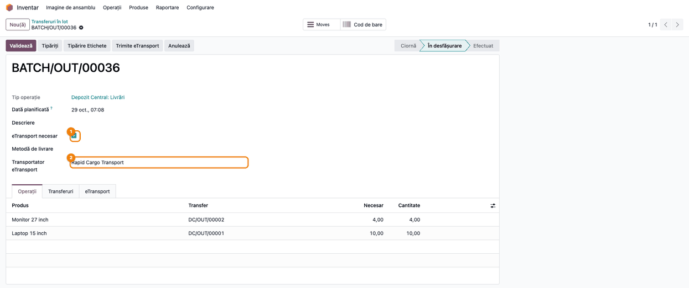
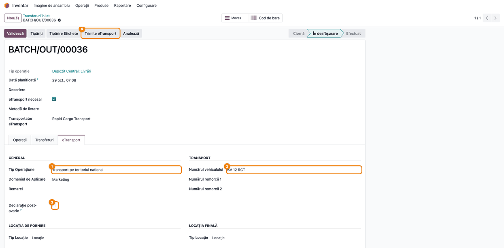
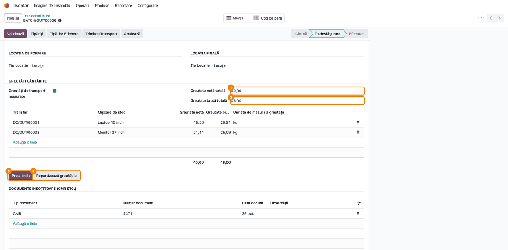
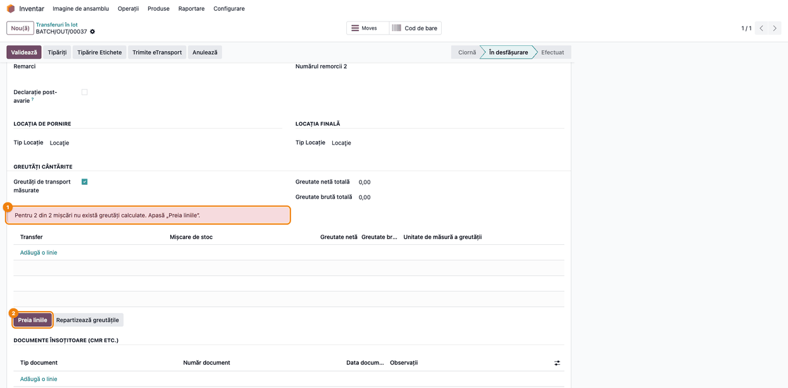
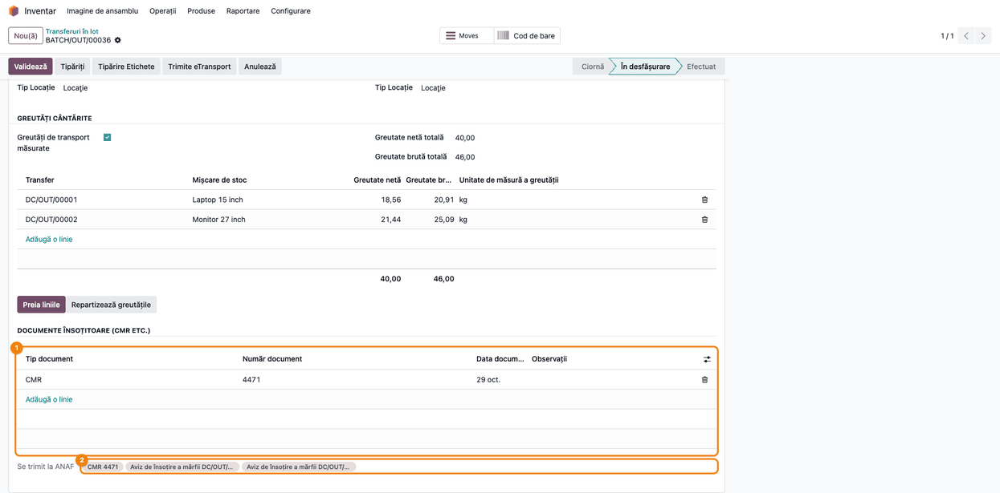
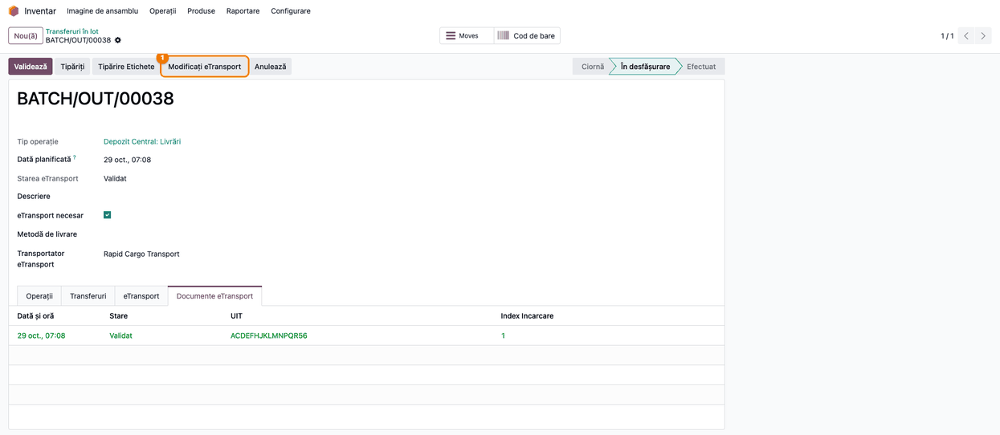
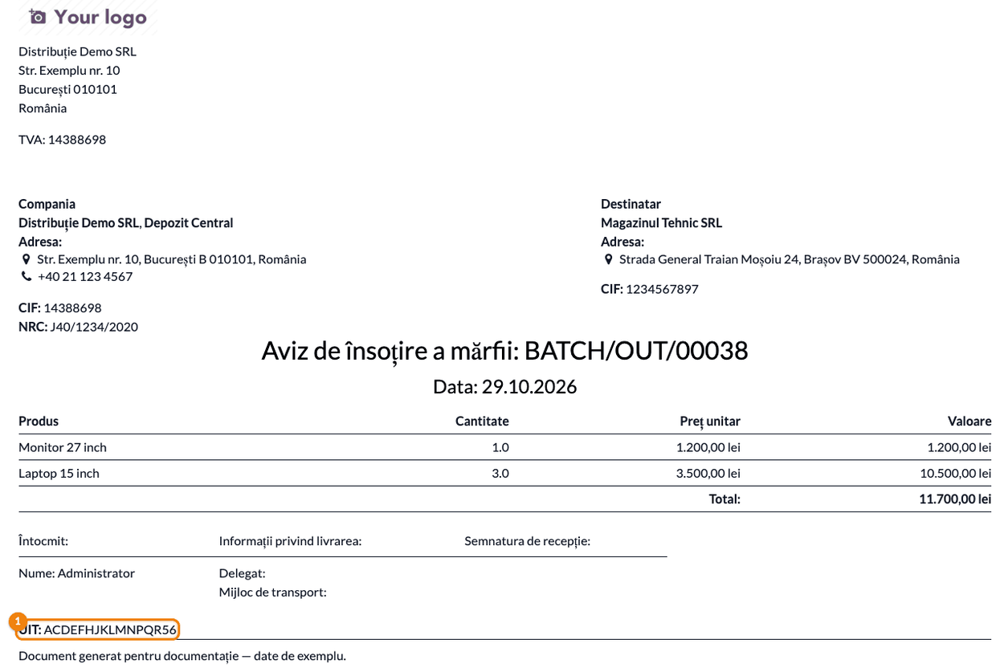

# Fișă Modul: Declarația eTransport pentru un lot de transferuri

**Modul:** `l10n_ro_etransport_batch_enhancement`
**Utilizator principal:** Operator depozit / logistică, responsabil fiscal
**Prioritate:** 🔴 Ridicată (fără modul, declarația lotului pleacă la ANAF fără greutățile cântărite și fără CMR, iar ANAF o acceptă)

---

## 1. Scop business

Când mai multe livrări pleacă în **același camion**, ele se grupează într-un **lot de transferuri**,
iar declarația RO e-Transport se face o singură dată, din lot. Modulul standard Odoo
`l10n_ro_edi_stock_batch` permite trimiterea din lot, dar declara doar greutățile calculate din
fișele produselor și un singur aviz, cu numele lotului. Modulul aduce pe lot aceleași completări pe
care `l10n_ro_etransport_enhancement` le aduce pe transfer:

- **Bifa „eTransport necesar”** pe lot: numai loturile bifate au tab-ul **eTransport** și butonul
  de trimitere.
- **Transportatorul** și **metoda de livrare** se aleg o dată, pe lot, și se copiază pe toate
  transferurile din el.
- **Greutățile cântărite** pentru tot camionul: se introduc totalurile net și brut de pe cântar,
  iar modulul le repartizează pe liniile tuturor livrărilor din lot. Un avertisment arată liniile
  care lipsesc.
- **Documentele însoțitoare**: un **CMR** pentru tot transportul, declarat pe lot, plus avizele
  livrărilor. Toate ajung în aceeași declarație.
- **Declarația post-avarie**, pentru notificările depuse după o indisponibilitate a sistemului.
- **Corecția** unei declarații validate păstrează UIT-ul lotului, fără UIT nou.
- **UIT-ul** validat apare pe avizul de însoțire al lotului.

## 2. Bază legală și context

- **OUG 41/2022, cu modificările ulterioare,** instituie sistemul **RO e-Transport**: transporturile
  de bunuri cu risc fiscal ridicat și transporturile internaționale se declară în prealabil, iar
  declarația primește un **cod UIT** cu valabilitate limitată (5 zile calendaristice la transportul
  național, 15 zile la achiziția intracomunitară). Modulul nu verifică pragurile de declarare.
- **Declarația post-avarie** este notificarea depusă după o indisponibilitate a sistemului RO
  e-Transport, marcată în XML cu `declPostAvarie="D"`. Ajutorul câmpului din interfață o leagă de
  OUG 41/2022 art. 8 alin. (1^3).
- Structura XML urmează **schema ANAF eTransport v2**: o notificare poate avea mai multe
  **documente de transport** (CMR, aviz, factură), iar greutatea brută nu poate fi mai mică decât
  cea netă.
- Ghidul ANAF: [RO e-Transport — ghid de utilizare](https://static.anaf.ro/static/10/Anaf/AsistentaContribuabili_r/Ghid_RO_e_Transport_2025.pdf).

Modulul **nu decide** dacă un transport trebuie declarat. Operatorul stabilește obligația și alege
operațiunea corectă.

## 3. Utilizatori și roluri

- **Operator depozit / logistică:** grupează livrările în lot, completează transportatorul și
  datele de transport, cântărește camionul, trimite declarația și preia UIT-ul.
- **Responsabil fiscal / contabil:** completează codul SH pe produse și verifică în SPV
  declarațiile corectate.

Roluri recomandate la testare: **Inventar / Utilizator** (pentru loturi și transferuri) și
**Inventar / Administrator** (pentru setările UIT din `l10n_ro_etransport_enhancement`).

## 4. Conturi și date implicate

Modulul **nu generează note contabile**. Declarația citește cantitățile și valorile livrărilor, fără
să modifice contabilitatea.

Date implicate:
- pe **lot**:
  - **eTransport necesar**, **Metodă de livrare** și **Transportator eTransport**;
  - datele din tab-ul **eTransport**: operațiune, vehicul, locații, declarație post-avarie;
  - **Greutăți de transport măsurate**, cu totalurile și liniile pe livrări;
  - **Documente însoțitoare (CMR etc.)**: documentele declarate pe lot;
- pe **transferurile din lot**: avizele din **Documente însoțitoare** și transportatorul, copiat
  din lot;
- documentele **eTransport** ale lotului, cu stare (Trimis, Validat, Eroare) și UIT.

Date minime pentru demo:
- companie cu țara fiscală **România**, CUI și token ANAF pentru eTransport;
- un client din România și un transportator cu CUI sau CNP;
- două produse cu masă, greutate netă și cod SH;
- două livrări pregătite către același client, grupate într-un lot în desfășurare.

## 5. Configurare inițială

1. Instalați modulul `l10n_ro_etransport_batch_enhancement`. Se instalează automat și
   `l10n_ro_etransport_enhancement`, `l10n_ro_edi_stock_batch` și raportul de aviz pentru lot
   (`l10n_ro_stock_picking_batch_report`).
2. Configurați conexiunea ANAF, setările UIT și produsele ca în fișa modulului
   `l10n_ro_etransport_enhancement` (secțiunea 5): token ANAF, **UIT: preia valoarea din
   comandă**, **Timp de așteptare eTransport**, **Masă** și **Cod SH** pe produse.

## 6. Flux de utilizare

Loturile se găsesc în **Inventar → Operații → Locuri de muncă → Transferuri în lot**. Un lot nou
se creează cu **Nou**, sau din lista **Livrări**: selectați livrările, apoi **Acțiuni → Adăugați la
lot**. Butonul de trimitere apare imediat ce lotul are **eTransport necesar** bifat, chiar și în
starea **Ciornă**. Recomandăm trimiterea după confirmarea lotului (starea **În desfășurare**), când
componența lui e definitivă.

### Pasul 1 — Lotul: eTransport necesar și transportatorul

Deschideți lotul:
- **eTransport necesar** ①: marchează lotul care se declară. Bifați-l întâi: abia după el apar
  câmpurile următoare și tab-ul **eTransport**;
- **Transportator eTransport** ②: firma care face transportul. Valoarea aleasă pe lot se copiază
  pe **toate** livrările din el. **Metodă de livrare** se comportă la fel și poate rămâne goală.

În tab-urile **Operații** și **Transferuri** verificați că lotul conține livrările care pleacă în
același camion.



### Pasul 2 — Datele declarației și trimiterea

Pe același lot, tab-ul **eTransport**:
- **Tip Operațiune** ① (ex. „Transport pe teritoriul national”) și **Domeniul de Aplicare**. Pe
  lot, codul 101 apare ca „Marketing”: este **Comercializare** din nomenclatorul ANAF, eticheta
  netradusă a modulului standard;
- **Numărul vehiculului** ②;
- **Declarație post-avarie** ③: bifați **doar** când notificarea se depune după o indisponibilitate
  a sistemului RO e-Transport;
- locația de pornire și cea finală.

Apăsați **Trimite eTransport** ④. Se trimite **o singură declarație** pentru tot lotul, cu toate
produsele din livrările lui. Declarația poartă numele lotului ca referință. În tab-ul **Documente
eTransport** apare documentul cu starea **Trimis** și cu UIT-ul. **Preluare Stare** trece
documentul în **Validat** sau **Eroare**, după răspunsul ANAF. Cât timp ANAF încă prelucrează
declarația, documentul rămâne **Trimis**: reveniți mai târziu.

Partenerul comercial și adresa de livrare se iau de la **prima** livrare din lot. Grupați în același
lot doar livrări către același client și aceeași adresă. La **Validează**, modulul standard oprește
lotul cu clienți sau cu metode de livrare diferite, dar abia după ce declarația a plecat.



### Pasul 3 — Greutățile cântărite pentru tot camionul

Când camionul se cântărește, în blocul **Greutăți cântărite** din tab-ul **eTransport** bifați
**Greutăți de transport măsurate** și:
1. **Găsiți pe ecran:** totalurile **Greutate netă totală** ① și **Greutate brută totală** ②,
   apoi lista cu câte o linie pe produs. Coloana **Transfer** arată livrarea din care vine linia.
2. **Introduceți** totalurile citite pe cântar și apăsați **Preia liniile** ③. Liniile se
   recalculează pentru fiecare livrare din lot, din cantități și din greutatea produselor.
   Ajustările făcute anterior pe linii se pierd.
3. Apăsați **Repartizează greutățile** ④. Diferența dintre totalurile de pe cântar și suma
   liniilor se împarte proporțional cu fiecare linie.
4. **Verificați** că suma coloanelor din subsolul listei este egală cu totalurile introduse.

În exemplu, 40 kg net și 46 kg brut se împart în 18,56 / 20,91 kg (laptopurile din prima livrare)
și 21,44 / 25,09 kg (monitoarele din a doua).



### Pasul 4 — Avertismentul pentru liniile de greutate lipsă

Dacă bifați **Greutăți de transport măsurate** fără să preluați liniile, sau dacă adăugați o
livrare în lot după ce le-ați preluat, deasupra listei apare un avertisment roșu ①: „Pentru N din
M mișcări nu există greutăți calculate”. Fără linie de greutate, produsul respectiv pleacă la ANAF
cu greutatea calculată din fișa produsului, nu cu cea cântărită.

Remediere: apăsați **Preia liniile** ②, apoi **Repartizează greutățile**. Avertismentul dispare
când fiecare mișcare are linia ei.



### Pasul 5 — Documentele însoțitoare: CMR-ul lotului și avizele

În secțiunea **Documente însoțitoare (CMR etc.)** din tab-ul **eTransport**:
- adăugați pe lot documentele comune întregului transport ①, de regulă **CMR**-ul, cu număr și
  dată. **Observații** e opțional;
- avizele rămân pe fiecare livrare: pe transfer, tab-ul **eTransport**, butonul **Preia documentele
  implicite** (vezi fișa `l10n_ro_etransport_enhancement`, Pasul 6);
- câmpul **Se trimit la ANAF** ② arată tot ce intră în declarație: documentele lotului plus cele ale
  livrărilor din el.

Fără niciun document, nici pe lot, nici pe livrări, declarația conține doar avizul cu numele
lotului, ca în standard.



Extras din declarația lotului, cu greutățile cântărite și cele trei documente:

```xml
<eTransport xmlns="mfp:anaf:dgti:eTransport:declaratie:v2" ... refDeclarant="BATCH/OUT/00036">
  <notificare codTipOperatiune="30">
    <bunuriTransportate codTarifar="84713000" ... greutateNeta="18.56" greutateBruta="20.91"/>
    <bunuriTransportate codTarifar="852852" ... greutateNeta="21.44" greutateBruta="25.09"/>
    ...
    <documenteTransport tipDocument="10" dataDocument="2026-10-29" numarDocument="4471"/>
    <documenteTransport tipDocument="30" dataDocument="2026-10-29" numarDocument="DC/OUT/00001"/>
    <documenteTransport tipDocument="30" dataDocument="2026-10-29" numarDocument="DC/OUT/00002"/>
  </notificare>
</eTransport>
```

### Pasul 6 — Corecția declarației lotului

Pe un lot cu UIT **Validat**, modificați datele declarate greșit (ex. greutățile sau
documentele) și apăsați **Modificați eTransport** ①. Corecția poartă UIT-ul inițial al lotului
(`<corectie uit="..."/>`), fără să se emită un UIT nou. Apăsați apoi din nou **Preluare Stare**,
ca să confirmați că ANAF a validat corecția.

Schimbarea vehiculului după plecarea camionului nu e o corecție, ci o operațiune ANAF separată,
disponibilă în modulul `l10n_ro_etransport_uit_actions_batch`.



### Pasul 7 — UIT-ul pe avizul lotului

Din lot, rotița ⚙ de lângă nume → **Tipăriți** → **Aviz** generează avizul de însoțire a mărfii
pentru tot lotul. Butonul **Tipăriți** din antet scoate altceva: fișa de operații a lotului.

Când lotul are o declarație validată, sub semnături apare **UIT** ① cu codul primit de la ANAF.
Verificați că codul de pe aviz este cel din tab-ul **Documente eTransport**, cu starea **Validat**.



### Note de monografie și raportare

- Modulul **nu produce note contabile**. Este o completare a declarației e-Transport.
- **Greutatea netă** a unei linii de greutate (creată cu **Preia liniile**) se calculează din
  **Greutate netă** a produsului, când câmpul există (modulul `l10n_ro_stock`), altfel din
  **Masă**. **Greutatea brută** se calculează din **Masă**. Cantitatea se convertește întâi în unitatea de bază a produsului.
- **Greutățile cântărite**, când sunt bifate pe lot, înlocuiesc în declarație greutățile calculate,
  linie cu linie.
- **Valoarea declarată, codul tarifar și unitatea de măsură** urmează regulile modulului
  `l10n_ro_etransport_enhancement` (fișa lui, „Note de monografie și raportare”).

## 7. Legături cu alte module / declarații

| Modul / proces | Rol în flux | Tip legătură |
|---|---|---|
| `l10n_ro_edi_stock_batch` | trimiterea declarației RO e-Transport din lot, stări, UIT | dependență (manifest) |
| `l10n_ro_etransport_enhancement` | completările declarației: cod SH, greutăți, documente, corecție, post-avarie | dependență (manifest) |
| `l10n_ro_edi_stock`, `l10n_ro_edi` | declarația standard din transfer și conexiunea ANAF | dependență (manifest) |
| `l10n_ro_stock_picking_batch_report` | avizul de însoțire al lotului, pe care apare UIT-ul | dependență (manifest) |
| `stock_picking_batch` | loturile de transferuri | prin `l10n_ro_edi_stock_batch` |
| `l10n_ro_stock` | câmpul **Greutate netă** de pe produs | opțional |
| `l10n_ro_etransport_uit_actions_batch` | ștergerea sau confirmarea UIT-ului unui lot, schimbarea vehiculului | modul separat |

**Ce e automat:** copierea transportatorului și a metodei de livrare pe livrări, liniile de
greutate ale tuturor livrărilor, repartizarea greutăților cântărite, reunirea documentelor lotului
cu ale livrărilor, elementul de corecție, UIT-ul pe aviz.

**Ce rămâne manual:** stabilirea obligației de declarare și a operațiunii, gruparea în același lot
doar a livrărilor către același client (modulul standard o verifică abia la **Validează**, după
trimitere), cântărirea, CMR-ul, bifa post-avarie și verificarea în SPV.

## 8. Verificări pentru consultant

- [ ] Lotul are **eTransport necesar** bifat, iar tab-ul **eTransport** este vizibil.
- [ ] **Transportator eTransport** e completat pe lot și apare pe fiecare livrare din el.
- [ ] Toate livrările din lot merg la același client și la aceeași adresă.
- [ ] Lotul este **În desfășurare** (componența e definitivă) înainte de **Trimite eTransport**.
- [ ] Tab-ul **eTransport** are operațiunea, domeniul, vehiculul și locațiile.
- [ ] Cu greutăți cântărite, fiecare mișcare a lotului are o linie, suma liniilor este egală cu
      totalurile introduse și nu apare avertismentul roșu.
- [ ] **Se trimit la ANAF** conține CMR-ul lotului și avizele livrărilor.
- [ ] La o corecție, lotul păstrează același UIT, iar în SPV nu apare un UIT nou.
- [ ] Avizul lotului afișează UIT-ul validat.
- [ ] Bifa **Declarație post-avarie** e folosită doar după o indisponibilitate a sistemului.

## 9. Mesaje de eroare frecvente

| Mesaj / simptom | Cauză probabilă | Remediere |
|---|---|---|
| Avertisment roșu „Pentru N din M mișcări nu există greutăți calculate. Apasă „Preia liniile”.” | Liniile de greutate nu au fost preluate, sau s-a adăugat o livrare în lot după preluare | **Preia liniile**, apoi **Repartizează greutățile** |
| „Greutățile totale netă și brută trebuie să fie mai mari decât 0.” | **Repartizează greutățile** fără totaluri introduse | Introduceți totalurile de pe cântar |
| „Documentul însoțitor trebuie legat de un transfer sau de un lot de transfer.” | Document însoțitor creat fără lot și fără transfer | Adăugați documentul din lot sau din livrare |
| Tab-ul **eTransport** și butonul **Trimite eTransport** lipsesc | **eTransport necesar** nebifat | Bifați **eTransport necesar** |
| „Toate Picking-urile dintr-un Transfer ar trebui să aibă același Livrator” (la **Validează**) | Livrările din lot au metode de livrare diferite | Alegeți **Metodă de livrare** pe lot: se copiază pe toate livrările |
| „Toate alegerile dintr-un transfer de lot ar trebui să aibă același partener comercial” (la **Validează**) | Lotul conține livrări către clienți diferiți | Scoateți din lot livrările altor clienți. Dacă declarația a plecat deja, verificați partenerul declarat și corectați-o |
| Documentul eTransport al lotului are starea **Eroare** | Datele declarației nu trec validarea (ex. produs fără cod SH sau fără masă) | Citiți mesajul din pictograma stării, corectați și retrimiteți. Mesajele sunt cele din fișa `l10n_ro_etransport_enhancement`, secțiunea 9 |
| În declarație apare alt client decât cel așteptat | Lotul conține livrări către mai mulți clienți; se declară clientul primei livrări | Separați livrările pe clienți, în loturi sau declarații distincte |

## 10. Capturi de ecran

Capturile (`static/description/`) sunt **generate automat** din `tests/test_screenshots.py`
(mixinul `ScreenshotCase` din `l10n_ro_doc_screenshots`, import defensiv), în **limba română**,
pe planul de conturi RO (`setup_country("ro")`):

1. `01_lot_transportator.png`: lotul cu eTransport necesar și transportatorul ales.
2. `02_date_declaratie_lot.png`: datele declarației în tab-ul eTransport și butonul de trimitere.
3. `03_greutati_lot.png`: greutăți cântărite repartizate pe liniile ambelor livrări.
4. `04_avertisment_greutati.png`: avertismentul pentru mișcările fără linie de greutate.
5. `05_documente_lot.png`: CMR-ul lotului și avizele livrărilor, cu lista „Se trimit la ANAF”.
6. `06_corectie_uit_lot.png`: lot cu UIT validat, gata de corecție.
7. `07_aviz_lot_uit.png`: avizul de însoțire al lotului, cu UIT-ul.

Regenerare (restrânsă la clasă):

```bash
./odoo/odoo-bin -c odoo.conf -d <db> -i l10n_ro_etransport_batch_enhancement,l10n_ro_doc_screenshots \
    --test-tags=/l10n_ro_etransport_batch_enhancement:TestEtransportBatchScreenshots --stop-after-init
```

## 11. Observații pentru manual

- **Secvența de lucru:** livrări pregătite → lot cu eTransport necesar și transportator → date de
  transport → cântărire și greutăți → CMR pe lot, avize pe livrări → trimitere → preluarea UIT-ului
  → aviz tipărit cu UIT → eventuală corecție.
- **Un lot = un camion = o declarație = un UIT.** Merită explicat că livrările dintr-un lot trebuie
  să meargă la același client, pentru că declarația are un singur partener comercial și o singură
  destinație.
- **CMR-ul stă pe lot, avizele pe livrări.** Așa nu se dublează CMR-ul în declarație.
- **Transportatorul ales pe lot suprascrie** transportatorul livrărilor din el.
- Completările din transfer (cod SH, greutate brută, valoare declarată) sunt descrise în fișa
  modulului `l10n_ro_etransport_enhancement`.
