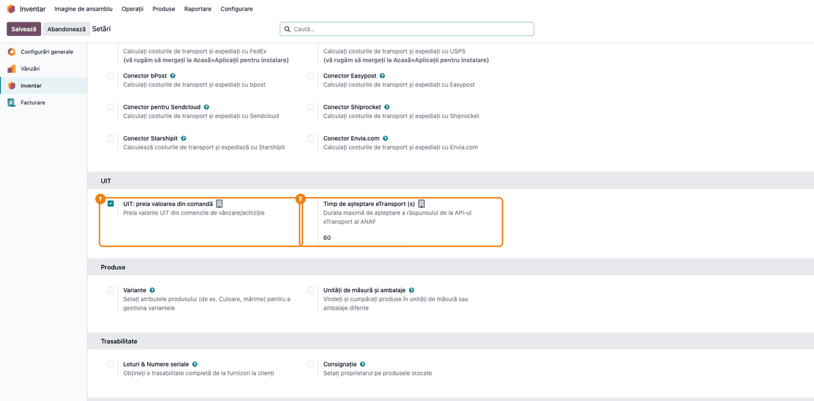
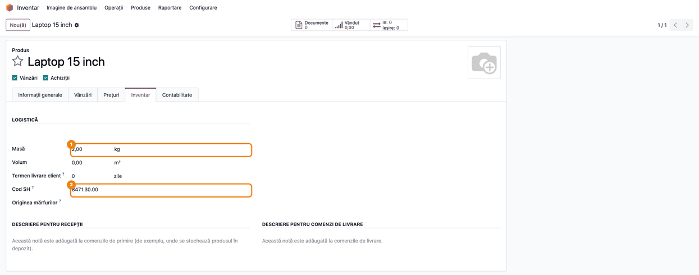
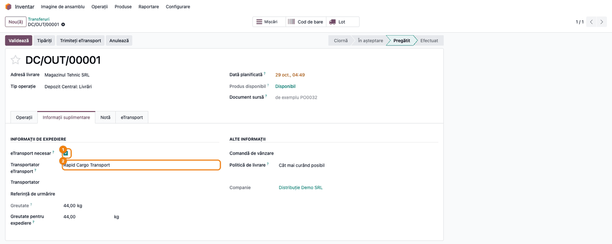
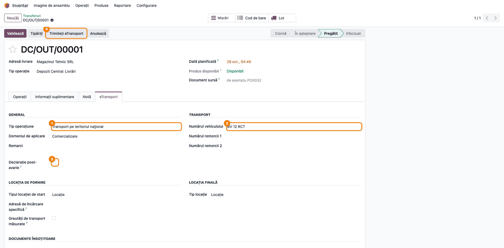
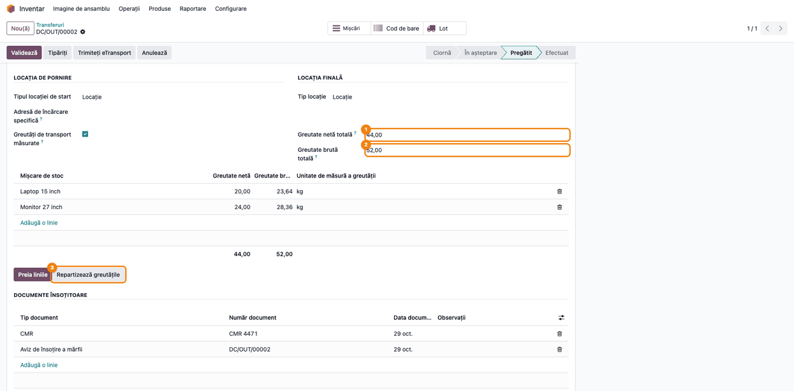
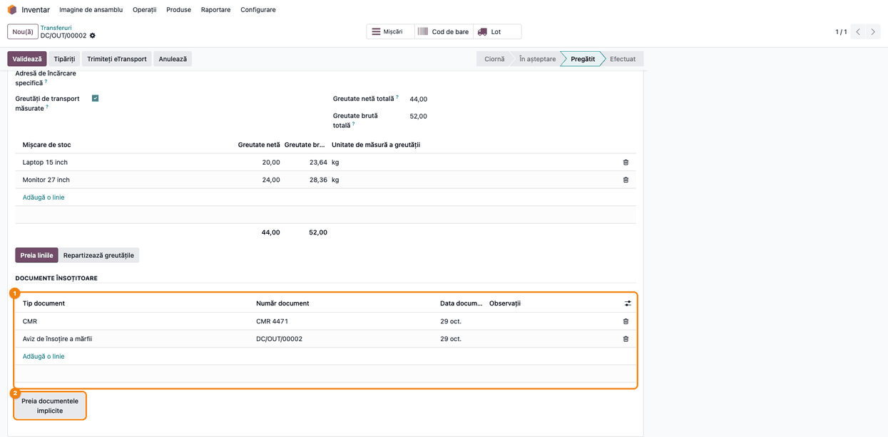
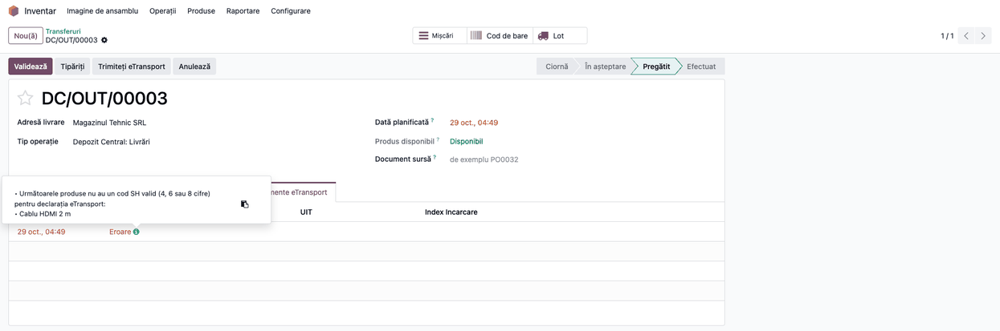
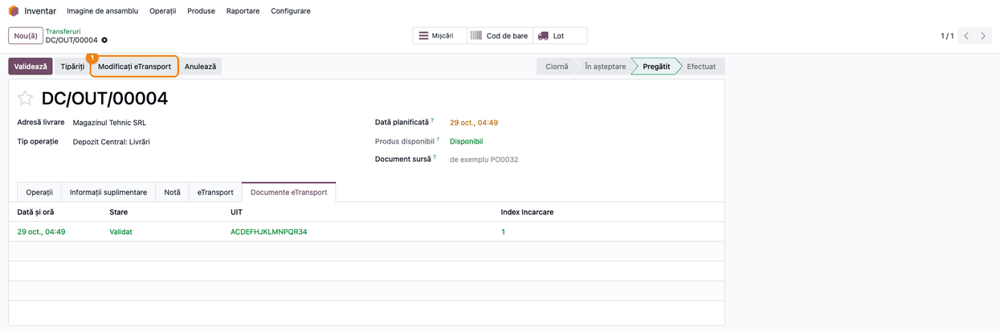

# Fișă Modul: Declarația eTransport completă și corectă din transfer

**Modul:** `l10n_ro_etransport_enhancement`
**Utilizator principal:** Operator depozit / logistică, responsabil fiscal
**Prioritate:** 🔴 Ridicată (corectează date declarate greșit la ANAF, fără ca ANAF să semnaleze eroarea)

---

## 1. Scop business

Modulul standard Odoo `l10n_ro_edi_stock` trimite declarația RO e-Transport din transfer, dar în mai
multe situații **ANAF acceptă XML-ul și emite UIT, deși datele declarate sunt greșite**. Modulul
completează și corectează declarația, astfel încât ce primește ANAF să corespundă cu marfa transportată.

- **Corecția unei declarații** nu mai produce un al doilea UIT. Butonul „Modificați eTransport”
  trimite acum UIT-ul corectat. Standardul trimitea o notificare nouă, deci în SPV rămâneau două
  UIT-uri active, iar transferul îl arăta pe cel vechi.
- **Codul tarifar** se ia din **Cod SH** de pe produs, când modulul Intrastat nu e instalat. Standardul
  trimitea atunci `00000000` pentru orice produs. Un produs fără cod SH oprește acum declarația
  înainte de trimitere.
- **Greutatea brută** nu mai dublează marfa când transferul e ambalat în colete. Tara coletului se
  adaugă o singură dată și se împarte pe produse.
- **Greutățile măsurate** pe cântar se pot declara direct: se introduc totalurile net și brut, iar
  modulul le repartizează pe produse.
- **Documentele însoțitoare** (CMR, factură, aviz) se declară explicit. Standardul trimitea doar
  numărul transferului.
- **Transportatorul** se alege direct pe transfer (**Transportator eTransport**), fără să mai fie
  nevoie de o metodă de livrare.
- **Declarația post-avarie**, pentru notificările depuse după o indisponibilitate a sistemului.
- **Comunicarea cu ANAF** e mai robustă: timp de așteptare configurabil, iar la o cădere de rețea
  transferul primește un mesaj clar în loc de o eroare tehnică.
- **Valorile declarate** sunt valoarea liniei, nu prețul unitar. Standardul punea costul unitar ca
  valoare a întregii linii. Opțional, valoarea se ia din comanda de vânzare sau de achiziție.
- **Livrarea directă furnizor → client (dropship)** se declară din transferul de dropship, cu
  partenerul și valoarea luate din comanda potrivită operațiunii.
- **Traseele cu vamă:** la import și export, ambele capete ale traseului pot fi punct de trecere a
  frontierei sau birou vamal.
- **Unitatea de măsură** a liniei declarate urmează cantitatea, exprimată în unitatea de bază a
  produsului. Liniile fără cantitate nu se mai declară.

## 2. Bază legală și context

- **OUG 41/2022, cu modificările ulterioare,** instituie sistemul **RO e-Transport**: transporturile
  de bunuri cu risc fiscal ridicat și, prin modificările ulterioare, transporturile internaționale se
  declară în prealabil, iar declarația primește un **cod UIT** valabil pe durata transportului.
  Modulul nu verifică pragurile de declarare.
- **Declarația post-avarie** este notificarea depusă după o indisponibilitate a sistemului RO
  e-Transport, marcată în XML cu `declPostAvarie="D"`. Ajutorul câmpului din interfață o leagă de
  OUG 41/2022 art. 8 alin. (1^3).
- Structura XML urmează **schema ANAF eTransport v2** și **regulile de validare (Schematron) v2.0.2**:
  - `corectie` trebuie să fie primul element al notificării;
  - codul tarifar e obligatoriu, cu excepția operațiunilor 60 și 70, și are 4, 6 sau 8 cifre;
  - greutatea brută nu poate fi mai mică decât cea netă.
- Ghidul ANAF: [RO e-Transport — ghid de utilizare](https://static.anaf.ro/static/10/Anaf/AsistentaContribuabili_r/Ghid_RO_e_Transport_2025.pdf).

Modulul **nu decide** dacă un transport trebuie declarat. Operatorul stabilește obligația și alege
operațiunea corectă.

## 3. Utilizatori și roluri

- **Operator depozit / logistică:** completează datele de transport pe livrare, cântărește marfa,
  trimite declarația și preia UIT-ul.
- **Responsabil fiscal / contabil:** completează codul SH pe produse și verifică în SPV
  declarațiile corectate.
- **Administrator:** setările UIT din Inventar.

Roluri recomandate la testare: **Inventar / Administrator** (pentru setări) și **Inventar /
Utilizator** (pentru transferuri).

## 4. Conturi și date implicate

Modulul **nu generează note contabile**. Valorile declarate se citesc din comenzi și din valoarea
de stoc, fără să modifice contabilitatea.

Date implicate:
- pe **produs**: **Masă** și **Cod SH**;
- pe **transfer**:
  - **eTransport necesar** și **Transportator eTransport**;
  - datele din tab-ul **eTransport**: operațiune, vehicul, locații, declarație post-avarie;
  - greutățile măsurate și documentele însoțitoare;
- documentele **eTransport** create la trimitere, cu stare (Trimis, Validat, Eroare) și UIT.

Date minime pentru demo:
- companie cu țara fiscală **România**, CUI și token ANAF pentru eTransport;
- un client din România și un transportator cu CUI sau CNP;
- două produse cu masă și cod SH și un produs fără cod SH;
- o livrare pregătită (stare **Pregătit**).

## 5. Configurare inițială

1. Instalați modulul `l10n_ro_etransport_enhancement` (dependențe: `l10n_ro_edi`, `l10n_ro_edi_stock`).
2. Verificați conexiunea ANAF a companiei: **Contabilitate** (sau **Facturare**) **→ Configurare → Setări**, blocul
   **E-Factura România**. Același token se folosește și pentru eTransport.
3. **Inventar → Configurare → Setări**, blocul **UIT**:
   - **UIT: preia valoarea din comandă**: bifați dacă valoarea declarată se ia din comanda de
     vânzare (la livrări) sau de achiziție (la recepții);
   - **Timp de așteptare eTransport (s)**: implicit 60 de secunde. Standardul Odoo folosește 10
     secunde, de multe ori prea puțin.
4. Pe fiecare produs transportat completați **Masă** și **Cod SH**, în tab-ul **Inventar**.

## 6. Flux de utilizare

### Pasul 1 — Setările UIT

**Inventar → Configurare → Setări**, blocul **UIT**:
- **UIT: preia valoarea din comandă** ①: valoarea declarată se ia din linia comenzii (prețul
  net, după reducere, fără TVA), convertită în RON la data planificată;
- **Timp de așteptare eTransport (s)** ②: cât așteaptă Odoo răspunsul ANAF înainte să renunțe.



### Pasul 2 — Produsul: masa și codul SH

**Inventar → Produse → Produse**, deschideți produsul, tab-ul **Inventar**:
- **Masă** ①: din ea se calculează greutatea netă declarată;
- **Cod SH** ②: devine **codul tarifar** din declarație. Punctele și spațiile se elimină
  (`8471.30.00` devine `84713000`); codul trebuie să aibă 4, 6 sau 8 cifre.

Dacă modulul Intrastat (`account_intrastat`) e instalat, codul SH nu se mai folosește: e obligatoriu
codul Intrastat al produsului, iar lipsa lui oprește declarația (vezi secțiunea 9).



### Pasul 3 — Livrarea: eTransport necesar și transportatorul

**Inventar → Operații → Livrări**, deschideți livrarea, tab-ul **Informații suplimentare**:
- **eTransport necesar** ①: marchează transferul care trebuie declarat. Bifați-l întâi: abia
  după el apare câmpul următor;
- **Transportator eTransport** ②: firma care face transportul. Se alege direct partenerul, fără
  metodă de livrare. Câmpul **Transportator** de dedesubt este metoda de livrare din standard și
  poate rămâne gol.



### Pasul 4 — Datele declarației și trimiterea

Pe aceeași livrare, tab-ul **eTransport**:
- **Tip operațiune** ① (ex. „Transport pe teritoriul național”) și **Domeniul de aplicare**;
- **Numărul vehiculului** ②;
- **Declarație post-avarie** ③: bifați **doar** când notificarea se depune după o indisponibilitate
  a sistemului RO e-Transport;
- locația de pornire și cea finală. Pentru operațiunea 30 se poate alege o **Adresă de încărcare
  specifică**, dacă marfa nu pleacă din depozit.

Apăsați **Trimiteți eTransport** ④. Declarația pleacă la ANAF, iar în tab-ul **Documente
eTransport** apare imediat documentul cu starea **Trimis** și cu UIT-ul. **Preluare stare** trece
documentul în **Validat** sau **Eroare**, după răspunsul ANAF.



### Pasul 5 — Greutățile măsurate pe cântar

Când marfa se cântărește, în tab-ul **eTransport** bifați **Greutăți de transport măsurate** și:
1. **Găsiți pe ecran:** totalurile **Greutate netă totală** ① și **Greutate brută totală** ②,
   apoi lista cu câte o linie pe produs (greutate netă, greutate brută, unitate).
2. **Introduceți** totalurile citite pe cântar și apăsați **Preia liniile**. Lista se recalculează
   din cantități, fără să se adune la valorile vechi.
3. Apăsați **Repartizează greutățile** ③. Totalurile se împart pe linii proporțional cu fiecare
   linie, sau egal dacă toate pornesc de la zero.
4. **Verificați** că suma coloanelor din subsolul listei este egală cu totalurile introduse.
   Dacă unei mișcări îi lipsește linia de greutate, deasupra listei apare un avertisment roșu.

În exemplu, 44 kg net și 52 kg brut se împart în 20 / 23,64 kg (laptopuri) și 24 / 28,36 kg (monitoare).



### Pasul 6 — Documentele însoțitoare

În secțiunea **Documente însoțitoare** din același tab ①:
- apăsați **Preia documentele implicite** ②. Se adaugă avizul (numărul transferului) și facturile
  și notele de credit postate legate de livrare, fără dubluri;
- adăugați manual celelalte documente, de exemplu **CMR**, cu număr și dată. **Observații** e
  opțional.

Fără niciun rând, declarația conține doar avizul cu numărul transferului, ca în standard.



### Pasul 7 — Declarația oprită: produs fără cod SH

Dacă un produs nu are un cod SH valid, declarația **nu pleacă la ANAF**. În tab-ul **Documente
eTransport** apare un document cu starea **Eroare**. Pictograma de lângă stare afișează mesajul, cu
produsele de completat.

Remediere: completați **Cod SH** pe produs (Pasul 2), apoi apăsați din nou **Trimiteți eTransport**.
La operațiunile 60 și 70 codul nu e obligatoriu și se omite din XML.



### Pasul 8 — Corecția unei declarații validate

Pe o livrare cu UIT **Validat**, modificați datele (ex. vehiculul) și apăsați **Modificați
eTransport** ①. Corecția poartă UIT-ul inițial, iar transferul îl păstrează pe acesta, fără să
primească altul. Apăsați apoi din nou **Preluare stare**, ca să confirmați că ANAF a validat
corecția.

```xml
<eTransport xmlns="mfp:anaf:dgti:eTransport:declaratie:v2" ...>
  <notificare codTipOperatiune="30">
    <corectie uit="ACDEFHJKLMNPQR34"/>
    ...
  </notificare>
</eTransport>
```



### Note de monografie și raportare

- Modulul **nu produce note contabile**. Este o completare a declarației e-Transport.
- **Greutatea brută**, când nu se folosesc greutăți măsurate:
  - fără colet, este egală cu greutatea netă;
  - pentru un colet cântărit, tara este greutatea coletului minus greutatea mărfii, iar pentru un
    colet necântărit este greutatea tipului de colet;
  - tara se adaugă o singură dată și se împarte pe produse proporțional cu marfa.

  Exemplu: un colet cântărit la 33 kg, cu 20 kg + 10 kg de marfă, se declară 22 kg + 11 kg brut.
  Standardul declara 53 kg + 43 kg.
- **Greutățile măsurate**, când sunt bifate, înlocuiesc calculul de mai sus.
- **Valoarea declarată** (valoarea liniei, fără TVA):
  - cu setarea **UIT: preia valoarea din comandă**: prețul net de pe linia comenzii × cantitatea.
    Dacă mișcarea nu provine dintr-o comandă, se aplică regula de mai jos;
  - fără setare: costul produsului × cantitatea. Doar dacă acesta e zero se caută, în ordine,
    valoarea de stoc a mișcării, apoi prețul de vânzare. Dacă nu se găsește niciun preț, trimiterea
    se oprește cu eroare.

### Livrarea directă furnizor → client (dropship)

Pe transferul de dropship se apasă același **Trimiteți eTransport**. Operatorul stabilește rolul
declarantului și alege operațiunea; modulul nu decide dacă e nevoie de UIT.

| Operațiune | Partener comercial / sursa valorii | Traseu tipic în România |
|---|---|---|
| 30 — transport național | clientul / comanda de vânzare | adresa de încărcare a furnizorului → adresa de livrare |
| 10 — achiziție intracomunitară | furnizorul / comanda de achiziție | punct de frontieră → adresa clientului |
| 20 — livrare intracomunitară | clientul / comanda de vânzare | adresa furnizorului din România → punct de frontieră |
| 40 — import | furnizorul / comanda de achiziție | frontieră sau vamă → destinația din România |
| 50 — export | clientul / comanda de vânzare | încărcare sau vamă în România → frontieră sau vamă |

- Valoarea vine **întotdeauna** din comandă, chiar fără setarea de la Pasul 1.
- Fiecare linie trebuie legată și de o vânzare, și de o achiziție a companiei declarante.
- Sunt oprite: retururile, loturile cu dropship, un declarant care nu e firmă din România, adresele
  care nu se pot deduce din comenzi.
- Dacă marfa nu pleacă de la adresa furnizorului, folosiți **Adresă de încărcare specifică**.

## 7. Legături cu alte module / declarații

| Modul / proces | Rol în flux | Tip legătură |
|---|---|---|
| `l10n_ro_edi_stock` | declarația RO e-Transport standard: trimitere, stări, UIT | dependență (manifest) |
| `l10n_ro_edi` | conexiunea ANAF a companiei (token) | dependență (manifest) |
| `stock_delivery` | câmpul **Cod SH** de pe produs | prin `l10n_ro_edi_stock` |
| `account_intrastat` | codul Intrastat înlocuiește codul SH (obligatoriu, în afară de operațiunile 60 și 70) | opțional |
| `stock_dropshipping` | declarația pentru livrarea directă furnizor → client | opțional |
| `l10n_ro_etransport_batch_enhancement` | aceleași completări pe loturi de transferuri | modul separat |
| `l10n_ro_etransport_uit_actions` | ștergerea sau confirmarea unui UIT, schimbarea vehiculului | modul separat |

**Ce e automat:** codul tarifar din codul SH, greutatea brută fără dubluri, repartizarea
greutăților măsurate, documentele implicite, elementul de corecție, valorile declarate, unitatea de
măsură a liniei și data transportului (în fusul orar al utilizatorului, implicit România, niciodată
în trecut).

**Ce rămâne manual:** stabilirea obligației de declarare și a operațiunii, completarea codurilor
SH, cântărirea, documentele însoțitoare în afara avizului și a facturii, bifa post-avarie și
verificarea în SPV după o cădere de rețea.

## 8. Verificări pentru consultant

- [ ] Blocul **UIT** apare în **Inventar → Configurare → Setări**, cu cele două setări.
- [ ] Produsele transportate au **Masă** și **Cod SH** cu 4, 6 sau 8 cifre.
- [ ] Pe livrare, **eTransport necesar** e bifat și **Transportator eTransport** e completat.
- [ ] Tab-ul **eTransport** are operațiunea, domeniul, vehiculul și locațiile.
- [ ] Cu greutăți măsurate, suma liniilor este egală cu totalurile introduse și nu apare
      avertismentul roșu.
- [ ] **Documente însoțitoare** conține avizul și CMR-ul sau factura, după caz.
- [ ] Un produs fără cod SH oprește trimiterea, cu mesajul care numește produsul.
- [ ] La o corecție, transferul păstrează același UIT, iar în SPV nu apare un UIT nou.
- [ ] Bifa **Declarație post-avarie** e folosită doar după o indisponibilitate a sistemului.
- [ ] Înainte de actualizarea modulului la un client fără Intrastat, codurile SH sunt completate
      pe toate produsele declarate.

## 9. Mesaje de eroare frecvente

| Mesaj / simptom | Cauză probabilă | Remediere |
|---|---|---|
| „Următoarele produse nu au un cod SH valid (4, 6 sau 8 cifre) pentru declarația eTransport” | **Cod SH** lipsă sau cu alt număr de cifre | Completați codul SH pe produs și retrimiteți |
| „Următoarele produse nu au greutatea definită” | Produsul nu are **Masă** | Completați masa pe produs |
| „Produsul … lipsește valoarea codului intrastat.” | Cu Intrastat instalat, produsul nu are cod Intrastat | Completați codul Intrastat pe produs |
| „Nu a fost găsit un preț pentru …” | Setarea din comandă e debifată, iar produsul nu are cost, valoare de stoc sau preț de vânzare | Completați costul sau prețul produsului ori bifați preluarea valorii din comandă |
| „ANAF nu a răspuns la cererea eTransport … verifică în SPV dacă a fost deja emis un UIT” | Cădere de rețea sau timp de așteptare depășit | Verificați în SPV înainte de retrimitere; măriți **Timp de așteptare eTransport** |
| „Greutățile totale netă și brută trebuie să fie mai mari decât 0.” | **Repartizează greutățile** fără totaluri introduse | Introduceți totalurile de pe cântar |
| În SPV apar două UIT-uri pentru același transport | Corecție făcută înainte de această versiune a modulului | Ștergeți notificarea în plus (din SPV sau cu `l10n_ro_etransport_uit_actions`) și păstrați UIT-ul de pe transfer |

## 10. Capturi de ecran

Capturile (`static/description/`) sunt **generate automat** din `tests/test_screenshots.py`
(mixinul `ScreenshotCase` din `l10n_ro_doc_screenshots`, import defensiv), în **limba română**,
pe planul de conturi RO (`setup_country("ro")`):

1. `01_setari_uit.png`: setările UIT din Inventar.
2. `02_produs_cod_sh.png`: produs cu masa și codul SH.
3. `03_transportator.png`: livrare cu eTransport necesar și transportatorul ales.
4. `04_date_declaratie.png`: datele declarației în tab-ul eTransport și butonul de trimitere.
5. `05_greutati_masurate.png`: greutăți măsurate repartizate pe produse.
6. `06_documente_insotitoare.png`: documentele însoțitoare (CMR, aviz).
7. `07_blocaj_cod_sh.png`: declarație oprită pentru un produs fără cod SH.
8. `08_corectie_uit.png`: livrare cu UIT validat, gata de corecție.

Regenerare (restrânsă la clasă):

```bash
./odoo/odoo-bin -c odoo.conf -d <db> -i l10n_ro_etransport_enhancement,l10n_ro_doc_screenshots \
    --test-tags=/l10n_ro_etransport_enhancement:TestEtransportScreenshots --stop-after-init
```

## 11. Observații pentru manual

- **Secvența de lucru:** produs cu masă și cod SH → livrare cu transportator și date de transport
  → greutăți și documente → trimitere → preluarea UIT-ului → eventuală corecție.
- **ANAF acceptă declarații cu date greșite.** UIT-ul emis nu dovedește că datele sunt corecte.
  Merită explicat în manual de ce contează codul SH, greutatea brută și corecția.
- **Corecția nu creează un UIT nou.** Un UIT nou apare doar dacă declarația e trimisă ca
  notificare nouă.
- **După o cădere de rețea, verificați în SPV înainte de retrimitere,** ca să nu emiteți un al
  doilea UIT pentru aceeași marfă.
- Pe **loturi de transferuri**, aceleași completări vin din modulul
  `l10n_ro_etransport_batch_enhancement`.
