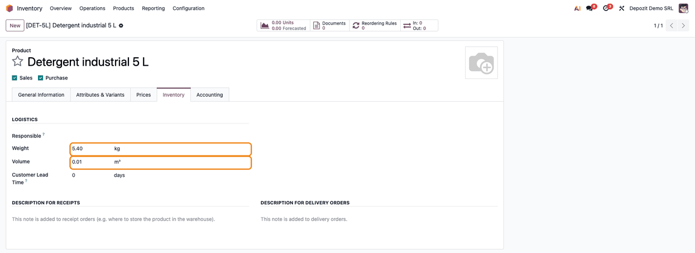

=========================
Romania - Hide Net Weight
=========================

..
   !!!!!!!!!!!!!!!!!!!!!!!!!!!!!!!!!!!!!!!!!!!!!!!!!!!!
   !! This file is generated by oca-gen-addon-readme !!
   !! changes will be overwritten.                   !!
   !!!!!!!!!!!!!!!!!!!!!!!!!!!!!!!!!!!!!!!!!!!!!!!!!!!!
   !! source digest: sha256:80e403a95fdc7ee33bacb462e373d6920f2cd3c6cc99a0cc7d99f5387f337751
   !!!!!!!!!!!!!!!!!!!!!!!!!!!!!!!!!!!!!!!!!!!!!!!!!!!!

.. |badge1| image:: https://img.shields.io/badge/maturity-Mature-brightgreen.png
    :target: https://odoo-community.org/page/development-status
    :alt: Mature
.. |badge2| image:: https://img.shields.io/badge/license-AGPL--3-blue.png
    :target: http://www.gnu.org/licenses/agpl-3.0-standalone.html
    :alt: License: AGPL-3
.. |badge3| image:: https://img.shields.io/badge/github-dhongu%2Fl10n--romania-lightgray.png?logo=github
    :target: https://github.com/dhongu/l10n-romania/tree/20.0/l10n_ro_hide_net_weight
    :alt: dhongu/l10n-romania

|badge1| |badge2| |badge3|

Ascunde câmpul „Greutate netă” (``l10n_ro_net_weight``) de pe formularul
produsului, deoarece generează confuzii de interpretare pentru
utilizatori.

**Table of contents**

.. contents::
   :local:

Usage
=====

Install the module when the company does not use the net weight of the
products. There is nothing to configure.

1. Go to **Inventory → Products → Products**, open a product and the
   **Inventory** tab. The **Logistics** group shows **Weight** and
   **Volume** one under the other: the **Net Weight** field added by
   ``l10n_ro_stock_base`` is hidden, on the product and on the product
   variant forms. Enter the product weight in **Weight**, the gross
   weight used for transport.

   |The Inventory tab of a product: the Logistics group shows Weight and
   Volume, highlighted, without the Net Weight field|

The field is only hidden: the values already saved stay in the database,
can be exported from the product list and show again if the module is
uninstalled.

If the company uses the shipping weight lines of
``l10n_ro_etransport_enhancement``, the net weight of the products is
still used for the net weight of the e-Transport declaration, even when
hidden. Clear the saved net weights first (export, set to 0, import; for
products with variants, from **Inventory → Products → Product
Variants**), or do not install this module.

Known issues / Roadmap
======================

Retragerea ``l10n_ro_net_weight``
---------------------------------

Modulul există doar pentru a ascunde câmpul ``l10n_ro_net_weight``,
definit de ``l10n_ro_stock_base`` (înainte, de modulul OCA
``l10n_ro_stock``).

1. Se păstrează cât timp ``l10n_ro_stock_base`` definește câmpul.
2. Dacă câmpul este scos din ``l10n_ro_stock_base``, vederile ascunse nu
   mai au țintă: modulul se declară învechit și se elimină (inclusiv din
   ``depends`` ale proiectelor care îl folosesc).
3. Ascunderea nu golește valorile: ``l10n_ro_etransport_enhancement``
   calculează greutatea netă a liniilor de greutăți la expediere din
   ``l10n_ro_net_weight``, când câmpul există.

Changelog
=========

20.0.0.0.5 (2026-11-03)
-----------------------

- Migration to 20.0.

19.0.0.0.5 (2026-11-03)
-----------------------

- Depends on ``l10n_ro_stock_base`` instead of the OCA module
  ``l10n_ro_stock``; the ``l10n_ro_net_weight`` field comes from the new
  module. Description with Romanian diacritics; the roadmap names
  ``l10n_ro_stock_base`` and the e-Transport weight lines that read the
  field.

19.0.0.0.4 (2026-10-22)
-----------------------

- Odoo Apps banner title: *Hide Net Weight* (was *Hide Product Net
  Weight*), the same as the module name.

19.0.0.0.3 (2026-10-09)
-----------------------

- Odoo Apps banner (``static/description/main_screenshot.png``),
  generated from ``banner.json``.

19.0.0.0.2 (2026-09-30)
-----------------------

- Own module icon in the flat style of the Terrabit modules, instead of
  the missing or generic one.

Bug Tracker
===========

Bugs are tracked on `Terrabit Issues <https://www.terrabit.ro/helpdesk>`_.
In case of trouble, please check there if your issue has already been reported.

Do not contact contributors directly about support or help with technical issues.

Credits
=======

Authors
-------

* Terrabit

Maintainers
-----------

.. |maintainer-danila12| image:: https://github.com/danila12.png?size=40px
    :target: https://github.com/danila12
    :alt: danila12

Current maintainer:

|maintainer-danila12| 

This module is part of the `dhongu/l10n-romania <https://github.com/dhongu/l10n-romania/tree/20.0/l10n_ro_hide_net_weight>`_ project on GitHub.

You are welcome to contribute.