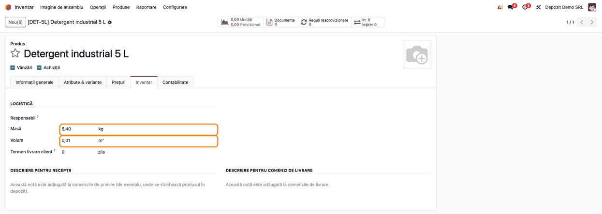

# Fișă Modul: Ascunderea greutății nete de pe produs

**Modul:** `l10n_ro_hide_net_weight`
**Utilizator principal:** Responsabil cu nomenclatorul de produse, gestionar
**Prioritate:** 🟢 Scăzută (modifică doar afișarea unui câmp; nu atinge stocul, documentele sau contabilitatea)

---

## 1. Scop business

Modulul `l10n_ro_stock_base` adaugă pe produs câmpul **Greutate netă**, lângă *Masă* (greutatea brută) și *Volum*. Multe firme nu folosesc greutatea netă, iar prezența a două câmpuri de greutate pe același ecran creează confuzii: operatorul completează greutatea în câmpul greșit sau o completează de două ori, cu valori diferite. Greutatea folosită implicit pe documentele de transport este *Masa* produsului; greutatea netă intră în declarația e-Transport doar prin liniile de greutăți la expediere din `l10n_ro_etransport_enhancement` (vezi secțiunea 5).

`l10n_ro_hide_net_weight` **ascunde** câmpul *Greutate netă* de pe formularul produsului, astfel încât pe ecran rămâne o singură greutate. Câmpul și valorile lui rămân în bază: modulul nu șterge nimic.

## 2. Bază legală și context

Nu există o obligație legală legată de acest modul: este o simplificare a interfeței. Contextul: în declarația e-Transport, greutatea brută vine din *Masa* produsului. Cu liniile de greutăți la expediere din `l10n_ro_etransport_enhancement`, greutatea netă a liniei se calculează din *Greutatea netă* a produsului înmulțită cu cantitatea; dacă aceasta este 0, se folosește greutatea brută.

## 3. Utilizatori și roluri

| Utilizator | Ce face | Drepturi recomandate la testare |
|---|---|---|
| Responsabil nomenclator | creează și întreține produsele; completează *Masa* și *Volumul* | Inventar / Utilizator |
| Consultant | decide, împreună cu clientul, dacă greutatea netă se folosește și instalează modulul dacă nu | Administrare / Setări |

## 4. Conturi și date implicate

Modulul nu folosește conturi contabile și nu creează date. Elementul implicat este câmpul **Greutate netă** de pe produs, adăugat de `l10n_ro_stock_base`: rămâne în bază, cu valorile existente, dar nu mai apare pe formular.

Date minime pentru demo: un produs stocabil cu *Masă* și *Volum* completate.

## 5. Configurare inițială

1. Verificați cu clientul că **nu folosește greutatea netă** (în rapoarte, exporturi sau integrări). Modulul doar ascunde câmpul; dacă cineva are nevoie de valoare, ea rămâne accesibilă prin export.
2. **e-Transport:** dacă firma folosește liniile de greutăți la expediere (`l10n_ro_etransport_enhancement`), greutățile nete deja salvate pe produse ajung în declarație și, după instalare, nu mai pot fi văzute sau corectate pe produs. În acest caz fie nu instalați modulul, fie goliți întâi greutățile nete (export, coloana *Greutate netă* pusă pe 0, apoi import); cu greutatea netă 0, se folosește greutatea brută. La produsele cu variante, exportul și importul se fac din **Inventar → Produse → Variante produs** (greutatea netă a variantei), nu din lista produselor. Pe transfer, greutățile se mai pot corecta și pe liniile de greutăți, înainte de trimitere.
3. Instalați modulul `l10n_ro_hide_net_weight` (instalează și `l10n_ro_stock_base`, dacă lipsește). Nu există altă configurare.

## 6. Flux de utilizare

### Pasul 1 — Produsul fără greutate netă

**Inventar → Produse → Produse**, deschideți un produs și mergeți în tab-ul **Inventar**. În grupul *Logistică* apar **Masă** și **Volum**, unul sub altul; **Greutate netă**, care stătea între ele, nu mai apare. Completați greutatea produsului în **Masă**. Grupul *Logistică* apare la produsele de tip *Bunuri*.

Același lucru se vede și pe formularul variantei de produs. Valoarea greutății nete salvate anterior rămâne în bază și se poate exporta din lista produselor (**Acțiuni → Export**, câmpul *Greutate netă*).



### Note de monografie și raportare

Modulul **nu generează note contabile** și nu influențează nicio raportare: modifică doar afișarea formularului de produs.

## 7. Legături cu alte module / declarații

| Modul | Rol |
|---|---|
| `l10n_ro_stock_base` | Dependență: definește câmpul *Greutate netă* pe care acest modul îl ascunde |
| `l10n_ro_etransport_enhancement` | Folosește *Masa* ca greutate brută; la liniile de greutăți la expediere, calculează greutatea netă din *Greutatea netă* ascunsă a produsului |

**Ce e automat:** ascunderea câmpului pe formularul produsului și al variantei, pentru toți utilizatorii.

**Ce rămâne manual:** decizia de a nu folosi greutatea netă și completarea corectă a *Masei* pe produse.

## 8. Verificări pentru consultant

- [ ] Pe formularul produsului, tab-ul *Inventar*, grupul *Logistică* arată *Masă* și *Volum*, fără *Greutate netă*.
- [ ] Pe formularul unei variante de produs, *Greutate netă* nu apare.
- [ ] O valoare de greutate netă salvată înainte de instalare se regăsește în exportul produselor (la produsele cu variante, în exportul variantelor).
- [ ] După dezinstalarea modulului, câmpul *Greutate netă* reapare, cu valorile păstrate.
- [ ] Dacă firma folosește liniile de greutăți e-Transport, greutățile nete ale produselor sunt 0 sau corecte înainte de instalare.

## 9. Mesaje de eroare frecvente

| Mesaj / simptom | Cauză | Remediere |
|---|---|---|
| *Greutate netă* apare în continuare | Modulul nu este instalat în baza curentă sau pagina nu a fost reîncărcată | Verificați în Aplicații și reîncărcați pagina |
| Tab-ul *Inventar* lipsește de pe produs | Utilizatorul nu are drept de Inventar sau produsul este de tip serviciu sau combo | Dați dreptul *Inventar / Utilizator*; grupul *Logistică* apare la produsele de tip *Bunuri* |
| Declarația e-Transport are o greutate netă diferită de cea așteptată | Greutatea netă ascunsă a produsului e folosită la liniile de greutăți | Exportați greutățile nete (la produsele cu variante, din *Variante produs*), corectați-le sau puneți-le pe 0 și reimportați |
| Clientul are nevoie din nou de greutatea netă | Modulul o ascunde pentru toți utilizatorii | Dezinstalați modulul; valorile nu se pierd |

## 10. Capturi de ecran

Capturile (`static/description/`) sunt **generate automat** din `tests/test_screenshots.py` (mixinul `ScreenshotCase` din `l10n_ro_doc_screenshots`, import defensiv), în **limba română**, pe o companie românească în RON:

1. `01_produs_fara_greutate_neta.png` — produsul, tab-ul *Inventar*, cu *Masă* și *Volum* evidențiate și fără *Greutate netă*.

Același ecran, cu interfața în engleză, este în `static/description/en/`, pentru `readme/USAGE.md`. Pentru comparație, ecranul cu greutatea netă vizibilă este în fișa modulului `l10n_ro_stock_base` (captura `06_produs_greutate_neta.png`).

Regenerare — **restrângeți la clasă**, altfel se rescriu capturile tuturor modulelor care au un test de fișe:

```bash
./odoo/odoo-bin -c odoo.conf -d <db> -i l10n_ro_hide_net_weight,stock_account,l10n_ro_doc_screenshots \
    --test-tags=/l10n_ro_hide_net_weight:TestHideNetWeightScreenshots --stop-after-init
```

## 11. Observații pentru manual

1. **Câmpul este ascuns, nu șters.** Valorile rămân în bază și reapar la dezinstalarea modulului.
2. **Ascunderea e pentru toți utilizatorii**, nu se poate alege pe utilizator sau pe companie.
3. **Greutatea pentru transport este *Masa*.** Manualul trebuie să spună operatorului să completeze acolo greutatea produsului.
4. **Valorile ascunse nu sunt inofensive** dacă firma folosește liniile de greutăți e-Transport: ele intră în greutatea netă a declarației. Curățați-le înainte de instalare.
