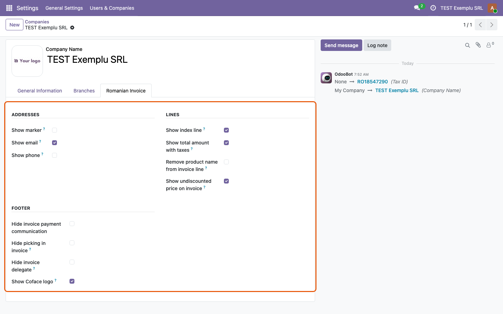
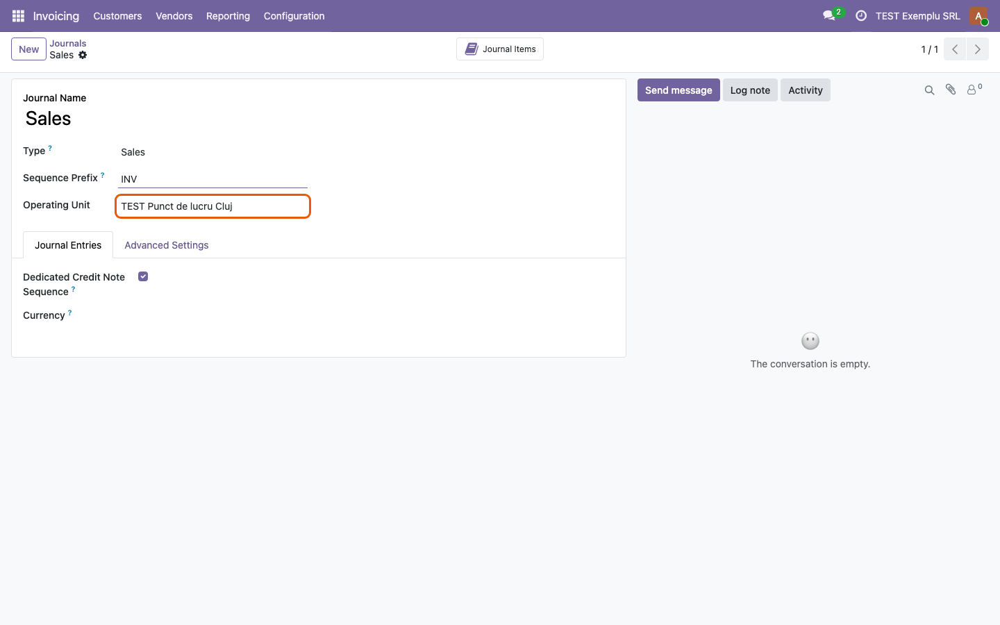
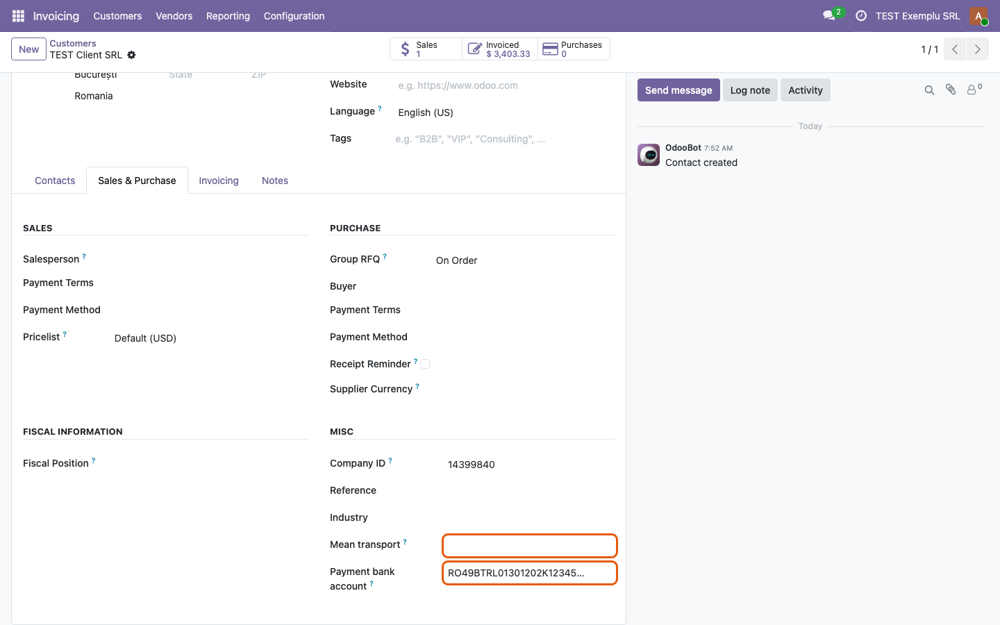
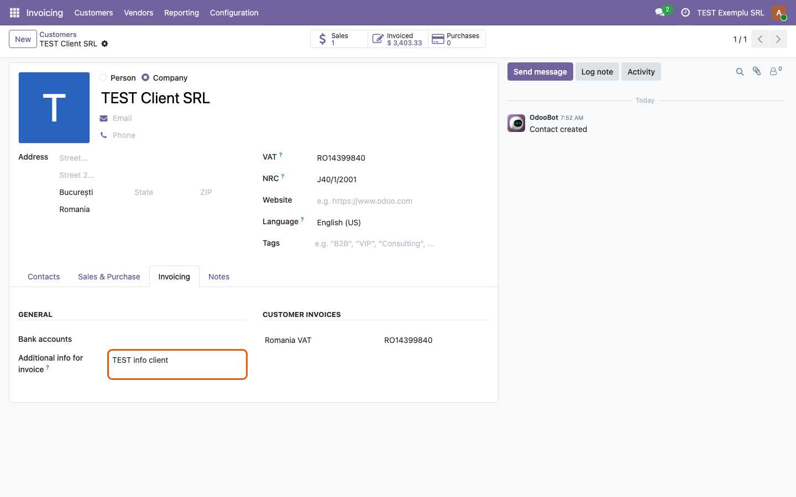
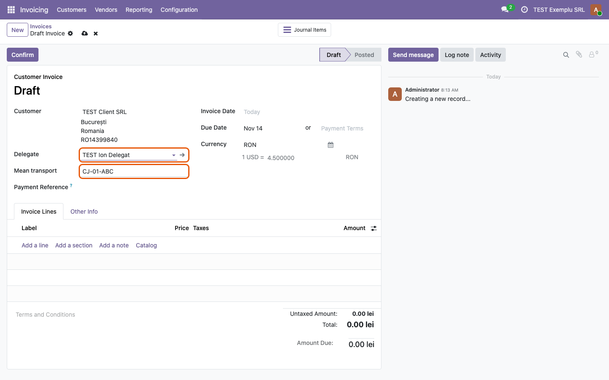
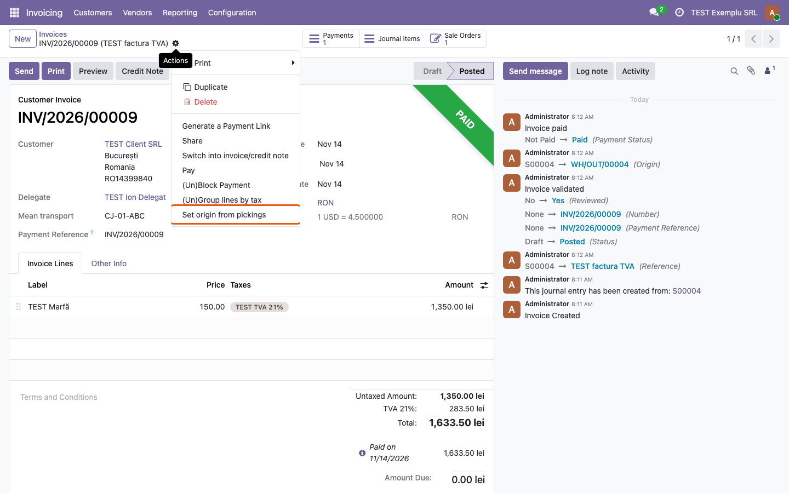
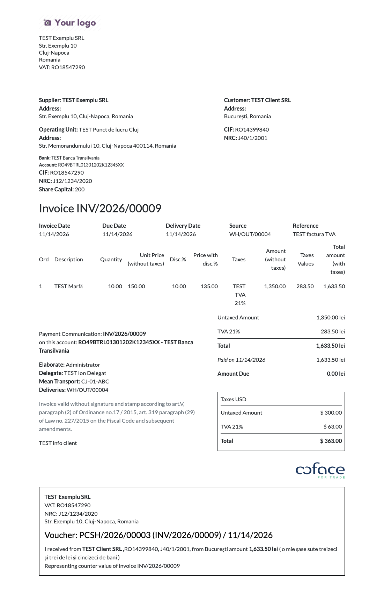
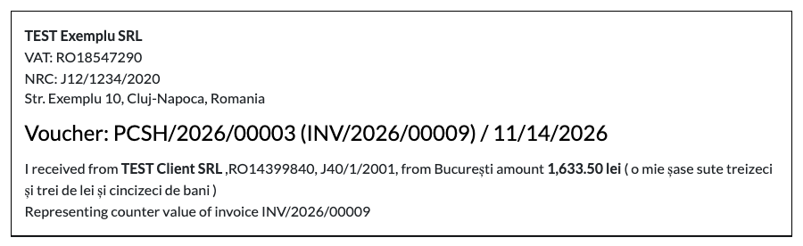
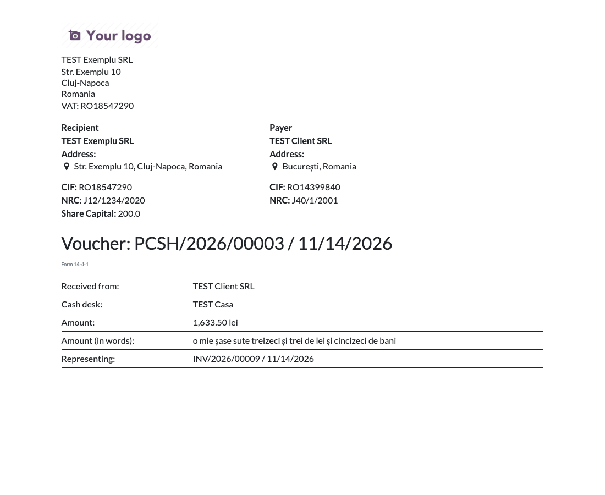
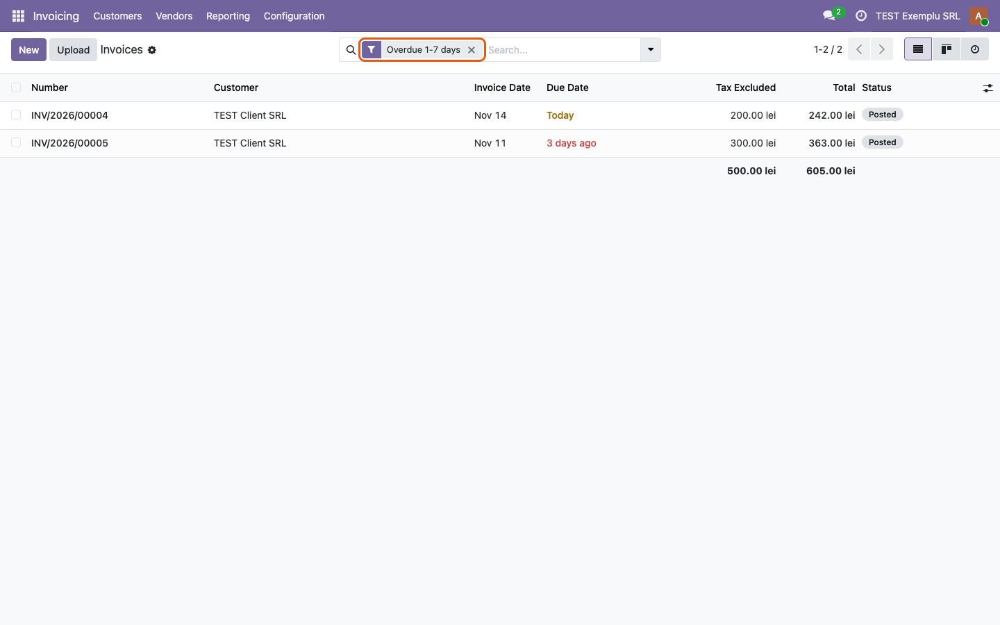

========================================
Romania - Invoice Report for Odoo Online
========================================

..
   !!!!!!!!!!!!!!!!!!!!!!!!!!!!!!!!!!!!!!!!!!!!!!!!!!!!
   !! This file is generated by oca-gen-addon-readme !!
   !! changes will be overwritten.                   !!
   !!!!!!!!!!!!!!!!!!!!!!!!!!!!!!!!!!!!!!!!!!!!!!!!!!!!
   !! source digest: sha256:9606403448e4a5d366e8f5a097d9f029c6f91b2319d01d9aaf7880d5b7dd5506
   !!!!!!!!!!!!!!!!!!!!!!!!!!!!!!!!!!!!!!!!!!!!!!!!!!!!

.. |badge1| image:: https://img.shields.io/badge/maturity-Beta-yellow.png
    :target: https://odoo-community.org/page/development-status
    :alt: Beta
.. |badge2| image:: https://img.shields.io/badge/license-AGPL--3-blue.png
    :target: http://www.gnu.org/licenses/agpl-3.0-standalone.html
    :alt: License: AGPL-3
.. |badge3| image:: https://img.shields.io/badge/github-dhongu%2Fl10n--romania-lightgray.png?logo=github
    :target: https://github.com/dhongu/l10n-romania/tree/20.0/l10n_ro_invoice_report_online
    :alt: dhongu/l10n-romania
.. |badge_fisa| image:: https://img.shields.io/badge/-Fi%C8%99%C4%83%20consultant-2ea44f.png
    :target: https://github.com/dhongu/l10n-romania/blob/20.0/l10n_ro_invoice_report_online/readme/FISA_CONSULTANT.md
    :alt: Fișă consultant

|badge1| |badge2| |badge3| |badge_fisa|

The Romanian layout of the invoice and of the cash receipt (*chitanță*),
for **Odoo Online** too: the module has no Python code and is imported
as a zip (Apps > Import Module). It is the data-only variant of
``l10n_ro_invoice_report``, for databases where custom Python cannot
run. It needs ``l10n_ro_report_common_online``, imported first.

**Invoice** (the standard *Invoices* report, changed in place):

- header with the supplier and the customer side by side: address, bank
  accounts, CIF, NRC, share capital, VAT on payment, delivery address;
  the operating unit of the journal, when set;
- lines: optional line number, unit price without VAT, VAT value per
  line, optional total with VAT, optional list price before discount,
  the product name removed from the description on request; credit notes
  printed with negative values;
- footer: issuer, delegate and means of transport, the deliveries (or
  receptions) of the invoice with their AWB numbers, the legal mention
  that the invoice is valid without signature and stamp, the additional
  info of the customer, the optional Coface logo;
- invoices paid in cash carry the cash receipt below, with the amount in
  words.

**Other reports**: *Voucher / Payment* (receipt or payment disposal,
Form 14-4-1 / 14-4-4 for the cash desk) and *Invoices in company
language*.

**Settings** are on the company, *Romanian Invoice* tab: e-mail, phone
and marker in the addresses, line number, total with VAT, list price
before discount, product name, payment communication, deliveries,
delegate, Coface logo.

**Automations** (instead of Python): the delegate brings its means of
transport on the invoice; the partner's *Payment bank account* is set on
its customer invoices; the action *Set origin from pickings* writes the
deliveries in the origin of the invoice.

What it does not do, compared with ``l10n_ro_invoice_report``: no
changes to the bank statements and no default delegate from the context.

Odoo Online
~~~~~~~~~~~

The module contains no Python: it can be imported on Odoo Online (Custom
plan) from Apps > Import Module. It cannot be installed next to
``l10n_ro_invoice_report`` (the manifest excludes it): the two modules
keep the same data in different fields.

**Table of contents**

.. contents::
   :local:

Usage
=====

Import ``l10n_ro_report_common_online`` first, then this module, from
**Apps > Import Module**.

**1. Invoice options, on the company.** In **Settings > Users &
Companies > Companies**, open the company and go to the **Romanian
Invoice** tab. Tick what the invoice prints: the address details
(marker, e-mail, phone), the lines (index line, total with taxes,
product name removed, undiscounted price) and the footer (payment
communication, pickings, delegate, Coface logo).

|Company form, Romanian Invoice tab, with the Addresses, Lines and
Footer groups|

On the company bank account, tick **Romania - Print in Report**: the
account is printed on the invoices in its currency (or in the company
currency, when the account has none).

**2. Operating unit, on the sales journal.** In **Invoicing >
Configuration > Journals**, set **Operating Unit** on the sales journal.
Its name and address are printed under the supplier; its bank accounts,
when it has any, replace those of the company.

|Sales journal with the Operating Unit field set|

**3. Partner fields.** On the partner, **Sales & Purchase** tab,
**Misc** group: **Payment bank account** (the company account the
customer pays into, set on its draft customer invoices) and **Mean
transport** (filled on the delegate, copied on the invoice).

|Customer form, Sales & Purchase tab, with Mean transport and Payment
bank account|

On the **Invoicing** tab, **Additional info for invoice** is printed at
the end of the partner's invoices.

|Customer form, Invoicing tab, with Additional info for invoice|

If you use the payment bank account, mark the company bank account as
trusted (*Send Money*), otherwise Odoo does not confirm the invoices on
which the account was set.

**4. Delegate on the invoice.** On a draft customer invoice, choose the
**Delegate** (a person, not a company): the **Mean transport** of the
delegate is copied on the invoice.

|Draft customer invoice with the delegate chosen and the means of
transport filled in|

**5. Origin from pickings.** On an invoice from a sale or purchase
order, **Actions > Set origin from pickings** writes the done deliveries
(or receptions) in the **Source** of the invoice.

|Invoice Actions menu with Set origin from pickings|

**6. Printed invoice.** **Print > Invoice PDF** prints the supplier and
the customer side by side, the operating unit, the lines with the VAT
value per line, the issuer, the delegate, the means of transport, the
deliveries with their AWB, the legal mention, the additional info of the
customer and the optional Coface logo. **Invoices in company language**
prints it in the language of the company partner.

|Printed invoice with the operating unit, discounted line, delegate,
deliveries and Coface logo|

An invoice paid on a **cash** journal carries the cash receipt below,
with the amount in words, on **Invoice PDF** only (not on **PDF without
Payment**).

|Receipt box printed below an invoice paid in cash, with the amount in
words|

**7. Voucher / Payment.** From a payment, **Actions > Print > Voucher /
Payment** prints the receipt (inbound) or the payment disposal
(outbound). On a cash journal it adds the form code (14-4-1 or 14-4-4),
the cash desk and, for payments, the identity document line.

|Voucher printed from a cash payment, form 14-4-1|

**8. Due filters.** On the customer invoices, the filters **Due
tomorrow**, **Due today**, **Overdue 1-7 days**, **Overdue 8-14 days**,
**Overdue 15-30 days** and **Overdue more than 30 days** list the posted
invoices not fully paid.

|Invoice list with the Overdue 1-7 days filter active|

Changelog
=========

20.0.1.0.0
----------

- Port to 20.0: the RO header replaces the ``information_block`` and
  ``address`` blocks of the invoice (no longer a ``
``), the line
  description prints ``label``, ``t-esc`` becomes ``t-out``,
  ``amount_in_words`` gets its values as ``t-call`` attributes,
  ``report_file`` is dropped and the delegate also accepts the contacts
  of a company.

19.0.1.0.0
----------

- First version: the data-only variant of ``l10n_ro_invoice_report``,
  importable on Odoo Online. The report templates are the same QWeb, on
  manual ``x_`` fields; the helpers of the report (deliveries, receipt
  detection, journal type and direction of the payments, amount in
  words) are computed in QWeb; the onchange of the delegate, the payment
  bank account of the partner and *Set origin from pickings* are
  automation rules and server actions; the settings are on the company
  form. The manifest excludes ``l10n_ro_invoice_report``.

Bug Tracker
===========

Bugs are tracked on `Terrabit Issues <https://www.terrabit.ro/helpdesk>`_.
In case of trouble, please check there if your issue has already been reported.

Do not contact contributors directly about support or help with technical issues.

Credits
=======

Authors
-------

* Dorin Hongu
* Terrabit

Maintainers
-----------

.. |maintainer-dhongu| image:: https://github.com/dhongu.png?size=40px
    :target: https://github.com/dhongu
    :alt: dhongu

Current maintainer:

|maintainer-dhongu| 

This module is part of the `dhongu/l10n-romania <https://github.com/dhongu/l10n-romania/tree/20.0/l10n_ro_invoice_report_online>`_ project on GitHub.

You are welcome to contribute.