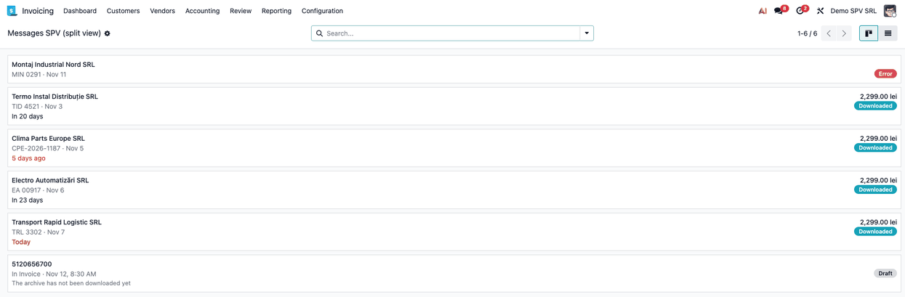
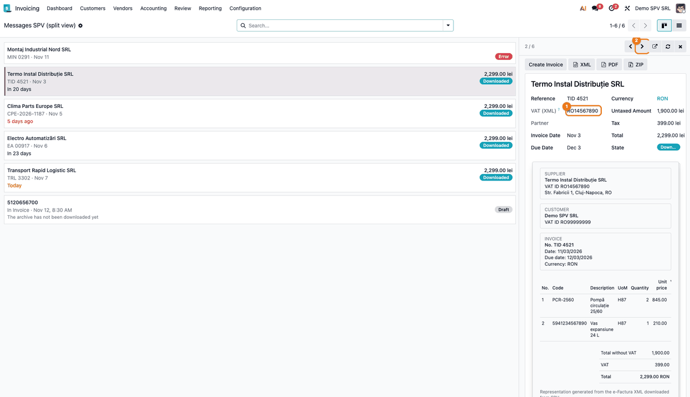
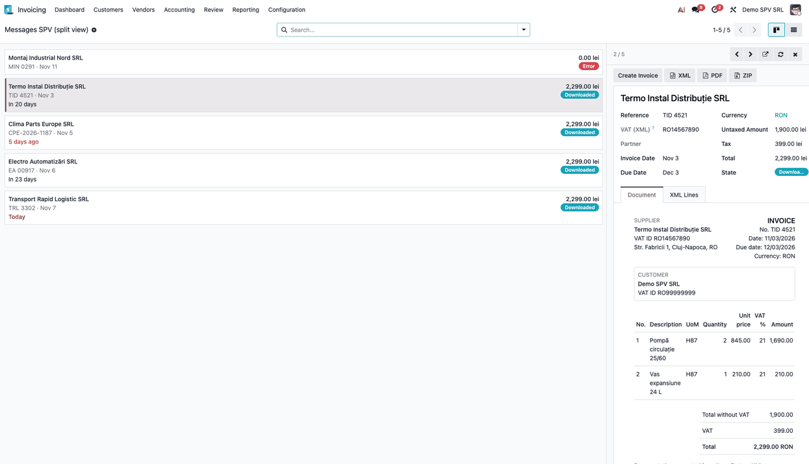
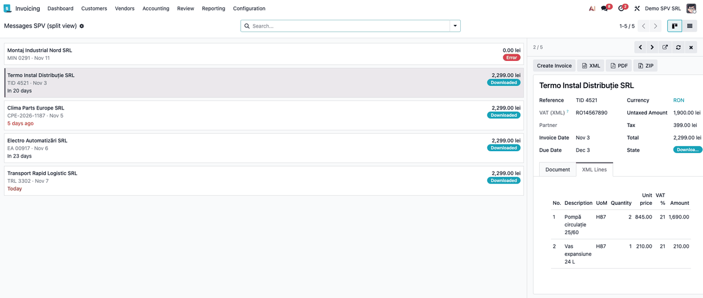
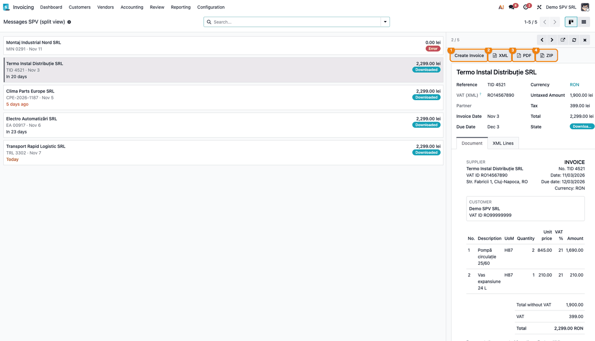
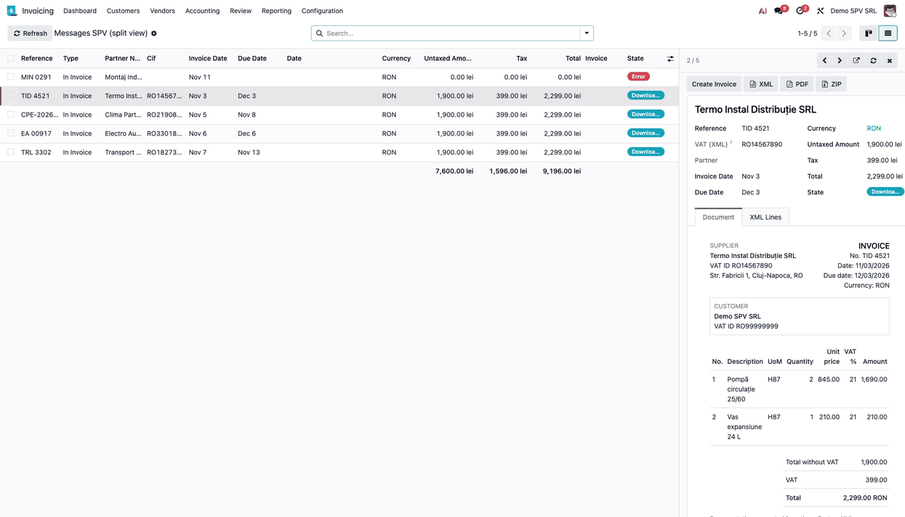

=======================
SPV Messages Side Panel
=======================

..
   !!!!!!!!!!!!!!!!!!!!!!!!!!!!!!!!!!!!!!!!!!!!!!!!!!!!
   !! This file is generated by oca-gen-addon-readme !!
   !! changes will be overwritten.                   !!
   !!!!!!!!!!!!!!!!!!!!!!!!!!!!!!!!!!!!!!!!!!!!!!!!!!!!
   !! source digest: sha256:ec05b1757e6b6d11672b960e007da5e626a72096c036253d2dc59c367ee12b4b
   !!!!!!!!!!!!!!!!!!!!!!!!!!!!!!!!!!!!!!!!!!!!!!!!!!!!

.. |badge1| image:: https://img.shields.io/badge/maturity-Beta-yellow.png
    :target: https://odoo-community.org/page/development-status
    :alt: Beta
.. |badge2| image:: https://img.shields.io/badge/license-AGPL--3-blue.png
    :target: http://www.gnu.org/licenses/agpl-3.0-standalone.html
    :alt: License: AGPL-3
.. |badge3| image:: https://img.shields.io/badge/github-dhongu%2Fl10n--romania-lightgray.png?logo=github
    :target: https://github.com/dhongu/l10n-romania/tree/19.0/l10n_ro_message_spv_side_panel
    :alt: dhongu/l10n-romania

|badge1| |badge2| |badge3|

Split view for the SPV messages: the invoices received through SPV on
the left, as cards, and the details of the selected one on the right,
without leaving the list.

- **Cards and list** — a new menu *Messages SPV (split view)*, with a
  kanban of cards (supplier, amount, number, date, status, days to the
  due date) and the usual list. A click selects the message and shows it
  in the panel.
- **The panel** — the supplier, the VAT number read from the XML, the
  dates, the amounts, the review state and the buttons *Create Invoice*,
  *Accept*, *Reject*, *XML*, *PDF* and *ZIP*.
- **The document** — a tab *Document* with the invoice as written in the
  XML (supplier, customer, lines and totals) and a tab *XML Lines* with
  the lines only. Nothing is stored: the XML is read from the ZIP when
  the message is opened.
- **Installed on request** — it is a bridge between
  *l10n_ro_message_spv* and *deltatech_web_side_panel*. The original
  menu and views stay as they are.

**Table of contents**

.. contents::
   :local:

Usage
=====

1. Open *Invoicing > Accounting > SPV > Messages SPV (split view)* (with
   the Accounting app installed, the first level is called
   *Accounting*). The received invoices appear as a column of cards:
   supplier, total, number, date, status and the days left to the due
   date.

   |The SPV messages as a column of cards|

2. Click a card: the message opens in the panel on the right and the
   card is highlighted. The panel shows the supplier, the VAT number
   read from the XML, the dates and the amounts, and the tab *Document*
   with the invoice as written in the XML (supplier, customer, lines and
   totals). Use the arrows of the panel to move to the previous or the
   next message.

   |The side panel on the tab Document|

   Scroll the tab *Document* to the totals: *Total without VAT*, *VAT*
   and *Total* match the amounts of the panel.

   |The totals of the document|

3. Open the tab *XML Lines* to check the lines of the invoice:
   description, unit, quantity, unit price, VAT rate and amount.

   |The tab XML Lines of the side panel|

4. Use the buttons of the panel: *Create Invoice*, *Accept* and *Reject*
   (when the review of the received invoices is on), or download the
   XML, the PDF or the ZIP. *Refresh* reads the message again after an
   action, the arrow-out button opens the full form and the cross closes
   the panel.

   |The action buttons of the panel|

5. The *List* view keeps all the columns, the grouping and the sorting;
   the panel works there too.

   |The list with the side panel|

On screens narrower than 1200 px (the extra-large breakpoint) the panel
is off and a click opens the form, as in the original menu.

Changelog
=========

19.0.1.0.0 (2026-11-13)
-----------------------

- First release: the menu *Messages SPV (split view)* with a kanban and
  a list that show the selected message in a side panel
  (``deltatech_web_side_panel``). The panel reads the supplier VAT
  number, the document and the lines from the invoice XML when the
  message is opened.

Bug Tracker
===========

Bugs are tracked on `Terrabit Issues <https://www.terrabit.ro/helpdesk>`_.
In case of trouble, please check there if your issue has already been reported.

Do not contact contributors directly about support or help with technical issues.

Credits
=======

Authors
-------

* Terrabit
* Dorin Hongu

Contributors
------------

- Dorin Hongu <dhongu@gmail.com> (Terrabit)

Maintainers
-----------

.. |maintainer-dhongu| image:: https://github.com/dhongu.png?size=40px
    :target: https://github.com/dhongu
    :alt: dhongu

Current maintainer:

|maintainer-dhongu| 

This module is part of the `dhongu/l10n-romania <https://github.com/dhongu/l10n-romania/tree/19.0/l10n_ro_message_spv_side_panel>`_ project on GitHub.

You are welcome to contribute.