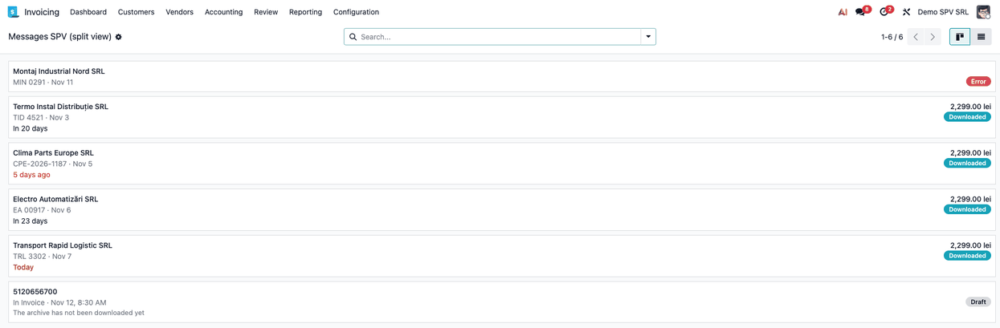
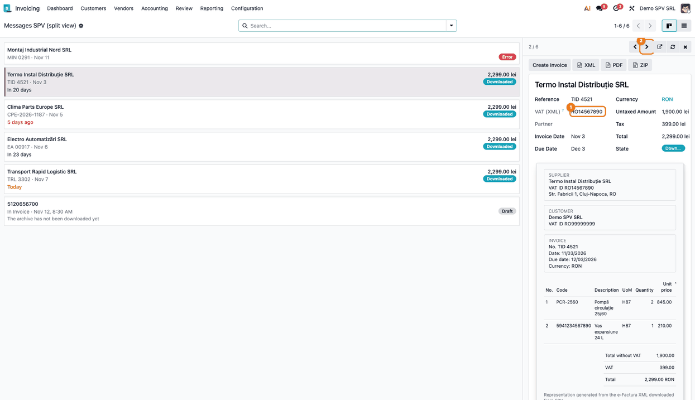
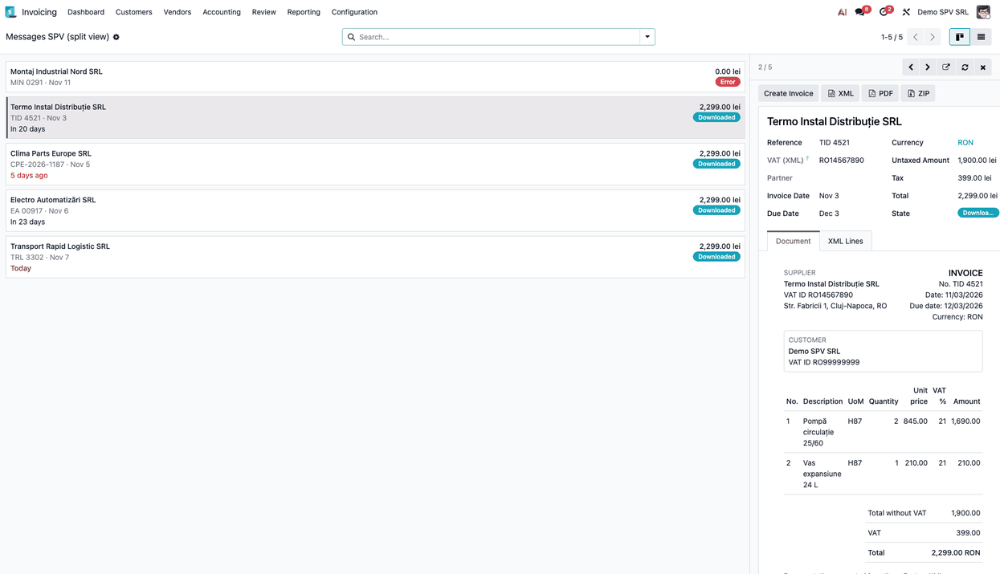
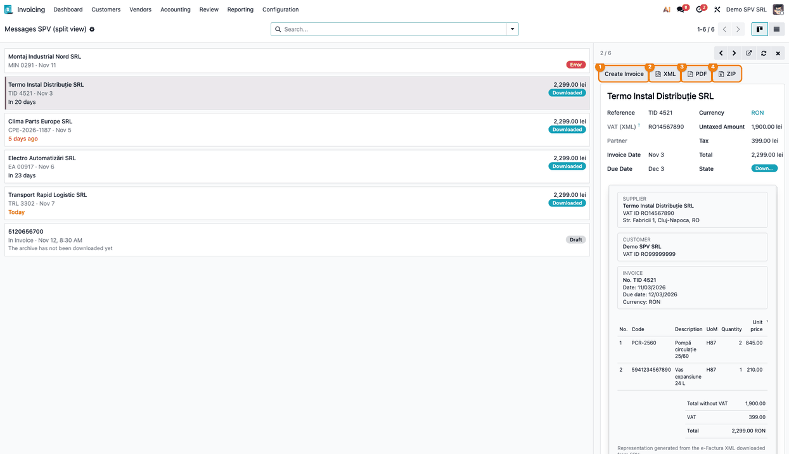
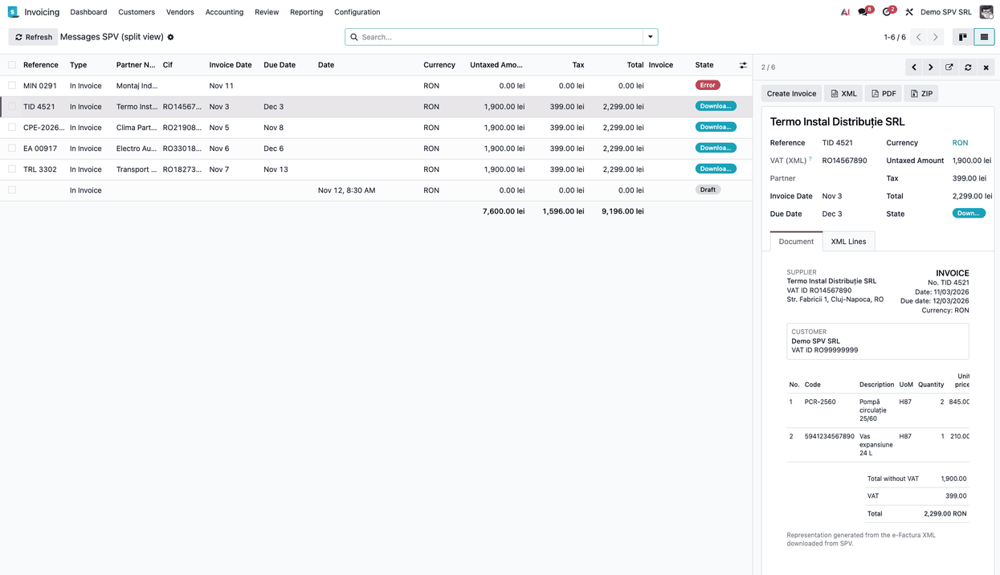
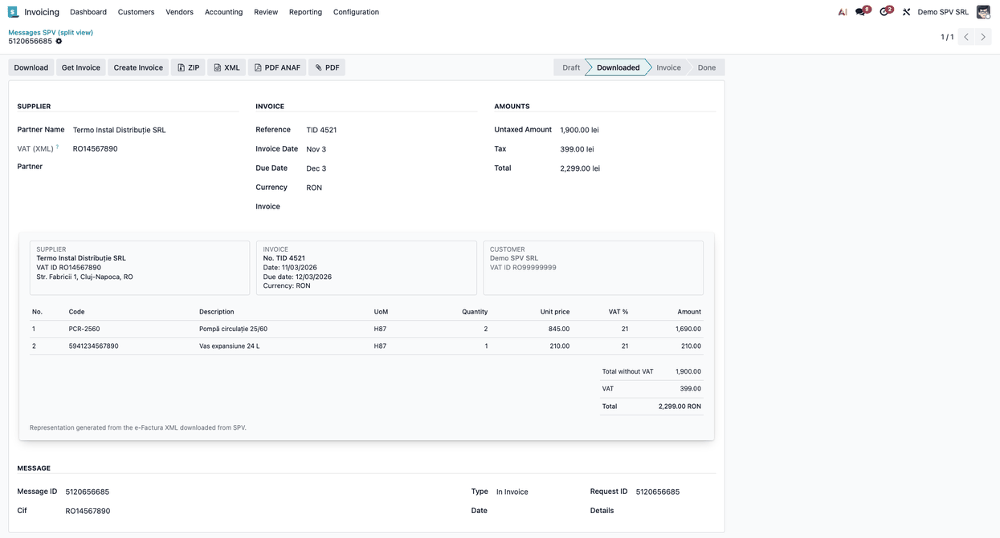

=======================
SPV Messages Side Panel
=======================

..
   !!!!!!!!!!!!!!!!!!!!!!!!!!!!!!!!!!!!!!!!!!!!!!!!!!!!
   !! This file is generated by oca-gen-addon-readme !!
   !! changes will be overwritten.                   !!
   !!!!!!!!!!!!!!!!!!!!!!!!!!!!!!!!!!!!!!!!!!!!!!!!!!!!
   !! source digest: sha256:ec05b1757e6b6d11672b960e007da5e626a72096c036253d2dc59c367ee12b4b
   !!!!!!!!!!!!!!!!!!!!!!!!!!!!!!!!!!!!!!!!!!!!!!!!!!!!

.. |badge1| image:: https://img.shields.io/badge/maturity-Beta-yellow.png
    :target: https://odoo-community.org/page/development-status
    :alt: Beta
.. |badge2| image:: https://img.shields.io/badge/license-AGPL--3-blue.png
    :target: http://www.gnu.org/licenses/agpl-3.0-standalone.html
    :alt: License: AGPL-3
.. |badge3| image:: https://img.shields.io/badge/github-dhongu%2Fl10n--romania-lightgray.png?logo=github
    :target: https://github.com/dhongu/l10n-romania/tree/20.0/l10n_ro_message_spv_side_panel
    :alt: dhongu/l10n-romania

|badge1| |badge2| |badge3|

Split view for the SPV messages: the invoices received through SPV on
the left, as cards, and the details of the selected one on the right,
without leaving the list.

- **Cards and list** — the menu *Messages SPV* opens a kanban of cards
  (supplier, amount, number, date, status, days to the due date; a
  message whose archive is not downloaded yet shows its id, type and
  date) and the usual list. A click selects the message and shows it in
  the panel.
- **The panel** — the supplier, the VAT number read from the XML, the
  dates, the amounts, the review state and the buttons *Create Invoice*,
  *Accept*, *Reject*, *XML*, *PDF* and *ZIP*.
- **The document** — the invoice as written in the XML, shown as a sheet
  of paper under the data of the message: three boxes on a row (the
  other party, the invoice data and our own company), the lines (code,
  description, unit, quantity, price, VAT rate and amount) and the
  totals. The panel and the full form of the message show the same
  document, with no tabs. Nothing is stored: the XML is read from the
  ZIP when the message is opened.
- **Installed on request** — it is a bridge between
  *l10n_ro_message_spv* and *deltatech_web_side_panel*. The menu of the
  SPV messages opens the split view; uninstalling the module puts it
  back.

**Table of contents**

.. contents::
   :local:

Usage
=====

1. Open *Invoicing > Accounting > SPV > Messages SPV* (with the
   Accounting app installed, the first level is called *Accounting*).
   The received invoices appear as a column of cards: supplier, total,
   number, date, status and the days left to the due date. A message
   whose archive is not downloaded yet is a draft: its card shows the
   id, the type and the date of the message.

   |The SPV messages as a column of cards|

2. Click a card: the message opens in the panel on the right and the
   card is highlighted. The panel shows the partner, the VAT number read
   from the XML and the total, with the state of the message as a status
   bar next to the buttons, and the document: the invoice as written in
   the XML, on a sheet of paper with three boxes (the other party, the
   invoice data and our own company), the lines (code, description,
   unit, quantity, unit price, VAT rate and amount) and the totals. Use
   the arrows of the panel to move to the previous or the next message.

   |The side panel with the document|

   Scroll the document to the totals: *Total without VAT*, *VAT* and
   *Total* match the amounts of the panel.

   |The totals of the document|

3. Use the buttons of the panel: *Create Invoice*, *Accept* and *Reject*
   (when the review of the received invoices is on), or download the
   XML, the PDF or the ZIP. *Refresh* reads the message again after an
   action, the arrow-out button opens the full form and the cross closes
   the panel.

   |The action buttons of the panel|

4. The *List* view keeps all the columns, the grouping and the sorting;
   the panel works there too.

   |The list with the side panel|

5. The arrow-out button of the panel opens the full form: it has the VAT
   ID read from the XML and the same document, with the lines. The
   fields are in three groups on a row (*Supplier*, *Invoice* and
   *Amounts*), the document is under them and the technical data of the
   message are at the bottom.

   |The full form with the document|

On screens narrower than 1200 px (the extra-large breakpoint) the panel
is off and a click opens the form of the message.

Changelog
=========

19.0.1.3.0 (2026-11-13)
-----------------------

- The state of the message is a status bar next to the buttons, in the
  panel and in the full form.
- The panel no longer repeats what the document shows (reference, dates,
  currency, untaxed amount, tax and the title): it keeps the partner,
  the VAT number read from the XML, the invoice, the total (red when it
  differs from the invoice) and the review state.
- The boxes of the document follow the direction of the invoice: the
  other party on the left, the invoice in the middle and our own company
  on the right, in a lighter color (the supplier on an issued invoice,
  the customer on a received one).
- The sheet of paper has only a soft shadow, without a border and
  without the second "page" behind.

19.0.1.2.0 (2026-11-13)
-----------------------

- The tabs *Document* and *XML Lines* are gone: the document (the
  invoice as written in the XML, with its lines and totals) is shown
  directly under the data of the message, in the panel and in the full
  form. The lines were shown twice, in both tabs.
- The document looks like a sheet of paper (border and shadow), to show
  that it is the invoice as received, and the supplier, the customer and
  the data of the invoice are three boxes on a row (fewer on a narrow
  panel).
- The fields of the full form are regrouped in three groups on a row
  (*Supplier*, *Invoice* and *Amounts*), followed by the document; the
  technical data of the message (message id, type, request id, VAT
  number, date, details) are in the group *Message* at the bottom.

19.0.1.1.0 (2026-11-13)
-----------------------

- One entry in the menu: *Messages SPV* (and its parent *SPV*) opens the
  split view; the extra entry *Messages SPV (split view)* is gone. The
  uninstall hook puts the menus back on the original action.
- The full form of the message has the VAT ID read from the XML and the
  tabs *Document* and *XML Lines*, like the panel.
- The lines show the code of the item from the XML: the code of the
  seller, or the standard identifier (e.g. GTIN) when there is none.
- A draft (a message whose archive is not downloaded yet) is a useful
  card: it shows the id, the type and the date of the message and says
  that the archive has not been downloaded, instead of an empty card
  with 0.00.
- The document and the lines built from the XML use the size of the text
  of the form, smaller than before, in the panel and in the full form.

19.0.1.0.0 (2026-11-13)
-----------------------

- First release: the menu *Messages SPV (split view)* with a kanban and
  a list that show the selected message in a side panel
  (``deltatech_web_side_panel``). The panel reads the supplier VAT
  number, the document and the lines from the invoice XML when the
  message is opened.

Bug Tracker
===========

Bugs are tracked on `Terrabit Issues <https://www.terrabit.ro/helpdesk>`_.
In case of trouble, please check there if your issue has already been reported.

Do not contact contributors directly about support or help with technical issues.

Credits
=======

Authors
-------

* Terrabit
* Dorin Hongu

Contributors
------------

- Dorin Hongu <dhongu@gmail.com> (Terrabit)

Maintainers
-----------

.. |maintainer-dhongu| image:: https://github.com/dhongu.png?size=40px
    :target: https://github.com/dhongu
    :alt: dhongu

Current maintainer:

|maintainer-dhongu| 

This module is part of the `dhongu/l10n-romania <https://github.com/dhongu/l10n-romania/tree/20.0/l10n_ro_message_spv_side_panel>`_ project on GitHub.

You are welcome to contribute.