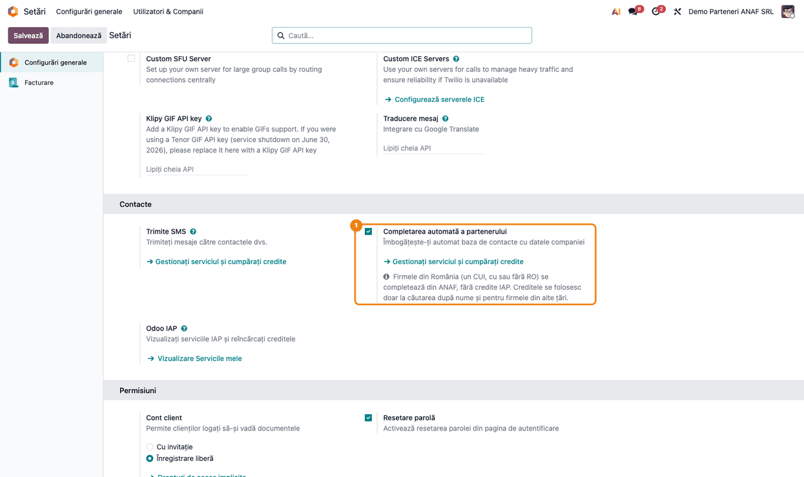
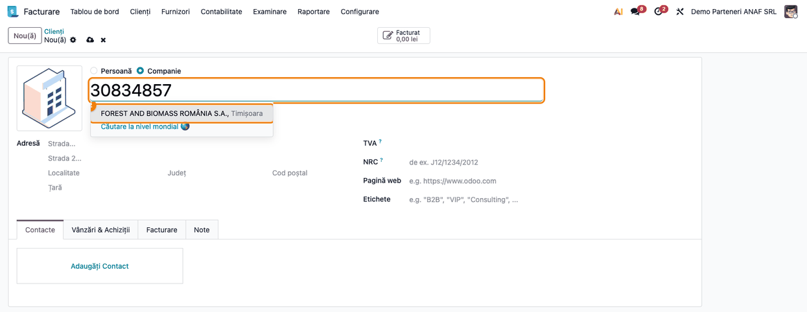
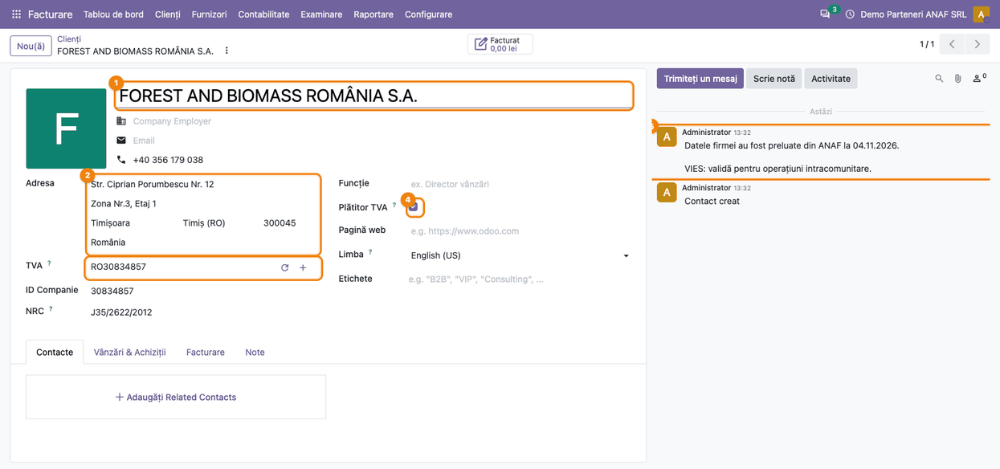
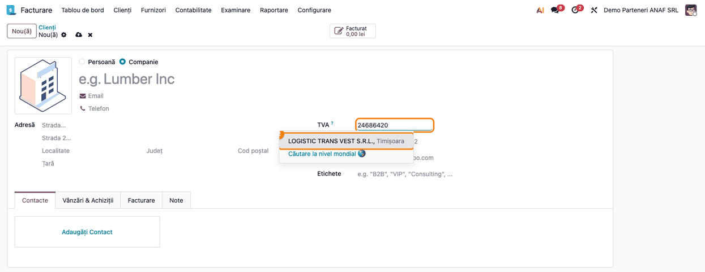
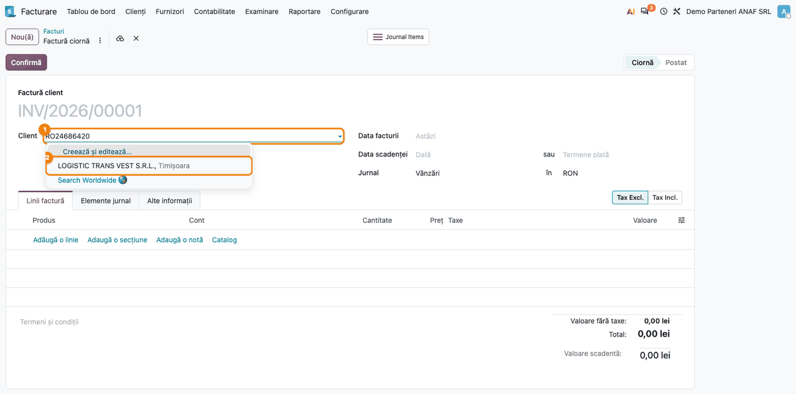
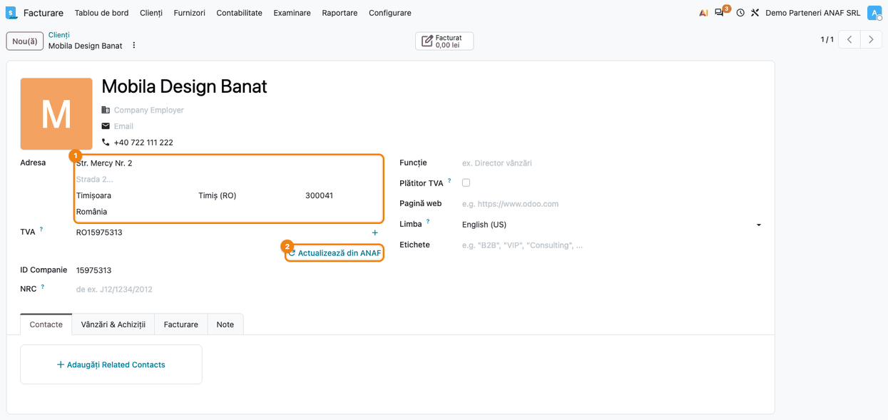
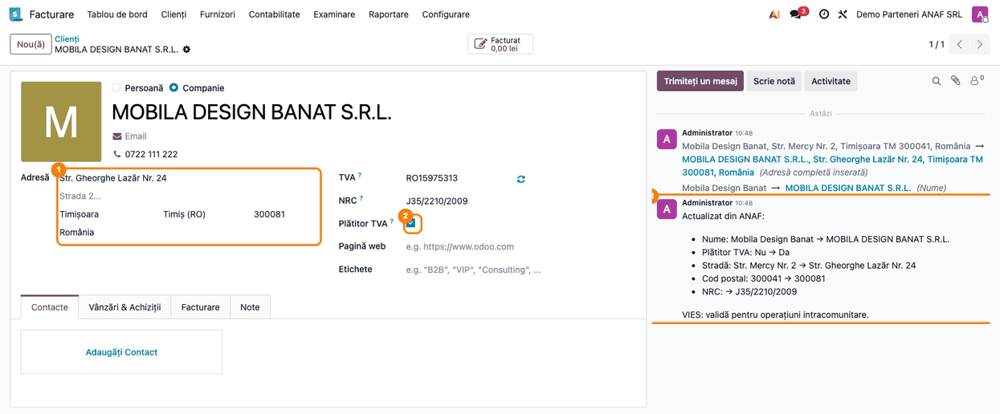
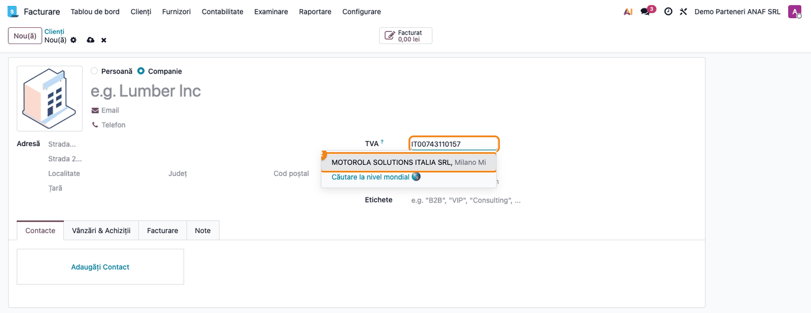
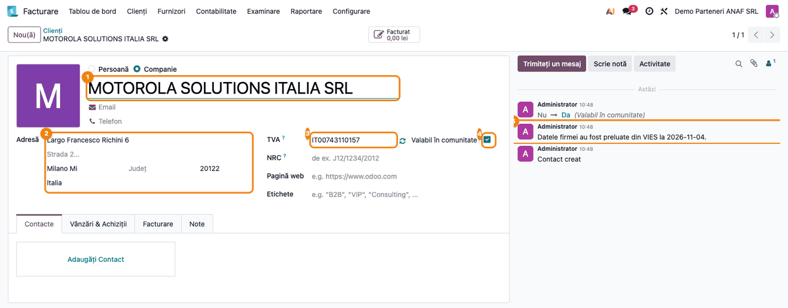
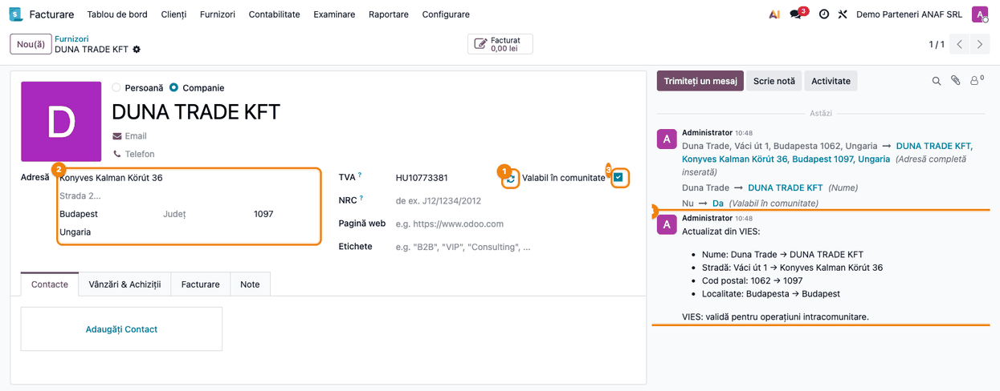

# Fișă Modul: Completarea partenerilor din ANAF și VIES, fără credite IAP

**Modul:** `l10n_ro_partner_autocomplete`
**Suită:** `l10n-romania`
**Utilizator principal:** operatorul care introduce clienți și furnizori (vânzări, facturare, achiziții, casier POS), contabilul care întreține nomenclatorul de parteneri
**Prioritate:** 🟡 Medie (orice firmă din România introduce parteneri după CUI; fără modul, Odoo consumă credite IAP pentru o informație gratuită la ANAF sau, pentru firmele din UE, la VIES)

---

## 1. Scop business

Odoo standard sugerează firmele, la tastarea numelui sau a codului fiscal, din serviciul IAP
*Partner Autocomplete* și consumă credite la fiecare completare. Pentru o firmă din România sursa
oficială este **ANAF**, iar interogarea ei este gratuită.

Cu modulul, un **CUI românesc** (cu sau fără `RO`) tastat acolo unde Odoo oferă completarea
automată — **numele** sau câmpul **TVA** (codul fiscal) al partenerului, câmpul **Client** dintr-o
ofertă sau factură, fișa clientului deschisă din Punctul de vânzare — aduce sugestia direct de la
ANAF. Alegerea ei completează partenerul: tipul **Companie**, denumire, cod fiscal (cu `RO` doar
pentru plătitorii de TVA), bifa **Plătitor TVA**, stradă și număr, detalii de adresă, localitate (pentru București,
sectorul), județ, cod poștal, număr de înregistrare la Registrul Comerțului (NRC) și telefon. Când
sugestia e aleasă în formularul partenerului (Nume, TVA), istoricul primește o notă că datele vin
de la ANAF.

Pe un partener deja existent, butonul **Actualizează din ANAF** (iconița ⟳ din dreapta codului
fiscal) reîncarcă datele și lasă în istoric lista câmpurilor modificate (valoarea veche → valoarea
nouă), plus avertismentul când ANAF arată firma ca radiată sau contribuabil inactiv. Cât timp ANAF
răspunde, un CUI românesc valid nu ajunge la IAP, deci nu se consumă credite; dacă ANAF este
indisponibil, Odoo întreabă IAP, ca în standard.

Pentru o firmă din **altă țară a Uniunii Europene**, codul de TVA cu prefixul țării (ex.
`IT00743110157`) este căutat în **VIES**, serviciul gratuit al Comisiei Europene: sugestia aduce
denumirea, strada, codul poștal, orașul și țara, fără credite IAP, iar alegerea ei bifează **Valabil
în comunitate**. Butonul **Actualizează din VIES** (aceeași iconiță ⟳) reîncarcă o astfel de firmă.
Unele state (Germania, Spania) nu comunică denumirea și adresa în VIES; pentru ele, ca și când VIES
nu răspunde sau nu cunoaște codul, sugestia vine din IAP, ca în standard.

Pentru o firmă românească **plătitoare de TVA**, nota din istoric de după preluarea din ANAF și după
**Actualizează din ANAF** spune și dacă firma este în VIES, adică înregistrată pentru operațiuni
intracomunitare. Căutarea după denumire și firmele din afara UE rămân la IAP.

## 2. Bază legală și context

- **Datele de identificare ale cumpărătorului pe factură** — denumirea, adresa și codul de
  înregistrare în scopuri de TVA sunt mențiuni obligatorii ale facturii (**Codul fiscal, art. 319
  alin. (20)**). Preluarea lor din registrul ANAF evită erorile de tastare care duc la facturi
  respinse sau corectate.
- **Sediul social** — documentele firmei trebuie să arate sediul social (**Legea 31/1990,
  art. 74**). De aceea modulul ia toată adresa dintr-un singur bloc: sediul social când ANAF îl
  are, altfel domiciliul fiscal — niciodată strada dintr-unul cu codul poștal din celălalt.
- **e-Factura** — pentru București, localitatea trebuie să fie **sectorul** (ex. „Sector 3”), nu
  „București”; modulul o completează așa.
- **Sursa datelor** — serviciul web public al ANAF pentru verificarea contribuabililor (registrul
  persoanelor impozabile înregistrate în scopuri de TVA, starea de inactiv / radiat). Interogarea
  este făcută de modulul `l10n_ro_anaf_partner_lookup`; acest modul o leagă de completarea automată
  a partenerilor din Odoo.
- **Operațiuni intracomunitare (VIES)** — o livrare intracomunitară de bunuri este scutită de TVA
  doar dacă cumpărătorul îi comunică furnizorului un cod de TVA valabil, atribuit de alt stat
  membru (**Codul fiscal, art. 294 alin. (2) lit. a)**). Valabilitatea codului se verifică în
  **VIES**, sistemul de schimb de informații privind TVA al statelor membre (**Regulamentul (UE)
  nr. 904/2010**). Modulul bifează **Valabil în comunitate** după răspunsul VIES; poziția fiscală
  pentru livrările intracomunitare se alege din această bifă (`base_vat`). O firmă românească
  apare în VIES doar dacă are un cod de înregistrare în scopuri de TVA — ca plătitor de TVA
  (**Codul fiscal, art. 316**) sau doar pentru operațiuni intracomunitare (**art. 317**) —, dar nu
  orice plătitor de TVA are codul valabil pentru operațiuni intracomunitare; de aceea nota din
  istoric o spune separat. Modulul verifică VIES doar pentru firmele cu **Plătitor TVA** bifat: la o
  firmă înregistrată numai după art. 317, nota nu are rândul VIES.
- **Contribuabili inactivi** — achizițiile de la un furnizor declarat inactiv au regim fiscal
  defavorabil (deducerea cheltuielilor și a TVA-ului). Modulul **doar semnalează** starea, la
  actualizarea din ANAF; nu blochează documentele.

## 3. Utilizatori și roluri

| Rol | Ce face în modul |
|---|---|
| Operator vânzări / facturare / achiziții | Creează parteneri tastând CUI-ul sau codul de TVA UE, alege sugestia ANAF sau VIES |
| Casier POS | Creează clientul persoană juridică din fișa de client a Punctului de vânzare |
| Contabil / responsabil nomenclator | Actualizează din ANAF sau din VIES partenerii vechi, pe rând; urmărește **Valabil în comunitate** la partenerii din UE |
| Administrator | Verifică nota din **Setări** și, dacă e cazul, creditele IAP rămase pentru restul țărilor |

**Roluri recomandate la testare:** un utilizator cu drept de creare a contactelor (ex. *Facturare /
Facturare*) pentru pașii 2–10 și un administrator pentru pasul 1. Butoanele **Actualizează din
ANAF** și **Actualizează din VIES** cer drept de modificare a partenerilor.

## 4. Conturi și date implicate

Modulul **nu generează note contabile** și nu folosește conturi; lucrează doar pe fișa partenerului
(`res.partner`). Datele minime pentru demo:

- compania curentă cu țara **România** (căutarea fără `RO` se face în țara companiei);
- un **CUI valid** (cifra de control se verifică înainte de interogare): în capturi, firmele demo
  ale testului — `30834857` (FOREST AND BIOMASS ROMÂNIA S.A.), `24686420`, `15975313`; pe o bază
  reală, orice CUI de firmă activă;
- un partener existent, de tip **Companie**, cu cod fiscal românesc și date vechi (pentru
  **Actualizează din ANAF**);
- pentru VIES: un cod de TVA valid din altă țară UE, cu prefixul țării — în capturi
  `IT00743110157` (MOTOROLA SOLUTIONS ITALIA SRL) pentru o firmă nouă și `HU10773381` (firmă demo,
  *Duna Trade*) pentru un furnizor existent, cu adresa veche;
- acces la internet spre serverele ANAF și VIES (în capturi, răspunsurile sunt simulate).

Câmpurile completate pentru o firmă din România: tipul **Companie** (bifa *Persoană / Companie* din capul formularului),
**Nume**, **TVA** (codul fiscal), **Plătitor TVA** (bifat pentru o firmă înregistrată în scopuri de
TVA, debifat altfel), **Stradă**, **Strada 2** (detaliile de adresă: bloc, etaj, zonă),
**Localitate**, **Județ**, **Cod poștal**, **Țară**, **NRC**, **Telefon**. Pentru o firmă din altă
țară UE, din VIES: **Nume**, **TVA** (cu prefixul țării), **Stradă**, **Cod poștal**, **Localitate**,
**Țară** și bifa **Valabil în comunitate** (din `base_vat`); VIES nu dă județul, NRC-ul sau telefonul.

Pe lângă ele, partenerul păstrează codul fiscal fără prefixul de țară (câmp tehnic, nevăzut pe
formular). **Plătitor TVA** și acest câmp au aceleași nume ca în celelalte module de localizare
românească, deci nu e nevoie de alt modul pentru ele.

## 5. Configurare inițială

1. Instalați modulul (aduce automat `partner_autocomplete` și `l10n_ro_anaf_partner_lookup`).
   Modulul **nu se poate instala împreună cu** `l10n_ro_partner_create_by_vat` (OCA): ambele
   completează partenerul din ANAF, fiecare în felul lui. Dezinstalați-l întâi, împreună cu
   modulele care depind de el (`l10n_ro_partner_create_by_vat_button`,
   `l10n_ro_partner_create_by_vat_openapi`, `l10n_ro_fiscal_validation` și, la clienții Terrabit,
   meta-modulul `terrabit_base`, a cărui dezinstalare nu scoate modulele aduse de el).
2. Verificați în **Setări → Configurări generale → Contacte** că opțiunea **Completarea automată a
   partenerului** este bifată (pasul 1 din flux).
3. Asigurați-vă că compania are țara **România** — altfel un CUI fără `RO` nu e recunoscut ca
   românesc.
4. Opțional, pentru localitatea aleasă din nomenclator: instalați lista orașelor din România
   (`l10n_ro_city`); modulul alege atunci și orașul din listă și păstrează codul poștal al străzii.
5. Pentru bifa **Valabil în comunitate** pe formular: în **Facturare → Configurare → Setări →
   secțiunea Taxe**, bifați **Verificare cod de TVA** (setare standard `base_vat`, pe companie).
   Fără ea, bifa nu se vede, deși modulul o completează. VIES nu cere cont sau cheie.
6. Nu e nevoie de credite IAP pentru firmele din România și pentru firmele din UE pe care VIES le
   cunoaște cu denumire. Creditele rămân necesare pentru căutarea după denumire, pentru firmele din
   afara UE și pentru cele pe care VIES nu le descrie (Germania, Spania).

## 6. Flux de utilizare

### Pasul 1 — Setarea „Completarea automată a partenerului”

**Setări → Configurări generale → secțiunea Contacte → Completarea automată a partenerului.**

Sub opțiunea standard, modulul adaugă o notă: firmele din România (un CUI, cu sau fără `RO`) se
completează din ANAF, fără credite IAP, iar firmele din alte țări UE din VIES; creditele se folosesc
doar la căutarea după nume și pentru firmele pe care VIES nu le descrie (firmele din UE sunt tratate
la pașii 8–10).



**Verificați:** bifa este pusă (fără ea Odoo nu mai oferă sugestii nici din ANAF, nici din IAP) și
nota despre ANAF apare sub opțiune. Linkul **Gestionați serviciul și cumpărați credite** privește
doar căutările care merg în continuare la IAP.

### Pasul 2 — CUI tastat în numele unui partener nou

**Facturare → Clienți → Clienți → Nou** (sau **Contacte → Nou**). În câmpul de nume tastați
CUI-ul firmei, de exemplu `30834857` sau `RO30834857`.

După ce ați tastat tot CUI-ul, sub câmp apare sugestia găsită la ANAF: **denumirea firmei** și
**localitatea** (ex. *FOREST AND BIOMASS ROMÂNIA S.A., Timișoara*). Linkul **Căutare la nivel
mondial** de sub ea caută în IAP, în toate țările — nu îl folosiți pentru o firmă românească.



**Verificați:** sugestia are denumirea oficială a firmei. Dacă nu apare nimic, CUI-ul are cifra de
control greșită sau ANAF nu are firma (vezi secțiunea 9).

### Pasul 3 — Sugestia aleasă: partenerul completat și salvat

Faceți clic pe sugestie. Formularul se completează și partenerul se salvează imediat:

- tipul **Companie** este (sau devine) selectat;
- **Nume** = denumirea de la ANAF;
- **Adresa** = stradă cu număr, detalii (zonă, etaj), localitate, județ, cod poștal, țara România;
- **TVA** = `RO30834857` (cu `RO` pentru că firma este plătitoare de TVA; fără `RO` altfel);
- **Plătitor TVA**, sub NRC = bifat, pentru că ANAF arată firma înregistrată în scopuri de
  TVA (debifat pentru un neplătitor);
- **NRC** = numărul de la Registrul Comerțului (J…);
- **Telefon**, dacă ANAF îl are.

În istoric (dreapta) apare nota **„Datele firmei au fost preluate din ANAF la …”**, cu data
preluării în forma an-lună-zi (ex. *2026-10-29*). Pentru un plătitor de TVA, nota are și rândul
VIES: **„VIES: validă pentru operațiuni intracomunitare.”**, **„VIES: nu este înregistrată pentru
operațiuni intracomunitare.”** sau, dacă VIES nu răspunde în 5 secunde, **„VIES nu a răspuns:
statutul intracomunitar nu a fost verificat.”** La un neplătitor de TVA rândul lipsește. În
dreapta codului fiscal apare iconița ⟳ **Actualizează din ANAF** (folosită la pasul 6; numele
butonului apare la trecerea cu mouse-ul).



**Verificați:** adresa vine dintr-un singur bloc (sediul social, altfel domiciliul fiscal);
pentru București, localitatea este sectorul; prefixul `RO` apare doar la plătitorii de TVA și
**Plătitor TVA** e bifat exact atunci; NRC-ul este completat; nota are rândul VIES. Nu s-a
consumat niciun credit IAP.

> **Variantă — partener creat cu CUI-ul ca nume.** Dacă într-un câmp de tip *Client* tastați un CUI
> și alegeți **Creează** (pe ofertă) sau **Creează și editează...** urmat de **Salvează**, fără să
> schimbați numele (pe factură, unde crearea rapidă nu există), ori importați parteneri al căror
> nume este un CUI, partenerul se completează tot din ANAF la salvare. Valorile date explicit se
> păstrează; un partener care are deja un alt cod fiscal, o persoană de contact (cu firmă-mamă) sau
> un partener din altă țară rămân neatinși. Pentru un import în masă, completarea se oprește cu
> cheia de context `l10n_ro_anaf_no_autofill`.

### Pasul 4 — CUI tastat în „TVA”

Pe un partener nou, tastați CUI-ul direct în câmpul **TVA**, cu sau fără `RO` (în captură,
`24686420`, fără prefix).

Sugestia vine tot de la ANAF, ca la nume: aceeași listă, aceeași completare la alegere. E util când
operatorul are deja codul fiscal în față (de pe factura furnizorului, de pe certificatul de
înregistrare).



**Verificați:** după alegerea sugestiei, câmpul **TVA** primește codul fiscal în forma de la ANAF
— cu `RO` pentru un plătitor de TVA, fără `RO` pentru un neplătitor —, indiferent cum l-ați tastat.

### Pasul 5 — CUI tastat la „Client” pe o factură

**Facturare → Clienți → Facturi → Nou.** În câmpul **Client** tastați CUI-ul unui client care nu
există încă în Odoo, de exemplu `RO24686420`.

Lista derulantă arată, sub opțiunile standard (**Creează și editează...**), sugestia ANAF a firmei.
Alegerea ei deschide formularul de partener nou, precompletat din ANAF; după **Salvează**, clientul
intră pe factură. Același comportament îl are câmpul *Client* din ofertele de vânzare. Pe această
cale, istoricul partenerului nou nu primește nota „Datele firmei au fost preluate din ANAF”.



**Verificați:** dacă firma există deja în Odoo, ea apare în partea de sus a listei — alegeți-o pe
aceea, nu sugestia ANAF, ca să nu creați un duplicat (Odoo afișează altfel bannerul
**Posibile duplicate**).

### Pasul 6 — Partener existent: butonul „Actualizează din ANAF”

**Facturare → Clienți → Clienți →** deschideți un client cu cod fiscal românesc și date vechi (în
captură, *Mobila Design Banat*, cu o adresă veche).

Butonul **Actualizează din ANAF** este iconița ⟳ din dreapta codului fiscal (rândul **TVA**); numele
lui apare la trecerea cu mouse-ul. Se vede doar pentru un partener de tip **Companie** (bifa din
capul formularului), din **România**, cu cod fiscal și fără firmă-mamă. Nu apare pe un partener de
tip *Persoană* și nici pe persoanele de contact ale unei firme. Mai jos, sub rândul **NRC**, este
bifa **Plătitor TVA**, afișată pentru un partener de tip **Companie**, din România, fără firmă-mamă,
chiar și fără cod fiscal. În captură, bifa e goală: firma a fost introdusă manual, înainte de modul.



**Găsiți pe ecran:** ① adresa actuală a partenerului; ② iconița ⟳ **Actualizează din ANAF**, în
dreapta codului fiscal; ③ bifa **Plătitor TVA**, goală.
Dacă iconița lipsește pe o firmă, verificați că tipul este **Companie**, nu *Persoană*.

### Pasul 7 — După actualizare: datele noi și modificările în istoric

Faceți clic pe iconița ⟳ **Actualizează din ANAF**. Odoo rescrie numele, adresa, codul fiscal, NRC-ul și bifa
**Plătitor TVA** cu datele de la ANAF; **telefonul existent se păstrează** (un telefon introdus local este de obicei
mai bun decât cel din registru). Când ANAF nu are **strada**, **detaliile adresei** sau **codul
poștal** (firme din localități fără nomenclator de străzi), iar localitatea și județul de la ANAF
sunt cele ale partenerului (iar ANAF nu dă o altă stradă), **valorile existente rămân**: strada cumpărătorului este obligatorie pe
factura e-Factura (CIUS-RO). Localitatea se compară fără diacritice; un partener fără județ se
compară doar după localitate, iar unul fără localitate nu se consideră în aceeași localitate. Dacă
ANAF dă **altă localitate** sau **altă stradă**, ori partenerul nu are localitate, strada, detaliile
adresei și codul poștal pe care ANAF nu le are se golesc, ca să nu rămână o adresă care nu există (strada veche în orașul nou, blocul
vechi lângă strada nouă); completați-le de mână.

În istoric apare nota **„Actualizat din ANAF:”** cu fiecare câmp modificat, **valoarea veche →
valoarea nouă** (în captură: Nume, Stradă, Cod poștal, NRC și **Plătitor TVA: Nu → Da**). O firmă care a ieșit din
evidența plătitorilor de TVA primește **Plătitor TVA: Da → Nu**, iar codul fiscal rămâne fără
`RO` (cu `l10n_ro_config` din OCA instalat, acesta pune prefixul la loc; se rezolvă la scoaterea
lui). Deasupra ei, urmărirea standard a
Odoo arată aceleași schimbări pentru câmpurile urmărite. Dacă nimic nu s-a schimbat, nota spune
**„Verificat în ANAF: nicio modificare.”**. Când ANAF arată firma ca radiată sau inactivă, nota
are în plus, îngroșat, **„ANAF arată firma ca radiată.”** sau **„ANAF arată firma ca și
contribuabil inactiv.”** La final, pentru un plătitor de TVA, nota are rândul VIES, ca la pasul 3
(în captură, **„VIES: validă pentru operațiuni intracomunitare.”**).



**Verificați:** fiecare câmp din notă are valoarea nouă și pe formular (inclusiv bifa **Plătitor
TVA**, acum pusă); telefonul a rămas cel vechi
(*0722 111 222*); nicio mențiune de radiere sau inactivitate — dacă apare, informați contabilul
înainte de a mai înregistra facturi de la acel furnizor. Dacă rândul VIES spune „nu este
înregistrată pentru operațiuni intracomunitare”, firma nu poate primi facturi de livrare
intracomunitară cu codul ei românesc — spuneți contabilului.

### Pasul 8 — Cod de TVA din altă țară UE: sugestia din VIES

Pe un partener nou, tastați în **TVA** (sau în nume) codul de TVA al firmei, **cu prefixul țării**
(în captură, `IT00743110157`, o firmă din Italia). Prefixul este cel din VIES: codul ISO al țării,
cu excepția Greciei (`EL`; `XI` pentru Irlanda de Nord este acceptat la sugestie, dar butonul de
actualizare nu apare pentru Regatul Unit). Cifrele de control ale țării se verifică înainte ca VIES să fie
întrebat.

Sub câmp apare sugestia găsită în VIES: **denumirea** și **localitatea** firmei (ex. *MOTOROLA
SOLUTIONS ITALIA SRL, Milano Mi*). Nu se consumă niciun credit IAP.



**Verificați:** sugestia are denumirea firmei, ca în VIES. Când VIES nu răspunde, nu cunoaște codul
sau statul nu comunică denumirea (Germania, Spania), sugestiile, dacă există, vin din IAP, ca în
standard, iar alegerea uneia consumă un credit IAP.

### Pasul 9 — Sugestia VIES aleasă: firma UE completată

Alegeți sugestia (în captură, după ce codul a fost tastat în nume). Partenerul se completează și se
salvează:

- tipul **Companie**, **Nume** = denumirea din VIES;
- **TVA** = codul cu prefixul țării;
- **Adresa** = stradă, cod poștal, localitate și țară, din adresa liberă din VIES (fiecare stat o
  scrie în felul lui; rândul cu codul poștal dă localitatea). Județul rămâne gol;
- bifa **Valabil în comunitate**, în dreapta codului fiscal, devine bifată (vizibilă doar cu
  **Verificare cod de TVA** pornită, vezi secțiunea 5).

În istoric apar nota **„Datele firmei au fost preluate din VIES la …”** și, deasupra ei, urmărirea
standard **Nu → Da (Valabil în comunitate)**. Bifa **Plătitor TVA** nu apare: ține doar de firmele
din România.



**Găsiți pe ecran:** ① numele; ② adresa (stradă, localitate, cod poștal, țară); ③ codul de TVA cu
`IT` și iconița ⟳ **Actualizează din VIES**; ④ **Valabil în comunitate** bifat; ⑤ nota VIES din
istoric.

**Verificați:** strada, codul poștal și localitatea au ajuns fiecare în câmpul lui. Dacă VIES dă
adresa fără cod poștal, toată adresa rămâne în **Stradă** — împărțiți-o de mână. Localitatea poate
păstra prescurtarea provinciei, cum o scrie VIES (în captură, *Milano Mi*); corectați-o dacă vreți
alt format.

### Pasul 10 — Firmă UE existentă: „Actualizează din VIES”

**Facturare → Furnizori → Furnizori →** deschideți o firmă dintr-o țară UE, cu codul de TVA cu
prefix (în captură, *Duna Trade*, din Ungaria, cu o adresă veche și **Valabil în comunitate**
nebifat). Iconița ⟳ **Actualizează din VIES** stă în dreapta codului fiscal, pentru un partener de
tip **Companie**, fără firmă-mamă, cu cod fiscal și cu țara într-un stat UE, alta decât România.
Faceți clic pe ea.

Odoo rescrie numele și adresa cu ce dă VIES și bifează **Valabil în comunitate**; un câmp pe care
VIES nu îl dă (ex. telefonul) rămâne cum era. Lângă o stradă nouă, **Strada 2** veche se golește, iar
lângă un oraș nou se golește **Județ** (VIES nu dă județul), ca la **Actualizează din ANAF**. Pentru o țară care nu comunică
datele (Germania, Spania) se actualizează doar bifa. În istoric apare nota **„Actualizat din VIES:”**
cu fiecare câmp schimbat (vechi → nou) și rândul **„VIES: validă pentru operațiuni
intracomunitare.”** Dacă nimic nu s-a schimbat, nota spune **„Verificat în VIES: nicio
modificare.”** Când VIES nu cunoaște codul, bifa **Valabil în comunitate** se scoate, iar nota are
ambele rânduri: **„Verificat în VIES: nicio modificare.”** și **„VIES: nu este înregistrată pentru
operațiuni intracomunitare.”**



**Găsiți pe ecran:** ① iconița ⟳ **Actualizează din VIES**; ② adresa nouă; ③ **Valabil în
comunitate** bifat; ④ nota **Actualizat din VIES:** din istoric.

**Verificați:** fiecare câmp din notă are valoarea nouă și pe formular; **Valabil în comunitate**
este bifat. Dacă orașul s-a schimbat, completați **Județ** de mână, unde țara îl cere. La un partener
care a pierdut validarea VIES, spuneți contabilului: livrările către el nu mai pot fi facturate ca
livrări intracomunitare scutite.

### Note de monografie și raportare

Modulul **nu generează note contabile** și nu modifică rapoarte sau declarații. Efectul lui asupra
contabilității este indirect: datele de identificare corecte ale partenerului (denumire, cod fiscal
cu/fără `RO`, adresa sediului social) ajung pe facturi, în e-Factura și în declarațiile care citesc
partenerul (D394, SAF-T).

## 7. Legături cu alte module / declarații

| Modul | Rol |
|---|---|
| `partner_autocomplete` (Odoo) | Completarea automată standard: câmpuri, sugestii; IAP pentru restul țărilor |
| `l10n_ro_anaf_partner_lookup` | Interogarea ANAF și VIES: validarea CUI-ului / codului de TVA UE, conversia răspunsului în date de partener |
| `base_vat` (Odoo, opțional) | Bifa **Valabil în comunitate** și poziția fiscală intracomunitară aleasă din ea |
| `l10n_ro` (Odoo) | Câmpul **NRC** și regulile de cod fiscal românesc |
| `l10n_ro_city` (opțional) | Nomenclatorul localităților: localitatea se alege din listă, codul poștal al străzii se păstrează |
| `l10n_ro_zip` (opțional) | Codul poștal al străzii, când blocul de adresă de la ANAF nu îl are |
| `l10n_ro_edi` / e-Factura | Folosește datele partenerului (sectorul pentru București, codul fiscal) |
| `l10n_ro_partner_create_by_vat` (OCA) | **Incompatibil** (`excludes`): face același lucru în alt fel |

**Ce e automat:** sugestia ANAF la tastarea unui CUI și sugestia VIES la un cod de TVA din altă țară
UE; completarea la alegere; nota din istoric, cu rândul VIES pentru plătitorii de TVA români; bifa
**Valabil în comunitate** la firmele din VIES; completarea la salvarea unui partener cu CUI-ul ca
nume; trimiterea la IAP doar a căutărilor nerecunoscute de ANAF sau VIES ori când acestea nu răspund.

**Ce rămâne manual:** actualizarea partenerilor existenți (**Actualizează din ANAF** / **din VIES**,
pe rând — nu există o acțiune de actualizare în masă); decizia contabilă la un partener radiat,
inactiv sau scos din VIES; verificarea duplicatelor; **Județ** la firmele din UE care și-au schimbat orașul.

## 8. Verificări pentru consultant

- [ ] În **Setări → Contacte**, opțiunea **Completarea automată a partenerului** e bifată și nota
      despre ANAF apare sub ea.
- [ ] Un CUI valid tastat în numele unui partener nou (cu și fără `RO`) aduce sugestia cu
      denumirea oficială și localitatea.
- [ ] După alegere: tipul **Companie**, TVA cu `RO` doar pentru plătitorii de TVA, NRC completat,
      adresa dintr-un singur bloc.
- [ ] După alegerea sugestiei pentru un plătitor de TVA, **Plătitor TVA** (sub NRC) e bifat;
      pentru un neplătitor, e debifat.
- [ ] Pentru o firmă din București, localitatea este sectorul.
- [ ] În istoricul partenerului apare „Datele firmei au fost preluate din ANAF la …”.
- [ ] CUI-ul tastat în **TVA** (cu sau fără `RO`) aduce aceeași sugestie.
- [ ] La **Client** pe o factură, CUI-ul unui client nou aduce sugestia ANAF; alegerea ei deschide
      partenerul precompletat.
- [ ] Un partener creat din CUI-ul tastat la *Client* (**Creează** pe ofertă; **Creează și
      editează...** → **Salvează** pe factură) se completează din ANAF.
- [ ] Iconița ⟳ **Actualizează din ANAF** apare în dreapta codului fiscal doar pe partenerii de tip
      **Companie**, din România, cu cod fiscal și fără firmă-mamă.
- [ ] Nota din istoric după preluarea din ANAF și după **Actualizează din ANAF** are rândul VIES la
      un plătitor de TVA și nu îl are la un neplătitor.
- [ ] După **Actualizează din ANAF**, nota din istoric listează fiecare câmp schimbat (vechi →
      nou), iar telefonul existent rămâne.
- [ ] La o firmă pentru care ANAF nu are stradă sau cod poștal, în aceeași localitate,
      **Actualizează din ANAF** păstrează strada, detaliile adresei și codul poștal existente, iar
      nota din istoric nu le listează ca modificate.
- [ ] Dacă ANAF dă altă localitate și nu are stradă, strada, detaliile adresei și codul poștal vechi
      se golesc, iar nota din istoric le arată ca modificate; la o stradă nouă fără detalii,
      detaliile vechi se golesc.
- [ ] La o firmă pe care ANAF o arată ca neplătitoare de TVA, **Actualizează din ANAF** debifează
      **Plătitor TVA**, scoate `RO` din codul fiscal și notează în istoric „Plătitor TVA: Da → Nu”.
- [ ] Un cod de TVA din altă țară UE, cu prefix (ex. `IT00743110157`), aduce sugestia din VIES;
      alegerea ei completează numele, strada, codul poștal, localitatea, țara și bifează **Valabil în
      comunitate**, cu nota „Datele firmei au fost preluate din VIES la …”.
- [ ] Un cod de TVA din Germania sau Spania (VIES nu dă denumirea) și un cod pe care VIES nu îl
      cunoaște merg la IAP.
- [ ] Iconița ⟳ **Actualizează din VIES** apare pe o firmă cu țara în UE (nu România); după clic,
      nota listează câmpurile schimbate, iar **Valabil în comunitate** urmează răspunsul VIES.
- [ ] Căutarea după o denumire (ex. „Forest”) și un cod fiscal din afara UE merg în continuare la
      IAP (alegerea unei sugestii IAP consumă un credit).
- [ ] Un CUI cu cifra de control greșită nu interoghează ANAF; căutarea merge la IAP, ca în
      standard (de regulă fără rezultat).

## 9. Mesaje de eroare frecvente

| Mesaj | Cauză | Remediere |
|---|---|---|
| *(nicio sugestie la tastarea CUI-ului)* | CUI cu cifra de control greșită; mai puțin de 3 caractere; ANAF nu are firma | Verificați CUI-ul pe certificatul de înregistrare |
| *(sugestii din IAP în loc de ANAF / credite consumate)* | CUI fără `RO` cu altă țară decât România în câmpul **Țară** al partenerului (sau, dacă e gol, al companiei), ANAF indisponibil, ori s-a apăsat **Căutare la nivel mondial** | Tastați CUI-ul cu `RO`, setați România (sau goliți) câmpul **Țară** al partenerului, ori setați țara companiei România |
| *(iconița **Actualizează din ANAF** / **din VIES** lipsește)* | Partenerul e de tip *Persoană*, are firmă-mamă, nu are cod fiscal sau țara nu e România (ANAF), respectiv un stat UE (VIES) | Bifați **Companie**, completați **TVA** și țara |
| *(sugestie din IAP pentru un cod de TVA UE)* | Cod fără prefixul țării, VIES indisponibil, codul nu e în VIES sau statul nu comunică denumirea (Germania, Spania) | Tastați codul cu prefix (`EL` pentru Grecia); altfel acceptați IAP sau completați manual |
| *(**Valabil în comunitate** nu se vede)* | **Verificare cod de TVA** e oprită pe companie, sau partenerul e din România | Porniți setarea din secțiunea 5; pentru firmele românești, citiți rândul VIES din notă |
| „… nu este un cod de TVA dintr-o țară UE.” | La **Actualizează din VIES**, codul fiscal nu are prefixul unui stat UE sau cifrele de control greșite | Corectați **TVA** (cu prefixul țării) |
| „VIES nu a răspuns. Încercați din nou peste puțin timp.” | Serviciul VIES sau statul membru nu răspunde | Reîncercați mai târziu |
| „VIES nu a răspuns: statutul intracomunitar nu a fost verificat.” (în notă) | VIES nu a răspuns în 5 secunde la verificarea unei firme românești | Verificați mai târziu cu **Actualizează din ANAF** |
| „… nu este un CUI valid.” | La **Actualizează din ANAF**, codul fiscal al partenerului nu e un CUI valid | Corectați câmpul **TVA** |
| „ANAF nu a răspuns. Încercați din nou peste puțin timp.” | Serviciul ANAF nu răspunde (întrerupere, timp de răspuns depășit) | Reîncercați mai târziu; la sugestii, Odoo trece automat la IAP |
| „La ANAF nu există nicio firmă înregistrată cu …” | CUI valid, dar fără firmă la ANAF (ex. CUI de persoană fizică autorizată neînregistrată, CUI greșit) | Verificați codul fiscal; completați manual |
| „Posibile duplicate: …” | Există deja un partener cu același cod fiscal | Folosiți partenerul existent; ștergeți sau îmbinați duplicatul (**Acțiuni → Îmbină**) |
| Modulul nu se instalează (conflict cu `l10n_ro_partner_create_by_vat`) | Modulul OCA e instalat (direct sau adus de alt modul, ex. `terrabit_base`) | Dezinstalați întâi modulul OCA și modulele care depind de el (vezi secțiunea 5) |

## 10. Capturi de ecran

Capturile din `static/description/` sunt **generate automat** de `tests/test_screenshots.py`
(mixinul `ScreenshotCase` din `l10n_ro_doc_screenshots`, import defensiv), cu interfața în
**română**, pe o companie românească în RON, pe Odoo 19. Serviciul ANAF este **simulat**
(răspunsuri în forma serviciului real, pentru firme demo), la fel VIES și verificarea VIES standard a
`base_vat`, deci capturile nu depind de rețea și nu consumă credite:

1. `01_setari_autocomplete.png` — Setări → Contacte: opțiunea **Completarea automată a
   partenerului**, cu nota despre ANAF.
2. `02_sugestie_cui_nume.png` — partener nou, CUI tastat în nume, sugestia ANAF.
3. `03_partener_completat.png` — partenerul completat și salvat din sugestie (tip **Companie**), cu
   nota ANAF și rândul VIES în istoric, iconița **Actualizează din ANAF** lângă TVA și bifa
   **Plătitor TVA**.
4. `04_sugestie_cui_tva.png` — partener nou, CUI tastat fără `RO` în **TVA**, sugestia ANAF.
5. `05_sugestie_client_factura.png` — factură nouă, CUI tastat la **Client**, sugestia ANAF sub
   **Creează și editează...**.
6. `06_buton_actualizare_anaf.png` — client existent cu date vechi și iconița **Actualizează din
   ANAF** lângă codul fiscal, cu bifa **Plătitor TVA** încă goală.
7. `07_actualizare_istoric.png` — clientul după actualizare, cu nota **Actualizat din ANAF:**
   (vechi → nou) și rândul VIES, **Plătitor TVA** bifat și telefonul păstrat.
8. `08_sugestie_vies.png` — partener nou, cod de TVA italian tastat în **TVA**, sugestia VIES.
9. `09_partener_ue_completat.png` — firma din Italia completată din VIES, cu **Valabil în
   comunitate** bifat și nota VIES în istoric.
10. `10_actualizare_vies.png` — furnizor din Ungaria după **Actualizează din VIES**: adresa nouă,
    **Valabil în comunitate** bifat, nota **Actualizat din VIES:**.

Regenerare:

```bash
./odoo/odoo-bin -c odoo.conf -d <db> -u l10n_ro_partner_autocomplete \
    --test-tags=fise_screenshots/l10n_ro_partner_autocomplete --stop-after-init
```

> Capturile cer modulul de tooling `l10n_ro_doc_screenshots` (suita `l10n_ro_ent`) pe
> `addons_path` și Playwright; dacă lipsesc, testul se sare.
> Bifa **Valabil în comunitate** din capturile 09–10 cere `base_vat` instalat în bază (testul
> pornește **Verificare cod de TVA** pe compania demo).

## 11. Observații pentru manual

- Prezentați modulul ca **„tastați CUI-ul, nu denumirea”**: sugestiile după denumire vin tot din
  IAP, iar alegerea uneia consumă un credit; CUI-ul merge la ANAF, gratuit, și aduce datele oficiale.
  În **Nume** și în **TVA**, CUI-ul se poate tasta cu sau fără `RO`.
- La alegerea unei sugestii ANAF, tipul partenerului devine **Companie**; iconița **Actualizează din
  ANAF** apare doar pe partenerii de tip *Companie*. Un partener lăsat pe *Persoană* nu o are.
- Butoanele de actualizare sunt doar o iconiță ⟳ lângă codul fiscal, fără text: în manual arătați
  iconița și numele care apare la trecerea cu mouse-ul.
- Pentru clienții și furnizorii din UE: „tastați codul de TVA **cu prefixul țării**” (`EL` pentru
  Grecia). **Valabil în comunitate** se vede doar cu **Verificare cod de TVA** pornită; pentru
  Germania și Spania VIES confirmă doar codul, iar datele vin din IAP sau se completează manual.
- **Actualizează din ANAF** rescrie numele și adresa (păstrează telefonul existent) și lasă urmă în
  istoric. Strada, detaliile adresei și codul poștal lăsate goale de ANAF nu șterg valorile
  partenerului cât timp localitatea și județul sunt aceleași; la o localitate nouă se golesc. Pe 19.0 nu există actualizare în masă: fiecare partener se actualizează din fișa lui.
- Prefixul `RO` la TVA este o informație fiscală, nu de formatare: îl are doar firma plătitoare de
  TVA. Nu-l adăugați manual la un neplătitor.
- Mențiunea de **radiere / inactivitate** apare doar la **Actualizează din ANAF**, nu la sugestie;
  recomandați clientului o reverificare periodică a furnizorilor importanți (și a partenerilor din
  UE, cu **Actualizează din VIES**).
- Rândul VIES din nota ANAF apare doar la firmele cu **Plătitor TVA** bifat; o firmă înregistrată
  în scopuri de TVA numai pentru operațiuni intracomunitare (art. 317) nu îl are.
- Limitări de spus clientului: nota „Datele firmei au fost preluate din ANAF” apare doar când
  sugestia e aleasă în formularul partenerului, nu și la partenerul creat din câmpul **Client** sau
  cu **Creează**; data din notă e în format ISO (aaaa-ll-zz); modulul nu se instalează împreună cu
  `l10n_ro_partner_create_by_vat` (OCA).
