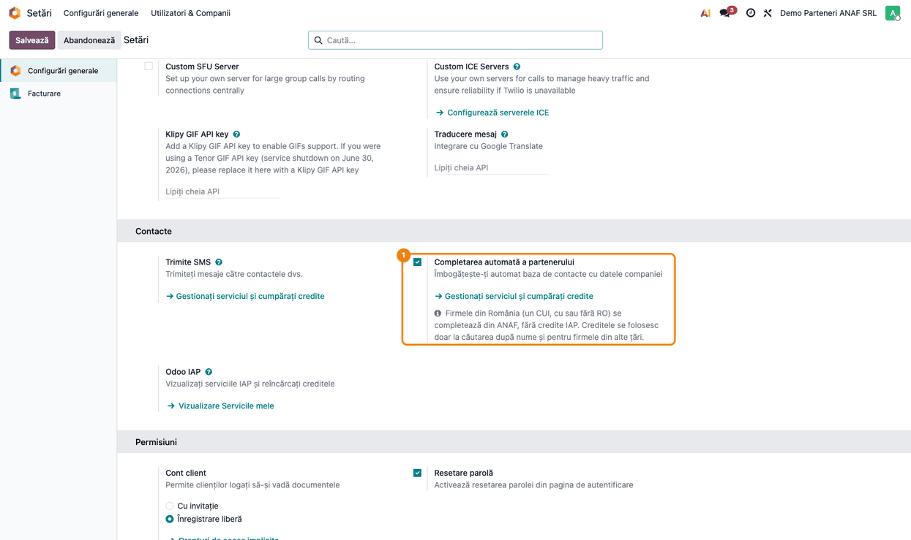
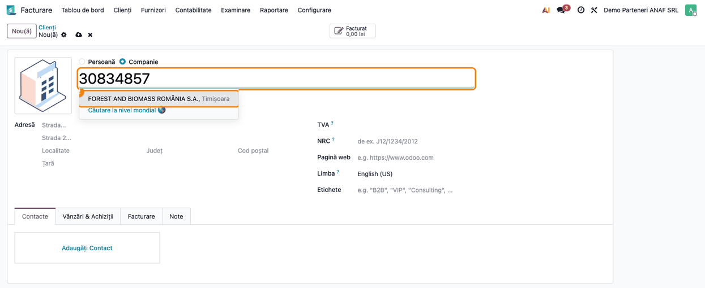
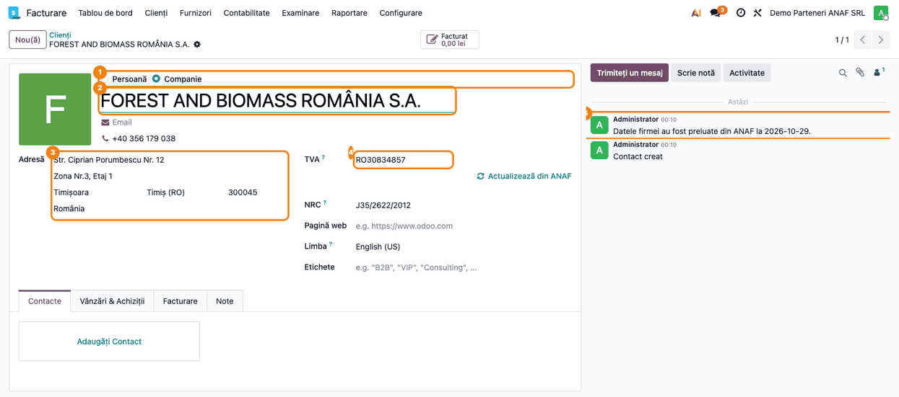
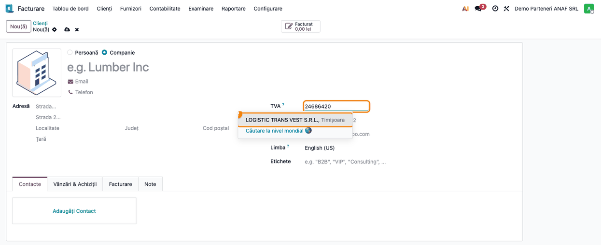
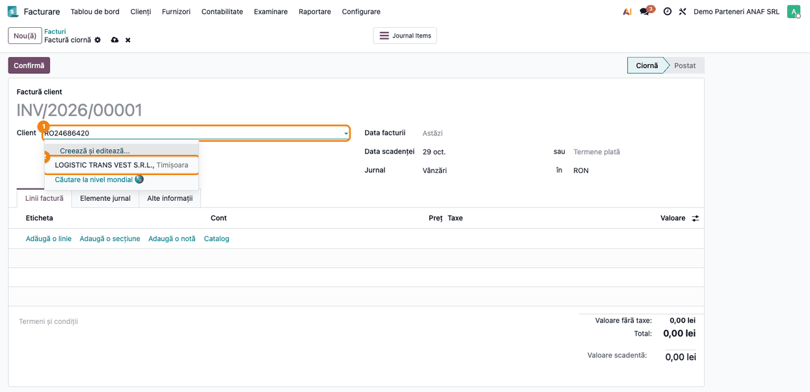
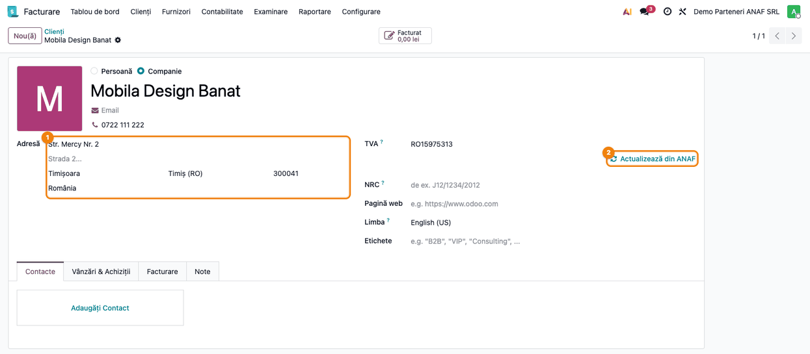
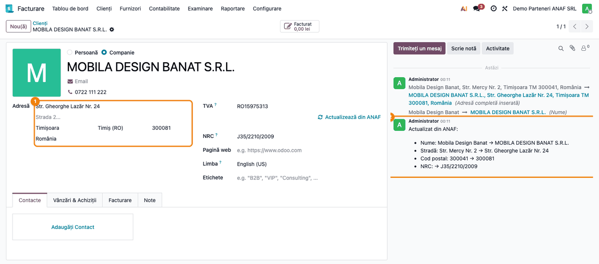

# Fișă Modul: Completarea partenerilor din ANAF, fără credite IAP

**Modul:** `l10n_ro_partner_autocomplete`
**Suită:** `l10n-romania`
**Utilizator principal:** operatorul care introduce clienți și furnizori (vânzări, facturare, achiziții, casier POS), contabilul care întreține nomenclatorul de parteneri
**Prioritate:** 🟡 Medie (orice firmă din România introduce parteneri după CUI; fără modul, Odoo consumă credite IAP pentru o informație gratuită la ANAF)

---

## 1. Scop business

Odoo standard sugerează firmele, la tastarea numelui sau a codului fiscal, din serviciul IAP
*Partner Autocomplete* și consumă credite la fiecare completare. Pentru o firmă din România sursa
oficială este **ANAF**, iar interogarea ei este gratuită.

Cu modulul, un **CUI românesc** (cu sau fără `RO`) tastat acolo unde Odoo oferă completarea
automată — **numele** sau câmpul **TVA** (codul fiscal) al partenerului, câmpul **Client** dintr-o
ofertă sau factură, fișa clientului deschisă din Punctul de vânzare — aduce sugestia direct de la
ANAF. Alegerea ei completează partenerul: tipul **Companie**, denumire, cod fiscal (cu `RO` doar
pentru plătitorii de TVA), stradă și număr, detalii de adresă, localitate (pentru București,
sectorul), județ, cod poștal, număr de înregistrare la Registrul Comerțului (NRC) și telefon. Când
sugestia e aleasă în formularul partenerului (Nume, TVA), istoricul primește o notă că datele vin
de la ANAF.

Pe un partener deja existent, linkul **Actualizează din ANAF** reîncarcă datele și lasă în istoric
lista câmpurilor modificate (valoarea veche → valoarea nouă), plus avertismentul când ANAF arată
firma ca radiată sau contribuabil inactiv. Cât timp ANAF răspunde, un CUI românesc valid nu ajunge
la IAP, deci nu se consumă credite; dacă ANAF este indisponibil, Odoo întreabă IAP, ca în standard.
Căutarea după denumire și firmele din alte țări rămân la IAP.

## 2. Bază legală și context

- **Datele de identificare ale cumpărătorului pe factură** — denumirea, adresa și codul de
  înregistrare în scopuri de TVA sunt mențiuni obligatorii ale facturii (**Codul fiscal, art. 319
  alin. (20)**). Preluarea lor din registrul ANAF evită erorile de tastare care duc la facturi
  respinse sau corectate.
- **Sediul social** — documentele firmei trebuie să arate sediul social (**Legea 31/1990,
  art. 74**). De aceea modulul ia toată adresa dintr-un singur bloc: sediul social când ANAF îl
  are, altfel domiciliul fiscal — niciodată strada dintr-unul cu codul poștal din celălalt.
- **e-Factura** — pentru București, localitatea trebuie să fie **sectorul** (ex. „Sector 3”), nu
  „București”; modulul o completează așa.
- **Sursa datelor** — serviciul web public al ANAF pentru verificarea contribuabililor (registrul
  persoanelor impozabile înregistrate în scopuri de TVA, starea de inactiv / radiat). Interogarea
  este făcută de modulul `l10n_ro_anaf_partner_lookup`; acest modul o leagă de completarea automată
  a partenerilor din Odoo.
- **Contribuabili inactivi** — achizițiile de la un furnizor declarat inactiv au regim fiscal
  defavorabil (deducerea cheltuielilor și a TVA-ului). Modulul **doar semnalează** starea, la
  actualizarea din ANAF; nu blochează documentele.

## 3. Utilizatori și roluri

| Rol | Ce face în modul |
|---|---|
| Operator vânzări / facturare / achiziții | Creează parteneri tastând CUI-ul, alege sugestia ANAF |
| Casier POS | Creează clientul persoană juridică din fișa de client a Punctului de vânzare |
| Contabil / responsabil nomenclator | Actualizează din ANAF partenerii vechi, pe rând |
| Administrator | Verifică nota din **Setări** și, dacă e cazul, creditele IAP rămase pentru restul țărilor |

**Roluri recomandate la testare:** un utilizator cu drept de creare a contactelor (ex. *Facturare /
Facturare*) pentru pașii 2–7 și un administrator pentru pasul 1. Linkul **Actualizează din ANAF**
cere drept de modificare a partenerilor.

## 4. Conturi și date implicate

Modulul **nu generează note contabile** și nu folosește conturi; lucrează doar pe fișa partenerului
(`res.partner`). Datele minime pentru demo:

- compania curentă cu țara **România** (căutarea fără `RO` se face în țara companiei);
- un **CUI valid** (cifra de control se verifică înainte de interogare): în capturi, firmele demo
  ale testului — `30834857` (FOREST AND BIOMASS ROMÂNIA S.A.), `24686420`, `15975313`; pe o bază
  reală, orice CUI de firmă activă;
- un partener existent, de tip **Companie**, cu cod fiscal românesc și date vechi (pentru
  **Actualizează din ANAF**);
- acces la internet spre serverul ANAF (în capturi, răspunsul ANAF e simulat).

Câmpurile completate: tipul **Companie** (bifa *Persoană / Companie* din capul formularului),
**Nume**, **TVA** (codul fiscal), **Stradă**, **Strada 2** (detaliile de adresă: bloc, etaj, zonă),
**Localitate**, **Județ**, **Cod poștal**, **Țară**, **NRC**, **Telefon**.

## 5. Configurare inițială

1. Instalați modulul (aduce automat `partner_autocomplete` și `l10n_ro_anaf_partner_lookup`).
   Modulul **nu se poate instala împreună cu** `l10n_ro_partner_create_by_vat` (OCA): ambele
   completează partenerul din ANAF, fiecare în felul lui. Dezinstalați-l întâi, împreună cu
   modulele care depind de el (`l10n_ro_partner_create_by_vat_button`,
   `l10n_ro_partner_create_by_vat_openapi`, `l10n_ro_fiscal_validation` și, la clienții Terrabit,
   meta-modulul `terrabit_base`, a cărui dezinstalare nu scoate modulele aduse de el).
2. Verificați în **Setări → Configurări generale → Contacte** că opțiunea **Completarea automată a
   partenerului** este bifată (pasul 1 din flux).
3. Asigurați-vă că compania are țara **România** — altfel un CUI fără `RO` nu e recunoscut ca
   românesc.
4. Opțional, pentru localitatea aleasă din nomenclator: instalați lista orașelor din România
   (`l10n_ro_city`); modulul alege atunci și orașul din listă și păstrează codul poștal al străzii.
5. Nu e nevoie de credite IAP pentru firmele din România. Creditele rămân necesare doar pentru
   căutarea după denumire și pentru firmele din alte țări.

## 6. Flux de utilizare

### Pasul 1 — Setarea „Completarea automată a partenerului”

**Setări → Configurări generale → secțiunea Contacte → Completarea automată a partenerului.**

Sub opțiunea standard, modulul adaugă o notă: firmele din România (un CUI, cu sau fără `RO`) se
completează din ANAF, fără credite IAP; creditele se folosesc doar la căutarea după nume și pentru
firmele din alte țări.



**Verificați:** bifa este pusă (fără ea Odoo nu mai oferă sugestii nici din ANAF, nici din IAP) și
nota despre ANAF apare sub opțiune. Linkul **Gestionați serviciul și cumpărați credite** privește
doar căutările care merg în continuare la IAP.

### Pasul 2 — CUI tastat în numele unui partener nou

**Facturare → Clienți → Clienți → Nou** (sau **Contacte → Nou**). În câmpul de nume tastați
CUI-ul firmei, de exemplu `30834857` sau `RO30834857`.

După ce ați tastat tot CUI-ul, sub câmp apare sugestia găsită la ANAF: **denumirea firmei** și
**localitatea** (ex. *FOREST AND BIOMASS ROMÂNIA S.A., Timișoara*). Linkul **Căutare la nivel
mondial** de sub ea caută în IAP, în toate țările — nu îl folosiți pentru o firmă românească.



**Verificați:** sugestia are denumirea oficială a firmei. Dacă nu apare nimic, CUI-ul are cifra de
control greșită sau ANAF nu are firma (vezi secțiunea 9).

### Pasul 3 — Sugestia aleasă: partenerul completat și salvat

Faceți clic pe sugestie. Formularul se completează și partenerul se salvează imediat:

- tipul **Companie** este (sau devine) selectat;
- **Nume** = denumirea de la ANAF;
- **Adresa** = stradă cu număr, detalii (zonă, etaj), localitate, județ, cod poștal, țara România;
- **TVA** = `RO30834857` (cu `RO` pentru că firma este plătitoare de TVA; fără `RO` altfel);
- **NRC** = numărul de la Registrul Comerțului (J…);
- **Telefon**, dacă ANAF îl are.

În istoric (dreapta) apare nota **„Datele firmei au fost preluate din ANAF la …”**, cu data
preluării în forma an-lună-zi (ex. *2026-10-29*). Sub rândul **TVA**, în dreapta, apare linkul
**Actualizează din ANAF** (folosit la pasul 6).



**Verificați:** adresa vine dintr-un singur bloc (sediul social, altfel domiciliul fiscal);
pentru București, localitatea este sectorul; prefixul `RO` apare doar la plătitorii de TVA; NRC-ul
este completat. Nu s-a consumat niciun credit IAP.

> **Variantă — partener creat cu CUI-ul ca nume.** Dacă într-un câmp de tip *Client* tastați un CUI
> și alegeți **Creează** (pe ofertă) sau **Creează și editează...** urmat de **Salvează**, fără să
> schimbați numele (pe factură, unde crearea rapidă nu există), ori importați parteneri al căror
> nume este un CUI, partenerul se completează tot din ANAF la salvare. Valorile date explicit se
> păstrează; un partener care are deja un alt cod fiscal, o persoană de contact (cu firmă-mamă) sau
> un partener din altă țară rămân neatinși. Pentru un import în masă, completarea se oprește cu
> cheia de context `l10n_ro_anaf_no_autofill`.

### Pasul 4 — CUI tastat în „TVA”

Pe un partener nou, tastați CUI-ul direct în câmpul **TVA**, cu sau fără `RO` (în captură,
`24686420`, fără prefix).

Sugestia vine tot de la ANAF, ca la nume: aceeași listă, aceeași completare la alegere. E util când
operatorul are deja codul fiscal în față (de pe factura furnizorului, de pe certificatul de
înregistrare).



**Verificați:** după alegerea sugestiei, câmpul **TVA** primește codul fiscal în forma de la ANAF
— cu `RO` pentru un plătitor de TVA, fără `RO` pentru un neplătitor —, indiferent cum l-ați tastat.

### Pasul 5 — CUI tastat la „Client” pe o factură

**Facturare → Clienți → Facturi → Nou.** În câmpul **Client** tastați CUI-ul unui client care nu
există încă în Odoo, de exemplu `RO24686420`.

Lista derulantă arată, sub opțiunile standard (**Creează și editează...**), sugestia ANAF a firmei.
Alegerea ei deschide formularul de partener nou, precompletat din ANAF; după **Salvează**, clientul
intră pe factură. Același comportament îl are câmpul *Client* din ofertele de vânzare. Pe această
cale, istoricul partenerului nou nu primește nota „Datele firmei au fost preluate din ANAF”.



**Verificați:** dacă firma există deja în Odoo, ea apare în partea de sus a listei — alegeți-o pe
aceea, nu sugestia ANAF, ca să nu creați un duplicat (Odoo afișează altfel bannerul
**Posibile duplicate**).

### Pasul 6 — Partener existent: linkul „Actualizează din ANAF”

**Facturare → Clienți → Clienți →** deschideți un client cu cod fiscal românesc și date vechi (în
captură, *Mobila Design Banat*, cu o adresă veche).

Linkul **Actualizează din ANAF** apare sub rândul **TVA** doar pentru un partener de tip
**Companie** (bifa din capul formularului), din **România**, cu cod fiscal și fără firmă-mamă. Nu
apare pe un partener de tip *Persoană* și nici pe persoanele de contact ale unei firme.



**Găsiți pe ecran:** numele și adresa actuale ale partenerului, codul fiscal și linkul de sub el.
Dacă linkul lipsește pe o firmă, verificați că tipul este **Companie**, nu *Persoană*.

### Pasul 7 — După actualizare: datele noi și modificările în istoric

Faceți clic pe **Actualizează din ANAF**. Odoo rescrie numele, adresa, codul fiscal și NRC-ul cu
datele de la ANAF; **telefonul existent se păstrează** (un telefon introdus local este de obicei
mai bun decât cel din registru).

În istoric apare nota **„Actualizat din ANAF:”** cu fiecare câmp modificat, **valoarea veche →
valoarea nouă** (în captură: Nume, Stradă, Cod poștal, NRC). Deasupra ei, urmărirea standard a
Odoo arată aceleași schimbări pentru câmpurile urmărite. Dacă nimic nu s-a schimbat, nota spune
**„Verificat în ANAF: nicio modificare.”**. Când ANAF arată firma ca radiată sau inactivă, nota
are în plus, îngroșat, **„ANAF arată firma ca radiată.”** sau **„ANAF arată firma ca și
contribuabil inactiv.”**



**Verificați:** fiecare câmp din notă are valoarea nouă și pe formular; telefonul a rămas cel vechi
(*0722 111 222*); nicio mențiune de radiere sau inactivitate — dacă apare, informați contabilul
înainte de a mai înregistra facturi de la acel furnizor.

### Note de monografie și raportare

Modulul **nu generează note contabile** și nu modifică rapoarte sau declarații. Efectul lui asupra
contabilității este indirect: datele de identificare corecte ale partenerului (denumire, cod fiscal
cu/fără `RO`, adresa sediului social) ajung pe facturi, în e-Factura și în declarațiile care citesc
partenerul (D394, SAF-T).

## 7. Legături cu alte module / declarații

| Modul | Rol |
|---|---|
| `partner_autocomplete` (Odoo) | Completarea automată standard: câmpuri, sugestii; IAP pentru restul țărilor |
| `l10n_ro_anaf_partner_lookup` | Interogarea ANAF: validarea CUI-ului, conversia răspunsului în date de partener |
| `l10n_ro` (Odoo) | Câmpul **NRC** și regulile de cod fiscal românesc |
| `l10n_ro_city` (opțional) | Nomenclatorul localităților: localitatea se alege din listă, codul poștal al străzii se păstrează |
| `l10n_ro_zip` (opțional) | Codul poștal al străzii, când blocul de adresă de la ANAF nu îl are |
| `l10n_ro_edi` / e-Factura | Folosește datele partenerului (sectorul pentru București, codul fiscal) |
| `l10n_ro_partner_create_by_vat` (OCA) | **Incompatibil** (`excludes`): face același lucru în alt fel |

**Ce e automat:** sugestia ANAF la tastarea unui CUI; completarea la alegere; nota din istoric;
completarea la salvarea unui partener cu CUI-ul ca nume; trimiterea la IAP doar a căutărilor
nerecunoscute ca CUI românesc sau când ANAF nu răspunde.

**Ce rămâne manual:** actualizarea partenerilor existenți (**Actualizează din ANAF**, pe rând — nu
există o acțiune de actualizare în masă); decizia contabilă la un partener radiat sau inactiv;
verificarea duplicatelor.

## 8. Verificări pentru consultant

- [ ] În **Setări → Contacte**, opțiunea **Completarea automată a partenerului** e bifată și nota
      despre ANAF apare sub ea.
- [ ] Un CUI valid tastat în numele unui partener nou (cu și fără `RO`) aduce sugestia cu
      denumirea oficială și localitatea.
- [ ] După alegere: tipul **Companie**, TVA cu `RO` doar pentru plătitorii de TVA, NRC completat,
      adresa dintr-un singur bloc.
- [ ] Pentru o firmă din București, localitatea este sectorul.
- [ ] În istoricul partenerului apare „Datele firmei au fost preluate din ANAF la …”.
- [ ] CUI-ul tastat în **TVA** (cu sau fără `RO`) aduce aceeași sugestie.
- [ ] La **Client** pe o factură, CUI-ul unui client nou aduce sugestia ANAF; alegerea ei deschide
      partenerul precompletat.
- [ ] Un partener creat din CUI-ul tastat la *Client* (**Creează** pe ofertă; **Creează și
      editează...** → **Salvează** pe factură) se completează din ANAF.
- [ ] **Actualizează din ANAF** apare doar pe partenerii de tip **Companie**, din România, cu cod
      fiscal și fără firmă-mamă.
- [ ] După **Actualizează din ANAF**, nota din istoric listează fiecare câmp schimbat (vechi →
      nou), iar telefonul existent rămâne.
- [ ] Căutarea după o denumire (ex. „Forest”) și un cod fiscal din altă țară merg în continuare la
      IAP (alegerea unei sugestii IAP consumă un credit).
- [ ] Un CUI cu cifra de control greșită nu interoghează ANAF; căutarea merge la IAP, ca în
      standard (de regulă fără rezultat).

## 9. Mesaje de eroare frecvente

| Mesaj | Cauză | Remediere |
|---|---|---|
| *(nicio sugestie la tastarea CUI-ului)* | CUI cu cifra de control greșită; mai puțin de 3 caractere; ANAF nu are firma | Verificați CUI-ul pe certificatul de înregistrare |
| *(sugestii din IAP în loc de ANAF / credite consumate)* | CUI fără `RO` cu altă țară decât România în câmpul **Țară** al partenerului (sau, dacă e gol, al companiei), ANAF indisponibil, ori s-a apăsat **Căutare la nivel mondial** | Tastați CUI-ul cu `RO`, setați România (sau goliți) câmpul **Țară** al partenerului, ori setați țara companiei România |
| *(linkul **Actualizează din ANAF** lipsește)* | Partenerul e de tip *Persoană*, are firmă-mamă, nu are cod fiscal sau țara nu e România | Bifați **Companie**, completați **TVA** și țara România |
| „… nu este un CUI valid.” | La **Actualizează din ANAF**, codul fiscal al partenerului nu e un CUI valid | Corectați câmpul **TVA** |
| „ANAF nu a răspuns. Încercați din nou peste puțin timp.” | Serviciul ANAF nu răspunde (întrerupere, timp de răspuns depășit) | Reîncercați mai târziu; la sugestii, Odoo trece automat la IAP |
| „La ANAF nu există nicio firmă înregistrată cu …” | CUI valid, dar fără firmă la ANAF (ex. CUI de persoană fizică autorizată neînregistrată, CUI greșit) | Verificați codul fiscal; completați manual |
| „Posibile duplicate: …” | Există deja un partener cu același cod fiscal | Folosiți partenerul existent; ștergeți sau îmbinați duplicatul (**Acțiuni → Îmbină**) |
| Modulul nu se instalează (conflict cu `l10n_ro_partner_create_by_vat`) | Modulul OCA e instalat (direct sau adus de alt modul, ex. `terrabit_base`) | Dezinstalați întâi modulul OCA și modulele care depind de el (vezi secțiunea 5) |

## 10. Capturi de ecran

Capturile din `static/description/` sunt **generate automat** de `tests/test_screenshots.py`
(mixinul `ScreenshotCase` din `l10n_ro_doc_screenshots`, import defensiv), cu interfața în
**română**, pe o companie românească în RON, pe Odoo 19. Serviciul ANAF este **simulat**
(răspunsuri în forma serviciului real, pentru firme demo), deci capturile nu depind de rețea și nu
consumă credite:

1. `01_setari_autocomplete.png` — Setări → Contacte: opțiunea **Completarea automată a
   partenerului**, cu nota despre ANAF.
2. `02_sugestie_cui_nume.png` — partener nou, CUI tastat în nume, sugestia ANAF.
3. `03_partener_completat.png` — partenerul completat și salvat din sugestie (tip **Companie**), cu
   nota ANAF în istoric și linkul **Actualizează din ANAF** sub rândul TVA.
4. `04_sugestie_cui_tva.png` — partener nou, CUI tastat fără `RO` în **TVA**, sugestia ANAF.
5. `05_sugestie_client_factura.png` — factură nouă, CUI tastat la **Client**, sugestia ANAF sub
   **Creează și editează...**.
6. `06_buton_actualizare_anaf.png` — client existent cu date vechi și linkul **Actualizează din
   ANAF**.
7. `07_actualizare_istoric.png` — clientul după actualizare, cu nota **Actualizat din ANAF:**
   (vechi → nou) și telefonul păstrat.

Regenerare:

```bash
./odoo/odoo-bin -c odoo.conf -d <db> -u l10n_ro_partner_autocomplete \
    --test-tags=fise_screenshots/l10n_ro_partner_autocomplete --stop-after-init
```

> Capturile cer modulul de tooling `l10n_ro_doc_screenshots` (suita `l10n_ro_ent`) pe
> `addons_path` și Playwright; dacă lipsesc, testul se sare.

## 11. Observații pentru manual

- Prezentați modulul ca **„tastați CUI-ul, nu denumirea”**: sugestiile după denumire vin tot din
  IAP, iar alegerea uneia consumă un credit; CUI-ul merge la ANAF, gratuit, și aduce datele oficiale.
  În **Nume** și în **TVA**, CUI-ul se poate tasta cu sau fără `RO`.
- La alegerea unei sugestii ANAF, tipul partenerului devine **Companie**; linkul **Actualizează din
  ANAF** apare doar pe partenerii de tip *Companie*. Un partener lăsat pe *Persoană* nu are linkul.
- **Actualizează din ANAF** rescrie numele și adresa (păstrează doar telefonul) și lasă urmă în
  istoric. Pe 19.0 nu există actualizare în masă: fiecare partener se actualizează din fișa lui.
- Prefixul `RO` la TVA este o informație fiscală, nu de formatare: îl are doar firma plătitoare de
  TVA. Nu-l adăugați manual la un neplătitor.
- Mențiunea de **radiere / inactivitate** apare doar la **Actualizează din ANAF**, nu la sugestie;
  recomandați clientului o reverificare periodică a furnizorilor importanți.
- Limitări de spus clientului: nota „Datele firmei au fost preluate din ANAF” apare doar când
  sugestia e aleasă în formularul partenerului, nu și la partenerul creat din câmpul **Client** sau
  cu **Creează**; data din notă e în format ISO (aaaa-ll-zz); modulul nu se instalează împreună cu
  `l10n_ro_partner_create_by_vat` (OCA).
