=========================================
Romania - Picking Reports for Odoo Online
=========================================

..
   !!!!!!!!!!!!!!!!!!!!!!!!!!!!!!!!!!!!!!!!!!!!!!!!!!!!
   !! This file is generated by oca-gen-addon-readme !!
   !! changes will be overwritten.                   !!
   !!!!!!!!!!!!!!!!!!!!!!!!!!!!!!!!!!!!!!!!!!!!!!!!!!!!
   !! source digest: sha256:ef951608a32e6b813e5f36954645b1a6160953fedf5ab6d3ce5a668b29345b3c
   !!!!!!!!!!!!!!!!!!!!!!!!!!!!!!!!!!!!!!!!!!!!!!!!!!!!

.. |badge1| image:: https://img.shields.io/badge/maturity-Beta-yellow.png
    :target: https://odoo-community.org/page/development-status
    :alt: Beta
.. |badge2| image:: https://img.shields.io/badge/license-AGPL--3-blue.png
    :target: http://www.gnu.org/licenses/agpl-3.0-standalone.html
    :alt: License: AGPL-3
.. |badge3| image:: https://img.shields.io/badge/github-dhongu%2Fl10n--romania-lightgray.png?logo=github
    :target: https://github.com/dhongu/l10n-romania/tree/20.0/l10n_ro_picking_report_online
    :alt: dhongu/l10n-romania

|badge1| |badge2| |badge3|

Documentele de stoc românești, și pe **Odoo Online**: modulul nu conține
cod Python și se importă ca arhivă zip (Aplicații > Importați modulul).
Este varianta fără Python a modulului ``l10n_ro_picking_report``, pentru
bazele în care codul Python propriu nu poate rula. Are nevoie de
``l10n_ro_invoice_report_online`` (și, prin el, de
``l10n_ro_report_common_online``), importate înainte.

Rapoarte, din meniul **Tipăriți** al transferului:

- **Recepție (NIR)**, **Recepție fără TVA** și **Recepție cu preț de
  vânzare** (tipăresc doar recepțiile): preț unitar, valoare, TVA, preț
  de vânzare, adaos în procente; cantitățile și prețurile în unitatea de
  pe document (o cutie de 13 kg rămâne cutie), prețul din comanda de
  achiziție sau din valoarea mișcării.
- **Aviz** și **Aviz cu preț** (livrarea): prețul din comanda de vânzare
  (cu discount, cu TVA inclus sau nu); pe livrările fără comandă, prețul
  din lista de prețuri a clientului, altfel prețul de listă.
- **Aviz de însoțire a mărfii** (14-3-6A): livrarea bifată *Aviz de
  însoțire* se tipărește cu acest titlu; celelalte au titlul *Livrare*.
- **Bon de consum** și **Transfer intern** (cu prețuri de vânzare când
  locația e magazin).

Pe documente: datele firmei și conturile bancare, gestionarul locației,
delegatul și mijlocul de transport, numărul AWB (când e instalat modulul
de curierat), semnăturile.

**Setări**, pe firmă, în fila *Factură România*, grupul *Documente de
stoc*: ascunde TVA pe NIR, ascunde băncile pe documentele de stoc. Pe
locație: lista de prețuri a magazinului, gestionarul, *Este locație de
tip magazin*.

**Automatizări** (în locul codului Python): delegatul aduce mijlocul de
transport; prețul de vânzare se fixează pe mișcare la validarea
recepției; recepția din comanda de achiziție primește ca document sursă
referința furnizorului.

Ce nu face, față de ``l10n_ro_picking_report``: rapoartele cumulative pe
perioadă, butonul *Tipăriți* care alege singur raportul, facturarea din
livrare cu delegatul și atașarea livrării semnate.

Odoo Online
~~~~~~~~~~~

Modulul nu conține Python: se poate importa pe Odoo Online (planul
Custom) din Aplicații > Importați modulul. Nu se poate instala împreună
cu ``l10n_ro_picking_report`` (manifestul îl exclude, iar importul zip
este refuzat cât timp acel modul e instalat): cele două țin aceleași
date în câmpuri diferite.

**Table of contents**

.. contents::
   :local:

Usage
=====

Configurare
~~~~~~~~~~~

1. Importați, în ordine, ``l10n_ro_report_common_online``,
   ``l10n_ro_invoice_report_online`` și acest modul din **Aplicații →
   Importați Modulul** (mod dezvoltator), după instalarea limbii române.

2. În **Setări → Utilizatori & Companii → Companii**, pe firmă, fila
   **Factură România**, grupul **Documente de stoc**: bifați, după caz,
   **Ascunde TVA pe NIR** și **Ascunde băncile pe documentele de stoc**.

   |Fila Factură România a firmei, cu grupul Documente de stoc și cele
   două bife evidențiate|

3. În **Inventar → Configurare → Locații**, pe fiecare gestiune: **Listă
   de prețuri a magazinului**, **Gestionar** și, la magazine, **Este
   locație de tip magazin**.

   |Locația TEST Magazin, cu lista de prețuri, gestionarul și bifa de
   magazin evidențiate|

4. Pe comanda de achiziție, completați **Referința furnizorului**
   înainte de confirmare: devine documentul sursă al recepției și
   numărul „conform documentului" de pe NIR.

Utilizare
~~~~~~~~~

1. Pe transfer, fila **Informații suplimentare**: alegeți **Delegat**
   (mijlocul de transport vine din fișa lui), verificați **Mijloc
   transport** și, pe livrările facturate ulterior, bifați **Aviz de
   însoțire**. Validați transferul.

   |Livrarea cu Delegat, Mijloc transport și Aviz de însoțire
   evidențiate|

2. Din roata dințată → **Tipăriți**, alegeți documentul: **Recepție
   (NIR)**, **Recepție fără TVA**, **Recepție cu preț de vânzare**,
   **Aviz**, **Aviz cu preț**, **Bon de Consum** sau **Notă de
   Transfer**.

   |Meniul Tipăriți cu cele șapte rapoarte ale modulului|

3. **NIR-ul** are prețul din comanda de achiziție sau, fără comandă, din
   valoarea mișcării, în unitatea de pe document (o cutie de 13 kg
   rămâne cutie).

   |NIR pe recepția din comanda de achiziție|

   |NIR pe recepția fără comandă, în cutii de 13 kg|

4. **NIR-ul cu preț de vânzare** folosește prețul fixat la validarea
   recepției, din lista de prețuri a magazinului sau din prețul
   produsului; coloana *Valoare vânzare* este cu TVA.

   |NIR cu preț de vânzare, marjă și totaluri la preț de vânzare|

5. Livrarea bifată **Aviz de însoțire** se tipărește ca **Aviz de
   însoțire a mărfii**, cu delegatul și mijlocul de transport; prețul
   vine din comanda de vânzare sau, fără comandă, din lista de prețuri a
   clientului.

   |Avizul de însoțire a mărfii, cu prețuri, delegat și mijloc de
   transport|

   |Livrarea fără comandă, cu prețuri din lista clientului|

6. **Bonul de consum** arată valoarea de cost a mișcării; **nota de
   transfer** către un magazin arată și prețurile de vânzare. Între două
   locații interne, Odoo nu valorizează mișcarea și valoarea iese 0,00.

   |Bonul de consum către o locație de consum|

   |Nota de transfer către locația de tip magazin|

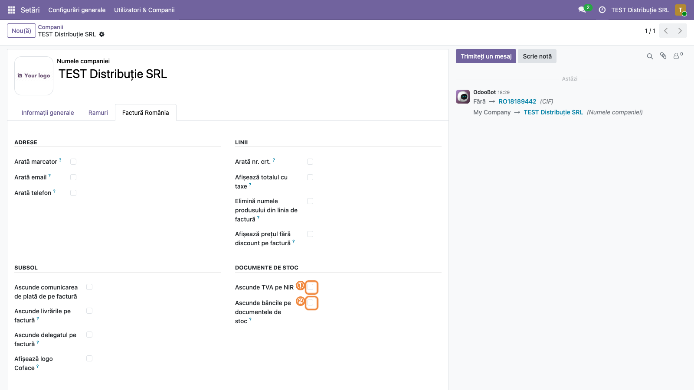
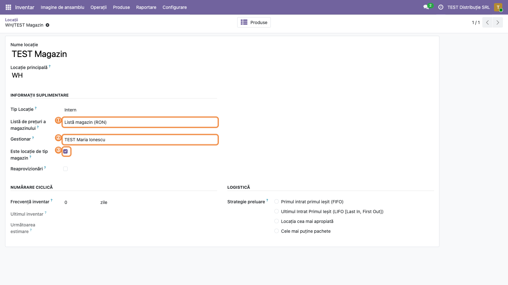
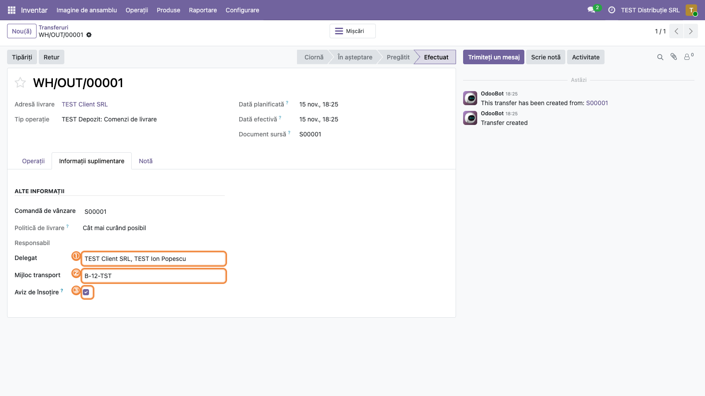
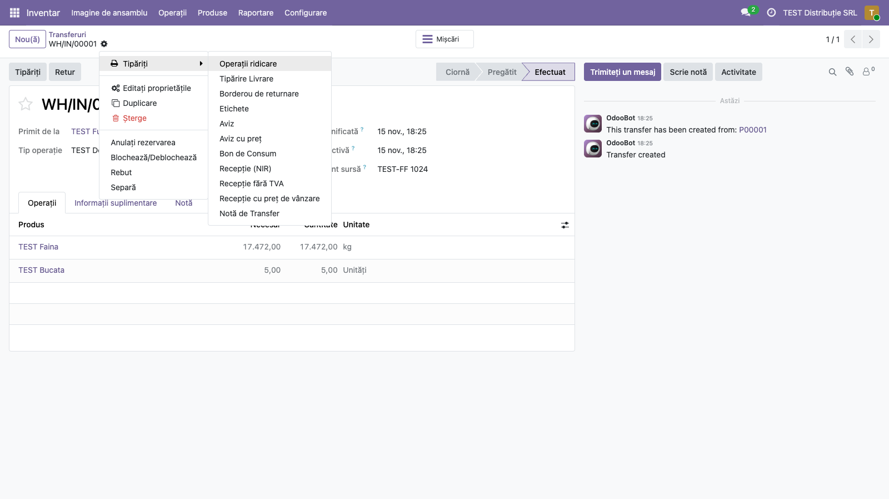
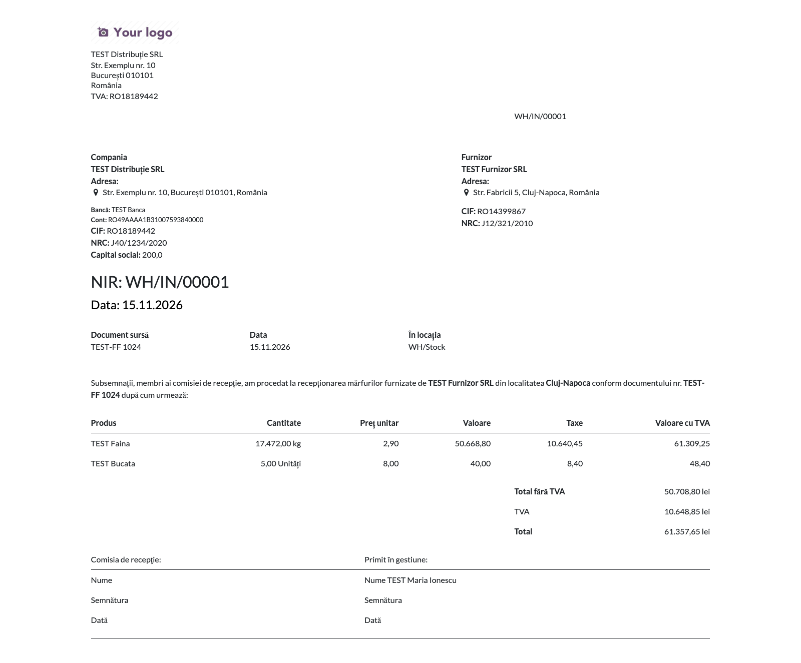
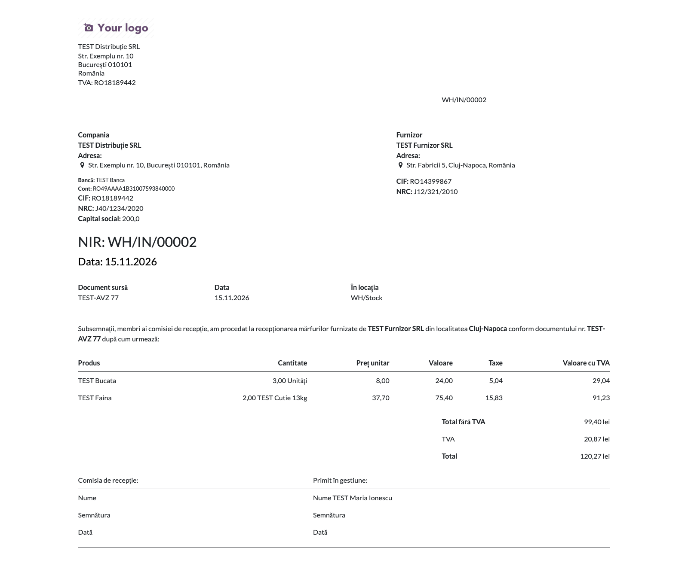
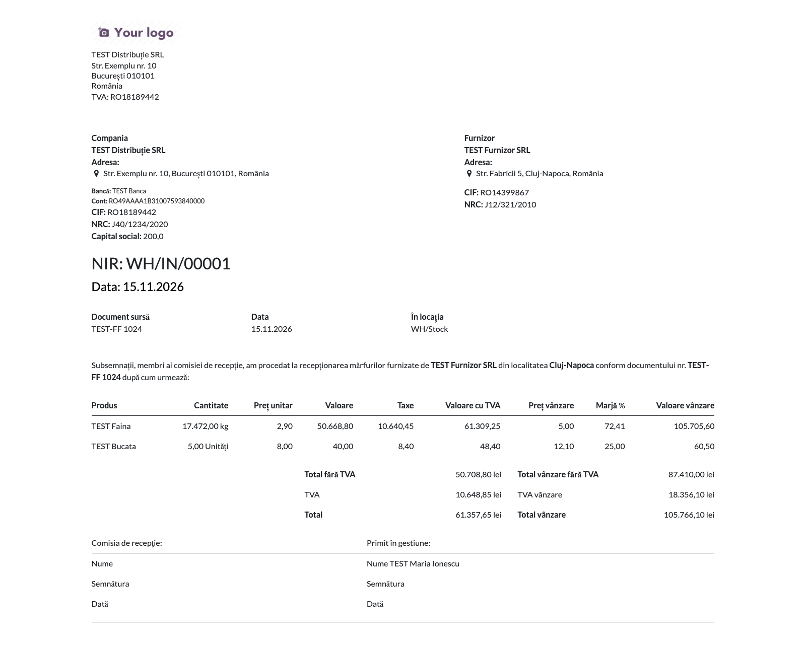
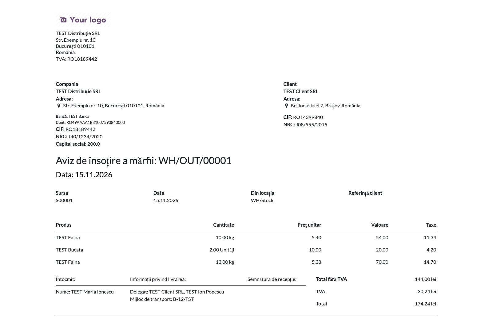
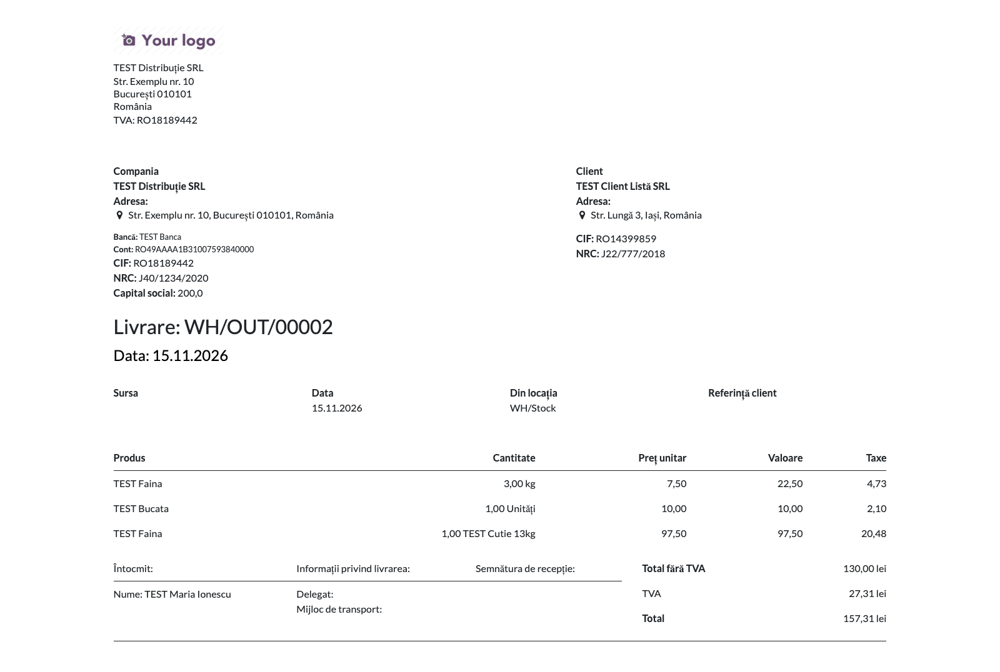
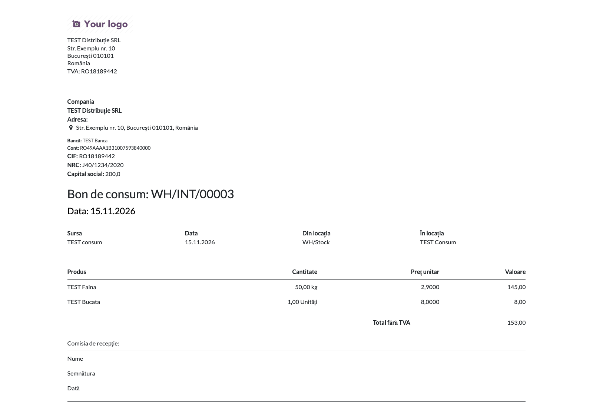
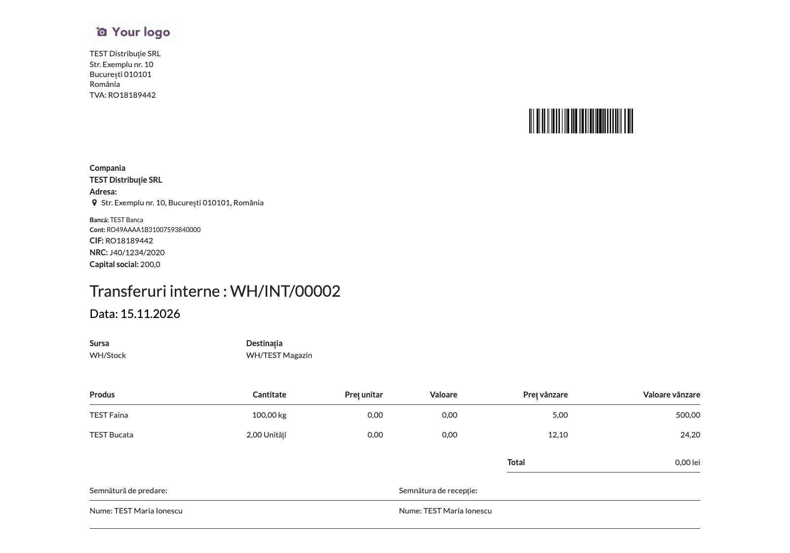

Changelog
=========

20.0.1.0.0
----------

- Portare pe 20.0: mișcarea de stoc își ține unitatea de măsură în
  ``uom_id`` (era ``product_uom``), ``t-esc`` devine ``t-out``,
  ``report_file`` dispare din acțiunile de raport, iar delegatul acceptă
  și contactele unei firme (în 20.0 contactele unei firme cu CUI au
  ``is_company`` bifat).

19.0.1.0.0
----------

- Prima versiune: varianta fără Python a modulului
  ``l10n_ro_picking_report``, importabilă pe Odoo Online. Calculul
  liniilor și al totalurilor din rapoarte (prețuri în unitatea
  documentului, TVA, preț de vânzare, adaos) este scris în QWeb și dă
  aceleași valori ca modelele Python ale modulului clasic (verificat
  linie cu linie). Câmpurile sunt manuale (``x_l10n_ro_*``), setările
  sunt pe firmă, iar delegatul, prețul de vânzare la recepție și
  referința furnizorului sunt automatizări.
- Corecturi față de modulul clasic: rapoartele de recepție tipăresc doar
  recepțiile; gestionarul și capitalul social se tipăresc doar când sunt
  completate; starea *Ciornă* se vede pe documente; totalul bonului de
  consum e aliniat la dreapta; traducerile „Recepție fără TVA”,
  „Semnătura”, „Din locația”, „Document sursă”, „recepționarea
  mărfurilor”.

Bug Tracker
===========

Bugs are tracked on `Terrabit Issues <https://www.terrabit.ro/helpdesk>`_.
In case of trouble, please check there if your issue has already been reported.

Do not contact contributors directly about support or help with technical issues.

Credits
=======

Authors
-------

* Dorin Hongu
* Terrabit

Maintainers
-----------

.. |maintainer-dhongu| image:: https://github.com/dhongu.png?size=40px
    :target: https://github.com/dhongu
    :alt: dhongu

Current maintainer:

|maintainer-dhongu| 

This module is part of the `dhongu/l10n-romania <https://github.com/dhongu/l10n-romania/tree/20.0/l10n_ro_picking_report_online>`_ project on GitHub.

You are welcome to contribute.