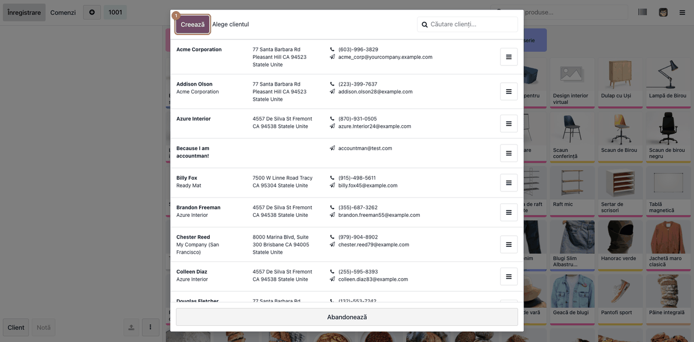
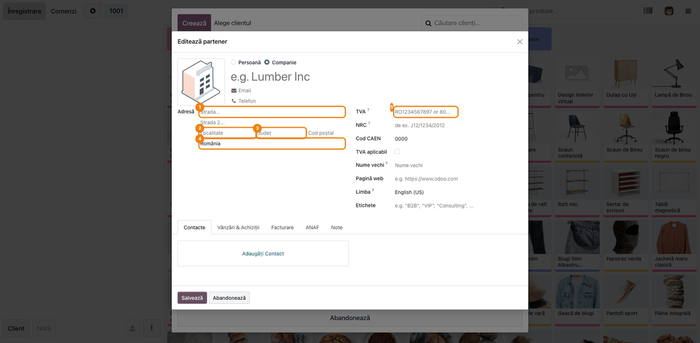
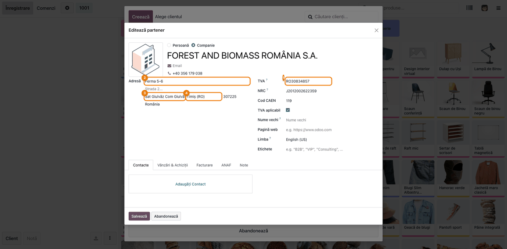
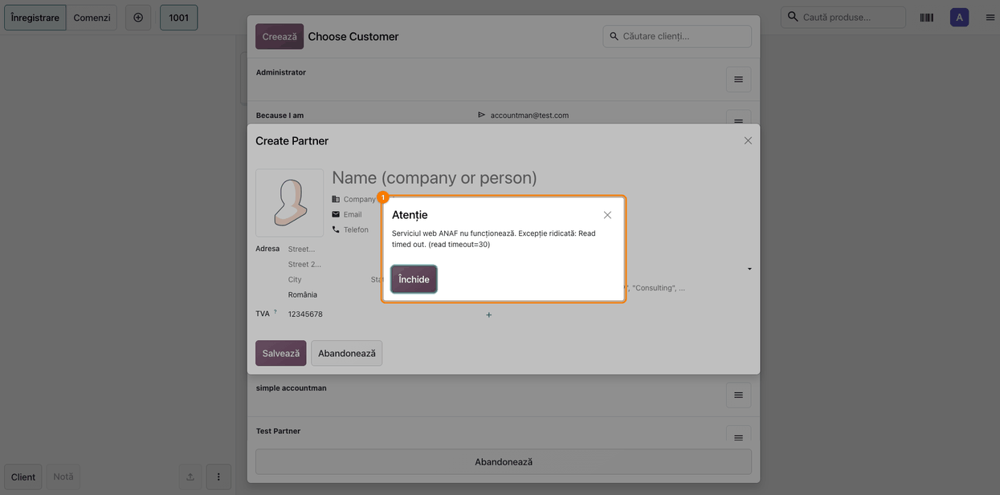
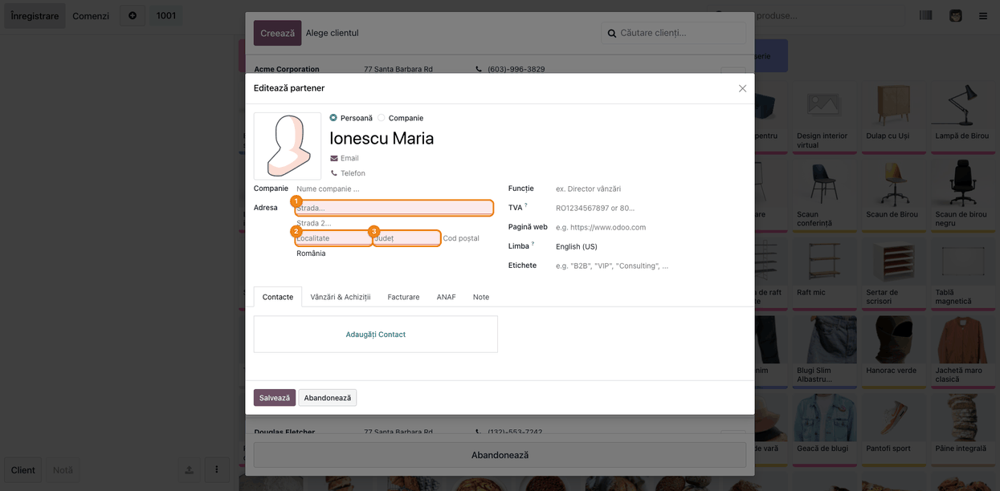
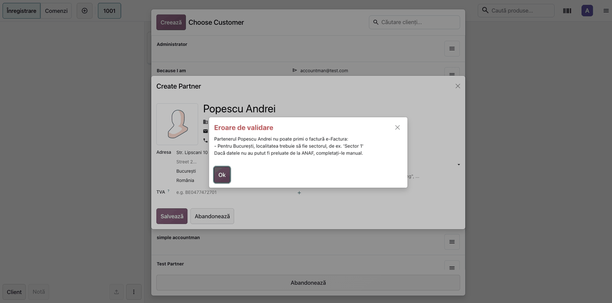
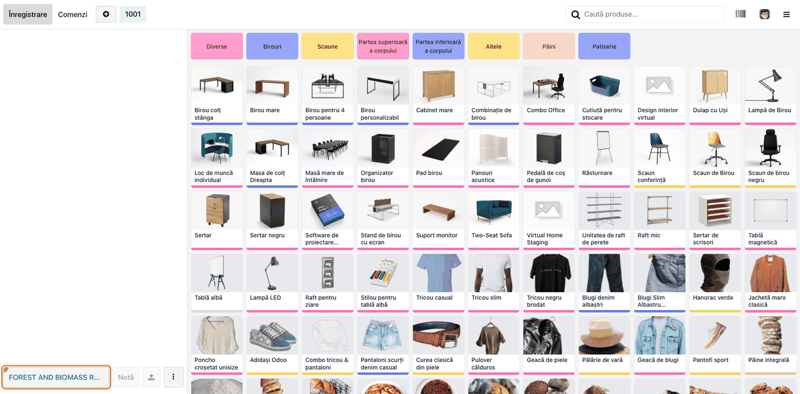

# Fișă Modul: Date obligatorii e-Factura la clientul creat în POS

**Modul:** `l10n_ro_pos_partner_efactura`
**Utilizator principal:** Casier / vânzător POS, Contabil clienți
**Prioritate:** 🔴 Ridicată (factura din POS către un client fără adresă sau CUI este respinsă la trimiterea în SPV)

---

## 1. Scop business

La casă, clientul care cere factură este creat de casier, în grabă, din ecranul POS. Odoo
permite salvarea partenerului doar cu numele, iar lipsa datelor se descoperă abia la trimiterea
facturii în SPV, când clientul a plecat. Modulul mută controlul la momentul creării clientului:
formularul de partener deschis din POS cere strada, localitatea, județul și țara, iar pentru
firme și CUI-ul. Datele firmelor se preiau de la ANAF după CUI; când ANAF nu răspunde, casierul
le completează manual, iar partenerul nu se poate salva până nu sunt complete.

## 2. Bază legală și context

- **e-Factura (RO e-Factura, CIUS-RO)** — factura electronică transmisă în SPV trebuie să conțină
  adresa completă a cumpărătorului: stradă, localitate și județ (subdiviziunea țării). Pentru
  județul București, localitatea se transmite ca sector (`SECTOR1` … `SECTOR6`).
- Regulile sunt cele pe care le aplică motorul CIUS-RO din Odoo (`l10n_ro_edi`) la generarea
  XML-ului; modulul le verifică mai devreme, în POS, nu adaugă reguli noi.
- **CNP-ul nu se cere în POS.** Clientul persoană fizică are nevoie doar de adresa completă.

## 3. Utilizatori și roluri

- **Casier / vânzător POS** (grup *Point of Sale / Utilizator*): creează sau completează clientul
  din ecranul de vânzare, înainte de a emite factura.
- **Contabil clienți**: trimite facturile în SPV și nu mai primește respingeri pentru adresă lipsă.
- **La testare**: un utilizator cu rol doar de casier, ca să se vadă formularul exact cum îl vede
  la casă.

## 4. Conturi și date implicate

Modulul nu generează note contabile; verifică doar datele partenerului.

Date verificate pe partener (doar în formularul deschis din POS):

| Câmp | Când e obligatoriu |
|---|---|
| Stradă | mereu |
| Localitate | mereu; la București trebuie să fie sectorul (ex. `Sector 3`) |
| Județ | mereu |
| Țară | mereu (la un client nou se completează cu țara companiei) |
| CUI (Tax ID) | doar pentru firme |

Nu se verifică: partenerii creați din backoffice (**Contacte**, **Vânzări**, **Facturare**) și
persoanele de contact ale unei firme, care preiau adresa de la firmă.

Date minime pentru demo: o sesiune POS deschisă cu opțiunea de facturare activă; un CUI valid
pentru preluarea de la ANAF (ex. o firmă reală activă) și o adresă de test din București.

## 5. Configurare inițială

1. Instalați `l10n_ro_pos_partner_efactura` (dependențe: `point_of_sale`, `l10n_ro_edi`).
2. Pentru preluarea automată a datelor firmei după CUI, instalați și modulul de creare partener
   după CUI (`l10n_ro_partner_create_by_vat`). Fără el, regulile se aplică la fel, dar toate
   datele se introduc manual.
3. Verificați că județele României sunt încărcate (**Contacte → Configurare → Țări → România →
   Județe**).
4. Nu există setări proprii: modulul este activ pe toate punctele de vânzare după instalare.

## 6. Flux de utilizare

### Pasul 1 — Deschiderea listei de clienți din POS

Accesați **Punct de vânzare → Tablou de bord → [punctul de vânzare] → Deschide casa**. În
ecranul de vânzare, apăsați butonul **Client**: se deschide fereastra **Alege clientul**, cu
butonul **Creează** în antet.



### Pasul 2 — Formularul de client nou: câmpurile obligatorii

Apăsați **Creează**. Se deschide formularul de partener, cu țara completată din compania curentă.
Câmpurile **Stradă**, **Localitate**, **Județ** și **Țară** sunt marcate ca obligatorii; când
alegeți tipul **Companie**, devine obligatoriu și **CUI**.



### Pasul 3 — Preluarea datelor firmei de la ANAF

Pentru o firmă, alegeți **Companie** și introduceți CUI-ul (cu sau fără prefixul `RO`). Datele se
completează automat de la ANAF: denumire, stradă, localitate, județ.

- **Găsiți pe ecran:** numele firmei și adresa completate din ANAF, județul ales din listă.
- **Verificați:** strada și localitatea nu sunt goale; la București, localitatea este sectorul.
- **Treceți mai departe:** apăsați **Salvează**; clientul este ales pe comanda curentă.



### Pasul 4 — ANAF nu răspunde: completarea manuală

Dacă serviciul ANAF nu răspunde sau CUI-ul nu este găsit, Odoo afișează un avertisment, iar
câmpurile rămân goale și editabile. Închideți avertismentul și completați manual stradă,
localitate și județ, apoi **Salvează**.



### Pasul 5 — Salvare cu date lipsă: formularul se oprește

Dacă apăsați **Salvează** cu un câmp obligatoriu gol, formularul nu se închide: câmpurile goale
sunt marcate cu roșu și apare mesajul de câmpuri invalide. Completați-le și salvați din nou.



### Pasul 6 — Adresă din București: localitatea este sectorul

Pentru județul **București**, localitatea trebuie scrisă ca sector (`Sector 1` … `Sector 6`). Dacă
introduceți `București`, la salvare apare mesajul că partenerul nu poate primi o factură
e-Factura, cu explicația pentru sector.



### Pasul 7 — Clientul complet pe comandă

După salvare, clientul apare pe comanda din POS. Factura emisă la plată are deja datele de
care are nevoie XML-ul e-Factura.



### Note de monografie și raportare

Modulul nu generează note contabile. Factura emisă din POS urmează monografia standard a
vânzării cu factură (ex. `4111 = 707 + 4427`, încasarea `5311 = 4111`), neschimbată de modul.
Efectul se vede în e-Factura: XML-ul facturii conține adresa completă a cumpărătorului
(`cac:PostalAddress` cu stradă, localitate și `RO-<cod județ>`), deci nu mai apar erorile CIUS-RO
de adresă lipsă.

## 7. Legături cu alte module / declarații

| Modul | Rol în flux |
|---|---|
| `point_of_sale` | ecranul de vânzare și formularul de client deschis din POS |
| `l10n_ro_edi` | motorul e-Factura CIUS-RO; regulile de adresă și lista sectoarelor București |
| `l10n_ro_partner_create_by_vat` | preluarea datelor firmei de la ANAF după CUI (opțional) |

**Ce e automat:** marcarea câmpurilor obligatorii în POS, țara implicită la client nou,
preluarea de la ANAF (cu modulul opțional), blocarea salvării fără datele complete.

**Ce rămâne manual:** introducerea adresei când ANAF nu răspunde sau clientul este persoană
fizică; completarea partenerilor vechi, creați înainte de instalare, la prima editare din POS.

## 8. Verificări pentru consultant

- [ ] Butonul **Creează** din lista de clienți POS deschide formularul cu Stradă, Localitate,
      Județ și Țară obligatorii.
- [ ] La un client nou, țara este completată cu țara companiei.
- [ ] La tipul **Companie**, câmpul CUI devine obligatoriu; la persoană fizică nu.
- [ ] Cu un CUI valid, datele firmei se completează de la ANAF.
- [ ] Cu ANAF indisponibil (sau CUI inexistent), câmpurile rămân editabile și partenerul se poate
      salva după completarea manuală.
- [ ] Salvarea cu un câmp obligatoriu gol nu închide formularul.
- [ ] La județul București cu localitatea `București`, salvarea este refuzată; cu `Sector 3` trece.
- [ ] Un partener creat din **Contacte** (backoffice) se poate salva fără adresă, ca înainte.
- [ ] Factura emisă din POS pentru clientul creat trece de validările e-Factura la trimiterea în SPV.

## 9. Mesaje de eroare frecvente

| Mesaj | Cauză | Remediere |
|---|---|---|
| Câmpuri invalide: Stradă / Localitate / Județ / Țară | Câmp obligatoriu gol la salvare din POS | Completați câmpurile marcate cu roșu |
| „The partner … cannot receive an e-Factura invoice: … Tax ID (CUI)” | Partener de tip Companie fără CUI | Introduceți CUI-ul sau alegeți Persoană fizică |
| „… For Bucharest the city must be the sector, e.g. 'Sector 1'” | Județul București cu localitatea `București` | Scrieți localitatea `Sector 1` … `Sector 6` |
| Avertisment ANAF la introducerea CUI-ului | Serviciul ANAF indisponibil sau CUI inexistent | Verificați CUI-ul; completați datele manual |
| Partenerul vechi nu se poate salva din POS | Creat înainte de instalare, fără adresă | Completați adresa la prima editare |

## 10. Capturi de ecran

Capturile **nu sunt încă generate**: trebuie rulat skill-ul `fisa-screenshots` pentru acest modul.
Lista de mai jos stabilește numele și ordinea, aceleași cu pașii din secțiunea 6. Capturile vor fi
generate automat din `tests/test_screenshots.py` (mixinul `ScreenshotCase` din
`l10n_ro_doc_screenshots`, import defensiv), în RO, pe planul de conturi RO, în
`static/description/`.

| # | Fișier | Conținut |
|---|--------|----------|
| 1 | `static/description/01_pos_lista_clienti.png` | Fereastra Alege clientul din POS, cu butonul Creează |
| 2 | `static/description/02_formular_partener_obligatorii.png` | Formular partener nou din POS, câmpurile de adresă și CUI obligatorii |
| 3 | `static/description/03_preluare_anaf.png` | Firmă completată automat de la ANAF după CUI |
| 4 | `static/description/04_anaf_indisponibil_manual.png` | Avertisment ANAF și adresa completată manual |
| 5 | `static/description/05_date_lipsa.png` | Salvare cu câmpuri goale, marcate cu roșu |
| 6 | `static/description/06_bucuresti_sector.png` | Mesajul pentru localitatea din București care nu este sector |
| 7 | `static/description/07_client_pe_comanda.png` | Clientul complet ales pe comanda din POS |

Regenerare (după scrierea testului de capturi):

```bash
./odoo/odoo-bin -c odoo.conf -d test19 -u l10n_ro_pos_partner_efactura --test-tags=/l10n_ro_pos_partner_efactura:TestScreenshots --stop-after-init
```

## 11. Observații pentru manual

- Regula se aplică **doar în POS**: în manual, la capitolul de parteneri din backoffice, nu se
  menționează câmpuri obligatorii noi.
- De subliniat pentru casieri: când ANAF nu răspunde, **nu se renunță** la client, se completează
  adresa manual.
- CNP-ul nu se cere la casă; clientul persoană fizică are nevoie doar de adresa completă.
- Partenerii vechi, fără adresă, vor cere completarea la prima editare din POS — de anunțat la
  punerea în producție.
- Formatul pentru București (`Sector N`) este cel mai frecvent motiv de respingere; merită un
  exemplu vizibil în manual.
