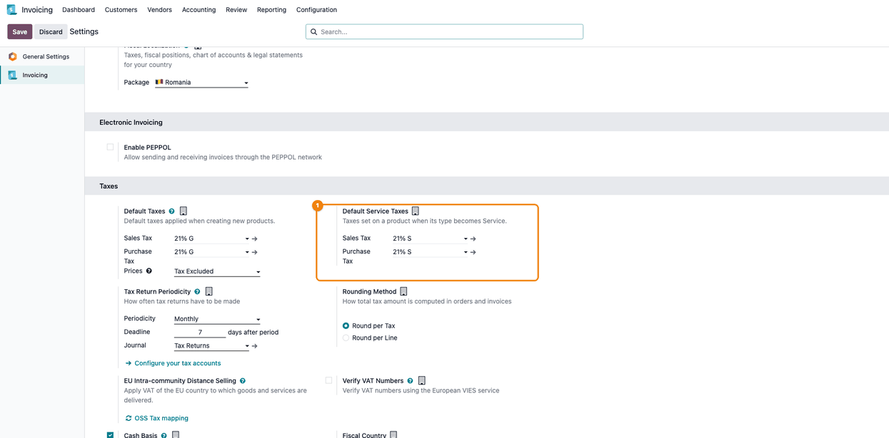
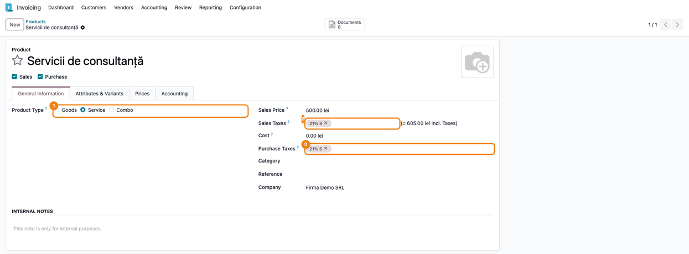
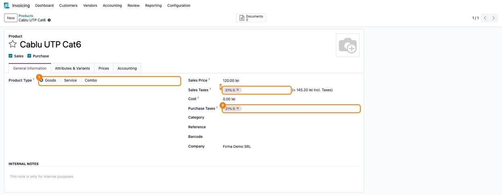

=======================
Romania - Service Taxes
=======================

..
   !!!!!!!!!!!!!!!!!!!!!!!!!!!!!!!!!!!!!!!!!!!!!!!!!!!!
   !! This file is generated by oca-gen-addon-readme !!
   !! changes will be overwritten.                   !!
   !!!!!!!!!!!!!!!!!!!!!!!!!!!!!!!!!!!!!!!!!!!!!!!!!!!!
   !! source digest: sha256:50862f1b7082d26256fe32ca4460fba2f5af711b4f47e86aa054a6707bf2285a
   !!!!!!!!!!!!!!!!!!!!!!!!!!!!!!!!!!!!!!!!!!!!!!!!!!!!

.. |badge1| image:: https://img.shields.io/badge/maturity-Beta-yellow.png
    :target: https://odoo-community.org/page/development-status
    :alt: Beta
.. |badge2| image:: https://img.shields.io/badge/license-LGPL--3-blue.png
    :target: http://www.gnu.org/licenses/lgpl-3.0-standalone.html
    :alt: License: LGPL-3
.. |badge3| image:: https://img.shields.io/badge/github-dhongu%2Fl10n--romania-lightgray.png?logo=github
    :target: https://github.com/dhongu/l10n-romania/tree/19.0/l10n_ro_service_tax
    :alt: dhongu/l10n-romania

|badge1| |badge2| |badge3|

Default sale and purchase taxes for **service** products on Romanian
companies.

The Romanian chart of accounts ships separate VAT taxes for services
(*TVA colectat 21% Servicii*, *TVA deductibil 21% Servicii*, ``21% S``)
next to the ones for goods (``21% G``). On domestic invoices both report
on the same D300 rows, but the EU fiscal positions map them by type: a
service sold to or bought from an EU partner must carry ``21% S`` to
land on the intra-community services rows (D300 row 3, rows 7/22)
instead of the goods rows (row 1, rows 5/20). Odoo has a single pair of
default taxes per company, so a new service product would otherwise get
the goods taxes.

The module adds:

- *Default Service Taxes* in **Accounting > Settings > Taxes**, next to
  the standard default taxes (visible for companies with Romania as
  fiscal country);
- the values ``tvac_21_s`` / ``tvad_21_s`` filled in when the Romanian
  chart of accounts is loaded, and at install time for companies that
  already have it;
- on the product form, when the type becomes *Service*, the service
  taxes replace the product taxes (including taxes set by hand); when
  the type changes back, the service taxes are replaced by the company
  default taxes (taxes set by hand are kept).

The field names match the ones historically provided by the OCA
``l10n_ro_config`` module, so databases migrating away from the OCA
stack keep their configuration without any data migration. Both modules
can be installed side by side.

**Table of contents**

.. contents::
   :local:

Usage
=====

1. Go to **Invoicing > Configuration > Settings > Taxes**. Next to
   *Default Taxes*, the *Default Service Taxes* block holds the **Sales
   Tax** and **Purchase Tax** used for services (preset to ``21% S``
   from the Romanian chart of accounts).

   |Settings, Taxes section: Default Taxes with 21% G and the
   highlighted Default Service Taxes block with 21% S|

2. Create a product and set **Product Type** to *Service*: **Sales
   Taxes** and **Purchase Taxes** become the service taxes (``21% S``).

   |Product form with Product Type Service and both taxes 21% S|

3. If the type goes back to *Goods*, the service taxes are replaced by
   the company default taxes (``21% G``). Taxes set by hand are kept.

   |Product form with Product Type Goods and both taxes 21% G|

Changelog
=========

19.0.1.0.0 (2026-11-03)
-----------------------

- New module: default sale and purchase taxes for service products, with
  the same field names as OCA ``l10n_ro_config``, so that module can be
  uninstalled without losing the configuration.

Bug Tracker
===========

Bugs are tracked on `Terrabit Issues <https://www.terrabit.ro/helpdesk>`_.
In case of trouble, please check there if your issue has already been reported.

Do not contact contributors directly about support or help with technical issues.

Credits
=======

Authors
-------

* Terrabit
* Dorin Hongu

Maintainers
-----------

.. |maintainer-dhongu| image:: https://github.com/dhongu.png?size=40px
    :target: https://github.com/dhongu
    :alt: dhongu

Current maintainer:

|maintainer-dhongu| 

This module is part of the `dhongu/l10n-romania <https://github.com/dhongu/l10n-romania/tree/19.0/l10n_ro_service_tax>`_ project on GitHub.

You are welcome to contribute.