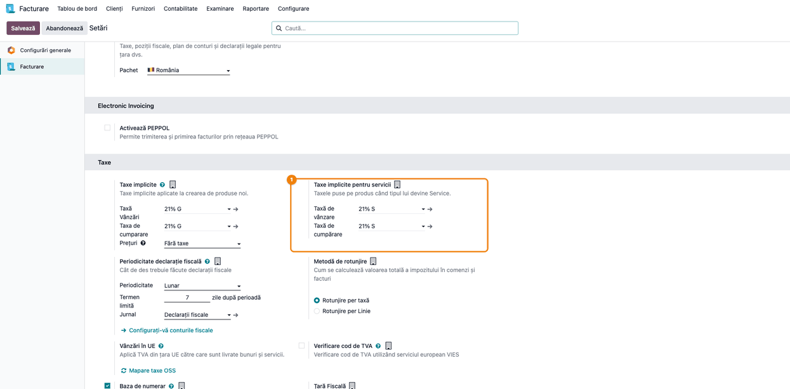
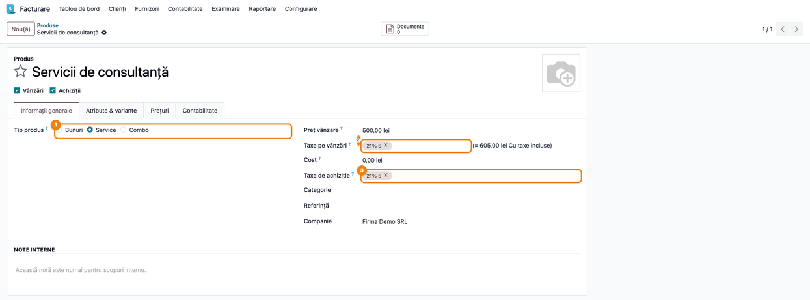
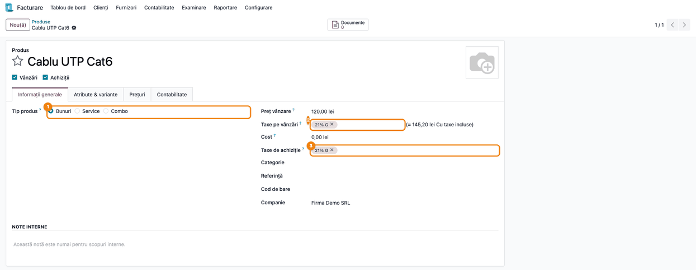

# Fișă Modul: Taxe implicite pentru produsele de tip serviciu

**Modul:** `l10n_ro_service_tax`
**Utilizator principal:** Contabil, Responsabil nomenclator produse
**Prioritate:** 🟡 Medie (un serviciu facturat unui partener din UE cu taxa de bunuri ajunge pe rândurile de bunuri din D300 și cu cod greșit în D390)

---

## 1. Scop business

Planul de conturi românesc din Odoo are taxe de TVA separate pentru servicii (*TVA colectat 21%
Servicii*, *TVA deductibil 21% Servicii*, eticheta scurtă `21% S`), pe lângă cele pentru bunuri
(`21% G`). Odoo are însă o singură pereche de taxe implicite pe companie, așa că orice produs nou
primește taxele de bunuri, chiar dacă e un serviciu. Pe facturile interne diferența nu se vede, dar
pe cele către sau de la parteneri din UE poziția fiscală transformă taxa de bunuri în operațiune
intracomunitară cu bunuri, iar serviciul ajunge pe rândurile greșite din decontul de TVA. Modulul
adaugă o a doua pereche de taxe implicite, pentru servicii, și le pune automat pe produs când tipul
lui devine serviciu.

## 2. Bază legală și context

- **Codul fiscal (Legea 227/2015):** art. 291 alin. (1) — cota standard de 21%; art. 278
  alin. (2)–(5) — locul prestării serviciilor (regula generală B2B, regula B2C și excepțiile);
  art. 307 alin. (2) — taxarea inversă la achiziția de servicii din UE; art. 325 alin. (1)
  lit. a), c), d), e) — declarația recapitulativă (D390), unde livrările și achizițiile de bunuri
  (L, A) se declară separat de prestările și achizițiile de servicii (P, S).
- **Regim intern:** în planul de conturi RO standard Odoo, `21% G` și `21% S` se raportează pe
  aceleași rânduri din decontul de TVA (D300): rândul 9 la livrări și prestări, rândul 24 la
  achiziții, cu aceleași conturi (4427, respectiv 4426).
- **Operațiuni intracomunitare:** pozițiile fiscale UE din planul RO transformă taxele după tip:

  | Operațiune | Din taxa `21% G` | Din taxa `21% S` |
  |---|---|---|
  | Livrare / prestare către un partener din UE cu cod de TVA (poziția *Schema intracomunitară*) | `0% EU G`, D300 rândul 1; D390 cod L | `0% EU S`, D300 rândul 3 (și 3.1, doar cu `l10n_ro_anaf_d300`); D390 cod P |
  | Achiziție din UE (taxare inversă) | D300 rândurile 5/5.1 și 20/20.1; D390 cod A | D300 rândurile 7/7.1 și 22/22.1; D390 cod S |

  De aceea tipul taxei de pe produs contează: un serviciu cu taxa de bunuri ajunge pe rândurile
  de bunuri din D300 și cu cod de bunuri (L sau A) în D390. Facturile deja validate își păstrează
  taxele.
- **Atenție, cazuri în care maparea automată nu e corectă:**
  - partener din UE **fără cod de TVA** (persoană neimpozabilă): poziția *Regim intracomunitar
    scutit* dă automat `0% EU S`, dar de regulă locul prestării e în România (art. 278 alin. (3)),
    deci se aplică 21% — corectați taxa pe factură; excepție, printre altele, serviciile
    electronice și de telecomunicații (art. 278 alin. (5) lit. h)), cu TVA-ul statului clientului,
    prin OSS;
  - **excepțiile de la art. 278 alin. (4)** (ex. servicii legate de imobile, transport de
    persoane): locul prestării nu se stabilește după sediul beneficiarului, iar taxa se pune de
    mână;
  - parteneri **din afara UE**: pe planul standard, maparea serviciilor are goluri pe care le
    corectează `l10n_ro_anaf_d300`; instalarea lui este recomandată.
- Modulul nu schimbă cotele sau maparea pe rânduri, care vin din planul de conturi RO standard
  Odoo (`l10n_ro`); stabilește doar ce taxă primește implicit un produs de tip serviciu.

## 3. Utilizatori și roluri

- **Contabil** (grup *Facturare / Administrator*): verifică și, dacă e cazul, schimbă taxele
  implicite pentru servicii din setări.
- **Responsabil nomenclator** (utilizator care creează produse): alege tipul produsului;
  taxele se completează singure.
- **La testare**: un administrator pentru setări și un utilizator obișnuit care creează produse.

## 4. Conturi și date implicate

Modulul nu generează note contabile. Datele implicate:

| Setare | Valoare implicită pe planul RO |
|---|---|
| Taxă de vânzare pentru servicii | `21% S` — TVA colectat 21% Servicii |
| Taxă de cumpărare pentru servicii | `21% S` — TVA deductibil 21% Servicii |
| Taxe implicite (standard Odoo, pentru restul produselor) | `21% G` |

Date minime pentru demo: o companie cu planul de conturi RO încărcat și două produse noi, unul de
tip serviciu și unul de tip bunuri.

## 5. Configurare inițială

1. Instalați `l10n_ro_service_tax` (dependență: `l10n_ro`).
2. Pe o companie care are deja planul de conturi RO, la instalare taxele de serviciu se completează
   singure cu `21% S`, doar dacă erau goale. Pe o companie nouă, se completează la încărcarea
   planului de conturi RO.
3. Dacă baza venea de pe localizarea OCA (`l10n_ro_config`), valorile setate acolo se păstrează:
   cele două module folosesc aceleași câmpuri.

## 6. Flux de utilizare

### Pasul 1 — Verificarea taxelor implicite pentru servicii

Accesați **Facturare → Configurare → Setări** și coborâți la secțiunea **Taxe**. Lângă blocul
standard **Taxe implicite** apare blocul **Taxe implicite pentru servicii**, cu **Taxă de vânzare**
și **Taxă de cumpărare**.

- **Găsiți pe ecran:** blocul *Taxe implicite pentru servicii*, în dreapta blocului *Taxe implicite*.
- **Verificați:** ambele câmpuri au `21% S`, iar *Taxe implicite* are `21% G`.
- **Treceți mai departe:** dacă ați schimbat ceva, apăsați **Salvează**.

Blocul apare doar la companiile cu România ca țară fiscală.



### Pasul 2 — Produs nou de tip serviciu

Accesați **Facturare → Clienți → Produse → Nou**. Completați numele și alegeți **Tip produs** =
**Service**. Câmpurile **Taxe pe vânzări** și **Taxe de achiziție** se schimbă din `21% G` în
`21% S`. Salvați produsul.

Atenție: la alegerea **Service**, taxele deja completate pe produs se înlocuiesc cu cele de
serviciu. Dacă produsul avea intenționat altă taxă (de ex. o cotă redusă), refaceți-o după
schimbarea tipului.



### Pasul 3 — Produs trecut înapoi pe bunuri

Dacă ați ales din greșeală **Service** și reveniți la **Bunuri**, taxele de serviciu se înlocuiesc
cu taxele implicite ale companiei (`21% G`). Taxele alese de mână rămân neschimbate: înlocuirea se
face doar când pe produs era exact taxa implicită pentru servicii.



### Note de monografie și raportare

Modulul nu generează note contabile. Linia de factură cu produsul de tip serviciu primește taxa
`21% S`. În regim intern, rezultatul în D300 e același ca la `21% G` (rândul 9, respectiv 24) și
se folosesc aceleași conturi; monografia rămâne cea standard (ex. vânzare `4111 = 704 + 4427`,
cumpărare `628 + 4426 = 401`). Diferența apare la partenerii din UE cu poziția *Schema
intracomunitară*: taxa `21% S` devine taxa de servicii UE (D300 rândul 3, și 3.1 cu
`l10n_ro_anaf_d300`, la prestări, rândurile 7/7.1 și 22/22.1 la
achiziții), nu cea de bunuri (rândul 1, respectiv 5/5.1 și 20/20.1). Notele intracomunitare
rezultate (ex.): prestare către UE `4111 = 704`, fără TVA; achiziție din UE `628 = 401` și
autolichidarea `4426 = 4427`.

## 7. Legături cu alte module / declarații

| Modul | Rol în flux |
|---|---|
| `l10n_ro` | planul de conturi RO, taxele `21% S` / `21% G` și pozițiile fiscale UE care le transformă după tip |
| `account` | setările de taxe implicite și formularul de produs |
| `l10n_ro_anaf_d300` (recomandat) | completează maparea pe rândurile D300 (rândul 3.1, serviciile cu parteneri din afara UE) |
| `l10n_ro_anaf_d390` | declarația recapitulativă: codul P/S vine din taxa de servicii UE |
| `l10n_ro_config` (OCA, opțional) | aceleași câmpuri; cele două module pot fi instalate împreună |

**Ce e automat:** completarea taxelor de serviciu la instalare și la încărcarea planului RO;
schimbarea taxelor când tipul produsului devine *Service* sau revine la *Bunuri*.

**Ce rămâne manual:** produsele existente, create înainte de instalare, își păstrează taxele;
produsele create prin import sau prin API, fără formular, primesc taxele implicite standard.

## 8. Verificări pentru consultant

- [ ] În **Facturare → Configurare → Setări → Taxe** apare blocul *Taxe implicite pentru servicii*
      cu `21% S` pe vânzare și pe cumpărare.
- [ ] Pe o companie cu altă țară fiscală decât România, blocul nu apare.
- [ ] Un produs nou cu tipul *Service* primește `21% S` pe *Taxe pe vânzări* și *Taxe de achiziție*.
- [ ] Trecut înapoi pe *Bunuri*, produsul primește `21% G`.
- [ ] Trecut de pe *Service* pe *Bunuri*, un produs cu taxe puse de mână (altele decât `21% S`)
      își păstrează taxele; la trecerea pe *Service*, taxele se înlocuiesc întotdeauna.
- [ ] Factura cu produsul de tip serviciu are `21% S` pe linie; către un partener din UE cu cod
      de TVA valid (poziția *Schema intracomunitară*), taxa devine `0% EU S`.
- [ ] Către un partener din UE fără cod de TVA, factura de serviciu primește automat `0% EU S`;
      verificați că taxa a fost corectată manual la 21% (cu excepțiile art. 278 alin. (4)–(5)).
- [ ] După dezinstalarea `l10n_ro_config`, taxele de serviciu din setări au rămas aceleași.

## 9. Mesaje de eroare frecvente

| Mesaj | Cauză | Remediere |
|---|---|---|
| Blocul *Taxe implicite pentru servicii* lipsește din setări | Țara fiscală a companiei nu e România | Verificați *Țară fiscală* în aceeași pagină de setări |
| Serviciul nou primește `21% G` | Taxele de serviciu sunt goale în setări | Completați-le în blocul *Taxe implicite pentru servicii* |
| Produsele vechi de tip serviciu au `21% G` | Create înainte de instalare | Corectați taxele pe produs; modulul nu le schimbă retroactiv |

## 10. Capturi de ecran

Capturile sunt generate automat din `tests/test_screenshots.py` (mixinul `ScreenshotCase` din
`l10n_ro_doc_screenshots`, import defensiv), în RO, pe planul de conturi RO, în
`static/description/`, în ordinea pașilor din secțiunea 6. Produsele sunt create prin formular,
ca schimbarea taxelor să ruleze exact ca în interfață.

| # | Fișier | Conținut |
|---|--------|----------|
| 1 | `static/description/01_setari_taxe_servicii.png` | Setările Facturare, secțiunea Taxe, cu blocul Taxe implicite pentru servicii |
| 2 | `static/description/02_produs_tip_serviciu.png` | Produs de tip Service cu taxele 21% S |
| 3 | `static/description/03_produs_revenire_bunuri.png` | Produs trecut înapoi pe Bunuri, cu taxele 21% G |

Regenerare:

```bash
./odoo/odoo-bin -c odoo.conf -d test19 -i l10n_ro_service_tax,l10n_ro_doc_screenshots --test-tags=fise_screenshots --stop-after-init
```

## 11. Observații pentru manual

- În interfața în română, tipul de produs apare ca **Service** (traducerea standard Odoo), nu
  „Serviciu”; în manual folosiți eticheta din interfață.
- De subliniat: modulul nu schimbă produsele existente. La punerea în producție, merită o listă a
  produselor de tip serviciu cu taxa `21% G`, de corectat o singură dată.
- Pentru companiile din grup cu altă țară fiscală, setarea nu apare și produsele primesc taxele
  implicite standard.
