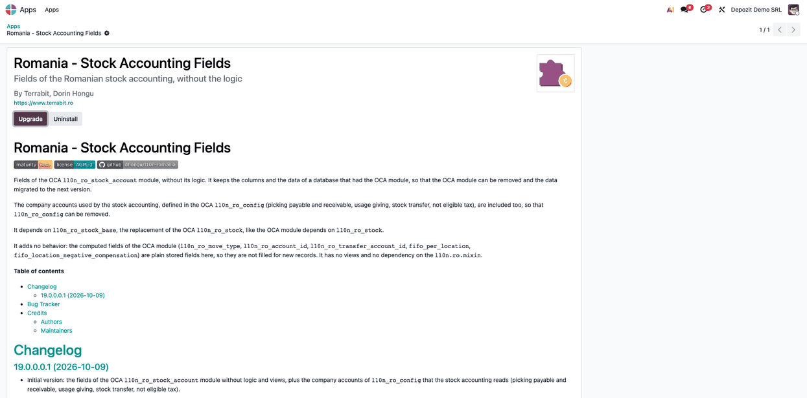
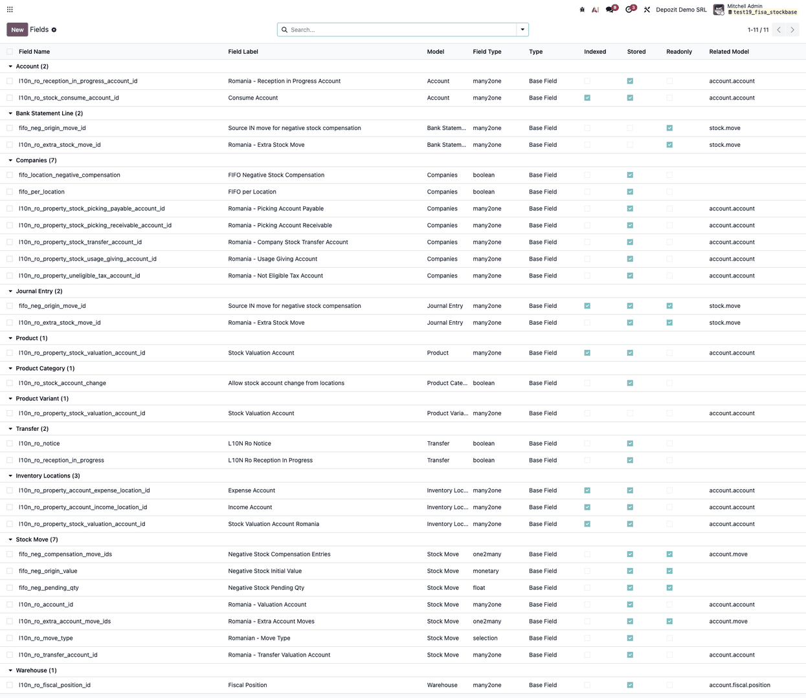

=================================
Romania - Stock Accounting Fields
=================================

..
   !!!!!!!!!!!!!!!!!!!!!!!!!!!!!!!!!!!!!!!!!!!!!!!!!!!!
   !! This file is generated by oca-gen-addon-readme !!
   !! changes will be overwritten.                   !!
   !!!!!!!!!!!!!!!!!!!!!!!!!!!!!!!!!!!!!!!!!!!!!!!!!!!!
   !! source digest: sha256:221119f77ebc8f3dc5c8c8fd2be1ffeb70cb66a0c441cf328d841a0d159af0eb
   !!!!!!!!!!!!!!!!!!!!!!!!!!!!!!!!!!!!!!!!!!!!!!!!!!!!

.. |badge1| image:: https://img.shields.io/badge/maturity-Beta-yellow.png
    :target: https://odoo-community.org/page/development-status
    :alt: Beta
.. |badge2| image:: https://img.shields.io/badge/license-AGPL--3-blue.png
    :target: http://www.gnu.org/licenses/agpl-3.0-standalone.html
    :alt: License: AGPL-3
.. |badge3| image:: https://img.shields.io/badge/github-dhongu%2Fl10n--romania-lightgray.png?logo=github
    :target: https://github.com/dhongu/l10n-romania/tree/19.0/l10n_ro_stock_account_base
    :alt: dhongu/l10n-romania

|badge1| |badge2| |badge3|

Fields of the OCA ``l10n_ro_stock_account`` module, without its logic.
It keeps the columns and the data of a database that had the OCA module,
so that the OCA module can be removed and the data migrated to the next
version.

The company accounts used by the stock accounting, defined in the OCA
``l10n_ro_config`` (picking payable and receivable, usage giving, stock
transfer, not eligible tax), are included too, so that
``l10n_ro_config`` can be removed.

It depends on ``l10n_ro_stock_base``, the replacement of the OCA
``l10n_ro_stock``, like the OCA module depends on ``l10n_ro_stock``.

It adds no behavior: the computed fields of the OCA module
(``l10n_ro_move_type``, ``l10n_ro_account_id``,
``l10n_ro_transfer_account_id``, ``fifo_per_location``,
``fifo_location_negative_compensation``) are plain stored fields here,
so they are not filled for new records. It has no views and no
dependency on the ``l10n.ro.mixin``.

**Table of contents**

.. contents::
   :local:

Usage
=====

The module has no screens and no accounting logic. It only keeps the
fields of the OCA stock accounting modules when they are removed. Work
on a copy of the database and make a backup first.

1. In **Apps**, install ``l10n_ro_stock_base`` and this module (*Romania
   - Stock Accounting Fields*) **before** uninstalling anything. Then
   uninstall the OCA module ``l10n_ro_stock_account`` (and
   ``l10n_ro_stock``, if no longer needed). Read the confirmation
   dialog: Odoo also uninstalls every module that depends on the one you
   remove. Only five company accounts of ``l10n_ro_config`` are kept by
   this module: uninstall ``l10n_ro_config`` only after its other fields
   (custody account, trade discount accounts, VAT fiscal positions,
   journal and partner fields) are taken over by other modules or
   confirmed unused, otherwise they are lost.

   |The Romania - Stock Accounting Fields module installed in Apps, with
   the Upgrade and Uninstall buttons|

2. With the developer mode on, open **Settings → Technical → Database
   Structure → Fields** and search by **Field Name** or group by
   **Model**: the fields of the module are still there, with **Stored**
   checked on their own model (the ones on the bank statement line and
   the product variant are inherited and show as not stored), and keep
   their values. Read the values with **Actions → Export** on the
   matching list (locations, stock moves, ...).

   |The fields declared by the module, grouped by model, with their
   technical name, label, type and the Stored column|

The computed fields of the OCA module (the Romanian move type, the
valuation account of the move, the FIFO options) are plain stored fields
here: records created after the OCA module is removed leave them empty.
The stock accounting entries are made by the stock valuation module
installed in the database, not by this one.

Changelog
=========

19.0.0.0.1 (2026-10-09)
-----------------------

- Initial version: the fields of the OCA ``l10n_ro_stock_account``
  module without logic and views, plus the company accounts of
  ``l10n_ro_config`` that the stock accounting reads (picking payable
  and receivable, usage giving, stock transfer, not eligible tax).
  Romanian translation of the field labels, taken from the OCA module
  where they exist.

Bug Tracker
===========

Bugs are tracked on `Terrabit Issues <https://www.terrabit.ro/helpdesk>`_.
In case of trouble, please check there if your issue has already been reported.

Do not contact contributors directly about support or help with technical issues.

Credits
=======

Authors
-------

* Terrabit
* Dorin Hongu

Maintainers
-----------

.. |maintainer-dhongu| image:: https://github.com/dhongu.png?size=40px
    :target: https://github.com/dhongu
    :alt: dhongu

Current maintainer:

|maintainer-dhongu| 

This module is part of the `dhongu/l10n-romania <https://github.com/dhongu/l10n-romania/tree/19.0/l10n_ro_stock_account_base>`_ project on GitHub.

You are welcome to contribute.