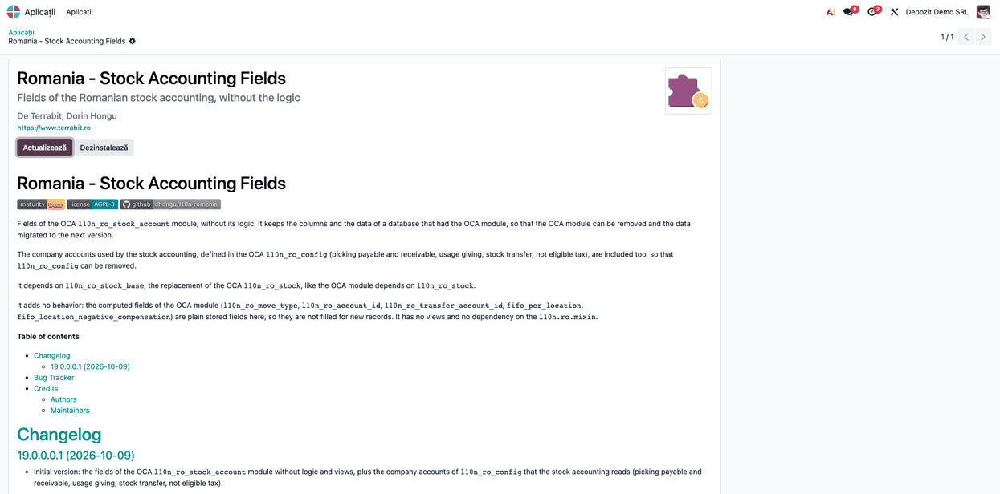

# Fișă Modul: Câmpurile contabilității de stoc românești, fără logică

**Modul:** `l10n_ro_stock_account_base`
**Utilizator principal:** Consultant sau administrator care scoate modulele OCA de contabilitate a stocului dintr-o bază și pregătește migrarea
**Prioritate:** 🟢 Scăzută (modul tehnic de tranziție: nu are ecrane și nu generează note contabile; contează doar la dezinstalarea modulelor OCA)

---

## 1. Scop business

Bazele care au folosit modulele OCA de localizare românească pentru stocuri (`l10n_ro_stock_account`, cu `l10n_ro_config`) au în tabele câmpuri proprii: conturile pe locație, contul de evaluare pe produs, tipul de mișcare românesc pe fiecare mișcare de stoc, conturile companiei pentru aviz, dare în folosință, transfer între gestiuni și TVA nedeductibilă (de exemplu la lipsurile la inventar; implicit în OCA, contul 6352), datele de compensare a stocului negativ FIFO. La dezinstalarea unui modul, Odoo șterge coloanele câmpurilor pe care doar acel modul le declara, deci datele s-ar pierde.

`l10n_ro_stock_account_base` declară **aceleași câmpuri, cu aceleași nume tehnice**, dar **fără nicio logică** și fără ecrane. Instalat înainte de dezinstalarea modulelor OCA, el face ca acele coloane și valorile lor să rămână în bază, ca să poată fi citite sau migrate la versiunea următoare.

Ce **nu** face modulul — de reținut de la început:

- **nu generează note contabile** și nu alege conturi la recepție, livrare, consum sau inventar;
- **nu completează** câmpurile pentru înregistrările noi: tipul de mișcare românesc, contul de evaluare al mișcării și opțiunile FIFO pe locație erau calculate de modulul OCA; aici sunt simple câmpuri stocate, care rămân goale pe documentele create după dezinstalarea OCA;
- **nu afișează** câmpurile pe niciun formular; ele se văd doar în meniul tehnic (vezi Pasul 2).

## 2. Bază legală și context

Modulul nu ține de o obligație legală: este un instrument de **continuitate a datelor** la schimbarea modulelor de localizare. Câmpurile păstrate țin de contabilitatea stocurilor din **OMFP 1802/2014** (conturile de stocuri, de cheltuieli și de venituri pe gestiuni), dar regulile de contare nu mai sunt aplicate de acest modul.

Contextul operațional: înlocuirea modulelor OCA `l10n_ro_stock` și `l10n_ro_stock_account` (cu `l10n_ro_config`) cu modulele Terrabit, fără pierderea istoricului din tabele.

## 3. Utilizatori și roluri

| Utilizator | Ce face | Drepturi recomandate la testare |
|---|---|---|
| Consultant / administrator | instalează modulul, dezinstalează modulele OCA, verifică păstrarea câmpurilor | Administrare / Setări, mod dezvoltator activ |
| Contabil | confirmă, după dezinstalare, că rapoartele și notele contabile ale stocului se fac de modulul de evaluare ales | Contabilitate / Contabil |

Operatorii de stoc nu lucrează cu acest modul.

## 4. Conturi și date implicate

Modulul **nu folosește conturi la înregistrare**. Păstrează următoarele câmpuri (etichetele sunt cele din interfață, deocamdată în engleză):

| Unde | Câmpuri păstrate |
|---|---|
| **Companie** | conturile *Romania - Picking Account Payable* / *Receivable* (aviz de însoțire), *Romania - Usage Giving Account*, *Romania - Company Stock Transfer Account*, *Romania - Not Eligible Tax Account*; opțiunile *FIFO per Location* și *FIFO Negative Stock Compensation* |
| **Cont** | *Consume Account*, *Romania - Reception in Progress Account* |
| **Categorie produs** | *Allow stock account change from locations* |
| **Produs** (și variantă) | *Stock Valuation Account* |
| **Locație** | *Income Account*, *Expense Account*, *Stock Valuation Account Romania* |
| **Depozit** | *Fiscal Position* |
| **Transfer** | indicatorii de aviz (*L10N Ro Notice*) și de recepție în curs (*L10N Ro Reception In Progress*) |
| **Mișcare de stoc** | *Romanian - Move Type*, *Romania - Valuation Account*, *Romania - Transfer Valuation Account*, notele contabile suplimentare legate, cantitatea și valoarea stocului negativ FIFO în așteptare, notele de compensare |
| **Înregistrare jurnal** (notă contabilă) | legătura cu mișcarea de stoc suplimentară și cu mișcarea de intrare care a compensat un stoc negativ |

Cele cinci conturi ale companiei de mai sus vin din `l10n_ro_config`. Modulul păstrează **doar** aceste cinci câmpuri ale lui `l10n_ro_config`, nu tot modulul: celelalte câmpuri ale acestuia (de exemplu contul de custodie, conturile de discount comercial, pozițiile fiscale pentru TVA la încasare și taxare inversă, datele de pe jurnale și de pe parteneri) **se pierd** la dezinstalarea lui, dacă nu le preia alt modul.

Date minime pentru demo: o bază cu `l10n_ro_stock_base` și `stock_account` instalate. Pentru testul complet al păstrării datelor, o copie a unei baze care are instalate modulele OCA `l10n_ro_stock_account` și `l10n_ro_config`, cu conturi completate pe locații și mișcări de stoc validate.

## 5. Configurare inițială

1. Lucrați pe o **copie** a bazei, nu direct în producție, și faceți o copie de siguranță înainte de dezinstalare.
2. Instalați `l10n_ro_stock_base` (înlocuitorul lui `l10n_ro_stock`) și `l10n_ro_stock_account_base`. Ordinea contează: **instalarea înaintea dezinstalării** modulelor OCA.
3. Notați, pentru control, câteva valori din baza OCA: contul de evaluare al unei locații, tipul de mișcare românesc al câtorva mișcări de stoc, conturile companiei. Le veți compara după dezinstalare.

## 6. Flux de utilizare

### Pasul 1 — Instalarea modulului și dezinstalarea modulelor OCA

**Aplicații**, scoateți filtrul *Aplicații* și căutați `l10n_ro_stock_account_base` (titlul *Romania - Stock Accounting Fields*). Deschideți fișa modulului și apăsați **Activează**. După instalare, fișa arată butoanele **Actualizează** și **Dezinstalează**, iar descrierea spune că modulul păstrează câmpurile fără logică.

Abia apoi, tot din **Aplicații**, deschideți modulul OCA `l10n_ro_stock_account` (și, dacă nu mai e nevoie de el, `l10n_ro_stock`) și apăsați **Dezinstalează**. Dezinstalați `l10n_ro_config` **numai** după ce ați confirmat că celelalte câmpuri ale lui sunt preluate de alte module sau nu mai sunt folosite (secțiunea 4). Citiți cu atenție lista din fereastra de confirmare: Odoo dezinstalează și **toate modulele care depind** de modulul ales. Dacă în listă apar module pe care încă le folosiți, opriți-vă și clarificați înlocuitorul lor.



### Pasul 2 — Verificarea câmpurilor păstrate

Activați **modul dezvoltator** și deschideți **Setări → Tehnic → Structura bazei de date → Câmpuri**. Căutați după *Nume câmp* (de exemplu `l10n_ro_property_stock_valuation_account_id`) sau grupați după *Model*.

Verificați:

- fiecare câmp din tabelul din secțiunea 4 există în continuare, pe modelul lui, cu *Stocat* bifat. Câmpurile din grupurile *Linie extras bancar* și *Variantă produs* sunt moștenite de la înregistrarea contabilă, respectiv de la produs, și apar nestocate: datele lor stau pe modelul de origine;
- valorile notate la configurare (secțiunea 5, pasul 3) sunt aceleași. Câmpurile nu au ecrane, deci valorile se citesc prin export (de exemplu, din lista locațiilor sau a mișcărilor de stoc, **Acțiuni → Export**, cu câmpul adăugat din lista de câmpuri disponibile) sau de un administrator tehnic.


### Note de monografie și raportare

Modulul **nu generează note contabile** și nu are monografie proprie. După dezinstalarea modulelor OCA, contarea recepțiilor, livrărilor, consumurilor și diferențelor de inventar o face modulul de evaluare a stocului instalat în bază, după configurarea lui; verificați-o acolo. Câmpurile păstrate de acest modul (de exemplu tipul de mișcare românesc al mișcărilor vechi) sunt doar istoric și nu influențează notele noi.

## 7. Legături cu alte module / declarații

| Modul | Rol |
|---|---|
| `l10n_ro_stock_base` | Dependență: locațiile și operațiile de consum și dare în folosință, înlocuitorul lui `l10n_ro_stock` |
| `stock_account` | Dependență: evaluarea stocului din Odoo |
| `l10n_ro_stock_account` (OCA) | Modulul ale cărui câmpuri le păstrează; poate fi dezinstalat după instalarea acestui modul |
| `l10n_ro_config` (OCA) | Cele cinci conturi ale companiei pentru stoc sunt păstrate aici; restul câmpurilor lui nu, deci se dezinstalează doar după ce sunt preluate sau confirmate ca nefolosite |

**Ce e automat:**

- păstrarea coloanelor și a valorilor la dezinstalarea modulelor OCA, pentru câmpurile din secțiunea 4.

**Ce rămâne manual:**

- ordinea operațiilor (instalare, apoi dezinstalare);
- verificarea listei de module dependente la dezinstalare;
- controlul valorilor păstrate;
- alegerea și configurarea modulului care face de acum contabilitatea stocului.

## 8. Verificări pentru consultant

- [ ] `l10n_ro_stock_base` și `l10n_ro_stock_account_base` sunt instalate **înainte** de dezinstalarea modulelor OCA.
- [ ] Fereastra de dezinstalare a fost citită; niciun modul folosit nu a fost scos fără înlocuitor.
- [ ] În Setări → Tehnic → Câmpuri, câmpurile din secțiunea 4 există după dezinstalare, cu *Stocat* bifat pe modelul propriu (cele de pe *Linie extras bancar* și *Variantă produs* sunt moștenite și apar nestocate).
- [ ] Înainte de dezinstalarea lui `l10n_ro_config`, s-a stabilit înlocuitorul fiecărui câmp al lui folosit în bază (altul decât cele cinci conturi păstrate aici).
- [ ] Contul de evaluare al unei locații, notat înainte, are aceeași valoare după dezinstalare.
- [ ] Tipul de mișcare românesc al unei mișcări de stoc vechi este păstrat.
- [ ] Pe o mișcare de stoc nouă, validată după dezinstalare, tipul de mișcare românesc este gol (comportament așteptat).
- [ ] Notele contabile ale unei recepții noi sunt generate de modulul de evaluare ales, nu de acest modul.

## 9. Mesaje de eroare frecvente

| Mesaj / simptom | Cauză | Remediere |
|---|---|---|
| După dezinstalarea OCA, valorile lipsesc | Modulul a fost instalat după dezinstalare | Restaurați copia de siguranță, instalați întâi modulul, apoi dezinstalați OCA |
| După dezinstalarea lui `l10n_ro_config` lipsesc date de pe jurnale, parteneri sau din setările contabile RO | Acest modul păstrează doar cele cinci conturi de stoc ale companiei din `l10n_ro_config` | Restaurați copia de siguranță și dezinstalați `l10n_ro_config` doar după ce celelalte câmpuri sunt preluate de alte module |
| Fereastra de dezinstalare listează multe module | Modulele OCA dependente se dezinstalează odată cu cel ales | Opriți-vă și stabiliți înlocuitorul fiecărui modul folosit |
| Tipul de mișcare românesc e gol pe documentele noi | Modulul nu calculează câmpurile | Comportament așteptat; câmpul este doar istoric |
| Nu găsesc câmpurile pe formularul locației sau al companiei | Modulul nu are ecrane | Folosiți meniul tehnic (Pasul 2) sau exportul |
| Meniul *Tehnic* nu apare în Setări | Modul dezvoltator inactiv | Activați modul dezvoltator |

## 10. Capturi de ecran

Capturile (`static/description/`) sunt **generate automat** din `tests/test_screenshots.py` (mixinul `ScreenshotCase` din `l10n_ro_doc_screenshots`, import defensiv), în **limba română**, pe o companie românească în RON:

1. `01_modul_instalat.png` — fișa modulului în Aplicații, instalat, cu butoanele *Actualizează* și *Dezinstalează*.
2. `02_campuri_modul.png` — lista câmpurilor declarate de modul, grupate pe model (meniul tehnic *Câmpuri*, în modul dezvoltator).

Aceleași ecrane, cu interfața în engleză, sunt în `static/description/en/`, pentru `readme/USAGE.md`.

Regenerare — **restrângeți la clasă**, altfel se rescriu capturile tuturor modulelor care au un test de fișe:

```bash
./odoo/odoo-bin -c odoo.conf -d <db> -i l10n_ro_stock_account_base,l10n_ro_doc_screenshots \
    --test-tags=/l10n_ro_stock_account_base:TestStockAccountBaseScreenshots --stop-after-init
```

## 11. Observații pentru manual

1. **Modul de tranziție, nu de contabilitate.** Nu înlocuiește logica OCA: păstrează doar datele. Contabilitatea stocului trebuie preluată de un alt modul de evaluare.
2. **Ordinea e totul:** instalare, apoi dezinstalare. `l10n_ro_config` se scoate ultimul și doar după ce restul câmpurilor lui sunt preluate. Invers, datele se pierd și se recuperează doar din copia de siguranță.
3. **Câmpurile păstrate sunt istoric.** Pe documentele noi rămân goale.
4. **Fără ecrane.** Valorile se citesc din meniul tehnic sau prin export.
5. Etichetele câmpurilor apar deocamdată în engleză și în interfața română (modulul nu are încă traducere).
