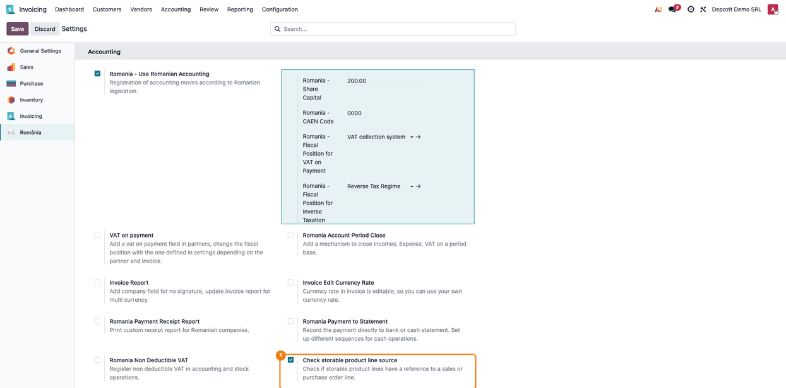
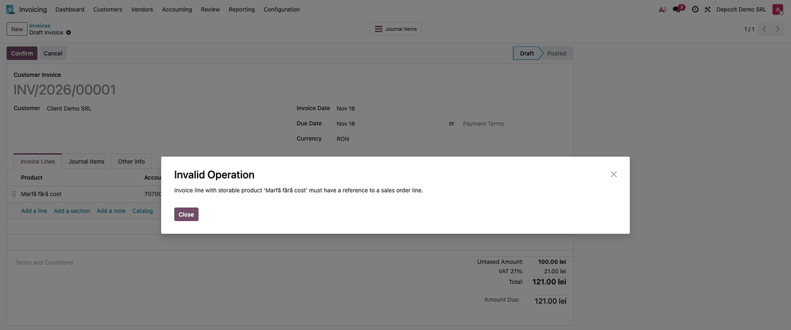
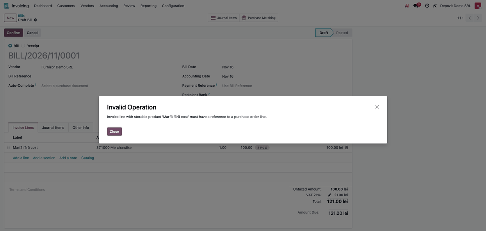
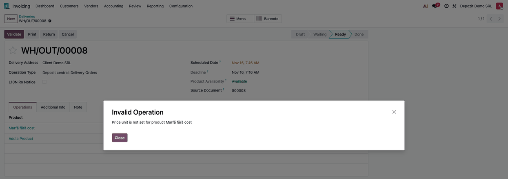
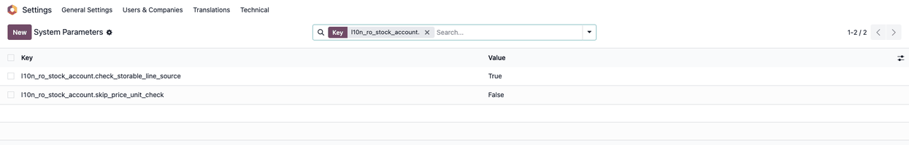

===================================
Romania - Stock Accounting Controls
===================================

..
   !!!!!!!!!!!!!!!!!!!!!!!!!!!!!!!!!!!!!!!!!!!!!!!!!!!!
   !! This file is generated by oca-gen-addon-readme !!
   !! changes will be overwritten.                   !!
   !!!!!!!!!!!!!!!!!!!!!!!!!!!!!!!!!!!!!!!!!!!!!!!!!!!!
   !! source digest: sha256:4c8fdebcc923e166c0d52b2ec4dcf9f3c26637332184d82bdb3f1fab9b54b8cf
   !!!!!!!!!!!!!!!!!!!!!!!!!!!!!!!!!!!!!!!!!!!!!!!!!!!!

.. |badge1| image:: https://img.shields.io/badge/maturity-Mature-brightgreen.png
    :target: https://odoo-community.org/page/development-status
    :alt: Mature
.. |badge2| image:: https://img.shields.io/badge/license-AGPL--3-blue.png
    :target: http://www.gnu.org/licenses/agpl-3.0-standalone.html
    :alt: License: AGPL-3
.. |badge3| image:: https://img.shields.io/badge/github-dhongu%2Fl10n--romania-lightgray.png?logo=github
    :target: https://github.com/dhongu/l10n-romania/tree/19.0/l10n_ro_stock_account_enhancement
    :alt: dhongu/l10n-romania

|badge1| |badge2| |badge3|

- Oprește operațiile care calculează un preț unitar zero pe mișcări
  reale de stoc (de exemplu, livrarea unei mărfi fără cost); controlul
  se poate dezactiva din parametrul de sistem
  ``l10n_ro_stock_account.skip_price_unit_check``.
- Restricție la confirmarea facturilor și a notelor de credit
  (vânzare/achiziție) care conțin produse stocabile fără referință la o
  comandă de vânzare (SO) sau de achiziție (PO).
- Posibilitatea de a activa/dezactiva această restricție din Setări →
  România, blocul Contabilitate (Accounting).

**Table of contents**

.. contents::
   :local:

Usage
=====

The module adds two controls that protect the stock accounting entries.

**1. Storable product lines must come from an order (optional)**

Go to **Invoicing → Configuration → Settings**, open **România** in the
left panel and tick **Check storable product line source**, then
**Save**. The option applies to the whole database.

|Settings, România section: the option Check storable product line
source is ticked and highlighted|

With the option on, a customer invoice or credit note with a storable
product that does not come from a sales order cannot be confirmed:
**Confirm** shows "Invoice line with storable product '...' must have a
reference to a sales order line." Invoice from the sales order instead.

|Draft customer invoice without a sales order and the Invalid Operation
dialog about the missing sales order line|

Vendor bills and refunds work the same way: a storable product line must
come from a purchase order (fill the bill from the purchase order with
**Auto-Complete**).

|Draft vendor bill without a purchase order and the Invalid Operation
dialog about the missing purchase order line|

Lines with services or consumables are not checked.

**2. Stock moves must have a unit price (always on)**

When Odoo computes the unit price of real stock moves and gets 0, the
operation stops with "Price unit is not set for product ...". For
example, validating the delivery of a FIFO product without cost from a
sales order (with the sales margin module installed) is blocked, and the
delivery stays **Ready**. Set the product cost, or receive the goods
with a price, then validate again.

|Delivery of a product without cost and the Invalid Operation dialog:
Price unit is not set for product|

Computations on an empty set of moves (for example, the returns of a
delivery that has none) are not checked.

**System parameters**

In developer mode, **Settings → Technical → Parameters → System
Parameters** shows ``l10n_ro_stock_account.check_storable_line_source``
(written by the setting above) and, if created,
``l10n_ro_stock_account.skip_price_unit_check``. Set the latter to
``True`` only to allow moves without cost temporarily (for example, an
opening stock at zero cost), then back to ``False``.

|System Parameters filtered on the l10n_ro_stock_account keys|

Changelog
=========

19.0.0.0.5 (2026-11-16)
-----------------------

- Fișa consultant (``readme/FISA_CONSULTANT.md``), cu capturi generate
  automat (``tests/test_screenshots.py``), în română și în engleză, plus
  GIF-ul demo.
- ``readme/USAGE.md`` nou, în engleză; ``readme/DESCRIPTION.md``
  corectat: opțiunea este în Setări → România, blocul Contabilitate.
- Traducerea în română a mesajului „Price unit is not set for product”.

19.0.0.0.4 (2026-11-16)
-----------------------

- Corectare: validarea livrărilor din comenzi de vânzare nu mai eșuează
  cu „Price unit is not set for product False”. Cu ``sale_stock_margin``
  instalat, recalcularea costului pe linia comenzii
  (``_get_price_unit_delivery``) apela ``_get_price_unit`` pe mișcările
  de retur, de obicei un recordset gol. Verificarea prețului rămâne
  activă pentru mișcările reale.

19.0.0.0.3 (2026-10-22)
-----------------------

- Listed on Odoo Apps as *Romania - Stock Accounting Controls* (was
  *Romania - Stock Accounting Enhancement*). The technical name
  ``l10n_ro_stock_account_enhancement`` does not change.

19.0.0.0.2 (2026-10-09)
-----------------------

- Odoo Apps banner (``static/description/main_screenshot.png``),
  generated from ``banner.json``.

19.0.0.0.1 (2026-09-30)
-----------------------

- Own module icon in the flat style of the Terrabit modules, instead of
  the missing or generic one.

Bug Tracker
===========

Bugs are tracked on `Terrabit Issues <https://www.terrabit.ro/helpdesk>`_.
In case of trouble, please check there if your issue has already been reported.

Do not contact contributors directly about support or help with technical issues.

Credits
=======

Authors
-------

* Terrabit
* Dorin Hongu

Contributors
------------

- `Terrabit <https://www.terrabit.ro>`__:

  - Dorin Hongu <dhongu@gmail.com>

Do not contact contributors directly about support or help with
technical issues.

Maintainers
-----------

.. |maintainer-dhongu| image:: https://github.com/dhongu.png?size=40px
    :target: https://github.com/dhongu
    :alt: dhongu

Current maintainer:

|maintainer-dhongu| 

This module is part of the `dhongu/l10n-romania <https://github.com/dhongu/l10n-romania/tree/19.0/l10n_ro_stock_account_enhancement>`_ project on GitHub.

You are welcome to contribute.