# Fișa consultant: Costuri adiționale la achiziție (l10n_ro_stock_account)

## 1. Scop business

Cheltuielile de transport, manipulare sau vamă, facturate separat de marfă, se adaugă la costul de
achiziție al stocului: Dr 371 Mărfuri. Cu `l10n_ro_stock_account`, contul de stoc vine de pe
locația și categoria produsului, iar creditul este contul de cheltuieli al liniei de cost
(de exemplu 624), completat din factura transportatorului.

Modulul adaugă, la documentul standard Odoo **Costuri adiționale**:

- **completarea automată** a costului creat din factura de furnizor: recepțiile comenzii de
  achiziție și contul fiecărei linii se iau din factură;
- **contul din locație** pentru nota de evaluare (locația de destinație la intrări, cea sursă la
  ieșiri) și poziția fiscală a jurnalului;
- opțional, **rutarea creditului clasei 6 printr-un cont intermediar tehnic**, pe companie: o notă
  cu două perechi echilibrate: stoc / intermediar și a doua pereche, care depinde de bifa
  **Storno accounting** a companiei (vezi mai jos).

Fișa tratează situațiile care apar între recepție și costul adițional, pentru **ambele moduri de
recepție**:

- **fără Aviz**: intrarea în stoc (371 / 401) se postează la factura mărfii;
- **pe bază de aviz (cu bifa Aviz)**: intrarea în stoc se postează la recepție, Dr 371 / Cr 408, iar factura
  mărfii stinge 408.

Scenarii: fluxul complet; stoc **rezervat** pentru o vânzare la validarea costului; stoc **deja
vândut** la validarea costului.

## 2. Bază legală și context

- **OMFP 1802/2014**: cheltuielile de transport și alte cheltuieli direct atribuibile achiziției intră în
  costul de achiziție al stocului: OMFP 1802/2014, pct. 8 (definiția costului de achiziție) și pct. 75 alin. (1)
  (verificat cu Pacioli, 11.11.2026: sumele și monografiile din fișă sunt corecte).
- Atenție la forma notei: OMFP nu prevede 624 pe credit în corespondență cu 371. Varianta conformă cu funcțiunea
  conturilor este transportul înregistrat direct Dr 371 / Cr 401 pe factura transportatorului. Metoda *Standard*
  (implicită) lasă 624 pe credit; doar metoda *Prin cont intermediar* cu Storno accounting evită creditul pe clasa 6.
- La recepția pe bază de aviz, marfa se înregistrează fără factură: Dr 371 / Cr 408 Furnizori – facturi
  nesosite, iar la sosirea facturii 408 se stinge prin 401 (verificat cu Pacioli).
- Odoo capitalizează costul adițional **doar pe cantitatea rămasă în stoc** la data validării.
  Cantitatea rezervată este încă în stoc, deci se capitalizează. Cantitatea deja livrată nu se mai
  capitalizează: partea ei rămâne pe contul de cheltuieli al liniei.
- Pentru partea rămasă pe contul de cheltuieli (marfă vândută) modulul nu postează nicio notă. Dacă și cum se
  reclasifică în costul vânzărilor, și dacă e corectă creditarea unui cont de clasa 6 la repartizarea
  pe stoc, sunt decizii ale politicii contabile a firmei: Pacioli nu a găsit în sursele lui un temei pentru
  nicio variantă, deci fișa **nu afirmă o monografie** pentru aceste două puncte.
- **Storno accounting** (bifa din Setări → Contabilitate, implicit pornită în România): la metoda *Prin cont
  intermediar*, a doua pereche se postează în roșu, pe aceleași părți: **Dr 624 −100 / Cr intermediar −100**
  (`624 = 4739` în roșu), în loc de Dr intermediar 100 / Cr 624 100. Efectul net pe conturi e același (rulajul
  debitor al 624 scade cu 100, fără înregistrare pe credit; intermediarul rămâne cu sold zero). La metoda *Standard* bifa nu schimbă nota.
- Contul intermediar este o soluție tehnică (exporturi care cer note echilibrate pe perechi de
  conturi). Îl alege firma prin politica contabilă; recomandăm să nu fie din clasa 6 (modulul nu verifică
  clasa contului, alegerea rămâne în grija contabilului).

## 3. Utilizatori și roluri

| Rol | Ce face |
|---|---|
| Administrator contabil | Alege metoda și contul intermediar în Setări |
| Contabil | Validează costurile adiționale, verifică notele și decide tratamentul părții vândute |
| Operator de stoc | Validează recepțiile (cu sau fără Aviz) și creează costul adițional din factură |

## 4. Conturi și date implicate

| Cont | Rol |
|---|---|
| 371 Mărfuri | Cont de evaluare (Dr), din locație sau din categoria produsului |
| 624 Cheltuieli cu transportul | Contul liniei de cost (Dr la factura transportatorului, Cr la costul adițional) |
| 408 Furnizori – facturi nesosite | Contrapartida recepției pe bază de aviz |
| Cont intermediar tehnic | Opțional, cu sold zero, ales de firmă; recomandat în afara clasei 6 (nevalidat de modul) |
| 609 | Nu se rutează niciodată prin contul intermediar |

Date: produs stocabil cu evaluare în timp real (FIFO sau cost mediu), produs de serviciu cu **Este cost
adițional** bifat, jurnal de stoc, contul 408 pentru recepțiile pe bază de aviz.

## 5. Configurare inițială

1. *Contabilitate → Configurare → Setări → România*: **Metodă cost adițional clasa 6**: *Standard*
   (implicit) sau *Prin cont intermediar*; pentru a doua, completați **Cont Intermediar**.

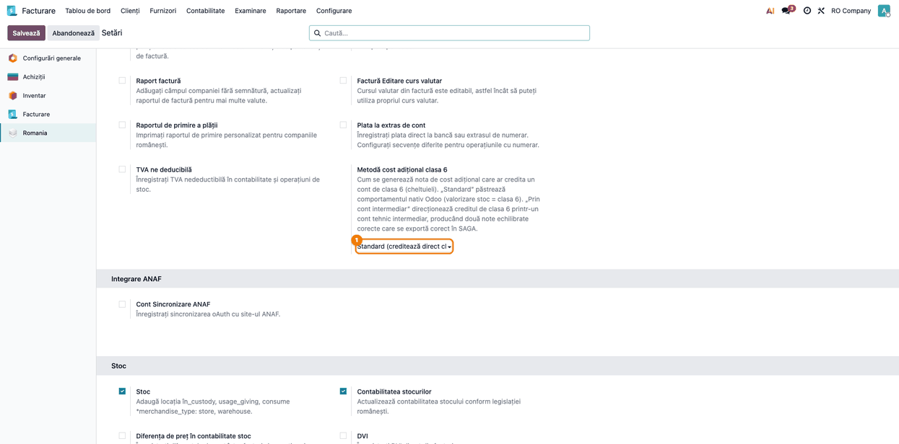

2. **Storno accounting**: *Contabilitate → Configurare → Setări → Contabilitate*, bifa **Storno accounting** (implicit
   pornită la companiile din România). Cu metoda *Prin cont intermediar*, bifa decide forma notei: a doua pereche în
   roșu (pornită) sau clasică (oprită); la metoda *Standard* nu schimbă nota.
   Dacă alegeți metoda *Prin cont intermediar* cu Storno accounting oprit, Odoo afișează un avertisment în Setări
   (mesaj în formular și fereastră la schimbarea metodei): activați bifa înainte de a lucra cu metoda.

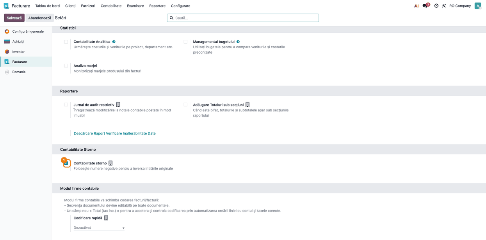

3. Produsul de transport: serviciu, **Este cost adițional**, cu contul de cheltuieli (624).
4. Marfa: stocabilă, categorie cu evaluare în timp real și cont de evaluare, jurnal de stoc.

## 6. Flux de utilizare

Marfa din exemple: 10 buc. × 100 lei = 1.000 lei. Transport: 100 lei + TVA 21%.

**Scenariul 1 — fluxul complet, recepție fără Aviz** (Pașii 1–7).

### Pasul 1 — Comanda de achiziție

Comandă către furnizor, 10 buc. × 100 lei, **Confirmă comanda**.

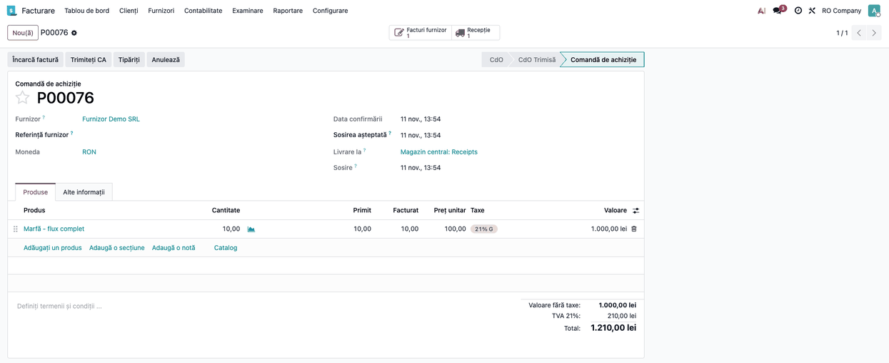

### Pasul 2 — Recepția

**Validează**, fără bifa **Aviz**. La validare nu se postează notă de stoc.

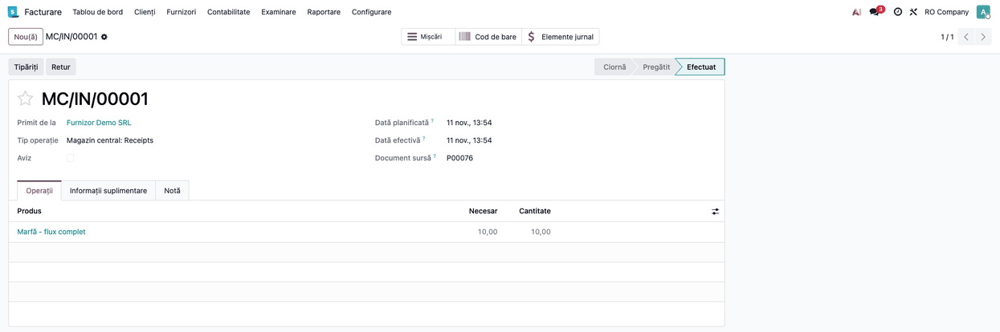

### Pasul 3 — Factura mărfii

**Creează factură** din comandă, apoi **Confirmă**: intrarea în stoc se postează aici:
   Dr 371 1.000 + Dr 4426 210 / Cr 401 1.210.

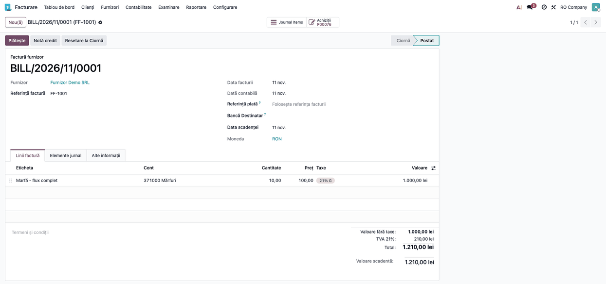

### Pasul 4 — Factura transportatorului

Linie cu produsul de transport (**Este cost adițional**), 100 lei. La bifarea **Este cost adițional**,
   contul liniei se completează din produs: contul de cheltuieli (aici 624), respectiv de venituri pe o factură
   de client;
   **Confirmă**. Nota facturii: Dr 624 100 + Dr 4426 21 / Cr 401 121.

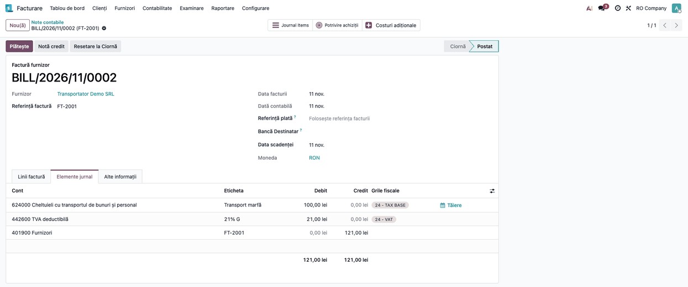

### Pasul 5 — Costul adițional din factură

Pe aceeași factură apare butonul **Creați costuri adiționale**. Apăsați-l. Dacă factura nu are comandă de
   achiziție (cazul obișnuit), recepția se adaugă manual în **Transferuri**: completarea automată ia doar
   recepțiile comenzii de achiziție din factură și exclude recepțiile deja acoperite de un cost adițional validat.
   Alegeți **Jurnalul**.

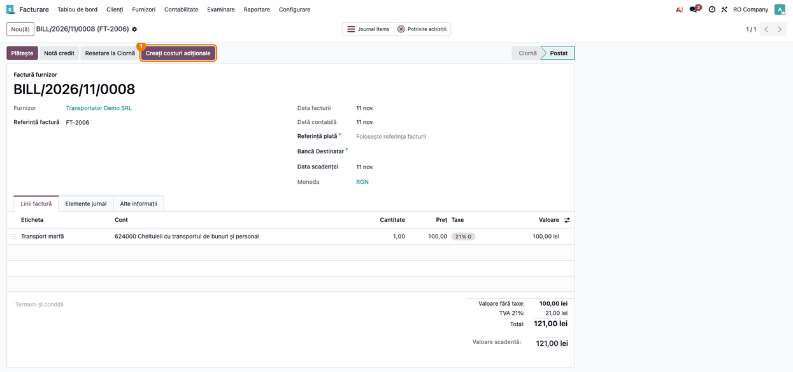

### Pasul 6 — Calcul și validare

**Calculează**, apoi **Validează**.

### Pasul 7 — Nota costului adițional

Nota costului adițional (metoda *Standard*): **Dr 371 100 / Cr 624 100**. Valoarea recepției crește la
1.100 lei.

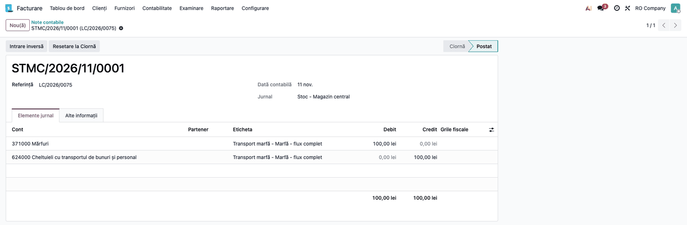

Cu metoda *Prin cont intermediar*, pentru un alt cost adițional (exemplul folosește același produs, a doua
factură de transport), nota are patru linii. Cu **Storno accounting** pornit (cazul României): Dr 371 100 /
Cr intermediar 100 și, **în roșu**, Dr 624 −100 / Cr intermediar −100. Cu bifa oprită: Dr 371 100 / Cr intermediar 100
și Dr intermediar 100 / Cr 624 100. În ambele cazuri soldul intermediarului este 0.

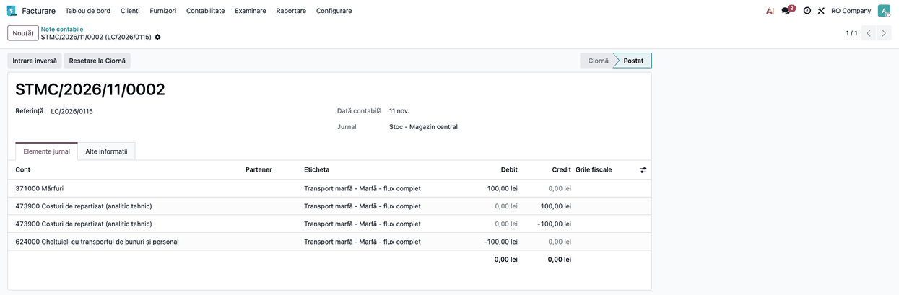

### Pasul 8 — Scenariul 2: stoc rezervat pentru o vânzare

Din cele 10 buc. recepționate, 4 sunt rezervate pe o livrare încă nevalidată (stare *Pregătit*).

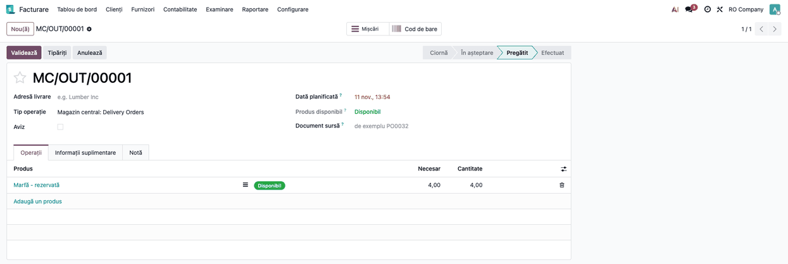

1. Validați costul adițional de 100 lei ca în Scenariul 1.
2. **Verificați:** nota este tot **Dr 371 100 / Cr 624 100**: stocul rezervat este încă în stoc, deci
   se capitalizează integral. Rezervarea nu se modifică.

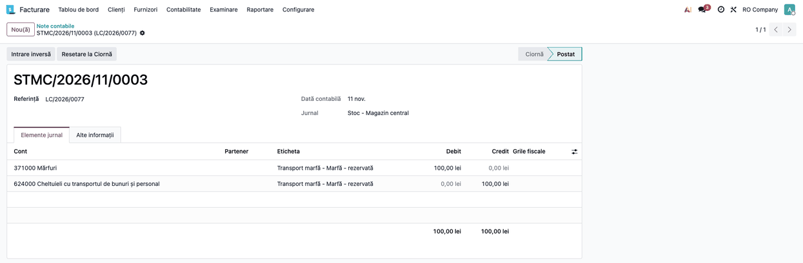

   Cu metoda *Prin cont intermediar* și Storno accounting pornit, nota are aceleași patru linii ca în
   Scenariul 1, pentru 100 lei (a doua pereche în roșu: 624 pe debit cu minus, nu pe credit).

3. Validați apoi livrarea. Cele 4 buc. ies la **110 lei** bucata (100 + 10 cost adițional): Dr 607 440 / Cr 371
   440. Costul adițional urmărește marfa în costul vânzărilor.

### Pasul 9 — Scenariul 3: stoc deja vândut

Din cele 10 buc., 4 au fost livrate și validate înainte de costul adițional. Livrarea a ieșit la
100 lei/buc.: Dr 607 400 / Cr 371 400.

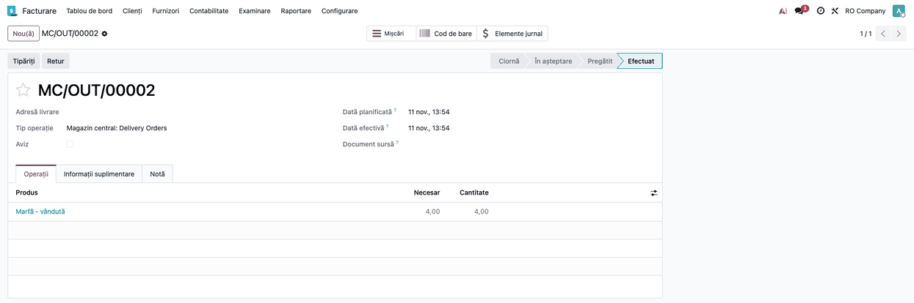

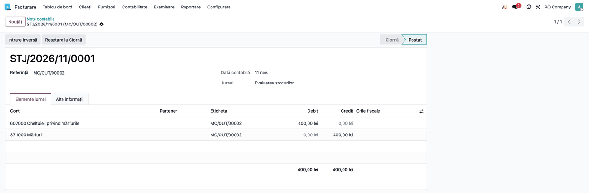

1. Validați costul adițional de 100 lei.
2. **Verificați:** nota este **Dr 371 60 / Cr 624 60**, adică doar cele 6 buc. rămase în stoc (6/10 din 100).
   Cu metoda *Prin cont intermediar* și Storno accounting pornit: Dr 371 60 / Cr intermediar 60 și, în roșu,
   Dr 624 −60 / Cr intermediar −60 (fără storno: Dr intermediar 60 / Cr 624 60).

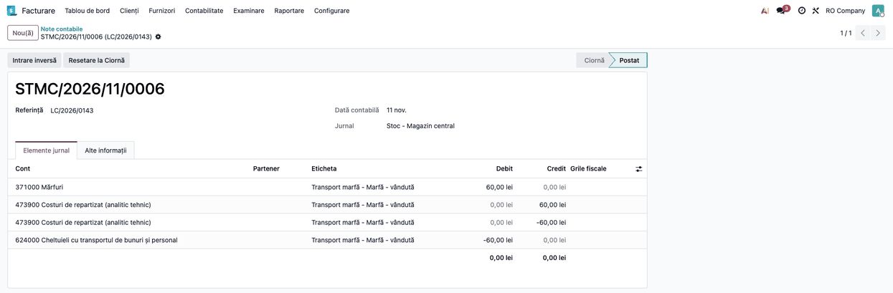

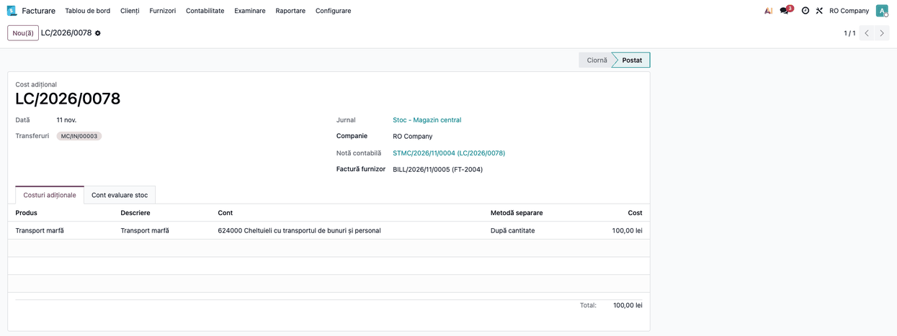

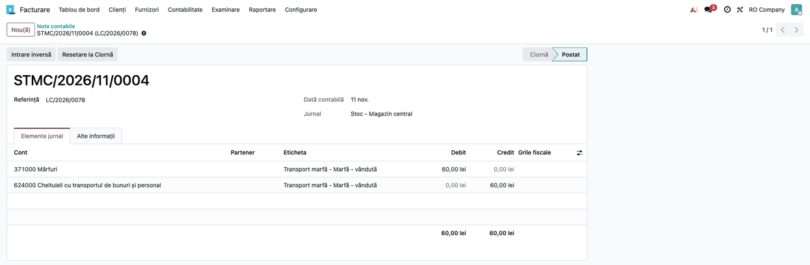

3. **Atenție:** cei 40 lei aferenți celor 4 buc. vândute **rămân pe 624** și livrarea nu se reevaluează
   (rămâne 400 lei). Modulul nu postează nicio notă pentru ei; tratamentul îl decide contabilul prin
   politica firmei (vezi secțiunea 2).
4. Dacă **toată** cantitatea a fost vândută, costul adițional se validează, dar nu se postează nicio
   linie: tot costul rămâne pe 624.

### Pasul 10 — Scenariul 4: recepție pe bază de aviz (408)

Cu bifa **Aviz** pe recepție, intrarea în stoc se postează la validarea recepției, nu la factură.

1. **Recepția**: bifați **Aviz**, apoi **Validează**. Nota: **Dr 371 1.000 / Cr 408 1.000**.

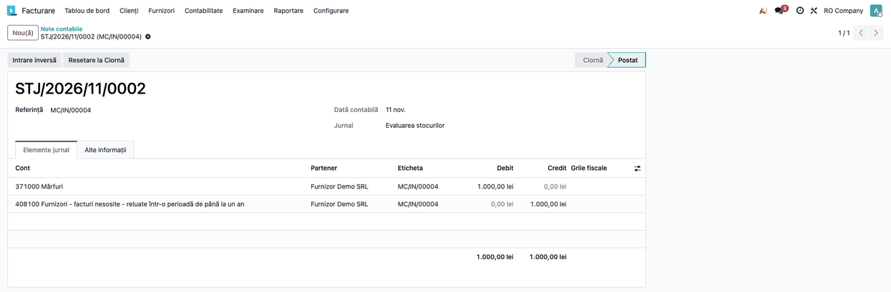

2. **Factura mărfii**, când sosește: **Confirmă**. Linia de marfă se înregistrează pe 408, nu pe 371:
   Dr 408 1.000 + Dr 4426 210 / Cr 401 1.210. Nu se postează a doua notă de stoc.

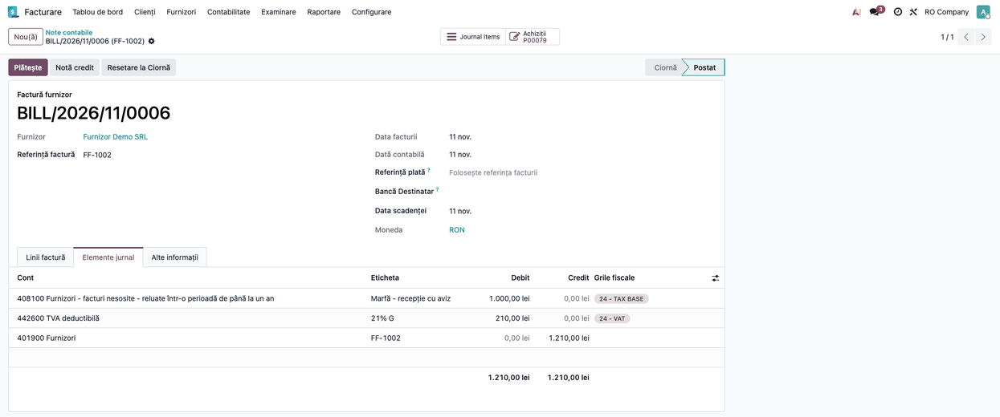

3. **Factura transportatorului** și **costul adițional**: identice cu Scenariul 1. Nota costului este tot
   **Dr 371 100 / Cr 624 100**; valoarea recepției crește la 1.100 lei.

4. **Stoc rezervat și stoc vândut** după o recepție cu aviz: aceleași rezultate ca în Scenariile 2 și 3 (100 lei
   capitalizați cu stoc rezervat, 60 lei cu 4 buc. vândute, nimic dacă totul a fost vândut). Costul adițional nu
   depinde de modul în care s-a înregistrat recepția.

### Note de monografie (10 buc., transport 100 lei)

| Operațiune | Debit | Credit | Sumă |
|---|---|---|---|
| Recepție fără Aviz | – | – | nicio notă la recepție |
| Factura mărfii, fără Aviz | 371 / 4426 | 401 | 1.000 + 210 |
| Recepție cu Aviz | 371 | 408 | 1.000 |
| Factura mărfii, cu Aviz | 408 / 4426 | 401 | 1.000 + 210 |
| Factura transportatorului | 624 / 4426 | 401 | 100 + 21 |
| Cost adițional, tot stocul în gestiune sau rezervat | 371 | 624 | 100 |
| Cost adițional, 4 buc. vândute | 371 | 624 | 60 |
| Cost adițional, toate vândute | – | – | 0 (rămâne pe 624) |
| Metoda intermediar, fără storno | 371 / intermediar | intermediar / 624 | suma capitalizată |
| Metoda intermediar, cu Storno accounting | 371; 624 (−) | intermediar; intermediar (−) | suma capitalizată; a doua pereche în roșu |

## 7. Legături cu alte module / declarații

- `l10n_ro_stock_account`: evaluarea stocului, conturile din locație, tipul mișcării, recepția cu aviz.
- `stock_landed_costs` (standard Odoo): documentul, metodele de împărțire.
- Pentru companiile cu `deltatech_obyc`, modulul echivalent este `deltatech_obyc_landed_cost`.
- Nu generează declarații; nota intră în balanță și în fișa contului 371.

## 8. Verificări pentru consultant

- Suma capitalizată = cost × (cantitatea rămasă în stoc / cantitatea recepției).
- Cantitatea rezervată nu scade capitalizarea; cantitatea livrată da.
- Valoarea recepției crește cu costul în Scenariile 1 și 4 (1.000 → 1.100 lei).
- La recepția cu aviz, factura mărfii stinge 408 și nu postează a doua notă de stoc.
- La metoda intermediar, soldul contului intermediar este 0, cu sau fără Storno accounting.
- Cu Storno accounting, a doua pereche are sume negative (în roșu) pe 624 (debit) și pe intermediar (credit); nota
  rămâne echilibrată și suma capitalizată nu se schimbă (100 în flux, în stoc rezervat și după recepția cu aviz; 60 cu
  4 buc. vândute).
- Costul adițional **negativ** (de exemplu o reducere de la transportator) se postează încă ca stornare clasică
  (Dr 6xx / Cr 371), indiferent de bifă; nu este tratat în roșu.
- Costul creat din factură: contul liniei este cel din factura transportatorului.

## 9. Mesaje de eroare frecvente

| Situație | Cauză | Remediere |
|---|---|---|
| `Please define Transfers on which those additional costs should apply.` | Factura transportatorului nu are comandă de achiziție | Adăugați recepțiile manual în **Transferuri** |
| `Missing credit account when generating account move` la recepția cu aviz | Lipsește contul 408 în setările de stoc ale companiei | Completați contul pentru recepții cu aviz (408) |
| Costul nu postează nicio linie | Toată cantitatea recepției a fost deja vândută | Tratați costul conform politicii firmei |
| Nu apare rutarea prin intermediar | Metoda e *Standard* sau contul lipsește | Setări → România |

## 10. Capturi de ecran

| Fișier | Ce arată |
|---|---|
| `01_settings_landed_cost.png` | Setări: metoda pentru creditul clasei 6 |
| `02_purchase_order.png` | Comanda de achiziție |
| `03_receipt.png` | Recepția validată, fără Aviz |
| `04_goods_bill.png` | Factura mărfii |
| `05_transport_bill_button.png` | Factura transportatorului, butonul Creați costuri adiționale |
| `06_landed_cost_form.png` | Costul adițional validat |
| `07_note_standard.png` | Nota Dr 371 / Cr 624 (100 lei) |
| `08_note_intermediary.png` | Nota prin cont intermediar |
| `09_delivery_reserved.png` | Livrare rezervată, nevalidată |
| `10_note_reserved.png` | Nota pentru stocul rezervat (100 lei) |
| `11_delivery_sold.png` | Livrare validată (stoc vândut) |
| `12_landed_cost_sold.png` | Costul adițional după vânzare |
| `13_note_sold.png` | Nota pentru stocul vândut (60 lei) |
| `14_transport_bill_note.png` | Nota facturii transportatorului |
| `15_delivery_sold_note.png` | Nota livrării vândute (Dr 607 / Cr 371) |
| `16_receipt_note_notice.png` | Nota recepției cu aviz (371 / 408) |
| `17_goods_bill_notice.png` | Factura mărfii pe 408 |
| `18_note_notice.png` | Nota costului adițional după recepția cu aviz |
| `19_settings_storno.png` | Setări: bifa Contabilitate storno |
| `20_note_reserved_storno.png` | Nota prin intermediar cu storno, stoc rezervat (100 lei) |
| `21_note_sold_storno.png` | Nota prin intermediar cu storno, stoc vândut (60 lei) |

## 11. Observații pentru manual

- Costul adițional se validează cât mai aproape de recepție: după vânzare, partea vândută nu se mai
  capitalizează.
- Stocul rezervat nu influențează costul adițional; modul de recepție (cu sau fără Aviz) nici el.
- Recepția fără Aviz nu postează nicio notă: dacă marfa e primită fără factură sau factura sosește în luna
  următoare, stocul nu apare în 371 la închiderea lunii. Pentru recepțiile fără factură se bifează **Aviz** (371 / 408).
- Partea vândută rămâne pe contul de cheltuieli al liniei: manualul trebuie să spună că tratamentul ei îl decide
  politica contabilă a firmei.
