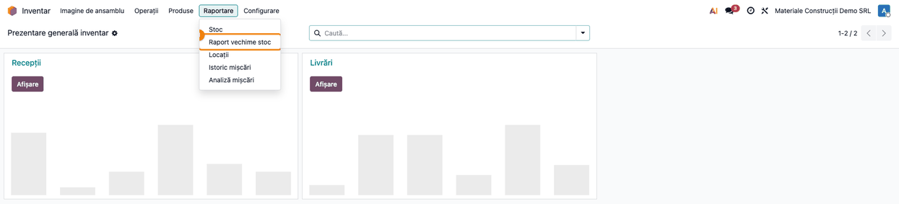
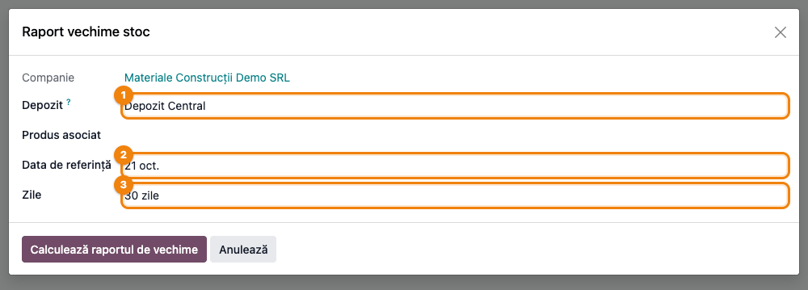
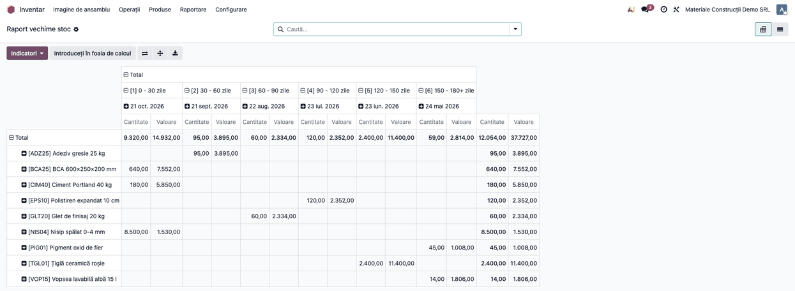
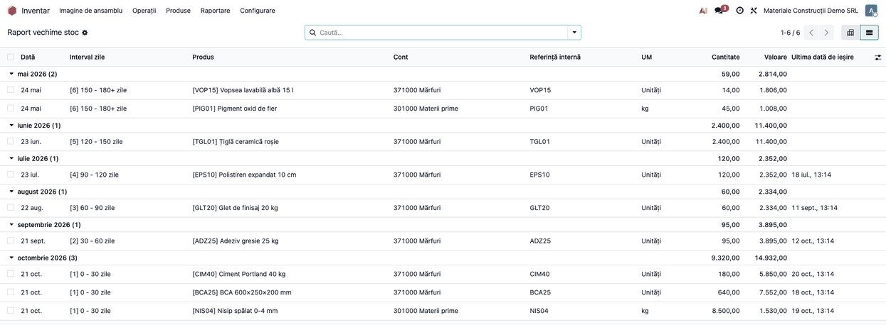
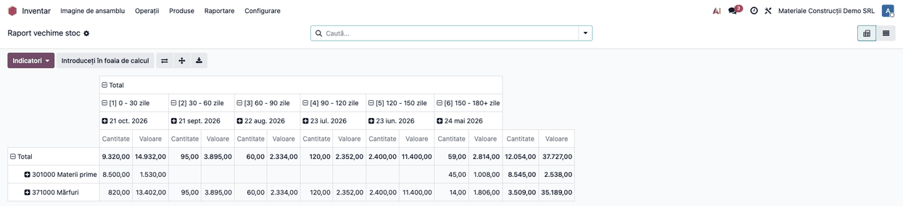

# Fișă Modul: Raportul de vechime a stocului

**Modul:** `l10n_ro_stock_aged_report`
**Utilizator principal:** Gestionar, responsabil aprovizionare, contabil de gestiune
**Prioritate:** 🟡 Medie (nu generează note contabile, dar susține deciziile despre stocul cu mișcare lentă și pregătirea inventarului anual)

---

## 1. Scop business

Odoo arată cât stoc există și cât valorează, dar nu spune **de cât timp stă** pe raft. Modulul adaugă un raport care împarte stocul unui depozit pe **intervale de vechime** (de exemplu 0–30, 30–60, … zile) și arată, pentru fiecare produs, cantitatea, valoarea, contul de stoc și **data ultimei ieșiri**. Cu el, gestionarul vede repede ce marfă nu se mai mișcă, aprovizionarea vede ce nu trebuie recomandat, iar contabilul are o listă de pornire pentru analiza stocurilor fără mișcare la inventarul de sfârșit de an.

Pentru asta, modulul ține pe fiecare poziție de stoc (produs × locație × lot) două date noi: **ultima intrare** și **ultima ieșire** din acea locație. Raportul citește aceste date; nu recalculează istoricul mișcărilor.

Trei lucruri trebuie înțelese de la început, pentru că fără ele raportul se citește greșit:

1. **Raportul pornește mereu de la stocul de azi.** Data de referință mută doar intervalele de vechime; nu reconstituie stocul de la o dată din trecut. Nu este un raport de stoc la 31.12 dacă îl rulați pe 15 ianuarie.
2. **Valoarea este cantitatea × costul actual al produsului** (câmpul *Cost* din fișa produsului), nu valoarea istorică de intrare.
3. **Vechimea înseamnă „zile de la ultima intrare în locație"**, nu vârsta celei mai vechi bucăți. Orice intrare în locație — o recepție, un transfer intern, un retur, o ajustare de inventar în plus — „întinerește" toată cantitatea din acea poziție. Data reținută este momentul validării în Odoo, nu data documentului. Doar pozițiile care nu au deloc dată de ultimă intrare (de exemplu stoc fără nicio mișcare validată la instalare) folosesc data de intrare din Odoo — cea mai veche intrare — sau, în lipsa ei, data creării poziției.

## 2. Bază legală și context

Modulul este un **instrument de analiză**; nu produce un document cu regim reglementat și nu înregistrează nimic în contabilitate.

Contextul în care se folosește:

- **Legea contabilității nr. 82/1991** (art. 7) cere inventarierea elementelor de activ cel puțin o dată în cursul exercițiului financiar; **OMFP 1802/2014** (pct. 82) o cere în vederea întocmirii situațiilor financiare anuale, iar procedura este detaliată în **OMFP 2861/2009** privind organizarea și efectuarea inventarierii.
- **OMFP 1802/2014** cere ca stocurile să fie prezentate la valoarea cea mai mică dintre cost și valoarea realizabilă netă (pct. 292) și precizează că ajustările pentru depreciere se constată **inclusiv pentru stocurile fără mișcare** (pct. 88 alin. (1)).
- Raportul ajută să **identificați** aceste stocuri; decizia de depreciere, valoarea ei și documentele comisiei de inventariere rămân ale contabilului și ale comisiei.

## 3. Utilizatori și roluri

| Rol | Ce face cu raportul |
|---|---|
| Gestionar / șef de depozit | Urmărește marfa care stă pe raft, pregătește listele pentru inventar |
| Responsabil aprovizionare | Evită să recomande produse care au deja stoc vechi |
| Contabil de gestiune | Compară valoarea pe conturi cu balanța, pornește analiza de depreciere |

Accesul: meniul este vizibil pentru grupul **Inventar / Utilizator** (`stock.group_stock_user`). Pentru testare ajunge un utilizator cu acest drept.

## 4. Conturi și date implicate

Modulul **nu generează note contabile**. Coloana **Cont** din raport arată contul de stoc al produsului, citit astfel:

1. contul de evaluare a stocului setat **pe produs**, dacă baza are modulul de contabilitate de stoc din localizare (câmpul de cont de stoc pe produs);
2. altfel, **Contul de evaluare a stocului** de pe **categoria** produsului.

Conturile care apar de obicei: **371** Mărfuri, **301** Materii prime, **302** Materiale consumabile, **345** Produse finite. Dacă o categorie nu are cont de evaluare setat, coloana rămâne goală.

Date minime pentru demo (cele din capturi):

- un depozit **Depozit Central** cu locația de stoc și două sublocații, **Raft A** și **Raft B**;
- categoria **Mărfuri** (cont 371) și categoria **Materii prime** (cont 301);
- produse stocabile cu cost completat (ciment, BCA, adeziv, glet, polistiren, țiglă, vopsea, nisip, pigment), cu ultima intrare de la câteva zile până la peste un an în urmă, unele cu ieșiri recente și altele fără nicio ieșire.

## 5. Configurare inițială

1. **Instalați modulul.** La instalare, modulul completează automat datele de ultimă intrare și ultimă ieșire pentru stocul existent (pozițiile cu cantitate pozitivă), din mișcările de stoc deja validate: ultima mișcare intrată în locație și ultima ieșită din ea, la nivel de **produs × locație** (nu pe lot), cu data mișcării. Nu e nevoie de nicio altă acțiune.
2. **Verificați costul produselor.** Valoarea din raport este cantitate × cost; un produs cu cost 0 apare cu valoare 0.
3. **Verificați conturile de evaluare** pe categoriile de produse (**Inventar → Configurare → Categorii de produse**), ca să fie completată coloana **Cont**.
4. Verificați că rafturile și zonele depozitului sunt locații **interne** ale depozitului (**Inventar → Configurare → Locații**, cu **Locații multiple** activat în setări): doar acestea intră în raport.

## 6. Flux de utilizare

### Pasul 1 — Deschiderea raportului

**Inventar → Raportare → Raport vechime stoc.**

Se deschide un dialog de parametri. Raportul nu are o listă de rapoarte salvate: de fiecare dată se pornește din meniu.



### Pasul 2 — Alegerea parametrilor

În dialog completați:

| Câmp | Ce înseamnă |
|---|---|
| **Companie** | Compania activă; nu se modifică. |
| **Depozit** ① | Depozitul analizat. Implicit, primul depozit al companiei. |
| **Produs asociat** | Opțional: un singur produs. Gol = tot stocul din locațiile alese. |
| **Data de referință** ② | Ziua de la care se numără vechimea. Implicit, azi. |
| **Zile** ③ | Lungimea unui interval: 15, 30, 90, 180 sau 365 de zile. Raportul are mereu **șase** intervale. |

Raportul ia **toate locațiile interne ale depozitului ales**, inclusiv sublocațiile (rafturi, zone). Lista lor nu apare în dialog și, în versiunea actuală, nu poate fi restrânsă de aici (vezi secțiunea 11, limitări): pentru o singură zonă, filtrați rezultatul pe produse sau exportați și filtrați în Excel. Pentru alt depozit, schimbați câmpul **Depozit**.

Apăsați **Calculează raportul de vechime**.



> **Data de referință nu face din raport un stoc istoric.** Stocul citit este cel de azi. Mutarea datei în trecut doar mută intervalele; marfa intrată **după** data de referință nu încape în niciun interval și ajunge în ultimul, cel mai vechi. Pentru analiza curentă lăsați data de azi.

### Pasul 3 — Citirea raportului pe intervale (pivot)

Raportul se deschide ca tabel pivot. Implicit, rândurile sunt grupate pe lună; pentru o citire pe produs, dați clic pe **Total** din stânga (se pliază), apoi din nou pe **Total** și alegeți **Produs**.

1. **Găsiți pe ecran.** Pe coloane sunt intervalele de vechime, numerotate de la **[1]** (cel mai nou) la **[6]** (cel mai vechi), de exemplu `[1] 0 - 30 zile`, `[2] 30 - 60 zile`, …, `[6] 150 - 180+ zile`. Sub fiecare interval apare o dată: este **capătul recent al intervalului** (pentru `[2] 30 - 60 zile`, data de acum 30 de zile), nu data de intrare a mărfii. Pentru fiecare interval aveți **Cantitate** și **Valoare**; pe rânduri, produsele, iar pe ultimele două coloane, totalul pe produs.
2. **Verificați.**
   - Totalul general al coloanei **Valoare** trebuie să fie de ordinul valorii stocului din **Inventar → Raportare → Stoc** pentru aceleași locații, calculată la costul de azi.
   - Ultimul interval, **[6]**, adună **tot** ce e mai vechi decât începutul lui, oricât de vechi: la intervale de 30 de zile, o marfă intrată acum un an apare tot la `[6] 150 - 180+ zile`.
   - Fiecare interval include capătul recent și exclude capătul vechi: o marfă intrată chiar în ziua de referință este în **[1]**, iar una intrată exact acum 30 de zile trece deja în **[2] 30 - 60 zile**.
   - Pozițiile cu stoc negativ sau zero nu apar în raport.
   - Pentru un produs, valoarea totală este cantitatea × costul din fișa produsului: în captură, Ciment Portland 40 kg are 180,00 × 32,50 = 5.850,00.
3. **Treceți mai departe.** Descărcați tabelul cu butonul de descărcare (săgeata în jos) din bara pivotului, care produce un fișier Excel cu exact ce vedeți pe ecran.



### Pasul 4 — Lista detaliată și data ultimei ieșiri

Din comutatorul de vizualizare (dreapta sus) treceți pe **Listă**. Lista vine grupată pe lună; deschideți grupurile cu clic pe ele.

1. **Găsiți pe ecran.** Fiecare rând este o poziție de stoc: **Dată** (capătul recent al intervalului, ca în pivot), **Interval zile**, produsul, **Cont**, **Referință internă**, **UM**, **Cantitate**, **Valoare** și **Ultima dată de ieșire**. Același produs poate avea mai multe rânduri — câte unul pe locație, lot, pachet și proprietar.
2. **Verificați.**
   - **Ultima dată de ieșire goală** înseamnă că din acea locație nu a ieșit nimic de la instalarea modulului (sau, pentru stocul existent la instalare, din istoricul de mișcări validate). Acestea sunt primii candidați pentru „stoc fără mișcare".
   - Ieșirea înseamnă **orice scădere** de cantitate din locație: livrare, consum, transfer intern către altă locație, ajustare de inventar în minus.
   - Pe un rând din intervalele vechi, o ieșire recentă arată că produsul încă se vinde, doar că nu s-a mai aprovizionat.
3. **Treceți mai departe.** Filtrați sau grupați din bara de căutare (**Produs**, **Interval zile**, **Dată**, **Cont**), selectați rândurile și folosiți **Acțiuni → Export** pentru Excel. După selectare apare și butonul **Afișare produse**, care deschide fișele produselor selectate, de exemplu ca să blocați recomandarea la achiziție.



### Pasul 5 — Comparația pe conturi de stoc

Reveniți pe **Pivot** și regrupați rândurile pe **Cont** (clic pe **Total** ca să se plieze, apoi din nou pe **Total** → **Cont**).

1. **Găsiți pe ecran.** Câte un rând pe cont de stoc (de exemplu **301000 Materii prime**, **371000 Mărfuri**), cu valoarea pe fiecare interval de vechime și totalul pe cont în ultimele două coloane.
2. **Verificați.**
   - Totalul pe fiecare cont este de ordinul soldului acelui cont din balanța de verificare la zi. Diferențele se explică: raportul folosește costul de azi, exclude pozițiile cu stoc negativ și acoperă un singur depozit.
   - Nu există un rând fără cont (gol). Dacă există, categoria unor produse nu are cont de evaluare a stocului.
   - Valoarea din intervalele vechi ale fiecărui cont este punctul de plecare pentru analiza de depreciere a contabilului.
3. **Treceți mai departe.** Descărcați pivotul în Excel și atașați-l analizei de inventar.



### Note de monografie și raportare

Modulul **nu generează note contabile**. El doar identifică stocul vechi. Dacă, în urma analizei și a inventarierii, se decide o ajustare pentru depreciere, aceasta se înregistrează **manual**, de contabil, de exemplu:

| Operațiune | Debit | Credit |
|---|---|---|
| Constituirea ajustării pentru deprecierea mărfurilor | 6814 Cheltuieli de exploatare privind ajustările pentru deprecierea activelor circulante | 397 Ajustări pentru deprecierea mărfurilor |
| Constituirea ajustării pentru deprecierea materiilor prime | 6814 | 391 Ajustări pentru deprecierea materiilor prime |
| Constituirea ajustării pentru materiale consumabile / produse finite | 6814 | 3921 Ajustări pentru deprecierea materialelor consumabile / 3945 Ajustări pentru deprecierea produselor finite |
| Reluarea ajustării (vânzare, casare, recuperarea valorii) | 397 / 391 / 3921 / 3945 | 7814 Venituri din ajustări pentru deprecierea activelor circulante |

Valoarea din raport **nu** este baza ajustării: ea este cantitate × costul de azi. Ajustarea se calculează față de valoarea realizabilă netă, pe care o stabilește contabilul.

## 7. Legături cu alte module / declarații

| Modul | Rol |
|---|---|
| `stock_account` (Odoo) | Singura dependență: contul de evaluare a stocului de pe categorie |
| Contabilitatea de stoc din localizarea RO (OCA) | Dacă e instalat, contul de stoc setat pe produs are prioritate față de cel de pe categorie |
| Fostul modul `l10n_ro_stock_age_report` | Înlocuit de acesta; la instalare, configurările și datele de ultimă intrare/ieșire se preiau automat, iar modulul vechi dispare din listă |

**Ce e automat**

- Data de ultimă intrare și de ultimă ieșire pe fiecare poziție de stoc, la fiecare mișcare.
- Completarea acestor date pentru stocul existent, la instalarea modulului.
- Selecția tuturor locațiilor interne ale depozitului (lista nu este afișată în dialog), contul de stoc și valoarea pe linie.

**Ce rămâne manual**

- Decizia ce înseamnă „mișcare lentă" (alegerea intervalului).
- Analiza de depreciere și nota contabilă de ajustare.
- Păstrarea rezultatului: liniile raportului sunt temporare și sunt șterse automat de Odoo după un timp; pentru arhivă, exportați în Excel.

## 8. Verificări pentru consultant

- [ ] Meniul **Inventar → Raportare → Raport vechime stoc** apare pentru un utilizator cu drept **Inventar / Utilizator**.
- [ ] Dialogul propune depozitul companiei, data de azi și intervalul de 15 zile.
- [ ] Fără produs ales, raportul conține toate produsele cu stoc pozitiv din toate locațiile interne ale depozitului, inclusiv sublocațiile (comparați numărul de produse cu **Inventar → Raportare → Stoc**, filtrat pe depozit).
- [ ] Pentru un produs, **Valoare** = **Cantitate** × **Cost** din fișa produsului.
- [ ] În pivotul grupat pe **Cont**, totalul pe contul 371 este de ordinul soldului contului 371 din balanță; diferențele se explică (cost curent față de valoarea istorică, poziții negative excluse, alte depozite).
- [ ] Etichetele intervalelor sunt în limba utilizatorului (`[1] 0 - 30 zile`).
- [ ] Un produs recepționat azi apare în intervalul **[1]**.
- [ ] După un transfer intern dintr-o locație în alta, poziția din locația de destinație apare în intervalul **[1]**, cu data de azi — comportament așteptat.
- [ ] O marfă intrată exact acum 30 de zile, cu intervale de 30 de zile, apare în intervalul **[2]**.
- [ ] O marfă intrată acum un an, cu intervale de 30 de zile, apare în intervalul **[6]**.
- [ ] Coloana **Ultima dată de ieșire** e goală pentru produsele fără nicio ieșire din locație.
- [ ] La instalarea pe o bază cu istoric, pozițiile de stoc existente au datele de ultimă intrare completate din mișcări (nu toate cu data instalării).
- [ ] Pentru fiecare analiză, raportul se pornește din meniu, într-un dialog nou (vezi secțiunea 11, limitări).

## 9. Mesaje de eroare frecvente

| Mesaj / simptom | Cauză | Remediere |
|---|---|---|
| Câmpul **Depozit** e gol la deschidere | Compania activă nu are niciun depozit | Creați depozitul sau schimbați compania activă |
| Raportul se deschide fără nicio linie | Depozitul nu are stoc pozitiv în locațiile interne, sau produsul ales nu are stoc acolo | Verificați stocul în **Inventar → Raportare → Stoc** sau scoateți filtrul de produs |
| Lipsesc produse dintr-o zonă a depozitului | Locația zonei nu este internă sau aparține altui depozit | Verificați tipul și depozitul locației în **Inventar → Configurare → Locații** |
| Coloana **Cont** e goală | Categoria produsului nu are cont de evaluare a stocului | Completați contul pe categorie |
| **Valoare** 0 pe un produs cu stoc | Costul produsului este 0 | Completați costul în fișa produsului |
| Marfă recepționată de curând apare în intervalul **[6]** | Data de referință este în trecut, înaintea intrării | Rulați raportul cu data de azi |
| Raportul deschis dintr-un link vechi e gol | Liniile raportului sunt temporare și au fost șterse | Recalculați raportul din meniu |

## 10. Capturi de ecran

Capturile (`static/description/`) sunt **generate automat** din `tests/test_screenshots.py` (mixinul `ScreenshotCase` din `l10n_ro_doc_screenshots`, import defensiv), în **limba română**, pe planul de conturi RO, pe o companie în RON:

1. `01_meniu_raport.png` — meniul **Inventar → Raportare** deschis, cu **Raport vechime stoc** evidențiat.
2. `02_wizard.png` — dialogul raportului, cu **Depozit**, **Data de referință** și **Zile** evidențiate.
3. `03_pivot_vechime.png` — pivotul raportului regrupat pe produs: cele șase intervale de 30 de zile, cu cantitate și valoare.
4. `04_lista_linii.png` — lista liniilor, cu grupurile lunare desfășurate: intervalul, contul și data ultimei ieșiri pe fiecare poziție.
5. `05_pivot_cont.png` — pivotul regrupat pe conturile de stoc 301 și 371.

Capturile folosesc intervalul de **30 de zile** (implicitul dialogului este 15).

Regenerare — **restrângeți la clasă**, altfel se rescriu capturile tuturor modulelor care au un test de fișe:

```bash
./odoo/odoo-bin -c odoo.conf -d <db> -i l10n_ro_stock_aged_report,l10n_ro_doc_screenshots \
    --test-tags=/l10n_ro_stock_aged_report:TestStockAgeReportScreenshots --stop-after-init
```

## 11. Observații pentru manual

Merită păstrate explicit în manualul de utilizare:

1. **Raportul este despre stocul de azi.** Data de referință mută doar intervalele. Pentru inventarul de 31.12, raportul se rulează **pe 31.12** (sau în ziua inventarierii, înainte de mișcările din anul nou) și se exportă în Excel; rulat în ianuarie, arată stocul din ianuarie.
2. **Valoarea este la costul de azi.** Nu este valoarea contabilă istorică și nu este baza ajustării pentru depreciere.
3. **Vechimea este „zile de la ultima intrare în locație".** O recepție mică peste un stoc vechi face ca **toată** cantitatea din acea poziție să pară nouă; la fel un transfer intern sau un retur. Data este momentul validării în Odoo: o recepție operată azi cu dată retroactivă apare în intervalul **[1]**. Produsele urmărite pe loturi au o poziție pe lot, deci vechimea lor e mai fidelă pentru intrările de după instalare; pentru stocul existent la instalare, toate loturile din aceeași locație primesc data ultimei intrări a produsului. Pentru stocul fără mișcare, citiți împreună vechimea și **Ultima dată de ieșire**.
4. **Ultimul interval este deschis.** `[6] 150 - 180+ zile` înseamnă „mai vechi de 150 de zile", oricât de vechi.

**Limitări cunoscute**

- **Lista de locații nu apare în dialog**, deși modulul o pregătește: raportul ia mereu toate locațiile interne ale depozitului ales. Nu se poate rula, de aici, doar pe o zonă sau pe un raft.
- **Limitare tehnică:** calculul nu șterge liniile unui calcul anterior pe același dialog; dacă același dialog ar fi calculat a doua oară (de exemplu, redeschis din istoricul browserului), liniile s-ar adăuga peste cele existente, cu cantități și valori dublate. Din interfață dialogul se închide după calcul, deci cazul e rar; porniți totuși fiecare analiză din meniu, într-un dialog nou.
- Liniile raportului sunt **temporare**: Odoo le șterge automat după un timp. Rezultatul care trebuie păstrat (de exemplu, anexa la procesul-verbal de inventariere) se exportă.
- Raportul nu reconstituie stocul la o dată din trecut și nu urmărește vechimea pe straturi de intrare (FIFO); pentru asta este nevoie de un raport de evaluare a stocului.
