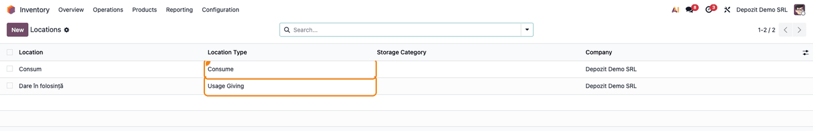
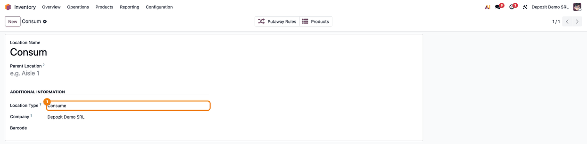
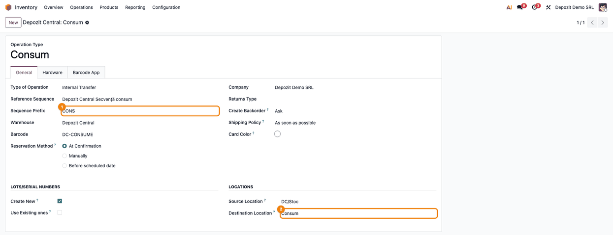
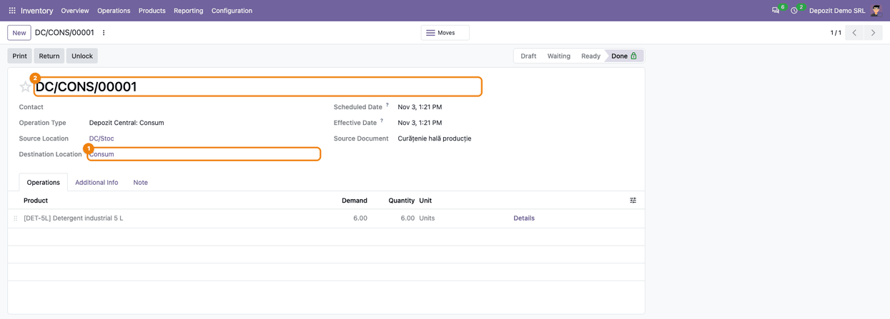
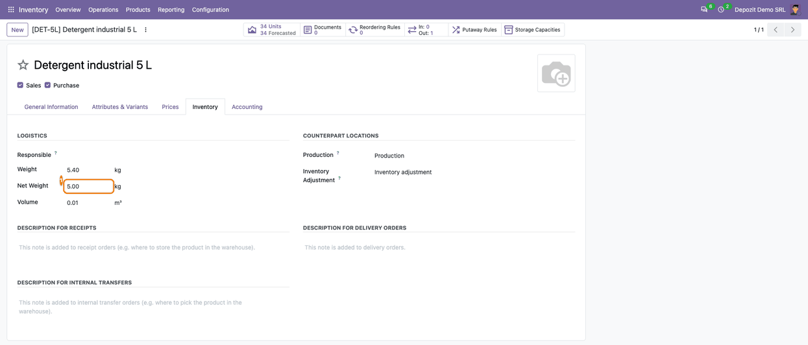

====================
Romania - Stock Base
====================

..
   !!!!!!!!!!!!!!!!!!!!!!!!!!!!!!!!!!!!!!!!!!!!!!!!!!!!
   !! This file is generated by oca-gen-addon-readme !!
   !! changes will be overwritten.                   !!
   !!!!!!!!!!!!!!!!!!!!!!!!!!!!!!!!!!!!!!!!!!!!!!!!!!!!
   !! source digest: sha256:e84f06be935267da3afb43939f114fb5190f902ddd732432d0a21b5859850700
   !!!!!!!!!!!!!!!!!!!!!!!!!!!!!!!!!!!!!!!!!!!!!!!!!!!!

.. |badge1| image:: https://img.shields.io/badge/maturity-Mature-brightgreen.png
    :target: https://odoo-community.org/page/development-status
    :alt: Mature
.. |badge2| image:: https://img.shields.io/badge/license-AGPL--3-blue.png
    :target: http://www.gnu.org/licenses/agpl-3.0-standalone.html
    :alt: License: AGPL-3
.. |badge3| image:: https://img.shields.io/badge/github-dhongu%2Fl10n--romania-lightgray.png?logo=github
    :target: https://github.com/dhongu/l10n-romania/tree/20.0/l10n_ro_stock_base
    :alt: dhongu/l10n-romania

|badge1| |badge2| |badge3|

Locations and operations for Romanian consumption and usage giving, and
the net weight of the products. It is the Terrabit replacement of the
OCA ``l10n_ro_stock`` module, written without a dependency on
``l10n_ro_config``.

- **Locations**: the location usages *Usage Giving* and *Consume*. Moves
  from or to them count as incoming, respectively outgoing, for the
  valuation.
- **Company**: every company whose fiscal country is Romania gets a
  usage and a consume location (``l10n_ro_usage_location_id``,
  ``l10n_ro_consume_location_id``), created at installation for the
  existing companies and at creation for the new ones. Locations that
  already exist are reused, not duplicated.
- **Warehouse**: every warehouse of such a company gets the operation
  types *Consume* and *Usage Giving*, with their own sequences
  (``CONS``, ``USAGE``). Renaming the warehouse or changing its code
  renames those sequences too.
- **Net weight** (``l10n_ro_net_weight``) on products, next to the
  volume.

The field names are the ones of the OCA module, so a database that has
it installed keeps its data when this module is installed and the OCA
one removed.

**Table of contents**

.. contents::
   :local:

Usage
=====

The consume and usage giving locations are created for every company
whose fiscal country is Romania, and the matching operation types for
every new warehouse of such a company. The fiscal country comes from the
Invoicing app, installed together with the module. Enable **Storage
Locations** in **Inventory → Configuration → Settings** to see the
locations menu and the source and destination locations on transfers.

1. Go to **Inventory → Configuration → Locations**, remove the
   *Internal* filter and look for the two locations of the company: one
   with the **Location Type** *Consume*, one with *Usage Giving*.

   |The locations of type Consume and Usage Giving of the company, with
   the Location Type column highlighted|

2. Open the consume location: its **Location Type** is *Consume*. The
   location names come from the language used at installation and can be
   renamed; the module finds them by their type.

   |The Consume location form, with Location Type Consume highlighted|

3. Go to **Inventory → Configuration → Warehouses** and open the
   warehouse. With the developer mode on, the **Technical Information**
   tab shows **Romania - Consume Type** and **Romania - Usage Giving
   Type**. The warehouses that exist at the installation get them when
   the module is installed, the new ones when they are created. If they
   are still missing (the fiscal country became Romania later), change
   the warehouse **Short Name**, save, then set it back and save again.

   |The Technical Information tab of the warehouse, with the Romania -
   Consume Type and Romania - Usage Giving Type fields highlighted|

4. The **Consume** operation type is an internal transfer from the
   warehouse stock to the company consume location, numbered with the
   ``CONS`` sequence prefix (``<warehouse code>/CONS/00001``). The
   **Usage Giving** type is the same, towards the usage giving location,
   with the ``USAGE`` prefix.

   |The Consume operation type, with the Sequence Prefix CONS and the
   Consume destination location highlighted|

5. Create a transfer of type **Consume** from **Inventory → Overview**,
   add the products and quantities, then **Mark as Todo** and
   **Validate**. The quantity leaves the warehouse stock; a **Return**
   brings it back, numbered in the same ``CONS`` sequence unless a
   **Return Type** is set on the operation type. Moves to the consume
   and usage giving locations count as outgoing for the stock valuation,
   and moves from them as incoming.

   |The done consume transfer DC/CONS/00001, from DC/Stoc to the Consume
   location|

6. On the product, the **Inventory** tab shows the **Net Weight** under
   the weight, in the same unit.

   |The Inventory tab of a product, with the Net Weight field
   highlighted|

.. |The Technical Information tab of the warehouse, with the Romania - Consume Type and Romania - Usage Giving Type fields highlighted| image:: https://raw.githubusercontent.com/dhongu/l10n-romania/20.0/l10n_ro_stock_base/static/description/en/03_depozit_tipuri_operatie.png

Changelog
=========

19.0.0.0.1 (2026-10-07)
-----------------------

- Initial version, replacing the OCA ``l10n_ro_stock`` module without
  ``l10n_ro_config``: consume and usage giving locations, company
  locations, warehouse operation types and sequences, net weight. The
  sequences of the consume and usage operation types follow the
  warehouse name and code when they are changed. While the OCA
  ``l10n_ro_stock`` module is still installed, the net weight and the
  warehouse operation types are shown only once on the forms. The module
  depends on ``account``, which gives the fiscal country of the company.
  The net weight given when a product is created is kept on its variant.
  The warehouses that exist when the module is installed get the consume
  and usage giving operation types, and their barcodes follow the
  warehouse code when it changes. The net weight field has the same
  width as the weight. The usage giving location is named *Dare în
  folosință* in Romanian.

Bug Tracker
===========

Bugs are tracked on `Terrabit Issues <https://www.terrabit.ro/helpdesk>`_.
In case of trouble, please check there if your issue has already been reported.

Do not contact contributors directly about support or help with technical issues.

Credits
=======

Authors
-------

* Terrabit
* Dorin Hongu

Maintainers
-----------

.. |maintainer-dhongu| image:: https://github.com/dhongu.png?size=40px
    :target: https://github.com/dhongu
    :alt: dhongu

Current maintainer:

|maintainer-dhongu| 

This module is part of the `dhongu/l10n-romania <https://github.com/dhongu/l10n-romania/tree/20.0/l10n_ro_stock_base>`_ project on GitHub.

You are welcome to contribute.