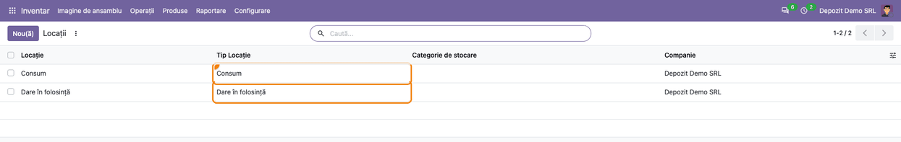
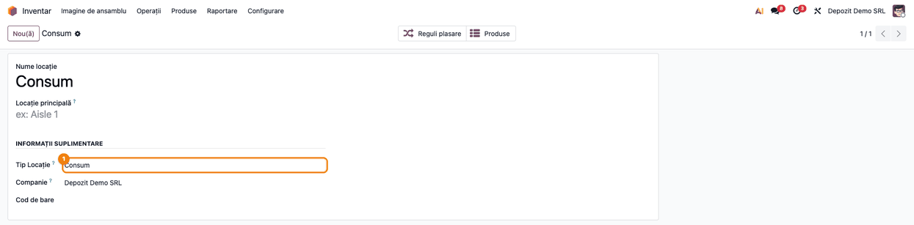
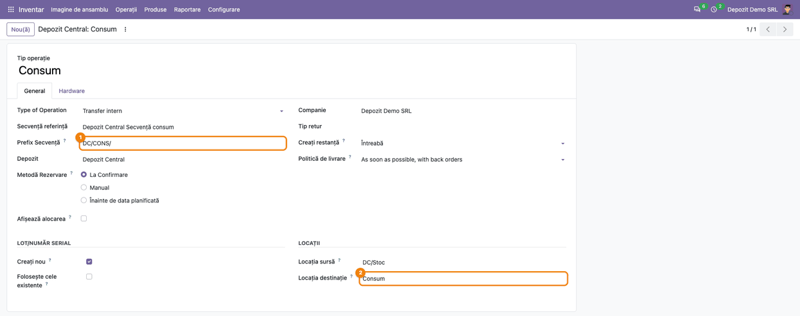
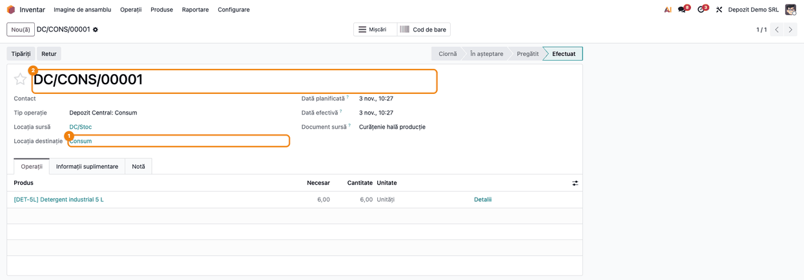
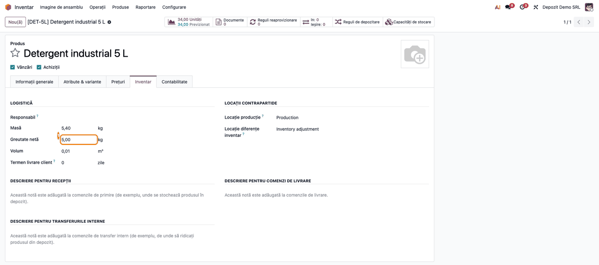

# Fișă Modul: Locații și operații de consum și dare în folosință

**Modul:** `l10n_ro_stock_base`
**Utilizator principal:** Gestionar, responsabil de depozit, consultant care configurează stocurile unei firme românești
**Prioritate:** 🟡 Medie (nu generează note contabile, dar pune bazele bonurilor de consum și ale dărilor în folosință, pe care se sprijină modulele de evaluare a stocului)

---

## 1. Scop business

În Odoo standard, o ieșire de materiale către consumul propriu al firmei sau darea în folosință a unui obiect de inventar nu are un loc al ei: se face cu un transfer intern către o locație improvizată sau cu o ajustare de inventar, iar documentul nu se deosebește de celelalte. Modulul adaugă cele două destinații pe care practica românească le cere:

- **Consum** — locația în care ies materialele consumabile, piesele de schimb sau materialele auxiliare date în consum (bonul de consum);
- **Dare în folosință** — locația în care ies obiectele de inventar predate personalului spre folosință.

Pentru fiecare companie cu țara fiscală **România** creează automat cele două locații, iar pentru fiecare depozit nou creează tipurile de operație **Consum** și **Dare în folosință**, cu numerotare proprie (`<cod depozit>/CONS/00001`, `<cod depozit>/USAGE/00001`). Cele două locații nu sunt locații interne, deci mutarea stocului în ele este o **ieșire din stoc**, valorizată ca orice ieșire, iar returul dinspre ele este o **intrare**. Modulul marchează explicit aceste mișcări ca ieșiri, respectiv intrări, și pentru modulele care le verifică direct (vânzări și achiziții cu producție).

Pe produs, modulul adaugă **Greutatea netă**, lângă masă (greutatea brută) și volum.

Modulul înlocuiește modulul OCA `l10n_ro_stock` și poate fi instalat alături de el: câmpurile au aceleași nume tehnice, deci datele rămân la dezinstalarea modulului OCA, iar cât timp ambele sunt instalate, greutatea netă și tipurile de operație apar **o singură dată** pe formulare.

## 2. Bază legală și context

Modulul nu înregistrează nimic în contabilitate; el pregătește evidența cantitativă a două operații uzuale:

- **Bonul de consum** este documentul de eliberare din gestiune a materialelor pentru consum, din lista documentelor financiar-contabile aprobată prin **OMFP 2634/2015**. Transferul de tip *Consum* din Odoo este suportul acestui document; formularul tipărit vine din alt modul (vezi secțiunea 7).
- **Obiectele de inventar date în folosință** ies din gestiune, dar rămân în răspunderea persoanei care le folosește, până la scoaterea din uz. Evidența lor operativă pe utilizatori și eventuala evidență în afara bilanțului nu sunt acoperite de acest modul.

Greutatea netă este o informație logistică; modulul nu o folosește în niciun calcul. Modulul `l10n_ro_etransport_enhancement` o citește la calculul greutății nete din declarația e-Transport, când se folosesc liniile de greutăți la expediere.

## 3. Utilizatori și roluri

| Utilizator | Ce face | Drepturi recomandate la testare |
|---|---|---|
| Gestionar | emite bonurile de consum și dările în folosință, completează greutatea netă pe produse | Inventar / Utilizator |
| Responsabil depozit | verifică locațiile și tipurile de operație ale depozitelor | Inventar / Administrator |
| Consultant | instalează modulul, verifică locațiile companiei și tipurile de operație ale depozitelor existente | Inventar / Administrator, mod dezvoltator activ (pentru tab-ul *Informații tehnice* al depozitului) |

Tab-ul **Inventar** al produsului este vizibil pentru utilizatorii cu drept de Inventar, la produsele de tip *Bunuri*.

## 4. Conturi și date implicate

Modulul **nu folosește conturi contabile** și nu generează note contabile. El adaugă:

| Element | Unde apare | Observații |
|---|---|---|
| Tipurile de locație **Consum** și **Dare în folosință** | Inventar → Configurare → Locații, câmpul *Tip locație* | Mișcările spre ele sunt ieșiri din stoc, cele dinspre ele intrări |
| Locația de consum și locația de dare în folosință ale companiei | câte una pe companie | Create la instalare și la crearea unei companii noi; nu se afișează pe formularul companiei |
| Tipurile de operație **Consum** și **Dare în folosință** | Inventar → Configurare → Tipuri operații; formularul depozitului, tab-ul *Informații tehnice* | Transfer intern din *Stoc* spre locația companiei, numerotare `CONS` / `USAGE` |
| **Greutate netă** | Produs → tab-ul *Inventar*, grupul *Logistică* | În unitatea de greutate a bazei (implicit kg) |

Date minime pentru demo:

- o companie cu țara fiscală **România**;
- un depozit creat după instalarea modulului (sau un depozit existent tratat ca în secțiunea 5, pasul 3);
- un produs stocabil, cu stoc în depozit;

## 5. Configurare inițială

1. Verificați că **țara fiscală** a companiei este România (implicit, țara companiei din Setări → Utilizatori și companii → Companii). Locațiile și tipurile de operație se creează doar pentru companiile românești.
2. Instalați modulul `l10n_ro_stock_base`. La instalare, fiecare companie românească primește locațiile **Consum** și **Dare în folosință** (dacă există deja câte o locație de acest tip în companie, de exemplu din modulul OCA, este preluată, nu dublată). Denumirea locațiilor vine din limba în care s-a făcut instalarea: în română ies *Consum* și *Folosință*, în engleză *Consume* și *Usage*. Le puteți redenumi (în capturi, a doua se numește *Dare în folosință*) — modulul le găsește după tip, nu după nume.
3. **Depozitele existente la instalare nu primesc automat** tipurile de operație Consum și Dare în folosință (cu excepția celor care le aveau deja din modulul OCA). Ca să le creați, deschideți depozitul (Inventar → Configurare → Depozite), modificați **Nume scurt** și salvați, apoi readuceți-l la valoarea inițială și salvați din nou. La schimbarea codului, Odoo completează tipurile de operație care lipsesc. Tipurile create astfel primesc **codul de bare** cu numele scurt temporar (de exemplu `TMP-CONSUME`), care nu se mai actualizează la revenire: corectați *Cod de bare* pe cele două tipuri (`<cod>-CONSUME`, `<cod>-USAGE`). Depozitele create după instalare le primesc direct.
4. Activați **Locații de stocare** (Inventar → Configurare → Setări, secțiunea *Depozit*). Fără această setare, meniul *Locații* nu apare, iar pe tipul de operație și pe transfer nu se văd locația sursă și locația destinație.

## 6. Flux de utilizare

### Pasul 1 — Verificarea locațiilor de consum și de dare în folosință

**Inventar → Configurare → Locații.** Lista pornește cu filtrul *Intern*; scoateți-l și căutați după **Tip locație** (sau grupați după *Tip locație*), ca să vedeți cele două locații ale companiei.

Verificați că pentru compania de lucru există **exact câte o** locație de tip *Consum* și una de tip *Dare în folosință*. Ele nu au locație părinte și nu aparțin unui depozit: sunt comune tuturor depozitelor companiei.



### Pasul 2 — Formularul locației de consum

Deschideți locația **Consum**. În secțiunea *Informații suplimentare*, câmpul **Tip locație** are valoarea *Consum*. Lista de tipuri din acest câmp conține acum și *Consum* și *Dare în folosință*, deci puteți crea, la nevoie, și alte locații de acest fel (de exemplu o locație de consum pe secție).

Nu schimbați tipul locațiilor create de modul: tipul este cel care face ca ieșirea în ele să fie tratată drept consum.



### Pasul 3 — Tipurile de operație ale depozitului

**Inventar → Configurare → Depozite**, deschideți depozitul. Cu **modul dezvoltator activ**, tab-ul **Informații tehnice** arată, în grupul *Tip operație*, două câmpuri noi: **România - Tip consum** și **România - Tip dare în folosință**, cu tipurile de operație create pentru acest depozit. Câmpurile sunt doar pentru citire.

Dacă cele două câmpuri sunt goale, depozitul exista înainte de instalarea modulului: aplicați secțiunea 5, pasul 3.


### Pasul 4 — Tipul de operație Consum

Din formularul depozitului, deschideți **Depozit Central: Consum** (sau din **Inventar → Configurare → Tipuri operații**). Tipul este un **transfer intern** cu:

- **Prefix secvență** `CONS` — bonurile se numerotează `DC/CONS/00001`, `DC/CONS/00002`… (la dare în folosință: `USAGE`, adică `DC/USAGE/00001`);
- **Locația sursă** — stocul depozitului (`DC/Stoc`);
- **Locația destinație** — locația **Consum** a companiei (la dare în folosință: locația *Dare în folosință*);
- **Cod de bare** `DC-CONSUME` (respectiv `DC-USAGE`).

Locațiile implicite pot fi schimbate, de exemplu dacă materialele se consumă dintr-o altă sublocație. Dacă redenumiți depozitul sau îi schimbați codul, secvențele celor două tipuri se redenumesc automat; **codul de bare** al celor două tipuri rămâne însă pe codul vechi și trebuie corectat manual (`<cod nou>-CONSUME`, `<cod nou>-USAGE`).



### Pasul 5 — Bonul de consum

**Inventar → Imagine de ansamblu**, pe cardul **Depozit Central: Consum**, din meniul **⋮** al cardului alegeți **Nou(ă)** (sau **Inventar → Operații → Transferuri → Intern**, **Nou(ă)**, cu *Tip operație* = Depozit Central: Consum). Locațiile se completează din tipul de operație. Adăugați produsele și cantitățile, apoi **Marchează de efectuat** și **Validează**.

După validare, transferul primește numărul din secvența de consum (`DC/CONS/00001`), iar cantitatea iese din stocul depozitului. Darea în folosință se face la fel, pe tipul **Dare în folosință**.

Pentru a reveni (material neconsumat, obiect de inventar returnat), folosiți butonul **Retur** de pe transferul validat: mișcarea dinspre locația de consum spre stoc este tratată ca **intrare**. Tipul *Consum* nu are *Tip retur*, deci returul primește tot un număr din secvența de consum (de exemplu `DC/CONS/00002`); dacă vreți retururile numerotate separat, completați *Tip retur* pe tipul de operație.



### Pasul 6 — Greutatea netă a produsului

**Inventar → Produse → Produse**, deschideți produsul, tab-ul **Inventar**, grupul *Logistică*. Câmpul **Greutate netă** apare sub *Masă* (greutatea brută), în aceeași unitate de greutate (implicit kg). La produsele cu variante, greutatea netă se completează pe fiecare variantă.



### Note de monografie și raportare

Modulul **nu generează note contabile** și nu alege conturi. Locațiile *Consum* și *Dare în folosință* nu sunt interne, deci o mișcare **spre** ele scade valoarea stocului ca orice ieșire, iar una **dinspre** ele o crește. Nota contabilă a consumului sau a dării în folosință (contul de cheltuială, eventuala evidență în afara bilanțului a obiectelor de inventar) o face modulul de evaluare a stocului instalat în bază, după configurarea lui; verificați-o acolo.

## 7. Legături cu alte module / declarații

| Modul | Rol |
|---|---|
| `stock` | Locațiile, tipurile de operație și transferurile pe care modulul le extinde |
| `account` (Facturare) | Dă țara fiscală a companiei, după care modulul decide dacă firma e românească; se instalează odată cu modulul |
| `l10n_ro_stock_account_base` | Păstrează câmpurile contabile ale stocului românesc (conturi pe locație, tip mișcare RO); depinde de acest modul |
| `l10n_ro_hide_net_weight` | Ascunde câmpul *Greutate netă* de pe produs, unde nu e folosit |
| `l10n_ro_picking_report` | Tipărește bonul de consum și celelalte documente de stoc românești; depinde deocamdată de modulul OCA `l10n_ro_stock`, care se instalează odată cu el (câmpurile apar tot o singură dată) |
| `l10n_ro_etransport_enhancement` | Folosește greutatea netă a produsului la liniile de greutăți ale declarației e-Transport |
| `l10n_ro_stock` (OCA) | Modulul înlocuit; poate rămâne instalat, câmpurile apar o singură dată |

**Ce e automat:**

- crearea locațiilor de consum și de dare în folosință pentru companiile românești, la instalare și la crearea unei companii noi;
- crearea tipurilor de operație și a secvențelor pentru fiecare depozit nou al unei companii românești;
- redenumirea secvențelor când se schimbă numele sau codul depozitului;
- tratarea mișcărilor spre și dinspre aceste locații ca ieșiri, respectiv intrări.

**Ce rămâne manual:**

- tipurile de operație pentru depozitele existente la instalare (secțiunea 5, pasul 3);
- emiterea și validarea bonurilor de consum și a dărilor în folosință;
- completarea greutății nete pe produse;
- nota contabilă, prin modulul de evaluare a stocului.

## 8. Verificări pentru consultant

- [ ] Compania de lucru are țara fiscală România.
- [ ] În Inventar → Configurare → Locații există exact o locație *Consum* și una *Dare în folosință* pe companie (și după reinstalare sau actualizare a modulului).
- [ ] Fiecare depozit al companiei are completate *România - Tip consum* și *România - Tip dare în folosință* (tab-ul *Informații tehnice*, mod dezvoltator).
- [ ] Un depozit nou creat după instalare primește direct cele două tipuri de operație, cu prefixele `<cod>/CONS/` și `<cod>/USAGE/`.
- [ ] Un bon de consum validat are numărul din secvența `CONS` și scade stocul depozitului cu cantitatea consumată.
- [ ] Returul unui bon de consum readuce cantitatea în stoc.
- [ ] După schimbarea codului depozitului, următorul bon de consum folosește noul prefix.
- [ ] Greutatea netă salvată pe un produs existent rămâne după reîncărcarea formularului.
- [ ] Cu modulul OCA `l10n_ro_stock` instalat alături, *Greutate netă* și cele două tipuri de operație apar o singură dată pe formulare.

## 9. Mesaje de eroare frecvente

| Mesaj / simptom | Cauză | Remediere |
|---|---|---|
| Câmpurile *România - Tip consum* / *Tip dare în folosință* sunt goale pe depozit | Depozitul exista înainte de instalarea modulului | Schimbați *Nume scurt* al depozitului, salvați, apoi readuceți-l (secțiunea 5, pasul 3) |
| Nu există locațiile *Consum* și *Dare în folosință* | Țara fiscală a companiei nu era România la instalare | Setați țara fiscală România, actualizați modulul din Aplicații, apoi tratați depozitele ca în secțiunea 5, pasul 3 |
| Locațiile se numesc *Folosință*, *Consume* sau *Usage* | Denumirea vine din limba de la instalare | Redenumiți locațiile; modulul le găsește după tip |
| Meniul *Locații* lipsește; pe transfer nu se văd locațiile sursă și destinație | *Locații de stocare* nu este activat | Activați *Locații de stocare* în Inventar → Configurare → Setări |
| Tab-ul *Inventar* lipsește de pe produs | Utilizatorul nu are drept de Inventar sau produsul este de tip serviciu sau combo | Dați dreptul *Inventar / Utilizator*; tab-ul apare la produsele de tip *Bunuri* |

## 10. Capturi de ecran

Capturile (`static/description/`) sunt **generate automat** din `tests/test_screenshots.py` (mixinul `ScreenshotCase` din `l10n_ro_doc_screenshots`, import defensiv), în **limba română**, pe o companie românească în RON:

1. `01_locatii_consum_dare.png` — lista locațiilor de tip *Consum* și *Dare în folosință* ale companiei, cu coloana *Tip locație* evidențiată.
2. `02_locatie_consum.png` — formularul locației *Consum*, cu *Tip locație* evidențiat.
3. `03_depozit_tipuri_operatie.png` — depozitul *Depozit Central*, tab-ul *Informații tehnice*, cu cele două tipuri de operație românești evidențiate.
4. `04_tip_operatie_consum.png` — tipul de operație *Consum*: prefixul secvenței și locația destinație evidențiate.
5. `05_bon_consum.png` — bonul de consum `DC/CONS/00001` validat.
6. `06_produs_greutate_neta.png` — produsul, tab-ul *Inventar*, cu *Greutate netă* evidențiată.

Aceleași ecrane, cu interfața în engleză, sunt în `static/description/en/`, pentru `readme/USAGE.md`.

Regenerare — **restrângeți la clasă**, pe o bază fără `l10n_ro_hide_net_weight` (care ascunde greutatea netă):

```bash
./odoo/odoo-bin -c odoo.conf -d <db> -i l10n_ro_stock_base,stock_account,l10n_ro_doc_screenshots \
    --test-tags=/l10n_ro_stock_base:TestStockBaseScreenshots --stop-after-init
```

## 11. Observații pentru manual

1. **Locațiile sunt pe companie, tipurile de operație pe depozit.** Toate depozitele unei companii consumă în aceeași locație *Consum*; numărul bonului arată depozitul din care s-a consumat.
2. **Depozitele vechi trebuie tratate o dată**, după instalare (secțiunea 5, pasul 3). Altfel, operatorul nu găsește cardul *Consum* pe depozitul lui.
3. **Tipul locației contează, nu numele.** Locațiile pot fi redenumite fără efect; schimbarea tipului lor scoate mișcările din categoria consumului.
4. **Modulul nu face contabilitate.** Nota contabilă a consumului se verifică în modulul de evaluare a stocului.
5. **Greutatea netă** nu intră în calculele acestui modul, dar e-Transport o poate folosi (secțiunea 7); dacă firma nu o folosește, câmpul poate fi ascuns cu `l10n_ro_hide_net_weight`.
