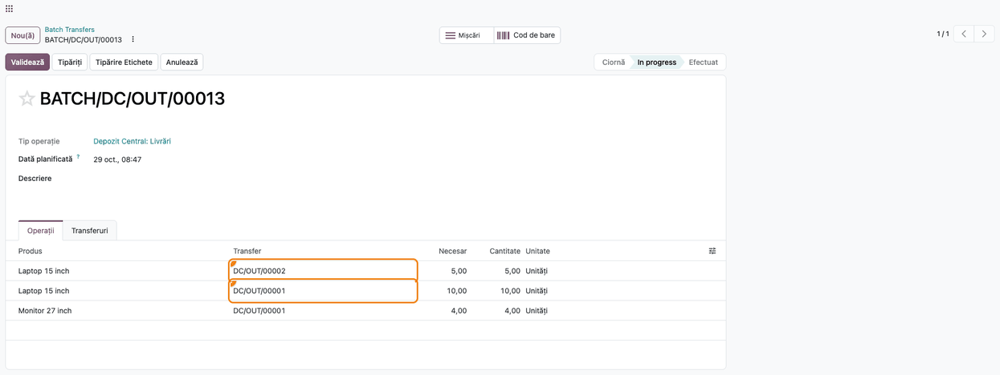
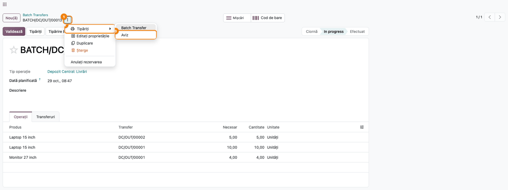
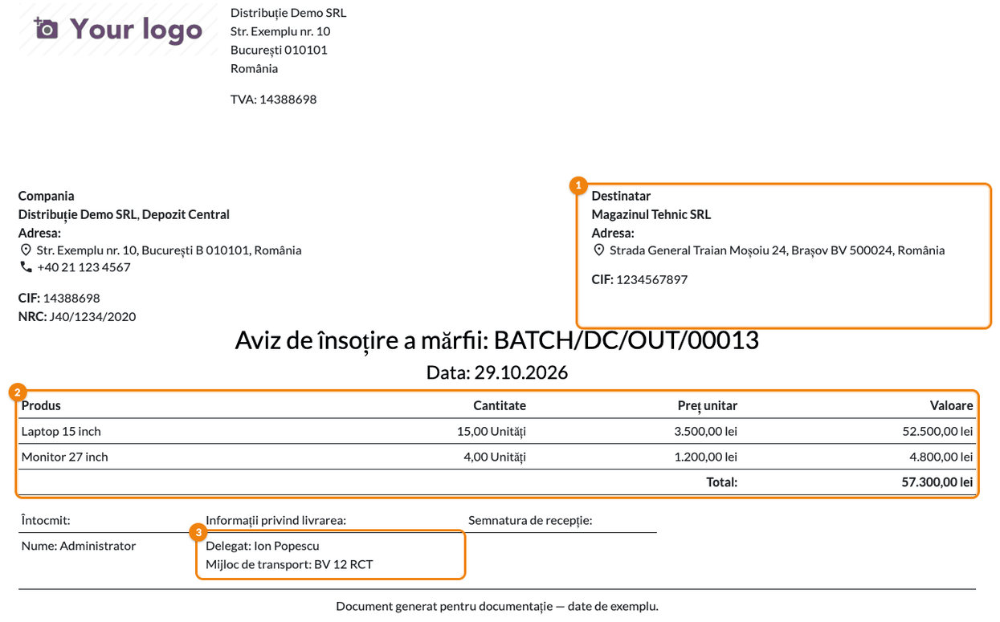

# Fișă Modul: Avizul de însoțire a mărfii pentru un lot de transferuri

**Modul:** `l10n_ro_stock_picking_batch_report`
**Utilizator principal:** Operator depozit / logistică
**Prioritate:** 🟡 Medie (un singur aviz pentru tot camionul, în locul câte unui aviz pe livrare)

---

## 1. Scop business

Când mai multe livrări pleacă împreună, grupate într-un **lot de transferuri**, depozitul are
nevoie de un singur document de însoțire pentru tot transportul. Odoo standard tipărește din lot
doar fișa de operații (lista de culegere), fără prețuri și fără datele fiscale ale părților.

Modulul adaugă pe lot raportul **Aviz**, un aviz de însoțire a mărfii în formatul avizului din
`l10n_ro_picking_report`:
- antetul cu firma, depozitul, CIF și NRC, și cu destinatarul;
- **o linie pe produs**, cu cantitățile cumulate din toate livrările lotului și unitatea de măsură;
- prețul unitar și valoarea, luate din comenzile de vânzare sau de achiziție, plus totalul;
- blocul de semnături: întocmit, delegat, mijloc de transport, semnătura de recepție.

## 2. Bază legală și context

- **OMFP 2634/2015** privind documentele financiar-contabile: **avizul de însoțire a mărfii**
  (cod **14-3-6A**) însoțește marfa pe timpul transportului, când factura se emite ulterior. Este
  formular fără regim special, deci formatul grafic nu e impus, dar conținutul minimal e
  obligatoriu. Detaliile sunt în fișa modulului `l10n_ro_picking_report`, secțiunea 2.
- Avizul pe lot reunește într-un singur document mai multe livrări către **același destinatar**.
  Modulul nu verifică asta: destinatarul tipărit este cel al primei livrări din tab-ul
  **Transferuri** al lotului.
- Formularul cere și **U/M**. Coloana apare pe aviz doar cu setarea **Unități de măsură** activă
  (vezi secțiunea 5).

## 3. Utilizatori și roluri

- **Operator depozit / logistică:** grupează livrările în lot și tipărește avizul la plecarea
  camionului.
- **Contabil:** verifică valorile de pe aviz față de comenzi, înainte de facturare.

Rol recomandat la testare: **Inventar / Utilizator**.

## 4. Conturi și date implicate

Modulul **nu generează note contabile**. Avizul este un document tipărit; descărcarea din gestiune
o face validarea livrărilor, independent de acest modul. Monografia livrării pe aviz (418 / 4428 la
livrare, apoi 4111 / 4427 la facturare) este în fișa modulului `l10n_ro_picking_report`.

Date implicate:
- pe **lot**: numele (devine numărul avizului), **Dată planificată** (devine data avizului),
  tipul de operație și depozitul;
- pe **livrările din lot**: destinatarul, **Delegat** și **Mijloc transport** ale primei livrări,
  cantitățile pregătite (coloana **Cantitate**, nu **Necesar**) și liniile de comandă din care
  provin;
- pe **companie** și **depozit**: denumire, adresă, telefon, CIF, NRC.

Date minime pentru demo:
- o companie din România cu CIF și NRC și un depozit cu adresă;
- un client din România cu CIF;
- două produse cu preț de vânzare;
- două comenzi de vânzare confirmate pentru același client, cu livrările grupate într-un lot.

## 5. Configurare inițială

1. Instalați modulul `l10n_ro_stock_picking_batch_report`. Se instalează automat și
   `l10n_ro_picking_report`. Loturile de transferuri fac parte, în Odoo 20, din aplicația Inventar.
2. Modulul nu poate fi instalat împreună cu `l10n_ro_stock_picking_comment_template`.
3. Activați **Inventar → Configurare → Setări**, bifa **Unități de măsură**. Fără ea, avizul nu
   tipărește unitatea de măsură lângă cantitate.
4. Modulul nu are setări proprii. Antetul (sigla, adresa firmei) vine din aspectul documentelor companiei:
   **Setări → Setări generale**, legătura **Configurare aspect document**.

## 6. Flux de utilizare

### Pasul 1 — Lotul cu livrările care pleacă împreună

**Inventar → Operații → Locuri de muncă → Transferuri în lot**, deschideți lotul. Tab-ul
**Operații** arată fiecare mișcare, cu livrarea din care vine (coloana **Transfer**).

În exemplu, laptopul apare în ambele livrări ① ②: 5 bucăți în `DC/OUT/00002` și 10 în
`DC/OUT/00001`. Pe aviz, cele două mișcări devin o singură linie, cu 15 bucăți.

Înainte de tipărire:
- verificați coloana **Cantitate**: avizul tipărește cantitatea pregătită, nu cea din coloana
  **Necesar**;
- completați **Delegat** și **Mijloc transport** în tab-ul **Informații suplimentare** al
  livrărilor. Avizul lotului le preia de pe prima livrare în ordinea Odoo (prioritatea cea mai
  mare, apoi cea mai devreme planificată), care poate diferi de primul rând din tab-ul
  **Transferuri** dacă rândurile au fost reordonate. Cel mai sigur este să le completați pe toate
  livrările din lot;
- ajustați **Dată planificată** a lotului la ziua plecării: ea devine data avizului.



### Pasul 2 — Tipărirea avizului

Pe lot, apăsați rotița ⚙ de lângă nume ①, apoi **Tipăriți** ② → **Aviz** ③. Se descarcă PDF-ul
avizului pentru tot lotul.

Butonul **Tipăriți** din antetul formularului scoate alt document: fișa de operații a lotului
(raportul **Transfer în lot** din același meniu), fără prețuri și fără date fiscale.



### Pasul 3 — Citirea și verificarea avizului

1. **Găsiți pe document:**
   - în antet, firma și depozitul (stânga) și **Destinatar** ① (dreapta), cu adresa și CIF-ul;
   - titlul „Aviz de însoțire a mărfii” urmat de numele lotului și **Data**;
   - tabelul ② cu **Produs**, **Cantitate** (cu unitatea de măsură), **Preț unitar**, **Valoare**
     și **Total**;
   - sub tabel, **Delegat** și **Mijloc de transport** ③, de pe prima livrare.
2. **Verificați:**
   - destinatarul este clientul tuturor livrărilor din lot. Când livrarea merge la o adresă de
     livrare a clientului, pe aviz apare adresa de livrare, iar CIF-ul și NRC-ul sunt cele ale
     firmei;
   - fiecare produs apare o singură dată, cu suma cantităților din tab-ul **Operații**
     (în exemplu, 15 laptopuri și 4 monitoare);
   - prețul unitar este cel din comandă și nu e 0, iar **Valoare** = cantitate × preț
     (15 × 3.500,00 = 52.500,00 lei);
   - **Total** este suma valorilor (57.300,00 lei);
   - delegatul și numărul mașinii sunt cele reale.
3. **Semnați și predați** avizul delegatului, apoi validați lotul.



### Note de monografie și raportare

- Modulul **nu produce note contabile**.
- **Cantitatea** de pe aviz este suma cantităților pregătite ale tuturor mișcărilor produsului din
  lot, convertite în unitatea de măsură a produsului (ex. 2 duzini + 6 bucăți = 30 de bucăți).
- **Valoarea** unei linii se calculează din comenzi, mișcare cu mișcare:
  - mișcare din comandă de achiziție: prețul unitar al liniei de achiziție × cantitatea, exprimată
    în unitatea liniei de comandă;
  - altfel, mișcare din comandă de vânzare: prețul unitar al liniei de vânzare × cantitatea, tot în
    unitatea liniei de comandă;
  - mișcare fără comandă: valoarea 0.
- **Prețul unitar** de pe aviz este valoarea liniei împărțită la cantitate, pe unitatea de măsură
  a produsului, deci o medie când produsul vine din comenzi cu prețuri diferite.
- Prețul din comandă se ia **înainte de reducere**. Comenzile în altă monedă se convertesc în
  moneda companiei, la cursul de la **Dată planificată** a lotului. Este prețul introdus pe
  comandă: la taxele cu preț inclus, valoarea conține TVA. Pentru comenzile cu reduceri sau cu taxe
  incluse, verificați valorile înainte de predare.

## 7. Legături cu alte module / declarații

| Modul / proces | Rol în flux | Tip legătură |
|---|---|---|
| `l10n_ro_picking_report` | avizul pe transfer și blocul de semnături folosit și pe lot | dependență (manifest) |
| `stock` | loturile de transferuri (în Odoo 20 fac parte din Inventar) | dependență (manifest) |
| `sale_stock` / `purchase_stock` | liniile de comandă din care vin prețurile | dependență (prin `l10n_ro_picking_report`) |
| `l10n_ro_etransport_batch_enhancement` | afișează pe acest aviz UIT-ul declarației eTransport a lotului | modul separat |
| `l10n_ro_stock_picking_comment_template` | incompatibil | `excludes` |

**Ce e automat:** cumularea pe produs, prețurile și valorile din comenzi, totalul, datele firmei,
ale depozitului și ale destinatarului.

**Ce rămâne manual:** gruparea în lot doar a livrărilor către același destinatar, completarea
delegatului și a mijlocului de transport pe prima livrare, data lotului la ziua plecării,
verificarea valorilor la comenzile cu reducere sau cu taxe incluse.

## 8. Verificări pentru consultant

- [ ] Rotița ⚙ a lotului are, sub **Tipăriți**, raportul **Aviz**.
- [ ] Toate livrările din lot au același destinatar, iar acesta apare pe aviz.
- [ ] La o livrare către o adresă de livrare, avizul tipărește CIF-ul și NRC-ul firmei clientului.
- [ ] Un produs prezent în mai multe livrări apare o singură dată pe aviz, cu suma cantităților.
- [ ] Cantitățile de pe aviz corespund coloanei **Cantitate** din tab-ul **Operații**.
- [ ] Livrările din comenzi au preț unitar diferit de 0, iar totalul este suma valorilor.
- [ ] Data avizului este **Dată planificată** a lotului, ajustată la ziua plecării.
- [ ] U/M apare lângă cantitate (setarea **Unități de măsură** activă).
- [ ] Delegatul și mijlocul de transport de pe prima livrare apar pe aviz.

## 9. Mesaje de eroare frecvente

| Mesaj / simptom | Cauză probabilă | Remediere |
|---|---|---|
| **Preț unitar** și **Valoare** 0,00 | Livrarea nu provine dintr-o comandă de vânzare sau de achiziție | Creați livrarea din comandă, sau completați valoarea manual pe documentul tipărit |
| Pe aviz apare alt destinatar decât cel așteptat | Lotul conține livrări către mai mulți clienți; se tipărește clientul primei livrări | Separați livrările pe clienți, în loturi distincte |
| **Delegat** și **Mijloc de transport** goale pe aviz | Nu sunt completate pe livrarea pe care o ia avizul (prioritatea cea mai mare, apoi cea mai devreme planificată) | Completați-le pe toate livrările din lot, în **Informații suplimentare** |
| Cantitatea apare fără unitate de măsură | Setarea **Unități de măsură** e inactivă | Activați-o în **Inventar → Configurare → Setări** |
| Cantitate 0 pe o linie | Cantitatea nu a fost pregătită (doar **Necesar** e completat) | Rezervați sau completați **Cantitate** înainte de tipărire |
| Raportul **Aviz** lipsește din meniu | Modulul nu e instalat, sau e instalat `l10n_ro_stock_picking_comment_template` | Instalați modulul; cele două se exclud reciproc |
| Valori diferite de factură la comenzile cu reducere, cu taxe incluse sau în valută | Prețul se ia din comandă, fără reducere și cu taxa inclusă dacă așa e pe comandă. Valuta se convertește la cursul de la data lotului, nu de la data facturii | Verificați valorile față de factură; vezi „Note de monografie” |

## 10. Capturi de ecran

Capturile (`static/description/`) sunt **generate automat** din `tests/test_screenshots.py`
(mixinul `ScreenshotCase` din `l10n_ro_doc_screenshots`, import defensiv), în **limba română**,
pe planul de conturi RO (`setup_country("ro")`):

1. `01_lot_livrari.png`: lotul cu două livrări și același produs în amândouă.
2. `02_tiparire_aviz.png`: meniul rotiței ⚙ → **Tipăriți** → **Aviz**.
3. `03_aviz_lot.png`: avizul lotului, cu destinatarul, produsele cumulate, valorile din comenzi,
   delegatul și mijlocul de transport.

Regenerare (restrânsă la clasă):

```bash
./odoo/odoo-bin -c odoo.conf -d <db> -i l10n_ro_stock_picking_batch_report,l10n_ro_doc_screenshots \
    --test-tags=/l10n_ro_stock_picking_batch_report:TestBatchReportScreenshots --stop-after-init
```

## 11. Observații pentru manual

- **Un lot = un camion = un aviz.** Avizul are un singur destinatar, deci în același lot intră doar
  livrări către același client.
- **Avizul din rotița ⚙, nu din butonul Tipăriți.** Butonul din antet scoate fișa de operații.
- **Prețurile vin din comenzi.** Livrările create manual, fără comandă, apar cu valoare 0.
- **Delegatul și mașina se completează pe prima livrare din lot,** nu pe lot.
- Pentru avizul unei singure livrări folosiți raportul din transfer (`l10n_ro_picking_report`).
