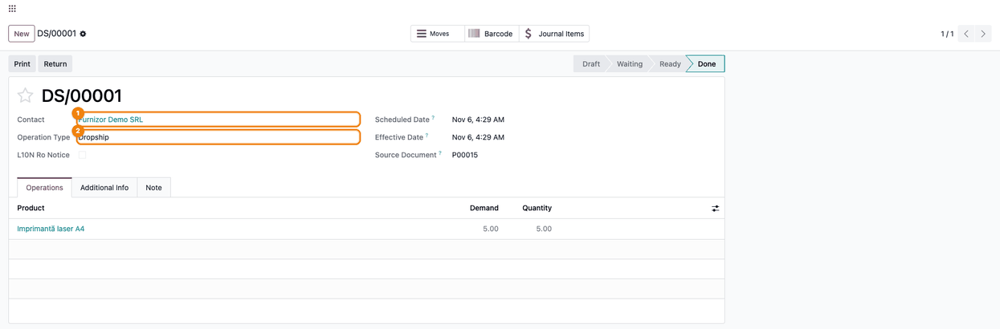
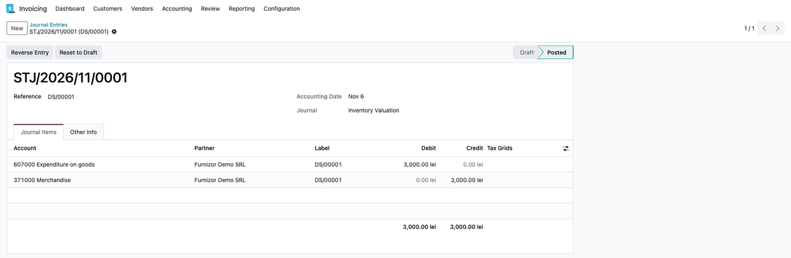
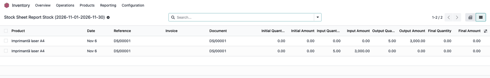
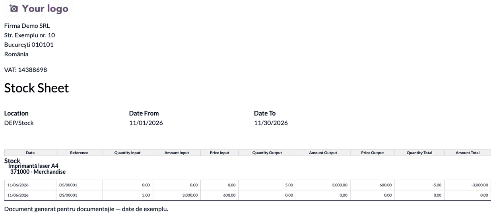

======================================
Romania - Stock Storage Sheet Dropship
======================================

..
   !!!!!!!!!!!!!!!!!!!!!!!!!!!!!!!!!!!!!!!!!!!!!!!!!!!!
   !! This file is generated by oca-gen-addon-readme !!
   !! changes will be overwritten.                   !!
   !!!!!!!!!!!!!!!!!!!!!!!!!!!!!!!!!!!!!!!!!!!!!!!!!!!!
   !! source digest: sha256:a6ff45a73bbd452eb1acfc1bffc0f8d5c67a0fa6fa5acd46b637ebbf49d3b2e0
   !!!!!!!!!!!!!!!!!!!!!!!!!!!!!!!!!!!!!!!!!!!!!!!!!!!!

.. |badge1| image:: https://img.shields.io/badge/maturity-Beta-yellow.png
    :target: https://odoo-community.org/page/development-status
    :alt: Beta
.. |badge2| image:: https://img.shields.io/badge/license-AGPL--3-blue.png
    :target: http://www.gnu.org/licenses/agpl-3.0-standalone.html
    :alt: License: AGPL-3
.. |badge3| image:: https://img.shields.io/badge/github-dhongu%2Fl10n--romania-lightgray.png?logo=github
    :target: https://github.com/dhongu/l10n-romania/tree/20.0/l10n_ro_stock_report_dropship
    :alt: dhongu/l10n-romania

|badge1| |badge2| |badge3|

Adds the dropshipped moves to the storage sheet (*Fișă de magazie*) of
the **OCA stock valuation stack**: the OCA module
``l10n_ro_stock_report``, on the OCA valuation engine
``l10n_ro_stock_account``.

A dropship goes from the vendor straight to the customer without
entering a warehouse. The OCA engine still values it on the goods
account (usually 371), so the storage sheet must show it as an input and
an output of the same quantity and value, under that account. With this
module the dropship moves get the *Dropship* valuation type and appear
in the sheet lines next to the receipts and deliveries.

**Scope:** this module extends only the OCA ``l10n_ro_stock_report``. It
does not apply to ``l10n_ro_storage_sheet``, the storage sheet of this
repository built on the native Odoo 19 valuation: databases that do not
use the OCA valuation engine have no dropship extension for their
storage sheet.

**Table of contents**

.. contents::
   :local:

Usage
=====

This is a technical add-on for the OCA storage sheet report
(``l10n_ro_stock_report``, on the OCA valuation engine
``l10n_ro_stock_account``). There is no menu or setting of its own.

1. Sell a product with the *Dropship* route, confirm the generated
   purchase order and validate the dropship transfer (``DS/…``) when the
   goods reach the customer.

   |Done dropship transfer from the vendor, operation type Dropship,
   with the product line|

   The OCA valuation engine posts the transfer entry *607 = 371* at the
   purchase value; the vendor bill posts *371 + 4426 = 401*.

   |Journal entry of the dropship transfer: 607000 debit and 371000
   credit, 3,000.00 each|

2. Open **Inventory > Reporting > Romanian Stock Sheet Report**, choose
   the location and the period and click **Show Sheet**: in the list
   view the dropship transfer shows as an input and an output row with
   the same quantity and amount.

   |Storage sheet list with the dropship transfer as one input and one
   output row of the same amount|

3. **Show Sheet Pdf** prints the dropship rows under the stock account
   of the product category (e.g. 371000); after both rows the stock is
   back to its previous value.

   |Printed storage sheet with the dropship input and output rows under
   the 371000 account|

Changelog
=========

19.0.1.1.3 (2026-11-06)
-----------------------

- Readme: the module extends the OCA ``l10n_ro_stock_report`` on the OCA
  valuation engine ``l10n_ro_stock_account``, not
  ``l10n_ro_storage_sheet`` (the storage sheet on the native valuation),
  which has no dropship extension.
- Consultant sheet with screenshots: the dropship flow, its journal
  entries on the OCA engine and the storage sheet rows.

19.0.1.1.2 (2026-10-09)
-----------------------

- Odoo Apps banner (``static/description/main_screenshot.png``),
  generated from ``banner.json``.

19.0.1.1.1 (2026-09-30)
-----------------------

- Own module icon in the flat style of the Terrabit modules, instead of
  the missing or generic one.

19.0.1.1.0 (2026-08-18)
-----------------------

**Bugfix**

- The dropship rows of the storage sheet are again reported under the
  account the movement is valued on (usually 371000), instead of being
  grouped under a separate "no account" bucket. The dropship insert left
  ``account_id`` NULL, so the dropship never appeared under the goods
  account the accountant reconciles - the sheet looked as if the
  dropship line was missing, even though its in/out values were correct.
  Up to 18.0 the account came from the valuation layer, and it was
  dropped when the module was ported to 19.0.

Bug Tracker
===========

Bugs are tracked on `Terrabit Issues <https://www.terrabit.ro/helpdesk>`_.
In case of trouble, please check there if your issue has already been reported.

Do not contact contributors directly about support or help with technical issues.

Credits
=======

Authors
-------

* Dan Stoica
* Terrabit

Maintainers
-----------

.. |maintainer-danila12| image:: https://github.com/danila12.png?size=40px
    :target: https://github.com/danila12
    :alt: danila12
.. |maintainer-dhongu| image:: https://github.com/dhongu.png?size=40px
    :target: https://github.com/dhongu
    :alt: dhongu

Current maintainers:

|maintainer-danila12| |maintainer-dhongu| 

This module is part of the `dhongu/l10n-romania <https://github.com/dhongu/l10n-romania/tree/20.0/l10n_ro_stock_report_dropship>`_ project on GitHub.

You are welcome to contribute.