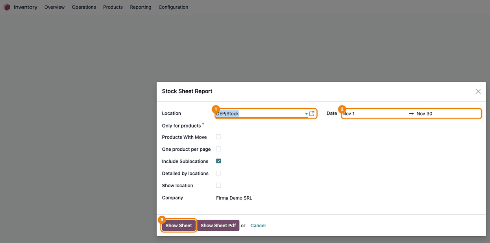
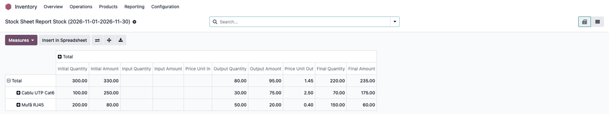
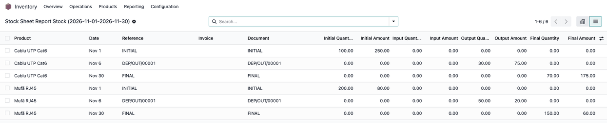
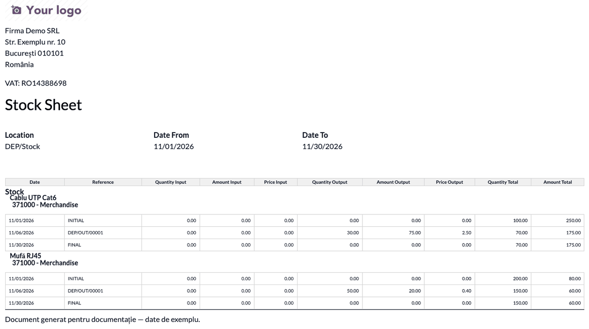

======================================
Romania - Storage Sheet (Fișă Magazie)
======================================

..
   !!!!!!!!!!!!!!!!!!!!!!!!!!!!!!!!!!!!!!!!!!!!!!!!!!!!
   !! This file is generated by oca-gen-addon-readme !!
   !! changes will be overwritten.                   !!
   !!!!!!!!!!!!!!!!!!!!!!!!!!!!!!!!!!!!!!!!!!!!!!!!!!!!
   !! source digest: sha256:40daa19c8944df469af992559215b458acd34651b86f0d8456ebe2cb0ca61c7f
   !!!!!!!!!!!!!!!!!!!!!!!!!!!!!!!!!!!!!!!!!!!!!!!!!!!!

.. |badge1| image:: https://img.shields.io/badge/maturity-Mature-brightgreen.png
    :target: https://odoo-community.org/page/development-status
    :alt: Mature
.. |badge2| image:: https://img.shields.io/badge/license-AGPL--3-blue.png
    :target: http://www.gnu.org/licenses/agpl-3.0-standalone.html
    :alt: License: AGPL-3
.. |badge3| image:: https://img.shields.io/badge/github-dhongu%2Fl10n--romania-lightgray.png?logo=github
    :target: https://github.com/dhongu/l10n-romania/tree/19.0/l10n_ro_storage_sheet
    :alt: dhongu/l10n-romania

|badge1| |badge2| |badge3|

This module adds the Romanian storage sheet (Fișă Magazie) report:
opening balance, receipts, deliveries and closing balance per product
and location, as a PDF or as a pivot analysis.

It works on the native Odoo stock valuation and does not depend on the
``l10n_ro_stock_account`` valuation engine.

It was previously published in this repository as
``l10n_ro_stock_report``, which clashed with the OCA module of the same
name. Databases that need the valued move types of the OCA engine keep
using the OCA ``l10n_ro_stock_report``.

**Table of contents**

.. contents::
   :local:

Installation
============

This module is the successor of the Terrabit copy of
``l10n_ro_stock_report``. It is not installed automatically in its
place: the old name now resolves to the OCA ``l10n_ro_stock_report``
module, which depends on ``l10n_ro_stock_account``.

On a database where the storage sheet was installed without
``l10n_ro_stock_account``, install ``l10n_ro_storage_sheet`` and
uninstall ``l10n_ro_stock_report`` before updating, otherwise the update
also installs the OCA stock valuation engine.

The report models are transient, so no data is migrated.

Usage
=====

1. Go to **Inventory > Reporting > Romanian Stock Sheet Report**, choose
   the **Location** and the **Date** range (the current month by
   default), then click **Show Sheet**.

   |Stock sheet wizard with the location, the date range and the Show
   Sheet button highlighted|

2. The sheet opens as a pivot. Group the rows by **Product**: each
   product shows the initial, input, output and final quantity and
   amount. Export it with the download (XLSX) button.

   |Stock sheet pivot grouped by product, with initial, input, output
   and final quantities and amounts|

3. Switch to the **list** view to see each move with its document; the
   **INITIAL** and **FINAL** rows of each product are the opening and
   closing balances of the period.

   |Stock sheet list with one row per move with the INITIAL and FINAL
   rows per product|

4. Back in the wizard, **Show Sheet Pdf** prints the storage sheet: per
   product and stock account, the INITIAL row, each move and the FINAL
   row, with the stock after every operation.

   |Printed storage sheet: per product, under the 371000 stock account,
   the INITIAL, delivery and FINAL rows with the running stock|

Changelog
=========

19.0.1.0.2 (2026-11-06)
-----------------------

- **The printed storage sheet (Show Sheet Pdf) came out without any
  move.** Both PDF templates group the lines by account, but on 19.0 the
  report never filled the account in: up to 18.0 it came from the
  valuation layer, which no longer exists. The lines now get the stock
  valuation account of the product (category account, then the company
  default), and lines that still have no account are printed without the
  account header instead of being left out. In the pivot the *Account*
  grouping now shows the stock account instead of an empty row.
- Consultant sheet: new step with the printed sheet. Printed sheet
  header: *Date* column (was hard-coded in Romanian), *Valoare ieșire*
  in the Romanian translation.

19.0.1.0.1 (2026-11-06)
-----------------------

- No longer depends on the OCA module ``l10n_ro_config``. It was used
  only to set ``is_l10n_ro_record`` on the *Romanian Stock Sheet Report*
  menu, a field with no effect on menus. No functional change.
- Consultant sheet with screenshots; Romanian translation fixes
  (*Cantitate ieșită*, *Preț unitar ieșire*, *Factură fiscală*).

19.0.1.0.0 (2026-10-14)
-----------------------

- Renamed from ``l10n_ro_stock_report`` to ``l10n_ro_storage_sheet``,
  together with its models (``l10n.ro.stock.storage.sheet`` ->
  ``l10n.ro.storage.sheet``, ``l10n.ro.stock.storage.sheet.line`` ->
  ``l10n.ro.storage.sheet.line``). The old name clashed with the OCA
  module ``l10n_ro_stock_report``, and the copy that loaded depended
  only on the order of the repositories in ``addons_path``. No migration
  of the module record: the report models are transient, and the old
  name now belongs to the OCA module. See ``INSTALL.md`` for databases
  that have the storage sheet without ``l10n_ro_stock_account``.

19.0.2.0.1 (2026-10-09)
-----------------------

- Odoo Apps banner (``static/description/main_screenshot.png``),
  generated from ``banner.json``.

Bug Tracker
===========

Bugs are tracked on `Terrabit Issues <https://www.terrabit.ro/helpdesk>`_.
In case of trouble, please check there if your issue has already been reported.

Do not contact contributors directly about support or help with technical issues.

Credits
=======

Authors
-------

* Terrabit
* NextERP Romania

Contributors
------------

- `Terrabit <https://www.terrabit.ro>`__:

  - Dorin Hongu <dhongu@gmail.com>

- `NextERP Romania <https://www.nexterp.ro>`__:

  - Fekete Mihai <feketemihai@nexterp.ro>
  - Alexandru Teodor <teodoralexandru@nexterp.ro>
  - Musat Natanaela <musatnatanaela@nexterp.ro>

Do not contact contributors directly about support or help with
technical issues.

Maintainers
-----------

.. |maintainer-dhongu| image:: https://github.com/dhongu.png?size=40px
    :target: https://github.com/dhongu
    :alt: dhongu
.. |maintainer-feketemihai| image:: https://github.com/feketemihai.png?size=40px
    :target: https://github.com/feketemihai
    :alt: feketemihai

Current maintainers:

|maintainer-dhongu| |maintainer-feketemihai| 

This module is part of the `dhongu/l10n-romania <https://github.com/dhongu/l10n-romania/tree/19.0/l10n_ro_storage_sheet>`_ project on GitHub.

You are welcome to contribute.