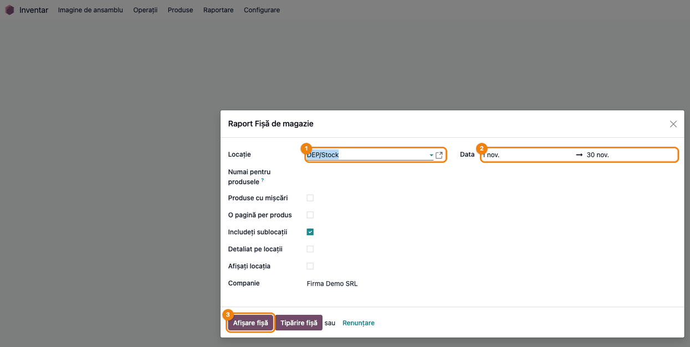
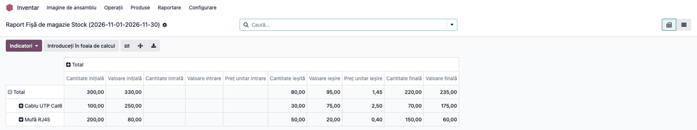
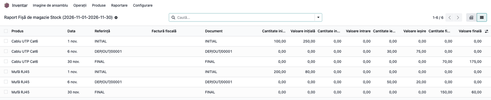

# Fișă Modul: Fișa de magazie

**Modul:** `l10n_ro_storage_sheet`
**Utilizator principal:** Gestionar, Contabil stocuri
**Prioritate:** 🟡 Medie (evidența intrărilor, ieșirilor și stocurilor pe gestiune, cantitativ și valoric, cerută la inventar și la control)

---

## 1. Scop business

Gestionarul și contabilul au nevoie, pe o perioadă și o gestiune, de situația fiecărui produs:
stocul la începutul perioadei, intrările, ieșirile și stocul final, în cantitate și valoare, cu
documentul care a generat fiecare mișcare. Modulul calculează aceste date direct din mișcările de
stoc Odoo, ca analiză (pivot și listă) pe care o puteți filtra, grupa și exporta, și ca fișă
tipărită, grupată pe contul de stoc.

## 2. Bază legală și context

- Fișa de magazie este un document de evidență a stocurilor pe gestiuni (formularul 14-3-8 din
  OMFP 2634/2015 privind documentele financiar-contabile); evidența se poate ține și în format
  electronic. Norma cere înregistrarea document cu document, pe fiecare loc de depozitare și fel
  de material, cu stocul după fiecare operație.
- Pivotul și lista din acest modul sunt o **analiză** a mișcărilor (fără coloana de stoc după
  fiecare operație); documentul echivalent formularului 14-3-8 este fișa tipărită
  (**Tipărire fișă**), cu stocul după fiecare operație. Exportul XLSX nu o înlocuiește.
- Modulul lucrează pe valorizarea nativă a stocului din Odoo 19; nu depinde de motorul de
  valorizare OCA (`l10n_ro_stock_account`).

## 3. Utilizatori și roluri

- **Gestionar** (grup *Inventar / Utilizator*, plus drept de citire pe elementele de jurnal, ex.
  *Contabilitate: doar citire* sau *Vânzări / Achiziții: utilizator*): verifică intrările și
  ieșirile pe gestiunea lui.
- **Contabil stocuri**: compară soldul final valoric cu soldul contului de stoc.
- **La testare**: un utilizator cu rol de *Inventar / Utilizator* și drept de citire pe elementele
  de jurnal, ca să se vadă meniul exact cum îl vede gestionarul.

## 4. Conturi și date implicate

Modulul nu generează note contabile; citește mișcările de stoc validate.

Date afișate pe fiecare produs: cantitate și valoare inițială, intrată, ieșită și finală, prețul
unitar de intrare și de ieșire, documentul (recepție, livrare, inventar) și partenerul.

Date minime pentru demo: două produse stocabile, o recepție dintr-o comandă de achiziție validată
în luna anterioară (sold inițial) și o livrare dintr-o comandă de vânzare validată în luna
curentă, în gestiunea principală.

## 5. Configurare inițială

1. Instalați `l10n_ro_storage_sheet` (dependențe: `stock`, `account`, `stock_account`, `purchase`, `sale`).
2. Setați contul de stoc pe categoria de produs (ex. 371 „Mărfuri” la mărfuri); altfel fișa
   folosește contul de stoc implicit al companiei (pe planul RO, 301 „Materii prime”).
3. Nu există setări proprii. Meniul apare în **Inventar → Raportare → Raport Fișă de magazie**
   pentru utilizatorii cu drept de stoc; calculul fișei cere și drept de citire pe elementele de
   jurnal (vezi secțiunea 3).

## 6. Flux de utilizare

### Pasul 1 — Alegerea gestiunii și a perioadei

Accesați **Inventar → Raportare → Raport Fișă de magazie**. Se deschide fereastra de parametri:

- **Locație** — gestiunea (ex. `DEP/Stock`); cu **Includeți sublocații** bifat, se iau și
  locațiile din interiorul ei;
- **Data** — perioada; implicit luna curentă;
- opțional: **Numai pentru produsele** (doar anumite produse), **Produse cu mișcări** (ascunde
  produsele fără mișcări în perioadă), **Detaliat pe locații**.

Apăsați **Afișare fișă**.



### Pasul 2 — Analiza pe produs (pivot)

Fișa se deschide ca tabel pivot, grupat pe **Cont** (contul de stoc al produselor, din categoria
lor; ex. 371 „Mărfuri”). Faceți clic pe **Total** ca să restrângeți gruparea, apoi încă o dată →
**Produs** (sau **Căutare → Grupare după → Produs**).

- **Găsiți pe ecran:** pentru fiecare produs, coloanele *Cantitate inițială / Valoare inițială*,
  *Cantitate intrată / Valoare intrare*, *Cantitate ieșită / Valoare ieșire* și *Cantitate finală /
  Valoare finală*.
- **Verificați:** pe fiecare rând, cantitatea finală = inițială + intrată − ieșită (ex. Cablu UTP
  Cat6: 100 + 0 − 30 = 70); la fel valoarea (250 + 0 − 75 = 175). Prețul mediu al perioadei se
  calculează ca *Valoare intrare / Cantitate intrată*; coloanele *Preț unitar* sunt media simplă
  pe mișcări (și, pe *Total*, pe produse), corectă doar când există o singură recepție.
- **Treceți mai departe:** pentru export, folosiți butonul de descărcare (XLSX) din bara pivotului
  sau **Introduceți în foaia de calcul**.



### Pasul 3 — Mișcările pe documente (listă)

Treceți pe vizualizarea **listă** (butonul din dreapta-sus). Primul rând al fiecărui produs, cu
referința **INITIAL**, este soldul de la începutul perioadei; urmează mișcările din perioadă (aici
livrarea `DEP/OUT/…`), iar ultimul rând, cu referința **FINAL**, este soldul de la sfârșitul
perioadei.

- **Găsiți pe ecran:** coloanele *Produs*, *Data*, *Referință*, *Document* și cantitățile și
  valorile pe intrare, ieșire și final.
- **Verificați:** fiecare recepție și livrare validată în perioadă apare o singură dată; rândul
  INITIAL are soldul de la sfârșitul perioadei anterioare; rândul FINAL are aceeași cantitate și
  valoare ca rândul produsului din pivot.



### Pasul 4 — Fișa tipărită

Din fereastra de la pasul 1, apăsați **Tipărire fișă**. Se descarcă fișa de magazie în PDF: antetul
cu gestiunea și perioada, apoi, pe fiecare produs și cont de stoc, rândul **INITIAL**, mișcările
document cu document și rândul **FINAL**, cu stocul (cantitate și valoare) după fiecare operație.
Cu **O pagină per produs** bifat, fiecare produs are pagina lui.

- **Găsiți pe ecran:** sub numele produsului, contul de stoc (ex. `371000 - Mărfuri`); coloanele
  *Cantitate totală* și *Suma totală* arată stocul după fiecare rând.
- **Verificați:** pe ultimul rând (FINAL), *Cantitate totală* și *Suma totală* sunt egale cu
  valorile finale ale produsului din pivot (ex. Cablu UTP Cat6: 70,00 și 175,00).


### Note de monografie și raportare

Modulul nu generează note contabile. Valorile vin din valorizarea stocului din Odoo (costul
mișcărilor de stoc). Reconcilierea cu balanța se face pe cont, nu pe gestiune: contul de stoc
(301, 371 etc.) se leagă de categoria de produs, deci soldul final valoric se însumează pe
**toate gestiunile** cu produse din categoriile acelui cont și se compară cu soldul contului la
aceeași dată. Comparația are sens doar cu valorizare perpetuă (*real_time*) sau, în valorizarea
periodică, după nota de închidere a perioadei.

## 7. Legături cu alte module / declarații

| Modul | Rol în flux |
|---|---|
| `stock` | mișcările de stoc, gestiunile și locațiile |
| `purchase`, `sale` | recepțiile și livrările care apar în fișă |
| `stock_account` | valorile mișcărilor de stoc și contul de stoc al produsului (din categorie sau implicit pe companie) |
| `account` | moneda; dreptul de citire pe elementele de jurnal |

**Ce e automat:** calculul soldurilor inițiale și finale, al intrărilor și ieșirilor pe produs și
gestiune, din mișcările validate.

**Ce rămâne manual:** alegerea gestiunii și a perioadei; compararea cu balanța.

## 8. Verificări pentru consultant

- [ ] Meniul **Inventar → Raportare → Raport Fișă de magazie** deschide fereastra de parametri.
- [ ] Cu gestiunea principală și luna curentă, **Afișare fișă** deschide pivotul.
- [ ] Pe fiecare produs, cantitatea finală = inițială + intrată − ieșită; la fel valoarea.
- [ ] În listă, fiecare recepție și livrare validată în perioadă apare o singură dată, cu
      documentul ei.
- [ ] Rândul FINAL al fiecărui produs are aceleași valori ca rândul produsului din pivot.
- [ ] Cu **Produse cu mișcări** bifat, produsele fără mișcări în perioadă nu apar.
- [ ] **Tipărire fișă** descarcă PDF-ul cu, pe fiecare produs, contul de stoc al categoriei
      (ex. `371000 - Mărfuri`), rândul INITIAL, mișcările document cu document și rândul FINAL;
      stocul de pe rândul FINAL este egal cu cel din pivot.
- [ ] Un produs dintr-o categorie fără cont de stoc, pe o companie fără cont implicit, apare tot
      în fișa tipărită, fără antetul de cont, cu toate rândurile lui.
- [ ] Cu valorizare perpetuă, soldul final valoric însumat pe toate gestiunile unui cont de stoc
      corespunde soldului contului din balanță.
- [ ] Un gestionar fără drept de citire pe elementele de jurnal primește eroare de acces la
      **Afișare fișă**.

## 9. Mesaje de eroare frecvente

| Mesaj | Cauză | Remediere |
|---|---|---|
| „Nu există mișcări ale stocurilor în perioada selectată” | Nicio mișcare validată în gestiune și perioadă, cu **Produse cu mișcări** bifat | Verificați gestiunea, perioada și dacă documentele sunt validate |
| Eroare de acces la **Afișare fișă** | Utilizatorul nu are drept de citire pe elementele de jurnal | Adăugați *Contabilitate: doar citire* sau rolul de utilizator Vânzări / Achiziții |
| Fișa tipărită are rânduri fără antet de cont | Nu există cont de stoc nici pe categoria produsului, nici pe companie; rândurile se tipăresc oricum, doar fără antetul de cont | Completați contul de stoc pe categoria de produs |

## 10. Capturi de ecran

Capturile sunt generate automat din `tests/test_screenshots.py` (mixinul `ScreenshotCase` din
`l10n_ro_doc_screenshots`, import defensiv), în RO, pe planul de conturi RO, în
`static/description/`, în ordinea pașilor din secțiunea 6. Testul validează o recepție și o
livrare pentru două produse din categoria *Mărfuri* (cont 371; recepția în luna anterioară),
apoi calculează fișa pe luna curentă.

| # | Fișier | Conținut |
|---|--------|----------|
| 1 | `static/description/01_wizard_fisa_magazie.png` | Fereastra de parametri: gestiune, perioadă, opțiuni |
| 2 | `static/description/02_pivot_fisa_magazie.png` | Pivotul grupat pe produs: inițial, intrări, ieșiri, final |
| 3 | `static/description/03_lista_miscari.png` | Lista mișcărilor pe documente, cu rândurile INITIAL și FINAL |
| 4 | `static/description/04_pdf_fisa_magazie.png` | Fișa tipărită, pe produs și cont de stoc |

Regenerare:

```bash
./odoo/odoo-bin -c odoo.conf -d test19 -i l10n_ro,l10n_ro_storage_sheet,l10n_ro_doc_screenshots --test-tags=fise_screenshots --stop-after-init
```

## 11. Observații pentru manual

- Fișa este o analiză calculată la cerere: se refac valorile la fiecare **Afișare fișă**; nu
  rămâne un document salvat.
- Exportul XLSX al pivotului e util pentru analiză, dar nu înlocuiește fișa de magazie
  (formularul 14-3-8), care e fișa tipărită (pasul 4).
- Rândurile INITIAL și FINAL din listă sunt soldurile calculate, nu documente.
