# Fișă Modul: Datele firmei de la ANAF în formularul de adresă al magazinului online

**Modul:** `l10n_ro_website_anaf`  
**Suită:** `l10n-romania`  
**Utilizator principal:** clientul firmă din magazinul online (completează adresa); agentul de vânzări
(citește nota de pe comandă); consultantul de implementare (verifică fluxul)  
**Prioritate:** 🟡 Medie (scutește clientul B2B de tastarea datelor firmei și oprește comenzile pe
coduri fiscale greșite sau pe firme radiate, dar nu este un flux contabil obligatoriu)

---

## 1. Scop business

Când un client cumpără din magazinul online pe firmă, trebuie să completeze în formularul de adresă
denumirea firmei, codul fiscal și adresa sediului. Datele tastate de mână ies adesea greșit (denumire
prescurtată, cod fiscal cu o cifră greșită, CNP tastat în locul CUI-ului), iar factura și e-Factura
pleacă apoi pe date care nu corespund cu registrul ANAF.

Modulul caută firma la ANAF **chiar în timp ce clientul tastează codul fiscal (CUI)**: sub câmp apare
firma găsită (denumirea pe care se emite factura, adresa, dacă e plătitoare de TVA), iar câmpurile
goale ale formularului — firma, strada, localitatea, codul poștal, județul — se completează singure.
Butonul **„Completează din ANAF”** înlocuiește, doar la cererea clientului, și ce a tastat el deja.

La **salvarea adresei**, codul fiscal se verifică din nou pe server: un cod care nu apare la ANAF sau o
firmă radiată sunt refuzate, un CNP primește un mesaj propriu, iar o firmă găsită primește denumirea
legală de la ANAF pe **firma-părinte** (entitatea comercială pe care se emit factura și e-Factura).
O firmă inactivă fiscal poate comanda, dar comanda primește o notă internă pentru agentul de vânzări.
Dacă ANAF nu răspunde, vânzarea nu se oprește: codul se acceptă așa cum a fost tastat și comanda
primește o notă.

## 2. Bază legală și context

- **Firma inactivă fiscal** — la o firmă declarată inactivă, înregistrarea în scopuri de TVA se
  anulează (Codul fiscal, Legea 227/2015, art. 316 alin. (11)), iar cât timp este inactivă firma nu își
  poate deduce cheltuielile și TVA-ul achizițiilor (art. 11 alin. (6)). Modulul nu
  calculează nimic fiscal; afișează clientului un avertisment și lasă agentului de vânzări o notă cu
  consecința practică (factura se emite cu TVA, fără taxare inversă, cu codul fiscal fără prefixul
  RO; încasarea se verifică, de preferat plata în avans). Textul notei este cel din modul.
- **Firma radiată** — nu mai există juridic, deci nu poate fi cumpărător; modulul refuză adresa.
- **e-Factura** — factura se transmite în SPV pe denumirea și codul fiscal ale entității comerciale;
  modulul asigură doar că denumirea legală de la ANAF ajunge pe firma-părinte.
- **Sursa datelor** — serviciul public ANAF de interogare a contribuabililor, apelat prin modulul
  `l10n_ro_anaf_partner_lookup` (fără cheie de acces).

## 3. Utilizatori și roluri

| Rol | Ce face în flux |
|---|---|
| **Client din magazin (utilizator portal sau vizitator)** | tastează codul fiscal în formularul de adresă de facturare, verifică firma afișată, apasă „Completează din ANAF” dacă vrea adresa ANAF, salvează adresa |
| **Agent de vânzări** | deschide comanda din backend, citește nota internă (firmă inactivă, ANAF indisponibil) și decide modul de încasare |
| **Consultant implementare** | verifică pe o bază de test mesajele pentru fiecare situație (firmă găsită, inactivă, radiată, inexistentă, CNP) și firma creată în Contacte |

La testare: un utilizator portal (ex. „Ion Popescu”) cu un coș deschis pentru partea de magazin și
administratorul (sau un utilizator cu drept de **Vânzări**) pentru verificarea comenzii și a firmei în
backend.

## 4. Conturi și date implicate

Modulul **nu generează note contabile** și nu atinge conturi. Datele implicate:

| Dată | Unde ajunge |
|---|---|
| Codul fiscal (CUI), cu sau fără prefixul RO | câmpul **TVA** al formularului, apoi pe firmă; Odoo deduce din el **ID Companie** (CUI-ul fără prefix) |
| Denumirea legală de la ANAF | câmpul **Company** al formularului, apoi numele firmei-părinte a persoanei de contact |
| Strada, localitatea, codul poștal, județul | câmpurile de adresă, **doar dacă sunt goale** (sau la „Completează din ANAF”) |
| Stare: plătitor de TVA / inactiv / radiat | doar în mesajul de sub codul fiscal și în nota de pe comandă |

Date minime pentru demo: un produs publicat în magazin, un utilizator portal cu țara România, e-mail și
telefon (telefonul e obligatoriu în formularul de adresă), un coș deschis.

## 5. Configurare inițială

Modulul nu are ecran de configurare. Pași de pregătire pe baza demo:

1. Instalați `l10n_ro_website_anaf` (aduce `website_sale` și `l10n_ro_anaf_partner_lookup`).
2. Activați limba română pe site și setați-o ca limbă implicită (**Site web → Configurare → Setări**,
   secțiunea limbilor), ca mesajele ANAF să apară în română.
3. Publicați un produs în magazin și creați (sau lăsați să se înregistreze) un client portal cu țara
   **România**.
4. Adresa serviciului ANAF este cea a modulului `l10n_ro_anaf_partner_lookup` (parametrul de sistem
   `l10n_ro_anaf_partner_lookup.url`); site-ul așteaptă un răspuns cel mult 5 secunde.

## 6. Flux de utilizare

Fluxul se desfășoară în magazin, pe pasul **Adresă** al comenzii: **Magazin → coș → Confirmă →
Editează adresa** (adresa de facturare). Căutarea pornește doar când țara din formular este
**România**. Același câmp funcționează și în formularul de adresă din contul de client
al portalului (**Contul meu → Adrese**, pentru adresa de facturare).

### Pasul 1 — Formularul de adresă de facturare

Clientul ajunge pe pasul **Adresă**. În partea de jos a formularului sunt câmpurile **TVA**
(codul fiscal) ①, pe care îl tastează clientul, și **Company** (firma) ②, pe care îl completează
căutarea. Câmpurile de adresă (județ, localitate, cod poștal, stradă)
sunt încă goale.

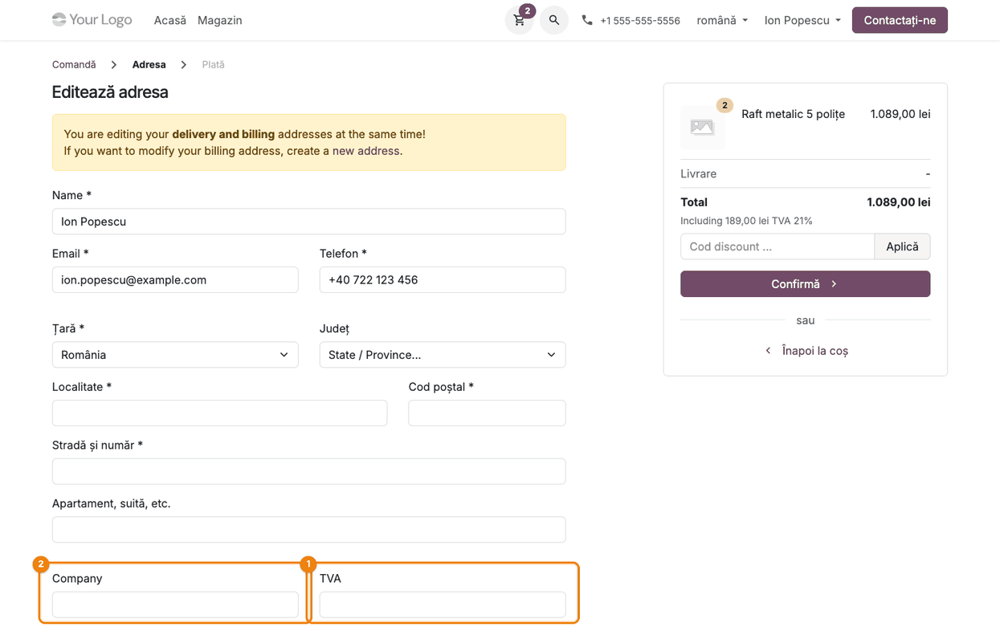

### Pasul 2 — Codul fiscal tastat: firma găsită la ANAF

Clientul tastează codul fiscal în câmpul **TVA**, cu sau fără prefixul `RO`; spațiile, punctele și
liniuțele dintre cifre sunt ignorate, atât la tastare, cât și la salvare. După o
scurtă pauză apare „Se caută la ANAF…”, apoi, în verde, sub cod:

- **găsiți pe ecran** — mesajul „Factura se emite pe *denumire* — *adresă* — plătitor de TVA /
  neplătitor de TVA” ① și linkul **Completează din ANAF**;
- **verificați** — câmpul **Company** ② are denumirea legală de la ANAF, iar **Stradă și număr** ③,
  **Localitate** ④, **Cod poștal** ⑤ și **Județ** ⑥ s-au completat, pentru că erau goale.

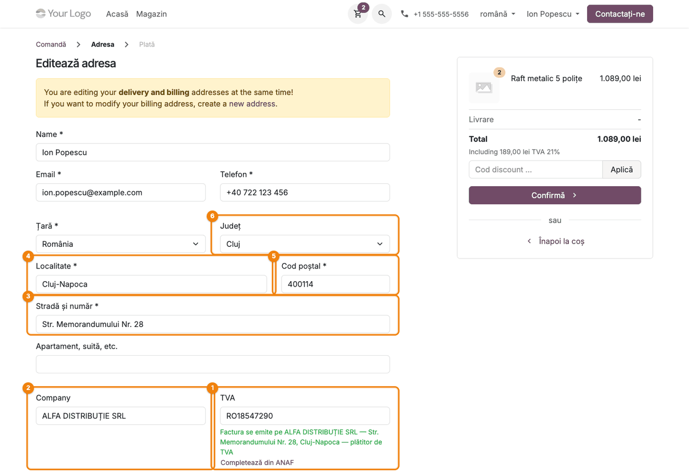

### Pasul 3 — Ce a tastat clientul rămâne neschimbat

Dacă clientul tastase deja o adresă (de exemplu adresa depozitului), căutarea **nu o suprascrie**:
**Stradă și număr** ① rămâne cea tastată, iar câmpurile goale (localitate, cod poștal, județ, firmă) se
completează. Linkul **Completează din ANAF** ② rămâne la vedere.

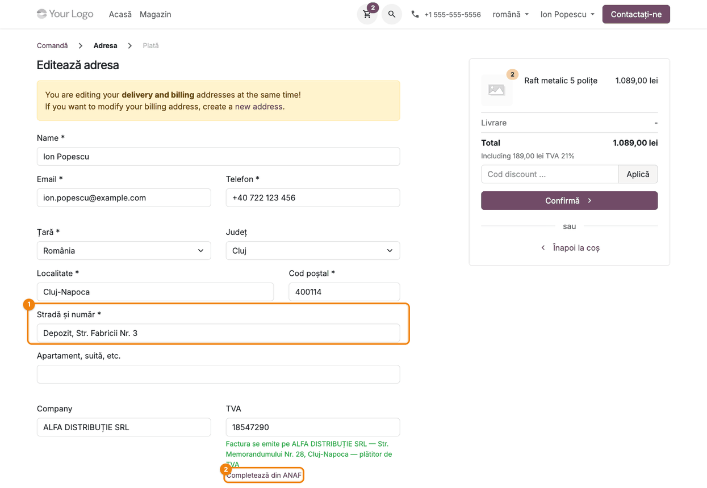

### Pasul 4 — „Completează din ANAF” înlocuiește adresa

La clic pe **Completează din ANAF**, toate câmpurile mapate (firmă, stradă, localitate, cod poștal,
județ) primesc valorile de la ANAF, inclusiv cele tastate de client: **Stradă și număr** ① are acum
adresa sediului social.

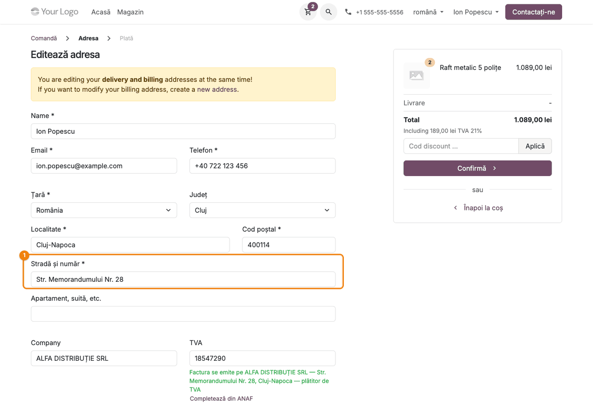

### Pasul 5 — Firmă inactivă fiscal: avertisment, comanda continuă

Pentru o firmă inactivă, mesajul de sub cod ① este **portocaliu**, arată „neplătitor de TVA” (codul
de TVA i-a fost anulat) și are un al doilea rând: firma
figurează ca inactivă fiscal la ANAF; comanda poate fi plasată, însă cât timp firma este inactivă nu
își poate deduce cheltuiala și TVA-ul aferente achiziției. Câmpurile goale se completează la fel, iar
clientul poate merge mai departe cu **Confirmă** ②.

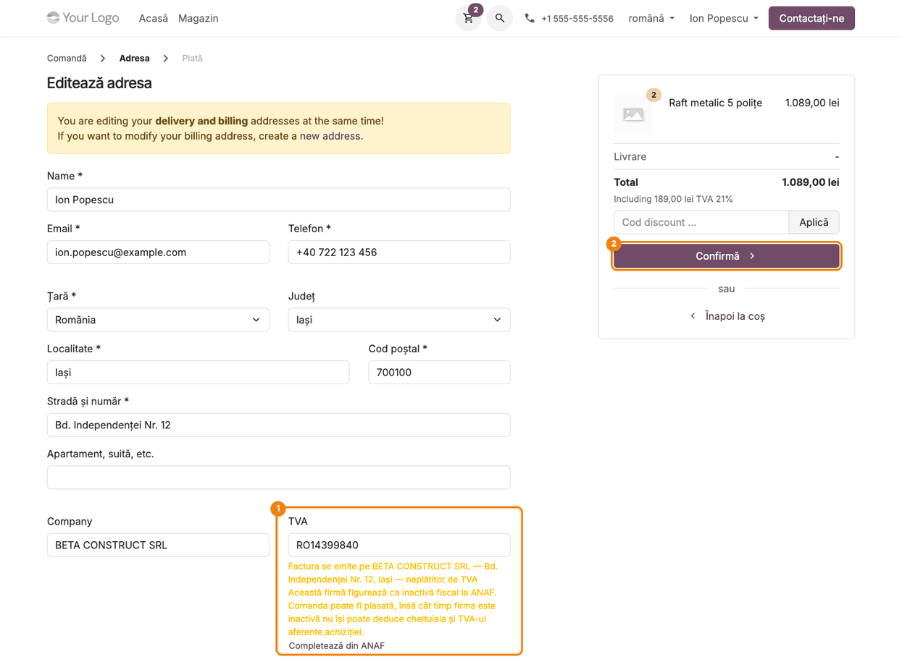

### Pasul 6 — Firmă radiată: nu poate comanda

Pentru o firmă radiată, mesajul este **roșu** ①: „*denumire* este radiată la ANAF: nu poate plasa o
comandă.” Câmpurile nu se completează, iar linkul **Completează din ANAF** nu apare.

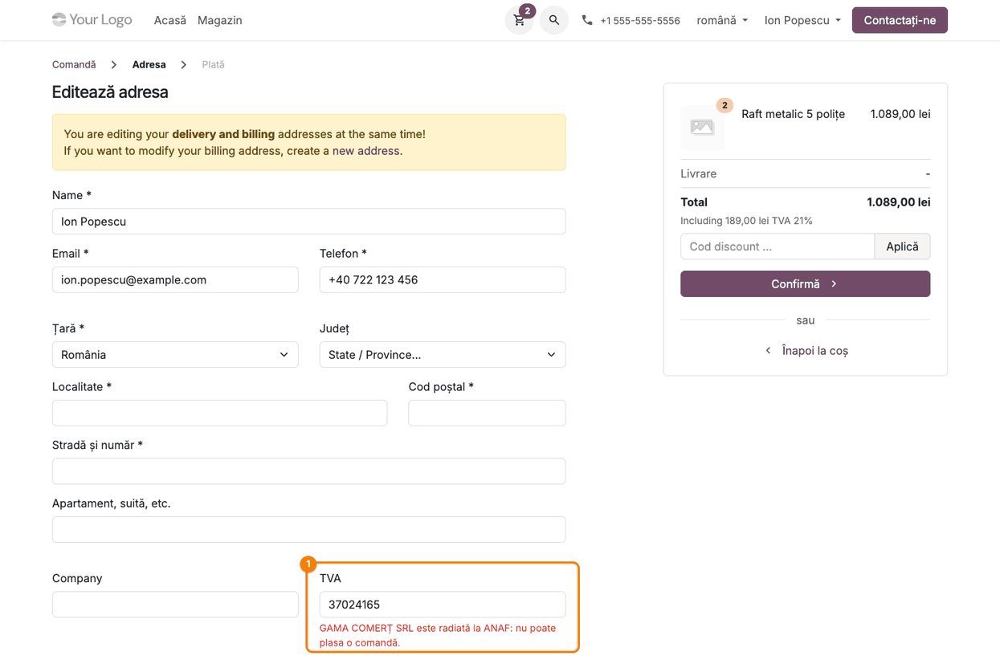

### Pasul 7 — Cod fiscal care nu apare la ANAF

Un cod fiscal valid ca formă, dar inexistent la ANAF, primește mesajul roșu ① „Acest cod fiscal nu
apare la ANAF.” Nu se completează nimic.

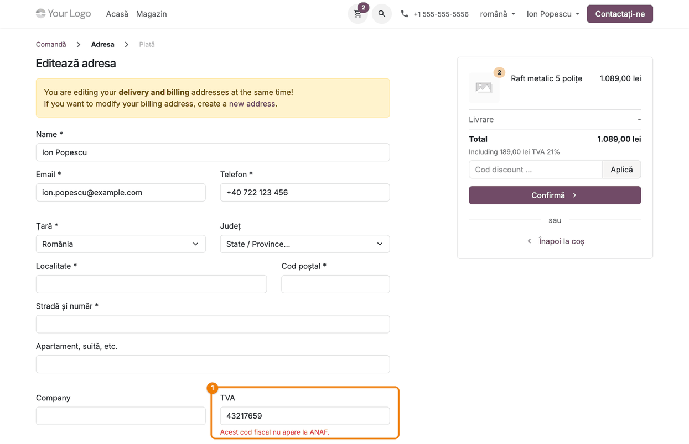

### Pasul 8 — CNP tastat din greșeală

O persoană fizică tastează uneori CNP-ul în câmpul de cod fiscal. Un CNP valid (13 cifre, cu cifra de
control corectă) **nu se trimite la ANAF**; apare mesajul roșu ① „Acesta pare a fi un cod numeric
personal (CNP). Dacă cumpărați ca persoană fizică, lăsați câmpul gol.”

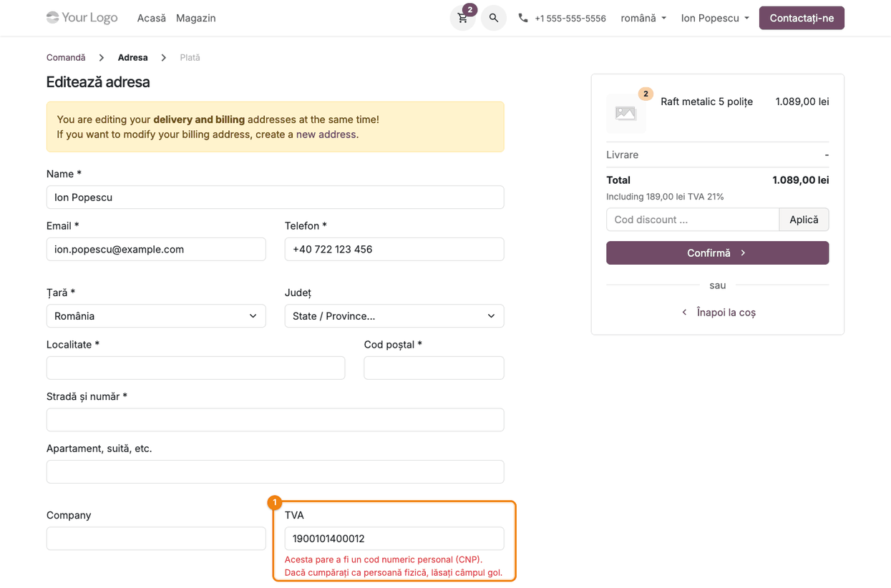

### Pasul 9 — La salvare, codul se verifică din nou pe server

Mesajele de sub cod sunt doar informative. Când clientul apasă **Confirmă**, adresa se verifică pe
server, indiferent ce a afișat formularul: pentru o firmă radiată, în partea de sus apare eroarea ①
„Firma cu acest cod fiscal este radiată la ANAF.”, câmpul **TVA** ② e marcat invalid și adresa nu se
salvează. La fel se refuză un cod care nu apare la ANAF („Codul fiscal nu este valid conform ANAF”) și
un CNP (mesaj propriu, vezi secțiunea 9).

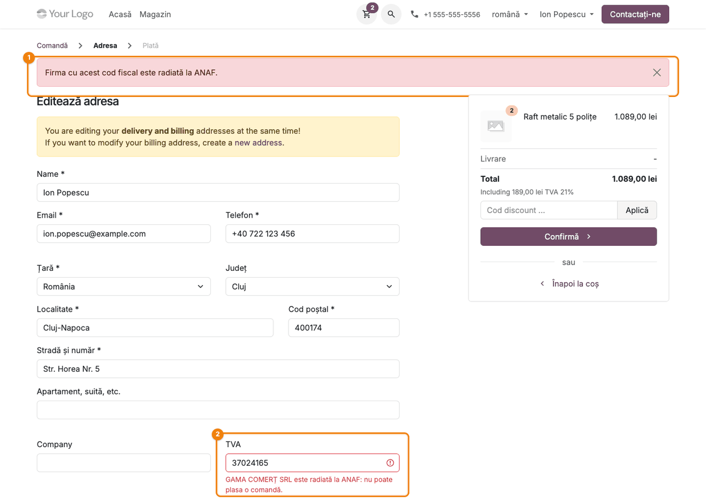

### Pasul 10 — Adresa salvată: comanda merge mai departe

Pentru o firmă găsită (aici, firma inactivă de la pasul 5), adresa se salvează și clientul ajunge la
**Metoda de livrare**. Cardul **Adresă de livrare** arată persoana de contact (Ion Popescu), adresa și
codul fiscal; adresa de facturare este aceeași.

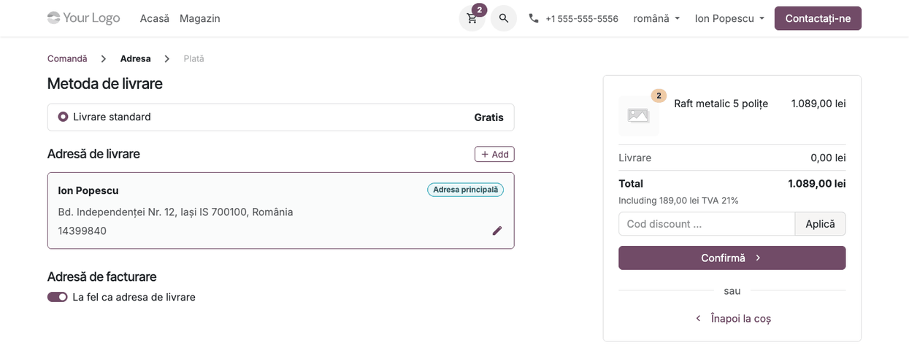

### Pasul 11 — Comanda din backend și nota pentru agentul de vânzări

Agentul deschide comanda din **Vânzări → Comenzi → Oferte** (scoateți filtrul implicit „Ofertele
mele”: coșul din magazin poate să nu aibă agent sau să aibă altul): cât timp clientul nu a plătit, coșul
este încă o ofertă.

- **găsiți pe ecran** — **Client** ① este persoana de contact, cu adresa și codul fiscal; în
  istoricul din dreapta ② apare nota internă (autorul afișat este clientul, pentru că nota se scrie
  în timpul comenzii lui; nu este un mesaj tastat de el) „Clientul *cod* este declarat inactiv fiscal la ANAF
  (din *data*), iar codul său de TVA este anulat: facturăm cu TVA, fără taxare inversă, cu codul
  fiscal fără prefixul RO. Verificați încasarea, de preferat cu plată în avans.”;
- **verificați** — liniile comenzii au TVA (fără taxare inversă) și modul de plată ales ține cont de
  notă.

Dacă ANAF nu a răspuns la salvare, nota spune că codul fiscal nu a putut fi verificat și cere
verificarea datelor clientului.

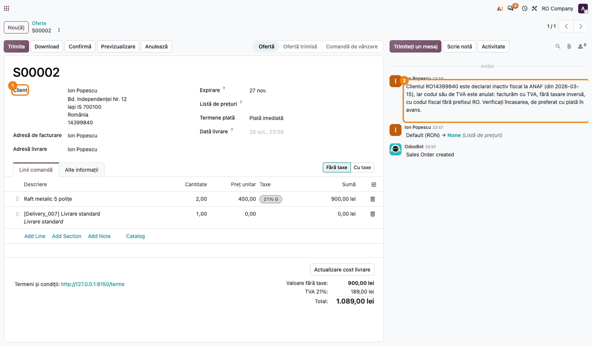

### Pasul 12 — Firma creată cu denumirea legală

Din **Client**, deschideți firma (sau **Vânzări → Comenzi → Clienți**). Denumirea legală de la ANAF
este pe **firmă** ①, nu pe persoana de contact; **TVA** ② are codul fiscal, iar **ID Companie** (CUI-ul)
este dedus automat de Odoo din el. La această firmă inactivă codul a rămas fără prefixul `RO` și
**TVA aplicabil** este nebifat — corect pentru un cumpărător fără cod de TVA valid; modulul nu scrie el
starea de plătitor de TVA pe firmă (vezi verificarea din secțiunea 8 pentru o firmă activă). Persoana de contact Ion Popescu ③ își păstrează numele tastat și
apare în fila **Contacte**. Firma devine „companie” automat: în Odoo 20, *este firmă* se calculează
(entitate comercială proprie cu cod fiscal) — modulul nu bifează nimic.

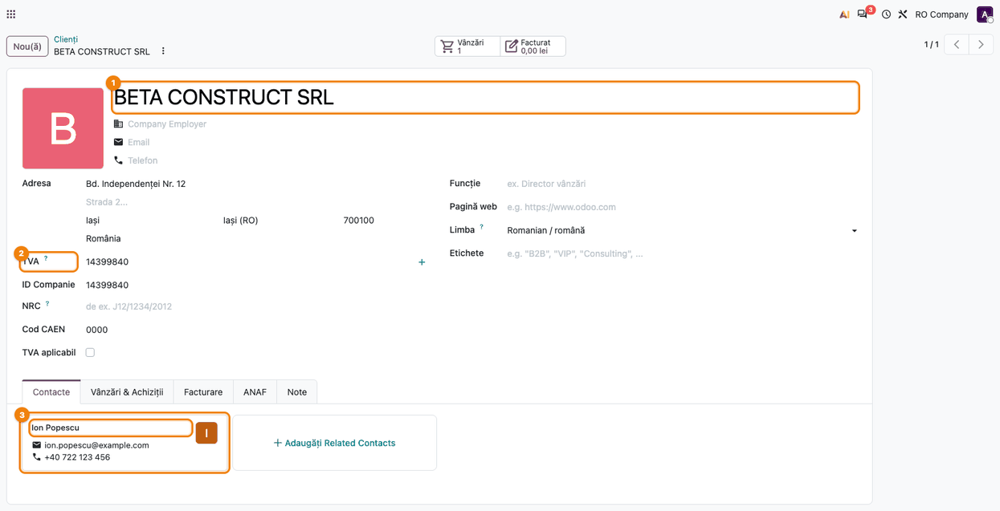

### Note de monografie și raportare

Modulul **nu generează note contabile**. Efectul lui asupra contabilității este indirect: factura
emisă din comandă poartă **denumirea legală de la ANAF** a firmei-părinte și codul fiscal verificat la
ANAF. Adresa cumpărătorului este cea de la ANAF doar dacă clientul nu a tastat alta sau a apăsat
„Completează din ANAF”; starea de plătitor de TVA nu se preia pe firmă. Aceste date ajung apoi în
e-Factura, jurnalul de vânzări și declarații (D394, SAF-T). Pentru
o firmă inactivă, factura se emite cu TVA, fără taxare inversă (vezi nota de la pasul 11).

## 7. Legături cu alte module / declarații

| Modul | Rol |
|---|---|
| `website_sale` | formularul de adresă al comenzii, în care se face căutarea și verificarea la salvare |
| `l10n_ro_anaf_partner_lookup` | face cererea la ANAF și întoarce datele firmei (localitate, sector București, cod poștal) |
| `portal` | formularul de adresă din contul de client folosește aceleași câmpuri |
| `deltatech_b2b_portal` (încă nemigrat pe 20.0) | formularul de cerere de cont B2B folosește aceeași căutare (atributele `data-anaf-lookup` și `data-anaf-fill`) |
| `deltatech_website_vat_validation` | notă istorică: versiunile până la 19.0.0.1.0 făceau aceeași verificare la salvare; cât timp o asemenea versiune o face, modulul acesta nu o repetă |

**Ce e automat:** căutarea la tastarea codului; completarea câmpurilor goale; refuzul la salvare
pentru cod inexistent, firmă radiată și CNP; denumirea legală pe firma-părinte; nota pe comandă pentru
firmă inactivă sau ANAF indisponibil; cache-ul de o zi și limita de cereri.

**Ce rămâne manual:** înlocuirea adresei tastate de client (doar prin „Completează din ANAF”);
decizia agentului privind încasarea la o firmă inactivă; verificarea datelor când ANAF a fost
indisponibil. Starea de plătitor de TVA apare doar în mesajul de sub cod — modulul nu o scrie pe firmă.

## 8. Verificări pentru consultant

- [ ] Cu țara **România** în formular, tastarea unui CUI existent afișează în verde firma, adresa și
  „plătitor de TVA”/„neplătitor de TVA”.
- [ ] O adresă cu CUI tastat cu spații (de exemplu „RO 1234 567 897”) găsește firma la tastare și se
  salvează la **Confirmă**, fără mesajul „Codul fiscal trebuie să conțină doar cifre”.
- [ ] Câmpurile goale (firmă, stradă, localitate, cod poștal, județ) se completează; o stradă tastată
  înainte rămâne neschimbată.
- [ ] **Completează din ANAF** înlocuiește strada tastată cu adresa de la ANAF.
- [ ] Cu altă țară decât România în formular, nu apare niciun mesaj ANAF.
- [ ] O firmă inactivă primește mesaj portocaliu, adresa se salvează, iar comanda are nota internă
  cu data inactivării.
- [ ] O firmă radiată primește mesaj roșu la tastare și eroare la **Confirmă**; adresa nu se salvează.
- [ ] Un cod inexistent la ANAF este refuzat la salvare cu „Codul fiscal nu este valid conform ANAF”.
- [ ] Un CNP valid primește mesajul de CNP și nu ajunge la ANAF.
- [ ] După salvare, firma din Contacte poartă denumirea legală, persoana de contact își păstrează
  numele, iar **ID Companie** este completat.
- [ ] Pentru o firmă **activă, plătitoare de TVA**, verificați după salvare câmpurile **TVA** (cu sau
  fără prefixul `RO`) și **TVA aplicabil** de pe firmă: modulul nu scrie starea de plătitor, deci
  corectați-le înainte de prima factură dacă localizarea nu le-a completat.
- [ ] Același CUI căutat a doua oară în aceeași zi răspunde imediat (din cache), fără o nouă cerere la
  ANAF. Cache-ul și limita de căutări sunt ținute în memoria fiecărui proces (worker) al serverului;
  pe o instanță cu mai mulți workeri, testați pe un singur worker.
- [ ] Cu serviciul ANAF indisponibil, adresa se salvează și comanda primește nota „nu a putut fi
  verificat la ANAF”.

## 9. Mesaje de eroare frecvente

| Mesaj | Cauză | Remediere |
|---|---|---|
| „Acest cod fiscal nu apare la ANAF.” (la tastare) | codul nu există în registrul ANAF | clientul verifică codul pe certificatul de înregistrare |
| „Codul fiscal nu este valid conform ANAF” (la salvare) | același caz, verificat pe server | se corectează codul; adresa nu se salvează până atunci |
| „*denumire* este radiată la ANAF: nu poate plasa o comandă.” / „Firma cu acest cod fiscal este radiată la ANAF.” | firma este radiată | comanda nu se poate plasa pe această firmă |
| „Acesta pare a fi un cod numeric personal (CNP)…” | s-a tastat un CNP în câmpul de cod fiscal | persoana fizică lasă câmpul gol |
| „Codul fiscal trebuie să conțină doar cifre (după codul țării)” | litere sau caractere în cod, după `RO` | se tastează doar cifrele (cu sau fără `RO` în față) |
| Niciun mesaj sub cod | țara din formular nu e România, codul are sub 2 cifre sau formatul e invalid (peste 10 cifre) | se alege România și se tastează CUI-ul complet |
| Niciun mesaj după multe căutări | s-a atins limita de 20 de căutări în 10 minute de pe aceeași adresă IP (per worker) | se așteaptă; la salvare codul se verifică oricum pe server |
| Niciun mesaj după „Se caută la ANAF…” | ANAF nu a răspuns în 5 secunde | clientul poate salva; codul se acceptă așa cum e tastat, iar comanda primește nota de indisponibilitate |
| Nota „Codul fiscal … nu a putut fi verificat la ANAF (serviciu indisponibil)” pe comandă | ANAF nu a răspuns în 5 secunde | agentul verifică manual datele clientului |

## 10. Capturi de ecran

Capturile din `static/description/` sunt **generate automat** de `tests/test_screenshots.py` (mixinul
`ScreenshotCase` din `l10n_ro_doc_screenshots`, import defensiv), cu interfața în română, pe compania
„RO Company” cu planul de conturi RO. Răspunsurile ANAF sunt simulate în test (fără cereri reale).

| Fișier | Ce arată |
|---|---|
| `01_formular_adresa.png` | formularul de adresă de facturare, cu câmpurile Company și TVA goale |
| `02_firma_gasita.png` | firma găsită la ANAF sub codul fiscal și câmpurile goale completate |
| `03_strada_tastata.png` | strada tastată de client păstrată; linkul „Completează din ANAF” |
| `04_completat_din_anaf.png` | adresa de la ANAF după „Completează din ANAF” |
| `05_firma_inactiva.png` | avertismentul portocaliu pentru firma inactivă fiscal |
| `06_firma_radiata.png` | mesajul roșu pentru firma radiată |
| `07_cod_negasit.png` | mesajul pentru codul fiscal care nu apare la ANAF |
| `08_cnp.png` | mesajul pentru CNP |
| `09_refuz_la_salvare.png` | eroarea de la salvare pentru firma radiată |
| `10_adresa_salvata.png` | pasul următor al comenzii, după salvarea adresei |
| `11_comanda_nota_inactiva.png` | comanda în backend, cu nota internă pentru firma inactivă |
| `12_firma_din_anaf.png` | firma creată cu denumirea legală, cu persoana de contact |

Regenerare:

```bash
.venv/bin/python odoo/odoo-bin -c odoo.conf -d <db> -u l10n_ro_website_anaf \
    --test-tags=fise_screenshots/l10n_ro_website_anaf --stop-after-init
```

(`l10n_ro_doc_screenshots` trebuie să fie în `addons_path`; baza trebuie să aibă planul de conturi RO
și limba română.)

## 11. Observații pentru manual

- Accentul cade pe **momentul tastării**: clientul vede imediat pe ce firmă se emite factura, înainte
  de a salva.
- De subliniat regula „**doar câmpurile goale**”: căutarea nu strică o adresă de livrare tastată de
  client; adresa sediului vine doar la clic pe „Completează din ANAF”.
- Mesajele de sub cod sunt informative; **verificarea care contează este cea de la salvare**.
- Denumirea legală merge pe **firmă**, nu pe persoana de contact: pe comandă apare persoana, pe
  factură entitatea comercială.
- Unele etichete ale ecranelor standard Odoo nu au încă traducere în română în Odoo 20 și apar în
  engleză în capturi: în magazin „Name”, „Company”, „State / Province...”, „Including … TVA”, banda
  galbenă despre adresele de livrare și facturare, „Add”; în backend „Download”, „Add Line / Add
  Section / Add Note”, „Sales Order created”, „Company Employer”, „Related Contacts”. Nu țin de acest
  modul.
- Limita de 20 de căutări în 10 minute și cache-ul de o zi protejează serviciul ANAF de abuz (ruta
  este publică); nu se configurează din interfață.
