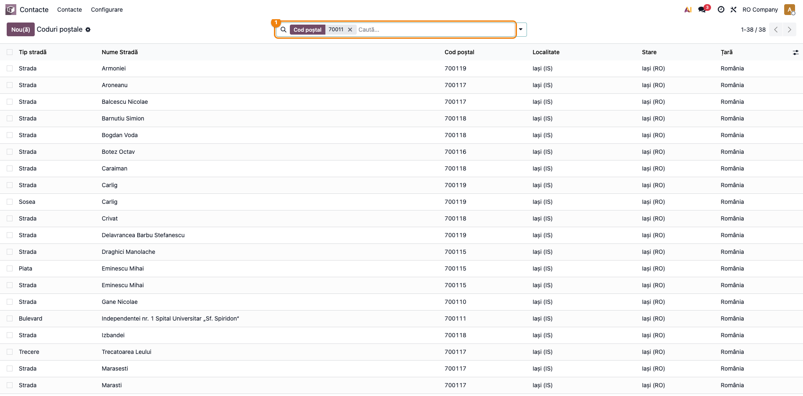
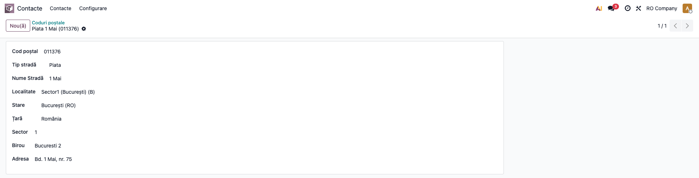
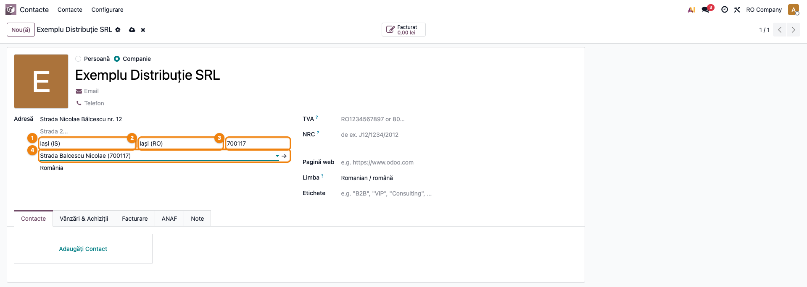

# Fișă Modul: Codul poștal pe stradă, ales din nomenclatorul Poștei Române

**Modul:** `l10n_ro_zip`
**Utilizator principal:** Operatorul care creează și întreține partenerii (agent de vânzări, operator comenzi, contabil la introducerea furnizorilor)
**Prioritate:** 🟡 Medie (nu generează documente, dar codul poștal corect ajunge pe facturi, avize și etichetele de curier)

---

## 1. Scop business

În orașele mari, codul poștal nu ține de localitate, ci de stradă (și uneori de numărul
clădirii): Iașiul, Clujul sau Bucureștiul au sute de coduri. Operatorii îl completează de mână,
din memorie sau de pe site-ul Poștei, și greșesc des, iar codul greșit ajunge pe factură, pe
eticheta de curier și pe adresa trimisă în e-Factura. Modulul aduce în Odoo **nomenclatorul
codurilor poștale din România** (circa 73.000 de rânduri: cod, localitate, județ, tip și nume de
stradă, sector, oficiu poștal) și adaugă pe partener un câmp în care operatorul tastează strada și
alege codul din listă; Odoo completează apoi codul poștal, localitatea și județul partenerului.

## 2. Bază legală și context

- Nu există o obligație legală care să ceară folosirea unui nomenclator anume. Modulul ține de
  **calitatea datelor de adresă**: codul poștal apare în adresa partenerului tipărită pe factură și
  transmisă în e-Factura, iar curierii îl folosesc la rutare.
- **Sursa datelor**: nomenclatorul public al codurilor poștale de pe
  [posta-romana.ro](https://www.posta-romana.ro), încărcat la instalare. Pentru orașele sub
  50.000 de locuitori, Poșta are un singur cod pe oraș și nu publică străzile; pentru unele dintre
  ele (de ex. Huși, Negrești, Murgeni, Tecuci, Târgu Bujor, Berești), denumirile străzilor vin din
  [OpenStreetMap](https://www.openstreetmap.org/copyright) (licența ODbL, menționată în
  `readme/CREDITS.md`) și primesc codul poștal unic al orașului.
- Actualizările nomenclatorului vin cu versiunile noi ale modulului: la actualizare, rândurile
  existente se corectează pe loc, iar partenerii rămân legați de rândul ales. Dacă Poșta a
  schimbat codul unei străzi, câmpul din nomenclator arată codul nou, dar codul din adresa
  partenerului (cel tipărit) rămâne cel vechi până când operatorul realege strada.

## 3. Utilizatori și roluri

- **Operatorul de parteneri** (utilizator cu dreptul **Contact: Creare**, cel care permite
  modificarea partenerilor): alege codul poștal pe partener. Același drept îi permite, tehnic, și
  modificarea rândurilor din nomenclator. Utilizatorii interni fără acest drept doar citesc
  partenerii și nomenclatorul.
- **Administratorul / consultantul** (dreptul **Administrare: Setări**): singurul care vede meniul
  **Contacte → Configurare**, deci lista nomenclatorului.
- **La testare**: un utilizator cu **Contact: Creare**, fără drepturi de administrare (pentru
  alegerea codului pe partener), și un administrator (pentru meniul nomenclatorului).

## 4. Conturi și date implicate

Modulul **nu generează note contabile** și nu atinge conturi. Datele implicate:

| Dată | Unde | Observație |
|---|---|---|
| Nomenclatorul de coduri poștale | **Coduri poștale** | cod, tip și nume stradă, localitate, județ, țară, sector, oficiu poștal și adresa oficiului |
| Localitățile și județele | nomenclatorul de localități din `l10n_ro_city` | fiecare cod poștal e legat, unde se poate, de o localitate și un județ din listă |
| Codul poștal ales pe partener | câmpul **Cod poștal** din nomenclator, sub localitate, în blocul de adresă | listă cu căutare, filtrată după localitatea partenerului |
| Codul poștal tipărit | câmpul standard de cod poștal al adresei (text) | primește valoarea codului ales; el apare pe documente |

Date minime pentru demo: un partener firmă din România, cu județul și localitatea alese din listă
(ex. Iași, județul Iași), fără cod poștal completat.

## 5. Configurare inițială

1. Instalați modulul: aduce automat `l10n_ro_city` (localitățile României) și
   `base_address_extended` (localitatea ca listă pe partener).
2. Nomenclatorul se încarcă **la instalare**, fără pași manuali; durează câteva zeci de secunde.
   După instalare, codurile sunt legate automat de județe, localități și de sectoarele Bucureștiului.
3. Verificați că țara **România** cere localitatea din listă (pe partener apare câmpul de localitate
   cu căutare, nu un câmp de text liber); `l10n_ro_city` face această setare la instalare.
4. Nu există parametri de configurat.

## 6. Flux de utilizare

### Pasul 1 — Nomenclatorul de coduri poștale

Ca administrator, accesați **Contacte → Configurare → Localizare → Coduri poștale**. Lista arată nomenclatorul
încărcat la instalare. Căutarea simplă din listă se face după **cod poștal** (tastați începutul
codului și apăsați Enter).

- **Găsiți pe ecran:** ① în bara de căutare, filtrul **Cod poștal** cu valoarea `70011`; coloanele
  **Tip stradă**, **Nume Stradă**, **Cod poștal**, **Localitate**, **Stare** (aici înseamnă
  județul) și **Țară**; în dreapta-sus, numărul de rânduri găsite (38).
- **Verificați:** pentru un oraș mare există câte un rând pe stradă, cu codul ei (ex. *Strada
  Balcescu Nicolae*, `700117`); străzile poartă numele ca în nomenclatorul Poștei, cu numele de
  familie întâi și fără diacritice; localitatea și județul sunt completate (rândurile fără
  localitate nu vor fi propuse pe partener, vezi pasul 3).



### Pasul 2 — Fișa unui cod poștal

Din listă, deschideți un rând. Fișa arată tot ce știe nomenclatorul despre acel cod. În exemplu,
un cod din București, Sectorul 1.

- **Găsiți pe ecran:** **Cod poștal** `011376`; **Tip stradă** *Piata* și **Nume Stradă** *1 Mai*;
  **Localitate** *Sector1 (București) (B)*; **Stare** (județul) *București (RO)*; **Țară** *România*;
  **Sector** `1`; **Birou** (oficiul poștal) *Bucuresti 2*; **Adresa** oficiului *Bd. 1 Mai, nr. 75*.
- **Verificați:** la București, localitatea este **sectorul** (așa cum o cere și e-Factura), nu
  „București”; sectorul din câmpul **Sector** corespunde localității. Nomenclatorul se modifică
  rar de mână: corecturile vin cu actualizările modulului.



### Pasul 3 — Căutarea străzii pe partener

Deschideți partenerul din **Contacte**. În blocul de adresă alegeți întâi ① **localitatea** din
listă (ex. *Iași (IS)*); județul se completează singur. Apoi, în ② câmpul **Cod poștal** din
nomenclator, aflat sub localitate (câmpul cu săgeată de listă, fără etichetă vizibilă), tastați
numele străzii. Nu tastați în câmpul cu textul gri *Cod poștal* din dreapta județului: acela
este codul tipărit pe documente și se completează singur la alegere.

- **Găsiți pe ecran:** după ce ați tastat *Nicolae Balcescu*, lista propune *Strada Balcescu
  Nicolae* și *Fundac Balcescu Nicolae*; în dreapta fiecărei propuneri, cu gri, codul poștal,
  localitatea și județul (`700117 · Iasi, IS`).
- **Verificați:** propunerile sunt doar din **localitatea aleasă** pe partener; ordinea cuvintelor
  nu contează (tastați *Nicolae Balcescu*, iar nomenclatorul scrie *Balcescu Nicolae*); puteți
  căuta și după cod, sau cu tipul străzii (*Strada Mircea*). Fără diacritice găsiți mai sigur,
  pentru că nomenclatorul Poștei le omite. Dacă strada nu apare, folosiți *Caută mai mult...* sau
  verificați localitatea. Cu câmpul gol, lista arată primele coduri ale localității alese; restul, prin *Caută mai mult...*.


### Pasul 4 — Codul poștal completat pe partener

Alegeți propunerea potrivită (ex. *Strada Balcescu Nicolae*) și salvați partenerul (iconița de
salvare de lângă numele lui).

- **Găsiți pe ecran:** ① localitatea *Iași (IS)*; ② județul *Iași (RO)*; ③ codul poștal standard
  al adresei, completat cu `700117`; ④ câmpul din nomenclator, cu *Strada Balcescu Nicolae
  (700117)*; țara *România*.
- **Verificați:** codul poștal standard (③), cel tipărit pe documente, are aceeași valoare ca
  rândul ales (④); localitatea și județul sunt ale codului ales. Strada din adresa partenerului
  **nu** se modifică: modulul completează doar codul poștal, localitatea, județul și țara.



### Note de monografie și raportare

Modulul **nu generează note contabile** și nu are rapoarte proprii. Efectul se vede pe documentele
emise partenerului după completarea codului: factura, avizul și XML-ul e-Factura preiau codul
poștal din adresa partenerului (câmpul standard, ③ din pasul 4).

## 7. Legături cu alte module / declarații

| Modul | Rol în flux |
|---|---|
| `l10n_ro_city` | localitățile și județele României, de care se leagă fiecare cod poștal; localitatea din listă pe partener |
| `base_address_extended` | câmpul de localitate din listă pe partener, sub care modulul pune codul poștal din nomenclator |
| `l10n_ro_anaf_partner_lookup` (opțional) | la crearea firmei după CUI, codul poștal vine de la ANAF; nomenclatorul ajută la găsirea localității după acel cod, când numele dat de ANAF nu se potrivește cu lista, și, când ANAF nu trimite cod, dă codul străzii din nomenclator (dacă găsește un singur rând potrivit). Câmpul din nomenclator rămâne gol |
| e-Factura / rapoartele de factură | preiau codul poștal din adresa partenerului |

**Ce e automat:** încărcarea nomenclatorului la instalare și corectarea lui la actualizarea
modulului; legarea codurilor de județe, localități și sectoarele Bucureștiului; completarea
codului poștal, a localității, a județului și a țării pe partener la alegerea unui rând.

**Ce rămâne manual:** alegerea localității înaintea codului; alegerea străzii potrivite când
aceeași stradă are mai multe rânduri (pe tronsoane de numere sau blocuri); completarea străzii și
a numărului în adresă; codul poștal pentru adresele din afara României; realegerea străzii după
o schimbare a localității sau după o actualizare a nomenclatorului care a schimbat codul; alegerea
străzii din nomenclator pentru partenerii creați după CUI (codul din adresă vine de la ANAF).

## 8. Verificări pentru consultant

- [ ] Meniul **Contacte → Configurare → Localizare → Coduri poștale** există, iar lista are
      peste 50.000 de rânduri.
- [ ] Căutarea în listă după începutul codului (ex. `70011`) găsește străzile din Iași.
- [ ] Un cod din București are ca localitate sectorul (ex. *Sector1*) și câmpul **Sector** completat.
- [ ] Pe un partener cu localitatea *Iași*, tastarea *Nicolae Balcescu* în câmpul **Cod poștal**
      propune *Strada Balcescu Nicolae* (`700117`), deși nomenclatorul scrie numele invers.
- [ ] Propunerile sunt doar din localitatea aleasă pe partener: la altă localitate, strada din
      Iași nu mai apare.
- [ ] După alegere, codul poștal standard al adresei are valoarea codului ales, iar localitatea
      și județul nu s-au schimbat (sau s-au completat corect).
- [ ] Strada și numărul din adresa partenerului rămân cum le-a scris operatorul.
- [ ] Pentru localitățile clientului, codurile sunt legate de localitate (în listă, coloana
      **Localitate** e completată); altfel ele nu se propun pe partener.
- [ ] Un utilizator fără **Administrare: Setări** nu vede meniul **Coduri poștale**; unul fără
      **Contact: Creare** nu poate modifica nici partenerul, nici nomenclatorul.

## 9. Mesaje de eroare frecvente

Modulul nu afișează mesaje de eroare proprii. Situațiile frecvente:

| Mesaj / simptom | Cauză | Remediere |
|---|---|---|
| Lista din câmpul **Cod poștal** nu propune strada | localitatea partenerului nu este aleasă sau este alta decât a străzii | alegeți întâi localitatea din listă, apoi căutați strada |
| Lista nu propune nicio stradă pentru un oraș mic | Poșta are un singur cod pe oraș și nu publică străzile; numele localității nu este criteriu de căutare | deschideți lista fără să tastați (apar primele coduri ale localității, restul prin *Caută mai mult...*) sau tastați codul; la localitățile cu un singur cod, codul se completează deja la alegerea localității |
| Strada există în nomenclator, dar nu se propune pe partener | rândul nu este legat de o localitate din listă (coloana **Localitate** goală) | cereți administratorului să caute codul în **Coduri poștale**; anunțați echipa de suport pentru corectarea legăturii |
| După ce ați schimbat localitatea, codul din adresă s-a schimbat sau s-a golit | la schimbarea localității, Odoo pune în adresă codul localității noi; strada aleasă din nomenclator rămâne cea veche | alegeți din nou strada în câmpul din nomenclator |
| După o actualizare a modulului, câmpul din nomenclator și codul din adresă diferă | Poșta a schimbat codul străzii; rândul s-a corectat, codul din adresă nu | alegeți din nou strada în câmpul din nomenclator și salvați |
| Căutarea după numele străzii în lista **Coduri poștale** nu găsește nimic | căutarea simplă din listă se face după cod | căutați strada din câmpul **Cod poștal** al partenerului sau după cod în listă |
| Nu vedeți meniul **Coduri poștale** | meniul **Contacte → Configurare** este doar pentru **Administrare: Setări** | cereți administratorului consultarea sau corectura |
| Nu puteți modifica partenerul sau un rând din nomenclator | utilizatorul nu are dreptul **Contact: Creare** | cereți administratorului dreptul |

## 10. Capturi de ecran

Capturile sunt generate automat din `tests/test_screenshots.py` (mixinul `ScreenshotCase` din
`deltatech_doc_screenshots` sau, în lipsa lui, `l10n_ro_doc_screenshots`, import defensiv; dacă lipsește, testul se sare), în RO, pe compania
„RO Company” în RON, în `readme/screenshots/`, în ordinea pașilor din secțiunea 6. Codurile
poștale sunt cele reale din nomenclator; partenerul *Exemplu Distribuție SRL* este de exemplu.
Aceleași ecrane, cu interfața în engleză, sunt în `readme/screenshots/en/`, pentru
`readme/USAGE.md`.

| # | Fișier | Conținut |
|---|--------|----------|
| 1 | `screenshots/01_lista_coduri_postale.png` | Lista **Coduri poștale** filtrată după codul `70011` (străzi din Iași) |
| 2 | `screenshots/02_fisa_cod_postal.png` | Fișa codului `011376`: Piata 1 Mai, Sector1 (București) (B), oficiul poștal |
| 3 | `screenshots/03_partener_cautare_strada.png` | Partener din Iași: căutarea *Nicolae Balcescu* în câmpul **Cod poștal** și propunerile |
| 4 | `screenshots/04_partener_cod_completat.png` | Partenerul după alegerea străzii: codul `700117`, localitatea și județul |

Regenerare:

```bash
# suita deltatech (deltatech_doc_screenshots) în addons_path
./odoo/odoo-bin -c odoo.conf -d test19 -i l10n_ro_zip,deltatech_doc_screenshots \
    --test-tags=/l10n_ro_zip:TestResZipScreenshots --stop-after-init
```

## 11. Observații pentru manual

- Capitolul se încadrează la **crearea partenerilor**: ordinea *localitate → stradă în câmpul Cod
  poștal → alegere* este regula de reținut.
- De subliniat că ordinea cuvintelor nu contează și că diacriticele lipsesc din nomenclatorul
  Poștei, deci căutarea fără ele e mai sigură.
- Câmpul din nomenclator nu are etichetă vizibilă pe formular: în manual, arătați-l pe captură
  (sub localitate, cu săgeată de listă).
- În lista nomenclatorului, coloana **Stare** înseamnă **județul** (eticheta vine din traducerea
  modulului).
- Meniul nomenclatorului este pentru administrator și consultant; operatorul lucrează doar pe
  partener.
- De păstrat avertismentul: după schimbarea localității sau după o actualizare care schimbă
  codul unei străzi, strada se realege din nomenclator.
